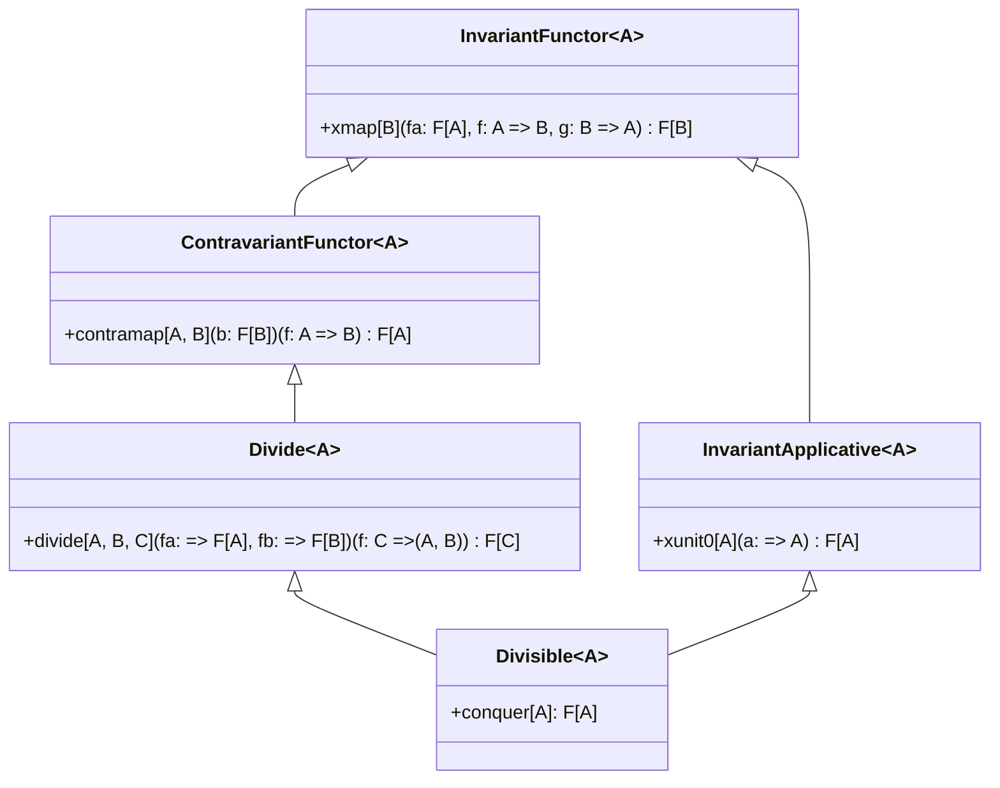



# Divisible

**`Divisible`** — это класс типов, который расширяет возможности **`Divide`** 
и добавляет поддержку "единичного" элемента (аналог моноида для [контравариантных функторов](contravariant-functor.md)). 
Он позволяет не только [разделять данные](divide.md), но и комбинировать их с учётом нейтрального элемента.

`Divisible` определяется для типа `F[_]` и предоставляет две операции:

- **`divide`**:
    - Разделяет значение типа `C` на два компонента `A` и `B` с помощью функции `C => (A, B)`.
    - Комбинирует два значения типа `F[A]` и `F[B]` в значение типа `F[C]`.
- **`conquer`**:
    - Возвращает "нейтральный" элемент типа `F[A]`, который можно использовать как основу для комбинирования.

`Divisible` позволяет не только разделять данные, но и комбинировать их с учётом нейтрального элемента. 
Это полезно в ситуациях, где требуется собирать данные из нескольких частей, 
а также обрабатывать случаи, когда данные отсутствуют или не требуют обработки.

**Примеры использования**

- **Валидация данных**:
    - Если у вас есть валидаторы для нескольких полей, `Divisible` позволяет создать валидатор для составного типа, 
      а также обрабатывать случаи, когда некоторые поля отсутствуют.
- **Парсинг**:
    - Если у вас есть парсеры для нескольких частей данных, `Divisible` позволяет создать парсер для составного типа, 
      а также обрабатывать случаи, когда некоторые части данных отсутствуют.
- **Контекстные вычисления**:
    - В функциональных программах, где требуется декомпозиция данных, `Divisible` может использоваться для работы 
      с контекстами (например, `F[_]` может быть `Option`, `Either`, `List` и т.д.).

**Краткие примеры**

- **Валидация формы**:
    - У вас есть валидаторы для имени пользователя (`F[String]`), возраста (`F[Int]`) и адреса (`F[String]`).
    - С помощью `divide` вы можете создать валидатор для всей формы (`F[User]`), где `User` — это тип, содержащий все три поля.
    - С помощью `conquer` вы можете создать валидатор, который всегда проходит (например, для необязательных полей).
- **Парсинг JSON**:
    - У вас есть парсеры для полей `"name"` (`F[String]`), `"age"` (`F[Int]`) и `"address"` (`F[String]`).
    - С помощью `divide` вы можете создать парсер для всего JSON-объекта (`F[Person]`), где `Person` — это тип, содержащий все три поля.
    - С помощью `conquer` вы можете создать парсер, который всегда возвращает значение по умолчанию (например, для необязательных полей).
- **Работа с контекстами**:
    - У вас есть три значения в контексте `Option`: `Option[String]` (имя), `Option[Int]` (возраст) и `Option[String]` (адрес).
    - С помощью `divide` вы можете создать значение `Option[User]`, где `User` — это тип, содержащий все три поля.
    - С помощью `conquer` вы можете создать значение `Option[User]`, которое всегда возвращает `Some` (например, для необязательных полей).

`Divisible` полезен в ситуациях, где требуется декомпозиция данных и работа с контекстами, 
а также поддержка нейтрального элемента. Он часто используется в библиотеках для функционального программирования, 
таких как **Cats** или **Scalaz**, для реализации сложных операций над типами.

## Формальное определение

`Divisible` - контравариантный аналог [`Applicative`](applicative.md). 
Он расширяет [`Divide`](divide.md) и [`InvariantApplicative`](invariant-applicative.md).

Законы `Divisible`:

- Тождественность (identity): Если определен метод идентификации `id` такой, что: `id(a) == a`,
  тогда `cmap(fa)(id) == fa`.
- Композиция (composition): Если определены два метода `f: A => B` и `g: B => C`,
  тогда `cmap(cmap(fc)(g))(f) == cmap(fc)(g(f(_)))`.
- Композиция (composition): `divide(divide(fa1, fa2)(delta), fa3)(delta) == divide(fa1, divide(fa2, fa3)(delta))(delta)`,
  где `delta: A => (A, A) = a => (a, a)`.
- Тождественность справа (right identity): `divide(fa, conquer)(delta) == fa`.
- Тождественность слева (left identity): `divide(conquer, fa)(delta) == fa`.

## Код

```dotty
trait Divisible[F[_]] extends Divide[F], InvariantApplicative[F]:
  def conquer[A]: F[A]

  override def xunit0[A](a: => A): F[A] = conquer

  override def cmap[A, B](fb: F[B])(f: A => B): F[A] =
    divide(conquer[Unit], fb)(c => ((), f(c)))
```

### Унарная функция

```dotty
given functionDivisible[R: Monoid]: Divisible[[X] =>> Function1[X, R]] with
  override def divide[A, B, C](fa: => A => R, fb: => B => R)(f: C => (A, B)): C => R =
    c => {
      val (a, b) = f(c)
      summon[Monoid[R]].combine(fa(a), fb(b))
    }

  override def conquer[A]: A => R = _ => summon[Monoid[R]].empty
```

### Законы

Тождественность справа: `divide(fa, conquer)(delta) == fa`.
Тождественность слева: `divide(conquer, fa)(delta) == fa`.

```dotty
... // Законы Divide

def checkDivisibleRightIdentity[F[_], A](fa: F[A], a: A)(using
    div: Divisible[F]
): ValidatedNel[String, Unit] =
  import div.*
  def delta: A => (A, A) = a => (a, a)

  Either.cond[String, Unit](
    divide(fa, conquer)(delta) == fa,
    (),
    "Не соблюдается Тождественность справа: divide(fa, conquer)(delta) == fa, где delta: A => (A, A) = a => (a, a)"
  ).toValidatedNel

def checkDivisibleLeftIdentity[F[_], A](fa: F[A], a: A)(using
    div: Divisible[F]
): ValidatedNel[String, Unit] =
  import div.*
  def delta: A => (A, A) = a => (a, a)

  Either.cond[String, Unit](
    divide(conquer, fa)(delta) == fa,
    (),
    "Не соблюдается Тождественность слева: divide(conquer, fa)(delta) == fa, где delta: A => (A, A) = a => (a, a)"
  ).toValidatedNel
```

## Схема



---

**Ссылки:**

- [Ссылка на репозиторий с упражнениями][sample]
- [Scalaz API](https://javadoc.io/static/org.scalaz/scalaz-core_3/7.3.6/scalaz/Divisible.html)

[sample]: https://gitverse.ru/scalabook/typeclasses
