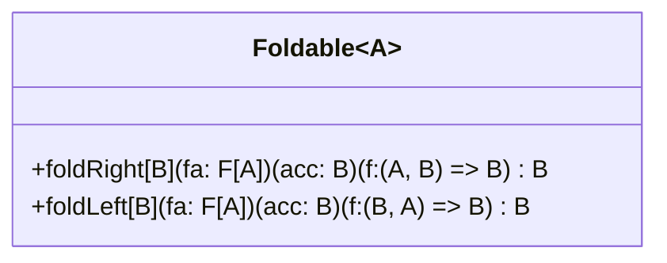



# Foldable

`Foldable` — это концепция из функционального программирования, 
которая описывает структуры данных, поддерживающие операцию "свёртки" (`fold`). 
Свёртка позволяет преобразовать коллекцию элементов в одно значение, 
последовательно применяя функцию к каждому элементу и аккумулируя результат.

**Основные характеристики `Foldable`:**

- **Операция свёртки**:
  `Foldable` предоставляет методы для обхода элементов структуры данных и их объединения в одно значение. 
  Например, можно сложить все числа в списке или объединить все строки в одну.
- **Гибкость**:
  Свёртка может быть выполнена в разных направлениях (слева направо или справа налево) и с разными начальными значениями.
- **Универсальность**:
  `Foldable` работает с различными типами коллекций, такими как списки, множества, деревья и другие.

**Где применяется `Foldable`?**

`Foldable` используется в функциональном программировании для:

- **Агрегации данных** (например, суммирование, умножение, конкатенация).
- **Преобразования коллекций** (например, фильтрация, поиск).
- **Работы с вложенными структурами данных** (например, деревья, графы).

**Примеры `Foldable`**

- **Суммирование элементов списка**.
  С помощью `Foldable` можно сложить все числа в списке и получить их сумму.
- **Конкатенация строк**.
  С помощью `Foldable` можно объединить все строки в одну.
- **Поиск минимального или максимального значения**.
  С помощью `Foldable` можно найти минимальное или максимальное значение в списке.
- **Подсчёт элементов**.
  С помощью `Foldable` можно подсчитать количество элементов в списке.
- **Фильтрация элементов**.
  С помощью `Foldable` можно отфильтровать все чётные числа и вернуть их сумму.
- **Работа с деревьями**.
  С помощью `Foldable` можно обойти все узлы дерева, где каждый узел содержит число, и вычислить сумму всех чисел.
- **Преобразование коллекции в другую структуру**.
  Представим, что есть список пар "ключ-значение". 
  С помощью `Foldable` можно преобразовать этот список в ассоциативный массив (словарь).

**Свертывание**

_Fold_ может использоваться для реализации `reduce`. 
Разница `fold` с `reduce` заключается в том, 
что в `reduce` начальный элемент является нейтральным элементом, который не изменяет значение, 
например, пустая строка `""` для операции конкатенации строк или `0` для операции `+` в типе `Int`. 
Можно реализовать версию `reduce`, в которой начальный элемент — 
это просто первый элемент, который будет объединен в _fold_, 
если есть доступ, например, к функции `head`. 

## Формальное определение

`Foldable` — это тип данных, для которого определена операция `fold` 
(или её варианты, такие как `foldLeft`, `foldRight`), удовлетворяющая следующим свойствам:

- **Операция `fold`**:
  Для типа `F[A]` (где `F` — контейнер, а `A` — тип элементов) операция `fold` имеет сигнатуру:
  `def fold[B](fa: F[A], z: B)(f: (B, A) => B): B`
- **Операция `foldLeft`**:
  Аналогична `fold`, но гарантирует порядок обхода элементов слева направо:
  `def foldLeft[B](fa: F[A], z: B)(f: (B, A) => B): B`
- **Операция `foldRight`**:
  Аналогична `fold`, но гарантирует порядок обхода элементов справа налево:
  `def foldRight[B](fa: F[A], z: B)(f: (A, B) => B): B`
- **Дополнительные операции**:
  На основе `fold` могут быть определены другие полезные операции, такие как:
    - `toList` — преобразование коллекции в список.
    - `isEmpty` — проверка, является ли коллекция пустой.
    - `size` — подсчёт количества элементов.
    - `sum`, `product`, `minimum`, `maximum` — агрегация элементов.

### Законы `Foldable`

Для того чтобы тип данных считался `Foldable`, он должен удовлетворять определённым законам. 
Вот основные из них:

- **Закон ассоциативности для `foldLeft`**:
  `foldLeft(fa, z)(f) == foldLeft(fa, z)((acc, x) => f(acc, x))`
  Этот закон гарантирует, что порядок применения функции `f` не влияет на результат.
- **Закон ассоциативности для `foldRight`**:
  `foldRight(fa, z)(f) == foldRight(fa, z)((x, acc) => f(x, acc))`
  Аналогично, этот закон гарантирует корректность порядка обхода справа налево.
- **Закон согласованности `foldLeft` и `foldRight`**:
  Для некоторых структур данных (например, списков) результаты `foldLeft` и `foldRight` должны быть согласованы, 
  если операция `f` ассоциативна и коммутативна:
  `foldLeft(fa, z)(f) == foldRight(fa, z)(f)`

### Взаимозаменяемость операций

Операции агрегации справа налево (`foldRight`), слева направо (`foldLeft`), используя моноид (`foldMap`),
свертывание `Foldable` (`combineAll`) и преобразование в связанный список (`toList`) можно выразить друг через друга.
Поэтому достаточно реализовать только `foldRight` или `foldMap`, но для лучшей производительности иногда
необходимо реализовать несколько операций напрямую.

Связь между операциями должна удовлетворять следующим законам:

- `foldLeft` соответствует `foldMap`: `fa.foldMap(Vector(_)) == fa.foldLeft(Vector.empty[A])(_ :+ _)`
- `foldRight` соответствует `foldMap`: `fa.foldMap(Vector(_)) == fa.foldRight(Vector.empty[A])(_ +: _)`

## Код

```dotty
trait Monoid[A]:
  def combine(a1: A, a2: A): A
  def empty: A

object Monoid:
  def dual[A](m: Monoid[A]): Monoid[A] = new:
    def combine(x: A, y: A): A = m.combine(y, x)
    val empty: A = m.empty

  def endoMonoid[A]: Monoid[A => A] = new:
    def combine(a1: A => A, a2: A => A): A => A = a1 andThen a2
    val empty: A => A = identity

trait Foldable[F[_]]:
  import Monoid.{endoMonoid, dual}

  extension [A](as: F[A])
    def foldRight[B](acc: B)(f: (A, B) => B): B =
      ??? // Упражнение 2.9.1: Реализация `foldRight` через `foldMap`.

    def foldLeft[B](acc: B)(f: (B, A) => B): B =
      ??? // Упражнение 2.9.2: Реализация `foldLeft` через `foldMap`.

    def foldMap[B](f: A => B)(using mb: Monoid[B]): B =
      ??? // Упражнение 2.9.3: Реализация `foldMap` через `foldRight`.

    def combineAll(using ma: Monoid[A]): A =
      ??? // Упражнение 2.9.4: Реализация `combineAll` через `foldLeft`.
    
    def toList: List[A] =
      ??? // Упражнение 2.9.5: Реализация `toList` через `foldRight`.
```

## Упражнения

### Упражнение 2.9.1: Реализация `foldRight` через `foldMap`.

> [Репозиторий с упражнениями и инструкцией по выполнению][sample]

`foldRight` — это правая свертка структуры данных. 
Она применяет бинарную операцию `f` к элементам справа налево, начиная с начального значения `init`.

Реализуйте `foldRight` через `foldMap`, используя тот факт, что функции `B => B` 
образуют [моноид (эндоморфизмы)](../monoid/monoid.md), 
а операция `f.curried` - функция, которая преобразует каждый элемент `A` в функцию `B => B`.

Подсказка: `endoMonoid[B]` даёт моноид для функций `B => B` с операцией композиции `andThen`, 
а `foldMap` комбинирует эти функции.

```dotty
trait Foldable[F[_]]:
  extension [A](fa: F[A])
    def foldRight[B](init: B)(f: (A, B) => B): B =
      ???
```

**Примеры:**

```dotty
val list = List(1, 2, 3, 4)

// Сумма элементов
Foldable[List].foldRight(list)(0)(_ + _)     
// 10

// Разность (правоассоциативная)
Foldable[List].foldRight(list)(0)(_ - _)     
// (1 - (2 - (3 - (4 - 0)))) = -2

// Конкатенация строк
Foldable[List].foldRight(List("a", "b", "c"))("")(_ + _) 
// "abc"
```

@:note(🔍 Показать решение)

Функция `f.curried` имеет тип `A => (B => B)`, то есть преобразует каждый элемент `A` в эндоморфизм `B => B`. 
Эти эндоморфизмы образуют моноид `endoMonoid[B]` с операцией композиции `combine = (g, h) => g.andThen(h)`. 
`foldMap` комбинирует все эндоморфизмы в один, который затем применяется к `init`. 
Важно, что порядок композиции в `foldRight` — от последнего элемента к первому — соответствует правой свёртке.

```dotty
trait Foldable[F[_]]:
  extension [A](fa: F[A])
    def foldRight[B](init: B)(f: (A, B) => B): B =
      fa.foldMap(f.curried)(using endoMonoid[B])(init)  
```

@:@

### Упражнение 2.9.2: Реализация `foldLeft` через `foldMap`.

`foldLeft` — это левая свертка структуры данных. 
Она применяет бинарную операцию `f` к элементам слева направо, начиная с начального значения `acc`.

Реализуйте `foldLeft` через `foldMap`, используя двойственный моноид эндоморфизмов. 
Подсказка: используйте `Monoid.dual(endoMonoid[B])`, чтобы изменить порядок композиции на противоположный.

```dotty
trait Foldable[F[_]]:
  extension [A](fa: F[A])
    def foldLeft[B](acc: B)(f: (B, A) => B): B =
      ???
```

**Примеры:**

```dotty
val list = List(1, 2, 3, 4)

// Сумма элементов
Foldable[List].foldLeft(list)(0)(_ + _)     // 10

// Разность (левоассоциативная)
Foldable[List].foldLeft(list)(0)(_ - _)     // (((0 - 1) - 2) - 3) - 4 = -10

// Конкатенация строк
Foldable[List].foldLeft(List("a", "b", "c"))("")(_ + _) // "abc"
```

@:note(🔍 Показать решение)

Функция `a => b => f(b, a)` преобразует каждый элемент `A` в эндоморфизм `B => B`. 
В обычном моноиде `endoMonoid[B]` композиция идёт слева направо, что соответствует правой свёртке. 
Чтобы получить левую свёртку, нужно использовать `Monoid.dual`, который переворачивает порядок композиции. 
В результате последовательное применение эндоморфизмов будет происходить в порядке обхода элементов слева направо.

```dotty
trait Foldable[F[_]]:
  extension [A](fa: F[A])
    def foldLeft[B](acc: B)(f: (B, A) => B): B =
      fa.foldMap(a => b => f(b, a))(using Monoid.dual(endoMonoid[B]))(acc)  
```

@:@

### Упражнение 2.9.3: Реализация `foldMap` через `foldRight`.

`foldMap` отображает каждый элемент структуры в моноид `B` с помощью функции `f`, 
а затем комбинирует все результаты с помощью операции моноида.

Реализуйте `foldMap` через `foldRight`. 

```dotty
trait Foldable[F[_]]:
  extension [A](fa: F[A])
    def foldMap[B](f: A => B)(using mb: Monoid[B]): B =
      ???
```

**Примеры:**

```dotty
val list = List(1, 2, 3, 4)

// Сумма элементов
Foldable[List].foldMap(list)(identity)        // 10

// Преобразование в строки с конкатенацией
Foldable[List].foldMap(list)(_.toString)      // "1234"

// С учётом моноида Option
Foldable[List].foldMap(List(Some(1), None, Some(3)))(identity) // None
```

@:note(🔍 Показать решение)

`foldRight` применяется к структуре данных, начиная с пустого элемента моноида `mb.empty`. 
Для каждого элемента `a` мы вычисляем `f(a)`, а затем комбинируем его с текущим аккумулятором с помощью `mb.combine`. 
Порядок комбинирования справа налево соответствует `foldRight`, что согласуется с определением `foldMap` через правую свертку.

```dotty
trait Foldable[F[_]]:
  extension [A](fa: F[A])
    def foldMap[B](f: A => B)(using mb: Monoid[B]): B =
      fa.foldRight(mb.empty)((a, b) => mb.combine(f(a), b))  
```

@:@

### Упражнение 2.9.4: Реализация `combineAll` через `foldLeft`.

`combineAll` комбинирует все элементы структуры, используя операцию моноида для типа `A`. 
Это полезно, когда сами элементы образуют моноид.

Реализуйте `combineAll` через `foldLeft`.

```dotty
trait Foldable[F[_]]:
  extension [A](fa: F[A])
    def combineAll(using ma: Monoid[A]): A =
      ???
```

**Примеры:**

```dotty
val list = List(1, 2, 3, 4)
val opt = Some(5)
val none = Option.empty[Int]

Foldable[List].combineAll(list)   // 10
Foldable[Option].combineAll(opt)  // 5
Foldable[Option].combineAll(none) // 0
```

@:note(🔍 Показать решение)

`foldLeft` применяется к структуре данных, начиная с пустого элемента моноида `ma.empty`. 
Для каждого элемента `a` выполняется `ma.combine(acc, a)`, что последовательно комбинирует все элементы слева направо. 
Результатом является комбинация всех элементов структуры в соответствии с законами моноида.

```dotty
trait Foldable[F[_]]:
  extension [A](fa: F[A])
    def combineAll(using ma: Monoid[A]): A =
      fa.foldLeft(ma.empty)(ma.combine)
```

@:@

### Упражнение 2.9.5: Реализация `toList` через `foldRight`.

`toList` преобразует структуру данных в список, сохраняя порядок элементов.

Реализуйте `toList` через `foldRight`. 

```dotty
trait Foldable[F[_]]:
  extension [A](fa: F[A])
    def toList: List[A] =
      ???
```

**Примеры:**

```dotty
Foldable[Option].toList(Some(5))        // List(5)
Foldable[Option].toList(None)           // Nil
Foldable[List].toList(Set(1, 2, 3))     // List(1, 2, 3)
Foldable[[X] =>> (X, X)].toList((1, 2)) // List(1, 2)
```

@:note(🔍 Показать решение)

`foldRight` применяется к структуре данных, начиная с пустого списка `List.empty[A]`. 
Для каждого элемента `a` выполняется операция `a :: acc`, которая добавляет элемент в начало списка. 
Поскольку `foldRight` обрабатывает элементы справа налево, 
порядок элементов в итоговом списке будет соответствовать исходному порядку обхода.

```dotty
trait Foldable[F[_]]:
  extension [A](fa: F[A])
    def toList: List[A] =
      fa.foldRight(List.empty[A])(_ :: _)
```

@:@

### Упражнение 2.9.6: Реализация Foldable для типа Option.

Реализуйте экземпляр `Foldable` для `Option`.

```dotty
given Foldable[Option] with
  extension [A](as: Option[A])
    override def foldRight[B](acc: B)(f: (A, B) => B): B = ???
    override def foldLeft[B](acc: B)(f: (B, A) => B): B = ???
    override def foldMap[B](f: A => B)(using mb: Monoid[B]): B = ???
```

**Примеры:**

```dotty
Foldable[Option].foldRight(Some(5))(0)(_ + _)   // 5
Foldable[Option].foldRight(None)(0)(_ + _)      // 0

Foldable[Option].foldLeft(Some(5))(0)(_ + _)    // 5
Foldable[Option].foldLeft(None)(0)(_ + _)       // 0

Foldable[Option].foldMap(Some(5))(_.toString)   // "5"
Foldable[Option].foldMap(None)(_.toString)      // ""
```

@:note(🔍 Показать решение)

Для `None` все свертки возвращают начальное значение аккумулятора (или пустой элемент моноида), так как элементов нет. 

Для `Some(a)`:

- `foldRight` применяет `f(a, acc)`
- `foldLeft` применяет `f(acc, a)`
- `foldMap` возвращает `f(a)`

Эти реализации соответствуют поведению `Option` как контейнера, который может содержать ноль или один элемент.

```dotty
given Foldable[Option] with
  extension [A](as: Option[A])
    override def foldRight[B](acc: B)(f: (A, B) => B): B =
      as match
        case None    => acc
        case Some(a) => f(a, acc)
    override def foldLeft[B](acc: B)(f: (B, A) => B): B =
      as match
        case None    => acc
        case Some(a) => f(acc, a)
    override def foldMap[B](f: A => B)(using mb: Monoid[B]): B =
      as match
        case None    => mb.empty
        case Some(a) => f(a)
```

@:@

### Упражнение 2.9.7: Реализация Foldable для типа List.

Реализуйте экземпляр `Foldable` для `List`.

```dotty
given Foldable[List] with
  extension [A](as: List[A])
    override def foldRight[B](acc: B)(f: (A, B) => B) = ???
    override def foldLeft[B](acc: B)(f: (B, A) => B) = ???
    override def toList: List[A] = ???
```

**Примеры:**

```dotty
Foldable[List].foldRight(List(1, 2, 3, 4))(0)(_ + _)  // 10
Foldable[List].foldRight(List(1, 2, 3, 4))(0)(_ - _)  // -2

Foldable[List].foldLeft(List(1, 2, 3, 4))(0)(_ + _)   // 10
Foldable[List].foldLeft(List(1, 2, 3, 4))(0)(_ - _)   // -10

Foldable[List].foldMap(List(1, 2, 3, 4))(_.toString)  // "1234"
Foldable[List].combineAll(List(1, 2, 3, 4))           // 10
Foldable[List].toList(List(1, 2, 3, 4))               // List(1, 2, 3, 4)
```

@:note(🔍 Показать решение)

Эта реализация `Foldable[List]` использует рекурсивные определения для обхода списка: 
`foldRight` рекурсивно проходит до конца списка и сворачивает элементы справа налево, 
применяя функцию `f` к голове `h` и результату свертки хвоста `t` (начиная с `acc` для пустого списка); 
`foldLeft` также рекурсивно проходит список, но накапливает результат слева направо, 
обновляя аккумулятор на каждом шаге как `f(acc, h)`, а затем продолжает с хвостом; 
`toList` просто возвращает сам список, поскольку он уже является требуемым представлением. 

```dotty
given Foldable[List] with
  extension [A](as: List[A])
    override def foldRight[B](acc: B)(f: (A, B) => B) =
      as match
        case Nil    => acc
        case h :: t =>
          f(h, this.foldRight(t)(acc)(f))

    override def foldLeft[B](acc: B)(f: (B, A) => B) =
      as match
        case Nil => acc 
        case h :: t =>
          this.foldLeft(t)(f(acc, h))(f)
        
    override def toList: List[A] = 
      as
```

@:@

### Упражнение 2.9.8: Реализация Foldable для кортежей.

Кортежи фиксированной длины могут рассматриваться как контейнеры с известным количеством элементов. 
Реализуйте экземпляры `Foldable` для пары `(X, X)` и тройки `(X, X, X)`.

Правая свертка должна обрабатывать элементы справа налево: сначала последний элемент, затем предпоследний и т.д.

```dotty
given tuple2Foldable: Foldable[[X] =>> (X, X)] with
  extension [A](fa: (A, A))
    override def foldRight[B](init: B)(f: (A, B) => B): B = ???

given tuple3Foldable: Foldable[[X] =>> (X, X, X)] with
  extension [A](fa: (A, A, A))
    override def foldRight[B](init: B)(f: (A, B) => B): B = ???
```

**Примеры:**

```dotty
val pair = (1, 2)
val triple = (1, 2, 3)

// Пары
Foldable[[X] =>> (X, X)].foldRight(pair)(0)(_ + _)   // 1 + 2 = 3
Foldable[[X] =>> (X, X)].foldRight(pair)(0)(_ - _)   // 1 - 2 = -1

// Тройки
Foldable[[X] =>> (X, X, X)].foldRight(triple)(0)(_ + _) // 1 + 2 + 3 = 6
Foldable[[X] =>> (X, X, X)].foldRight(triple)(0)(_ - _) // 1 - (2 - (3 - 0)) = 1 - (2 - 3) = 2
```

@:note(🔍 Показать решение)

Для пары `(a0, a1)` правая свертка сначала применяет `f` к правому элементу `a1` и начальному значению `init`, 
получая промежуточный результат, а затем применяет `f` к левому элементу `a0` и этому промежуточному результату. 
Для тройки `(a0, a1, a2)` процесс аналогичен: сначала обрабатывается `a2`, затем `a1`, затем `a0`. 
Такой порядок обеспечивает правильную правую ассоциативность.

```dotty
given tuple2Foldable: Foldable[[X] =>> (X, X)] with
  extension [A](fa: (A, A))
    override def foldRight[B](init: B)(f: (A, B) => B): B =
      val (a0, a1) = fa
      val b        = f(a1, init)
      f(a0, b)

given tuple3Foldable: Foldable[[X] =>> (X, X, X)] with
  extension [A](fa: (A, A, A))
    override def foldRight[B](init: B)(f: (A, B) => B): B =
      val (a0, a1, a2) = fa
      val b0           = f(a2, init)
      val b1           = f(a1, b0)
      f(a0, b1)
```

@:@

### Упражнение 2.9.9: Реализация Foldable для типа Either.

`Either[E, A]` может содержать либо значение в правой ветке (`Right`), либо ошибку в левой (`Left`). 
При свертке мы игнорируем левую ветку, так как она не содержит значений типа `A`.

Реализуйте экземпляр `Foldable` для `Either[E, A]` с фиксированным типом ошибки `E`.

```dotty
given eitherFoldable[E]: Foldable[[x] =>> Either[E, x]] with
  extension [A](fa: Either[E, A])
    override def foldRight[B](init: B)(f: (A, B) => B): B = ???
```

**Примеры:**

```dotty
val right: Either[String, Int] = Right(5)
val left: Either[String, Int] = Left("error")

Foldable[[x] =>> Either[String, x]].foldRight(right)(0)(_ + _)  // 5
Foldable[[x] =>> Either[String, x]].foldRight(left)(0)(_ + _)   // 0

Foldable[[x] =>> Either[String, x]].foldMap(right)(_.toString)  // "5"
Foldable[[x] =>> Either[String, x]].foldMap(left)(_.toString)   // ""
```

@:note(🔍 Показать решение)

Для `Either[E, A]` свертка имеет смысл только для правой ветки `Right(a)`, которая содержит значение типа `A`. 
Левая ветка `Left(e)` не содержит значений и при свертке просто возвращает начальное значение аккумулятора. 
Это согласуется с поведением `Option`: `Right` аналогичен `Some`, а `Left` — `None`. 
Такая реализация позволяет использовать `Either` в контекстах, где требуется обход структуры, игнорируя ветку с ошибкой.

```dotty
given eitherFoldable[E]: Foldable[[x] =>> Either[E, x]] with
  extension [A](fa: Either[E, A])
    override def foldRight[B](init: B)(f: (A, B) => B): B =
      fa match
        case Right(a) => f(a, init)
        case Left(_)  => init
```

@:@

### Упражнение 2.9.10: Реализация обобщённой свертки через опциональный аккумулятор.

`foldOpt` — это обобщённая форма свертки, которая представляет состояние аккумулятора как `Option[(B, A)]`. 
Это позволяет выразить как левую, так и правую свертки через единый механизм. 
Функция `f` преобразует текущее состояние в новое значение аккумулятора: 
`None` означает начальное состояние (аккумулятор ещё не содержит значений), 
а `Some((b, a))` представляет промежуточное состояние, 
где `b` — текущий аккумулятор, а `a` — последний обработанный элемент.

Реализуйте метод `foldOpt`, используя хвостовую рекурсию для эффективного обхода.

```dotty
trait Foldable[F[_]]:
  extension [A](fa: F[A])
    def foldOpt[B](f: Option[(B, A)] => B): B =
      ???
```

**Примеры:**

```dotty
val right: Either[String, Int] = Right(5)
val left: Either[String, Int] = Left("error")
val list = List(1, 2, 3, 4)

// Сумма элементов
right.foldOpt[Int] {
  case None          => 0
  case Some((acc, a)) => acc + a
} // 5

left.foldOpt[Int] {
  case None          => 0
  case Some((acc, a)) => acc + a
} // 0

// Левая свертка (аккумулятор слева)
list.foldOpt[Int] {
  case None          => 0
  case Some((acc, a)) => acc - a
} // (((0 - 1) - 2) - 3) - 4 = -10
```

@:note(🔍 Показать решение)

Реализация использует вспомогательную хвостовую рекурсивную функцию `loop`, 
которая обходит список элементов (полученный через `fa.toList`). Начальное состояние: `loop(fa.toList, f(None))`. 
На каждом шаге для головы списка `h` и текущего аккумулятора `acc` вызывается `f(Some((acc, h)))`, 
и результат передаётся в следующий рекурсивный вызов с хвостом списка. 
Когда список пуст, возвращается текущий аккумулятор `acc`.

```dotty
trait Foldable[F[_]]:
  extension [A](fa: F[A])
    def foldOpt[B](f: Option[(B, A)] => B): B =
      @annotation.tailrec
      def loop(rest: List[A], acc: B): B =
        rest match
          case Nil    => acc
          case h :: t => loop(t, f(Some((acc, h))))

      loop(fa.toList, f(None))
```

@:@

### Упражнение 2.9.11: Реализация `foldOpt` через стандартную свертку `foldLeft`.

Покажите эквивалентность `foldOpt` и `foldLeft`. 
Используя уже определённый метод `foldLeft`, выразите `foldOpt` как свёртку.

```dotty
trait Foldable[F[_]]:
  extension [A](fa: F[A])
    def foldOptViaFold[B](f: Option[(B, A)] => B): B =
      ???
```

**Примеры:**

```dotty
val list = List(1, 2, 3, 4)

// Эквивалентность с foldLeft
list.foldLeft(0)(_ + _) == list.foldOptViaFold[Int] {
  case None          => 0
  case Some((acc, a)) => acc + a
} // true (оба дают 10)
```

@:note(🔍 Показать решение)

`foldLeft` применяет бинарную операцию к аккумулятору и каждому элементу слева направо. 
В `foldOptViaFold` начальным аккумулятором является `f(None)`, 
а на каждом шаге мы применяем функцию обновления `(b, a) => f(Some((b, a)))`. 
Это в точности соответствует определению `foldOpt`, но выражается через уже существующий метод `foldLeft`. 
Такая реализация короче и использует уже определённые возможности `Foldable`.

```dotty
trait Foldable[F[_]]:
  extension [A](fa: F[A])
    def foldOptViaFold[B](f: Option[(B, A)] => B): B =
      foldLeft[B](f(None))((b, a) => f(Some((b, a))))
```

@:@

### Упражнение 2.9.12: Реализация стандартной свертки через `foldOpt`.

Покажите обратную эквивалентность: любую стандартную свертку можно выразить через `foldOpt`. 
Это демонстрирует, что `foldOpt` является более общим примитивом, чем `foldLeft` или `foldRight`.

```dotty
trait Foldable[F[_]]:
  extension [A](fa: F[A])
    def foldViaFoldOpt[B](init: B)(f: (B, A) => B): B =
      ???
```

**Примеры:**

```dotty
val right: Either[String, Int] = Right(5)
val left: Either[String, Int] = Left("error")
val list = List(1, 2, 3, 4)

// Левая свертка через foldViaFoldOpt
right.foldViaFoldOpt(0)(_ + _)   // 5
left.foldViaFoldOpt(0)(_ + _)    // 0
list.foldViaFoldOpt(0)(_ + _)    // 10
list.foldViaFoldOpt(0)(_ - _)    // -10

// Эквивалентность с foldLeft
list.foldLeft(0)(_ + _) == list.foldViaFoldOpt(0)(_ + _) // true
```

@:note(🔍 Показать решение)

Мы создаём функцию `g: Option[(B, A)] => B`, которая преобразует опциональное состояние в значение аккумулятора: 
для `Some((b, a))` возвращает `f(b, a)`, а для `None` — начальное значение `init`. 
Затем просто вызываем `foldOpt(g)`. Это показывает, что `foldOpt` является более общим примитивом: 
любую стандартную свертку можно выразить через неё, 
просто преобразовав бинарную операцию в функцию над опциональным состоянием.

```dotty
trait Foldable[F[_]]:
  extension [A](fa: F[A])
    def foldViaFoldOpt[B](init: B)(f: (B, A) => B): B =
      val g: Option[(B, A)] => B =
        case Some((b, a)) => f(b, a)
        case None         => init
      foldOpt[B](g)
```

@:@

## Схема



## Реализация в библиотеках

### Реализация в Cats

```dotty
import cats.Foldable
import cats.instances.list.*
import cats.instances.option.*
import cats.instances.int.*
import cats.instances.string.*

val ints = List(1, 2, 3)                           // List(1, 2, 3)
Foldable[List].foldLeft(ints, 0)(_ + _)            // 6

val maybeInt = Option(123)                         // Some(123)
Foldable[Option].foldLeft(maybeInt, 10)(_ * _)     // 1230

Foldable[Option].nonEmpty(Option(42))              // true
Foldable[List].find(List(1, 2, 3))(_ % 2 == 0)     // Some(2)
Foldable[List].combineAll(List(1, 2, 3))           // 6
Foldable[List].foldMap(List(1, 2, 3))(_.toString)  // 123
```

### Реализация в ScalaZ

```dotty
import scalaz.*
import Scalaz.*

List(1, 2, 3).foldRight (0) {_ - _}                        // 2
List(1, 2, 3).foldLeft (0) {_ - _}                         // -6

val trues: LazyList[Boolean] = LazyList.continually(true)
def lazyOr(x: Boolean)(y: => Boolean) = x || y
Foldable[LazyList].foldr(trues, false)(lazyOr)             // true

val digits = List(0,1,2,3,4,5,6,7,8,9)
Foldable[List].fold(digits)                                // 45
```

### Ленивая реализация `foldRight` в Cats

В Cats метод `foldRight` из класса типов `Foldable` имеет сигнатуру, которая может показаться необычной для тех, 
кто привык к стандартной коллекции Scala. Вместо ожидаемой строгой версии:

```dotty
def foldRight[A, B](fa: F[A], z: B)(f: (A, B) => B): B
```

Cats предлагает **ленивую** версию:

```dotty
def foldRight[A, B](fa: F[A], lb: Eval[B])(f: (A, Eval[B]) => Eval[B]): Eval[B]
```

Это изменение имеет глубокие последствия для производительности и корректности работы с бесконечными структурами данных. 
Давайте разберёмся, почему это важно и как правильно использовать эту возможность.

#### Проблема: строгая свёртка справа

В стандартной библиотеке Scala метод `foldRight` (доступный на `List`, `Vector` и других коллекциях) является **строгим**. 
Это означает, что:

1. Он начинает вычисления с **последнего** элемента коллекции.
2. Для этого ему необходимо сначала **обойти все элементы**, чтобы добраться до конца.
3. Затем он применяет функцию к элементам в обратном порядке.

Эта реализация требует, чтобы вся коллекция была доступна в памяти, и не работает с **бесконечными** коллекциями.

##### Пример проблемы: бесконечный список

Рассмотрим пример с бесконечным списком логических значений:

```dotty
val allFalse = LazyList.continually(false)
// Бесконечный поток: false, false, false, ...
```

Предположим, мы хотим «свернуть» этот поток в одно логическое значение, используя логическое И (`&&`). 
Мы интуитивно знаем, что результат должен быть `false`, потому что первый элемент уже равен `false`:

```
false && false && false && ... = false
```

Для определения результата нам достаточно проверить только первый элемент! 
Не нужно обходить всю бесконечную последовательность.

Однако стандартный `foldRight` из коллекций Scala **не знает об этом**:

```dotty
// ВНИМАНИЕ! Этот код вызовет OutOfMemoryError!
allFalse.foldRight(true)(_ && _)
```

Что произойдёт:

1. `foldRight` начнёт обход с конца коллекции.
2. Но у бесконечного потока нет конца!
3. Коллекция будет бесконечно накапливать элементы в памяти, пока не исчерпает доступную память.
4. Результат — **необрабатываемая ошибка `OutOfMemoryError`** (программу невозможно восстановить).

#### Решение: ленивая `foldRight` с использованием `Eval`

##### Как работает `Eval`

Cats предоставляет тип `Eval[B]`, который представляет ленивое вычисление значения типа `B`. 
Это позволяет отложить выполнение до момента, когда результат действительно понадобится.

Сигнатура `Foldable.foldRight` в Cats:

```dotty
def foldRight[A, B](fa: F[A], lb: Eval[B])(f: (A, Eval[B]) => Eval[B]): Eval[B]
```

Ключевые отличия от строгой версии:

1. **Начальное значение** `lb: Eval[B]` — ленивое.
2. **Функция `f`** возвращает `Eval[B]`, а не `B`.
3. **Результат** — `Eval[B]`, который может быть вычислен позже.

##### Как это предотвращает проблемы с бесконечными структурами

Благодаря ленивости, `foldRight` может **не вычислять** правый аргумент, если результат можно определить раньше.

Рассмотрим тот же пример с бесконечным потоком, но теперь с использованием Cats:

```dotty
import cats.Foldable
import cats.Eval

val allFalse = LazyList.continually(false)

// Ленивая свёртка с использованием Cats
val result =
  Foldable[LazyList].foldRight(allFalse, Eval.True) { (a, b) =>
    if a then b else Eval.False
  }.value
// Результат: false
```

Что здесь происходит:

1. `Eval.True` — это ленивое вычисление, которое возвращает `true`.
2. Функция `(a, b) => if a then b else Eval.False`:
    - Если `a == true`, мы **возвращаем `b`** (продолжаем вычисление).
    - Если `a == false`, мы **немедленно возвращаем `Eval.False`** (завершаем вычисление, не трогая `b`!).
3. Поскольку первый элемент в потоке — `false`, вычисление завершается сразу после обработки первого элемента.
4. Остальные элементы бесконечного потока никогда не вычисляются, что предотвращает переполнение памяти.

#### Удобный синтаксис: `foldr`

Возможна ситуация, когда вызов `Foldable[LazyList].foldRight(...)` может конфликтовать с `foldRight`, 
определённым на самой коллекции `LazyList` (или другой коллекции). 
Чтобы избежать путаницы и явно указать, что вы используете ленивую версию из Cats, существует **псевдоним** `foldr`:

```dotty
// Используем псевдоним foldr для доступа к ленивой реализации
val result = allFalse.foldr(Eval.True) { (a, b) =>
  if a then b else Eval.False
}.value

// Результат: false
```

`foldr` — это синтаксическое расширение, которое явно вызывает метод `foldRight` из `Foldable`. Это делает код более читаемым и явным.

#### Сравнение подходов

| Характеристика                        | Стандартный `foldRight`          | Cats `foldRight` / `foldr`                    |
|:--------------------------------------|:---------------------------------|:----------------------------------------------|
| **Сигнатура**                         | `(A, B) => B`                    | `(A, Eval[B]) => Eval[B]`                     |
| **Начальное значение**                | Строгое (`B`)                    | Ленивое (`Eval[B]`)                           |
| **Результат**                         | Немедленный (`B`)                | Ленивый (`Eval[B]`)                           |
| **Работа с бесконечными коллекциями** | ❌ Приводит к `OutOfMemoryError`  | ✅ Может завершиться досрочно при возможности  |
| **Ленивость правого аргумента**       | Нет                              | Да (можно не вычислять)                       |
| **Конфликты с библиотекой**           | Нет                              | Есть (решено через псевдоним `foldr`)         |

---

**Ссылки:**

- [Ссылка на репозиторий с упражнениями][sample]
- [Классические абстракции используемые в ФП](https://habr.com/ru/articles/896660/)
- [Cats](https://typelevel.org/cats/typeclasses/foldable.html)
- [Folds for Imperative Programmers](https://blog.tmorris.net/posts/folds-for-imperative-programmers/index.html)
- [Functional Programming in Scala, Second Edition, Chapter 10](https://www.manning.com/books/functional-programming-in-scala-second-edition?query=Functional%20Programming%20in%20Scala,%20Second%20Edition)
- [Herding Cats](http://eed3si9n.com/herding-cats/using-monoids-to-fold.html)
- [Learn Functional Programming course/tutorial on Scala](https://github.com/dehun/learn-fp)
- [Learning Scalaz](http://eed3si9n.com/learning-scalaz/Foldable.html)
- [Scala with Cats](https://scalawithcats.com/dist/scala-with-cats.html#sec:foldable)
- [Scalaz API](https://javadoc.io/doc/org.scalaz/scalaz-core_3/7.3.6/scalaz/Foldable.html)
- [SKB – Scala Foldable](https://leobenkel.com/2021/01/skb-scala-foldable/)
- [Tour of Scala](https://tourofscala.com/scala/foldable)

[sample]: https://gitverse.ru/scalabook/typeclasses
