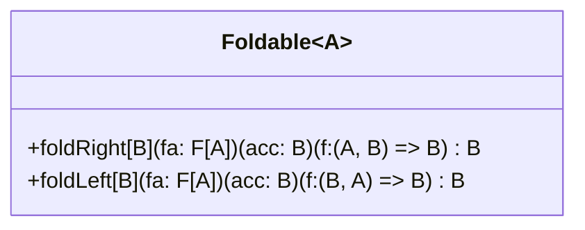



# Foldable

`Foldable` — это концепция из функционального программирования, 
которая описывает структуры данных, поддерживающие операцию "свёртки" (`fold`). 
Свёртка позволяет преобразовать коллекцию элементов в одно значение, 
последовательно применяя функцию к каждому элементу и аккумулируя результат.

**Основные характеристики `Foldable`:**

- **Операция свёртки**:
  `Foldable` предоставляет методы для обхода элементов структуры данных и их объединения в одно значение. 
  Например, можно сложить все числа в списке или объединить все строки в одну.
- **Гибкость**:
  Свёртка может быть выполнена в разных направлениях (слева направо или справа налево) и с разными начальными значениями.
- **Универсальность**:
  `Foldable` работает с различными типами коллекций, такими как списки, множества, деревья и другие.

**Где применяется `Foldable`?**

`Foldable` используется в функциональном программировании для:

- **Агрегации данных** (например, суммирование, умножение, конкатенация).
- **Преобразования коллекций** (например, фильтрация, поиск).
- **Работы с вложенными структурами данных** (например, деревья, графы).

**Примеры `Foldable`**

- **Суммирование элементов списка**.
  С помощью `Foldable` можно сложить все числа в списке и получить их сумму.
- **Конкатенация строк**.
  С помощью `Foldable` можно объединить все строки в одну.
- **Поиск минимального или максимального значения**.
  С помощью `Foldable` можно найти минимальное или максимальное значение в списке.
- **Подсчёт элементов**.
  С помощью `Foldable` можно подсчитать количество элементов в списке.
- **Фильтрация элементов**.
  С помощью `Foldable` можно отфильтровать все чётные числа и вернуть их сумму.
- **Работа с деревьями**.
  С помощью `Foldable` можно обойти все узлы дерева, где каждый узел содержит число, и вычислить сумму всех чисел.
- **Преобразование коллекции в другую структуру**.
  Представим, что есть список пар "ключ-значение". 
  С помощью `Foldable` можно преобразовать этот список в ассоциативный массив (словарь).

**Свертывание**

_Fold_ может использоваться для реализации `reduce`. 
Разница `fold` с `reduce` заключается в том, 
что в `reduce` начальный элемент является нейтральным элементом, который не изменяет значение, 
например, пустая строка `""` для операции конкатенации строк или `0` для операции `+` в типе `Int`. 
Можно реализовать версию `reduce`, в которой начальный элемент — 
это просто первый элемент, который будет объединен в _fold_, 
если есть доступ, например, к функции `head`. 

## Формальное определение

`Foldable` — это тип данных, для которого определена операция `fold` 
(или её варианты, такие как `foldLeft`, `foldRight`), удовлетворяющая следующим свойствам:

- **Операция `fold`**:
  Для типа `F[A]` (где `F` — контейнер, а `A` — тип элементов) операция `fold` имеет сигнатуру:
  `def fold[B](fa: F[A], z: B)(f: (B, A) => B): B`
- **Операция `foldLeft`**:
  Аналогична `fold`, но гарантирует порядок обхода элементов слева направо:
  `def foldLeft[B](fa: F[A], z: B)(f: (B, A) => B): B`
- **Операция `foldRight`**:
  Аналогична `fold`, но гарантирует порядок обхода элементов справа налево:
  `def foldRight[B](fa: F[A], z: B)(f: (A, B) => B): B`
- **Дополнительные операции**:
  На основе `fold` могут быть определены другие полезные операции, такие как:
    - `toList` — преобразование коллекции в список.
    - `isEmpty` — проверка, является ли коллекция пустой.
    - `size` — подсчёт количества элементов.
    - `sum`, `product`, `minimum`, `maximum` — агрегация элементов.

### Законы `Foldable`

Для того чтобы тип данных считался `Foldable`, он должен удовлетворять определённым законам. 
Вот основные из них:

- **Закон ассоциативности для `foldLeft`**:
  `foldLeft(fa, z)(f) == foldLeft(fa, z)((acc, x) => f(acc, x))`
  Этот закон гарантирует, что порядок применения функции `f` не влияет на результат.
- **Закон ассоциативности для `foldRight`**:
  `foldRight(fa, z)(f) == foldRight(fa, z)((x, acc) => f(x, acc))`
  Аналогично, этот закон гарантирует корректность порядка обхода справа налево.
- **Закон согласованности `foldLeft` и `foldRight`**:
  Для некоторых структур данных (например, списков) результаты `foldLeft` и `foldRight` должны быть согласованы, 
  если операция `f` ассоциативна и коммутативна:
  `foldLeft(fa, z)(f) == foldRight(fa, z)(f)`

### Взаимозаменяемость операций

Операции агрегации справа налево (`foldRight`), слева направо (`foldLeft`), используя моноид (`foldMap`),
свертывание `Foldable` (`combineAll`) и преобразование в связанный список (`toList`) можно выразить друг через друга.
Поэтому достаточно реализовать только `foldRight` или `foldMap`, но для лучшей производительности иногда
необходимо реализовать несколько операций напрямую.

Связь между операциями должна удовлетворять следующим законам:

- `foldLeft` соответствует `foldMap`: `fa.foldMap(Vector(_)) == fa.foldLeft(Vector.empty[A])(_ :+ _)`
- `foldRight` соответствует `foldMap`: `fa.foldMap(Vector(_)) == fa.foldRight(Vector.empty[A])(_ +: _)`

## Код

```dotty
trait Monoid[A]:
  def combine(a1: A, a2: A): A
  def empty: A

object Monoid:
  def dual[A](m: Monoid[A]): Monoid[A] = new:
    def combine(x: A, y: A): A = m.combine(y, x)
    val empty: A = m.empty

  def endoMonoid[A]: Monoid[A => A] = new:
    def combine(a1: A => A, a2: A => A): A => A = a1 andThen a2
    val empty: A => A = identity

trait Foldable[F[_]]:
  import Monoid.{endoMonoid, dual}

  extension [A](as: F[A])
    def foldRight[B](acc: B)(f: (A, B) => B): B =
      foldMap(f.curried)(using endoMonoid[B])(acc)

    def foldLeft[B](acc: B)(f: (B, A) => B): B =
      foldMap(a => b => f(b, a))(using dual(endoMonoid[B]))(acc)

    def foldMap[B](f: A => B)(using mb: Monoid[B]): B =
      foldRight(mb.empty)((a, b) => mb.combine(f(a), b))

    def combineAll(using ma: Monoid[A]): A =
      foldLeft(ma.empty)(ma.combine)
    
    def toList: List[A] =
      fa.foldRight(List.empty[A])(_ :: _)  
```

### "Обертка"

```dotty
type Id[A] = A
object Id:
  def apply[A](a: A): Id[A] = a

given Foldable[Id] with
  extension [A](fa: Id[A])
    override def foldRight[B](init: B)(f: (A, B) => B): B =
      f(fa, init)
```

### Option

```dotty
given Foldable[Option] with
  extension [A](as: Option[A])
    override def foldRight[B](acc: B)(f: (A, B) => B): B =
      as match
        case None    => acc
        case Some(a) => f(a, acc)
    override def foldLeft[B](acc: B)(f: (B, A) => B): B =
      as match
        case None    => acc
        case Some(a) => f(acc, a)
    override def foldMap[B](f: A => B)(using mb: Monoid[B]): B =
      as match
        case None    => mb.empty
        case Some(a) => f(a)
```

### Последовательность

```dotty
given Foldable[List] with
  extension[A] (as: List[A])
    override def foldRight[B](acc: B)(f: (A, B) => B) =
      as.foldRight(acc)(f)
    override def foldLeft[B](acc: B)(f: (B, A) => B) =
      as.foldLeft(acc)(f)
    override def toList: List[A] = as
```

### Кортеж от двух и более элементов

```dotty
given tuple2Foldable: Foldable[[X] =>> (X, X)] with
  extension [A](fa: (A, A))
    override def foldRight[B](init: B)(f: (A, B) => B): B =
      val (a0, a1) = fa
      val b = f(a1, init)
      f(a0, b)

given tuple3Foldable: Foldable[[X] =>> (X, X, X)] with
  extension [A](fa: (A, A, A))
    override def foldRight[B](init: B)(f: (A, B) => B): B =
      val (a0, a1, a2) = fa
      val b0 = f(a2, init)
      val b1 = f(a1, b0)
      f(a0, b1)
```

### Either

```dotty
given eitherFoldable[E]: Foldable[[x] =>> Either[E, x]] with
  extension [A](fa: Either[E, A])
    override def foldRight[B](init: B)(f: (A, B) => B): B =
      fa match
        case Right(a) => f(a, init)
        case Left(_)  => init
```

### Законы

- `foldLeft` соответствует `foldMap`: `fa.foldMap(Vector(_)) == fa.foldLeft(Vector.empty[A])(_ :+ _)`
- `foldRight` соответствует `foldMap`: `fa.foldMap(Vector(_)) == fa.foldRight(Vector.empty[A])(_ +: _)`

```dotty
def checkFoldLeftMatchesFoldMap[F[_]: Foldable, A](fa: F[A])(using
    Monoid[Vector[A]]
): ValidatedNel[String, Unit] =
  Either.cond[String, Unit](
    fa.foldMap(Vector(_)) == fa.foldLeft(Vector.empty[A])(_ :+ _),
    (),
    "`foldLeft` не соответствует `foldMap`, не соблюдается: `fa.foldMap(Vector(_)) == fa.foldLeft(Vector.empty[A])(_ :+ _)`"
  ).toValidatedNel

def checkFoldRightMatchesFoldMap[F[_]: Foldable, A](fa: F[A])(using
    Monoid[Vector[A]]
): ValidatedNel[String, Unit] =
  Either.cond[String, Unit](
    fa.foldMap(Vector(_)) == fa.foldRight(Vector.empty[A])(_ +: _),
    (),
    "`foldRight` соответствует `foldMap`, не соблюдается: `fa.foldMap(Vector(_)) == fa.foldRight(Vector.empty[A])(_ +: _)`"
  ).toValidatedNel
```

## Схема



## Реализация в библиотеках

### Реализация в Cats

```dotty
import cats.Foldable
import cats.instances.list.*
import cats.instances.option.*
import cats.instances.int.*
import cats.instances.string.*

val ints = List(1, 2, 3)                           // List(1, 2, 3)
Foldable[List].foldLeft(ints, 0)(_ + _)            // 6

val maybeInt = Option(123)                         // Some(123)
Foldable[Option].foldLeft(maybeInt, 10)(_ * _)     // 1230

Foldable[Option].nonEmpty(Option(42))              // true
Foldable[List].find(List(1, 2, 3))(_ % 2 == 0)     // Some(2)
Foldable[List].combineAll(List(1, 2, 3))           // 6
Foldable[List].foldMap(List(1, 2, 3))(_.toString)  // 123
```

### Реализация в ScalaZ

```dotty
import scalaz.*
import Scalaz.*

List(1, 2, 3).foldRight (0) {_ - _}                        // 2
List(1, 2, 3).foldLeft (0) {_ - _}                         // -6

val trues: LazyList[Boolean] = LazyList.continually(true)
def lazyOr(x: Boolean)(y: => Boolean) = x || y
Foldable[LazyList].foldr(trues, false)(lazyOr)             // true

val digits = List(0,1,2,3,4,5,6,7,8,9)
Foldable[List].fold(digits)                                // 45
```

---

**Ссылки:**

- [Cats](https://typelevel.org/cats/typeclasses/foldable.html)
- [Folds for Imperative Programmers](https://blog.tmorris.net/posts/folds-for-imperative-programmers/index.html)
- [Functional Programming in Scala, Second Edition, Chapter 10](https://www.manning.com/books/functional-programming-in-scala-second-edition?query=Functional%20Programming%20in%20Scala,%20Second%20Edition)
- [Herding Cats](http://eed3si9n.com/herding-cats/using-monoids-to-fold.html)
- [Learn Functional Programming course/tutorial on Scala](https://github.com/dehun/learn-fp)
- [Learning Scalaz](http://eed3si9n.com/learning-scalaz/Foldable.html)
- [Scala with Cats](https://www.scalawithcats.com/dist/scala-with-cats.html#sec:foldable)
- [Scalaz API](https://javadoc.io/doc/org.scalaz/scalaz-core_3/7.3.6/scalaz/Foldable.html)
- [SKB – Scala Foldable](https://leobenkel.com/2021/01/skb-scala-foldable)
- [Tour of Scala](https://tourofscala.com/scala/foldable)
