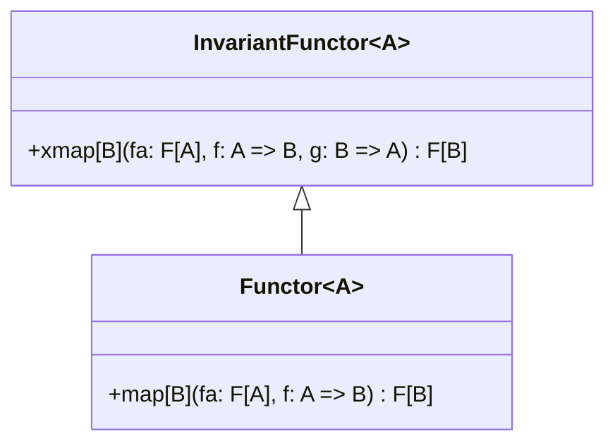



# Функтор

**Функтор** — это концепция из теории категорий, которая широко используется в функциональном программировании. 
В контексте программирования функтор — это абстракция, которая позволяет применять функцию к значениям, 
"завернутым" в некоторый контекст, без извлечения этих значений из контекста.

**Основная идея функтора**

Функтор — это тип, который реализует операцию `map`. Эта операция принимает:

- Контейнер (или контекст) со значением типа `A`.
- Функцию `A => B`.
- Возвращает новый контейнер с результатом применения функции к значению, но не меняя сам контекст.

**Зачем нужны функторы?**

Функторы полезны, потому что они позволяют работать с данными, 
находящимися в контексте (например, в `Option`, `List`, `Future` и т.д.), 
без необходимости извлекать их из этого контекста. 
Это делает код более безопасным, композируемым и выразительным.

**Примеры функторов**

- `Option` как функтор. `Option` — это контейнер, который может содержать значение (`Some`) или быть пустым (`None`). 
  Функтор позволяет применить функцию к значению внутри `Option`, если оно существует.
- `List` как функтор. `List` — это контейнер, содержащий множество значений. Функтор позволяет применить функцию к каждому элементу списка.
- `Future` как функтор. `Future` — это контейнер, представляющий асинхронное вычисление. 
  Функтор позволяет применить функцию к результату `Future`, когда он будет доступен.

## Формальное определение

Функтор — это преобразование из категории `A` в категорию `B`. 
Такие преобразования часто изображаются стрелкой: `A -> B` (или через метод `map`).
Функтор сохраняет структуру: что было связано в исходной категории, будет связано и в целевой.

Функтор создает новые экземпляры классов типов, добавляя функцию в цепочку преобразований.

Функтор (F) расширяет [инвариантный функтор](invariant-functor.md) 
и должен следовать следующим законам 
(помимо законов инвариантного функтора):

- Тождественность (identity): Если определен метод идентификации `identity` такой, что: `identity(a) == a`, 
  тогда `map(fa)(identity) == fa`. Другими словами: если мы отобразим функцию `identity` на функтор, 
  функтор, который мы получим, должен быть таким же, как исходный функтор.
- Композиция (composition): Если определены два метода `f` и `g`, тогда `fa.map(f).map(g) == fa.map(g(f(_)))`.
  Другими словами: композиция двух функций и последующее отображение результирующей функции на функтор 
  должно быть таким же, как сначала отображение одной функции на функтор, а затем отображение другой.

> Стоит отметить, что здесь и далее речь идет только о чистых функциях `identity`, `f` и `g`.

## Код

```dotty
trait Functor[F[_]] extends InvariantFunctor[F]:
  extension [A](fa: F[A])
    def map[B](f: A => B): F[B]

    override def xmap[B](f: A => B, g: B => A): F[B] = fa.map(f)

  def lift[A, B](f: A => B): F[A] => F[B] = _.map(f)

  def mapply[A, B](a: A)(f: F[A => B]): F[B] = map(f)((ff: A => B) => ff(a))

  def fproduct[A, B](fa: F[A])(f: A => B): F[(A, B)] = map(fa)(a => (a, f(a)))
```

Как видно из примера выше, функтор позволяет определить дополнительные операции:

- "поднимает" функцию `A => B` до функции преобразования функторов `F[A] => F[B]`
- применяет функтор от функции преобразования из `A` в `B` (`F[A => B]`) к элементу типа `A` и получает функтор от `B`
- по функтору от `A` и функции преобразования из `A` в `B` позволяет получать функтор от кортежа `(A, B)` 

### "Обертка" является функтором

```dotty
type Id[A] = A
object Id:
  def apply[A](a: A): Id[A] = a

given idFunctor: Functor[Id] with
  extension [A](as: Id[A]) override def map[B](f: A => B): Id[B] = Id(f(as))
```

Докажем, что `Id` удовлетворяет функториальным законам.

- сохраняет единичные морфизмы: `map(fa)(identity) == fa`
    - по определению метода `map` получим: `Id(a).map(identity) == Id(identity(a)) == Id(a)`
- сохраняет композицию: `fa.map(f).map(g) == fa.map(g(f(_)))`
    - по определению метода `map` получим:
      `Id(a).map(f).map(g) == Id(f(a)).map(g) == Id(g(f(a)))` и `Id(a).map(g(f(_))) == Id(g(f(a)))`
  
### Option

```dotty
given optionFunctor: Functor[Option] with
  extension [A](optA: Option[A])
    override def map[B](f: A => B): Option[B] =
      optA match
        case Some(a) => Some(f(a))
        case None    => None
```

Докажем, что `Option` удовлетворяет функториальным законам.

- сохраняет единичные морфизмы: `map(fa)(identity) == fa`
    - если `fa` равно `None`, то по определению метода `map` получим: `None.map(identity) == None`
    - если `fa` равно `Some(a)`, то по определению метода `map` получим: 
      `Some(a).map(identity) == Some(identity(a)) == Some(a)`
- сохраняет композицию: `fa.map(f).map(g) == fa.map(g(f(_)))`
    - если `fa` равно `None`, то по определению метода `map` получим:
      `None.map(f).map(g) == None.map(g) == None` и `None.map(g(f(_))) == None` 
    - если `fa` равно `Some(a)`, то по определению метода `map` получим:
      `Some(a).map(f).map(g) == Some(f(a)).map(g) == Some(g(f(a)))` и `Some(a).map(g(f(_))) == Some(g(f(a)))`

### Последовательность

```dotty
given listFunctor: Functor[List] with
  extension [A](as: List[A])
    override def map[B](f: A => B): List[B] = as match
      case Nil    => Nil
      case h :: t => f(h) :: t.map(f)
```

### Either

```dotty
given eitherFunctor[E]: Functor[[x] =>> Either[E, x]] with
  extension [A](fa: Either[E, A])
    override def map[B](f: A => B): Either[E, B] =
      fa match
        case Right(a) => Right(f(a))
        case Left(e)  => Left(e)
```

### Writer - функциональный журнал

```dotty
case class Writer[W, A](run: () => (W, A))

given writerFunctor[W]: Functor[[x] =>> Writer[W, x]] with
  extension [A](fa: Writer[W, A])
    override def map[B](f: A => B): Writer[W, B] =
      val (w, a) = fa.run()
      Writer[W, B](() => (w, f(a)))
```

### State - функциональное состояние

```dotty
case class State[S, +A](run: S => (S, A))

given stateFunctor[S]: Functor[[x] =>> State[S, x]] with
  extension [A](fa: State[S, A])
    override def map[B](f: A => B): State[S, B] =
      State[S, B] { s =>
        val (s1, a) = fa.run(s)
        (s1, f(a))
      }
```

### IO

```dotty
final case class IO[R](run: () => R)

given ioFunctor: Functor[IO] with
  extension [A](as: IO[A]) 
    override def map[B](f: A => B): IO[B] = IO { () => f(as.run()) }
```

### Бинарное дерево

```dotty
enum BinaryTree[+A]:
  case Leaf
  case Branch(value: A, left: BinaryTree[A], right: BinaryTree[A])

given Functor[BinaryTree] with
  extension [A](as: BinaryTree[A])
    override def map[B](f: A => B): BinaryTree[B] = as match
      case Leaf                   => Leaf
      case Branch(a, left, right) => Branch(f(a), left.map(f), right.map(f))
```


### Законы

- Закон тождественности утверждает, что применение тождественного преобразования к значению функтора
  не изменяет это значение. Формально это выражается так: `fu.map(fa)(identity) == fa`
- Закон композиции утверждает, что последовательное применение двух отображений эквивалентно одному отображению,
  которое является композицией этих двух отображений. Формально это выражается так:
  `fu.map(fu.map(fa)(f))(g) == fu.map(fa)(f.andThen(g))`

```dotty
def checkMapIdentityLaw[F[_], A](fa: F[A])(using
    fu: Functor[F]
): ValidatedNel[String, Unit] =
  Either.cond[String, Unit](
    fu.map(fa)(identity) == fa,
    (),
    "Не соблюдается тождественность: map(fa)(identity) == fa"
  ).toValidatedNel

def checkMapCompositionLaw[F[_], A, B, C](fa: F[A])(using
    fu: Functor[F],
    f: A => B,
    g: B => C
): ValidatedNel[String, Unit] =
  Either.cond[String, Unit](
    fu.map(fu.map(fa)(f))(g) == fu.map(fa)(f.andThen(g)),
    (),
    "Не соблюдается композиция: fa.map(f).map(g) == fa.map(g(f(_)))"
  ).toValidatedNel
```

## Композиция функторов

Композиция двух функторов - это функтор, для которого `map` - есть композиция соответствующих `map`.
Композиция функторов - категория, в которой объекты — это категории, а морфизмы — это функторы.

Рассмотрим пример:

```dotty
final case class Nested[F[_], G[_], A](value: F[G[A]])

given nf[F[_]: Functor, G[_]: Functor]: Functor[[X] =>> Nested[F, G, X]] with
  extension [A](fga: Nested[F, G, A])
    override def map[B](f: A => B): Nested[F, G, B] =
      Nested[F, G, B](fga.value.map(_.map(f)))

Nested(Some(List(1, 2))).map(_ + 10)
// res0: Nested[[A >: Nothing <: Any] => Option[A], List, Int] = Nested(
//   value = Some(value = List(11, 12))
// )
```

Композиция функторов удовлетворяет функториальным законам:

- сохраняет единичные морфизмы: `map(fa)(identity) == fa`
    - `fga.map(ga => ga.map(identity)) == fga.map(ga => ga) == fga.map(identity) == fga`
- сохраняет композицию: `fa.map(f).map(g) == fa.map(g(f(_)))`
    - `fga.map(ga => ga.map(f)).map(ga => ga.map(g)) == fga.map(ga => ga.map(f).map(g)) == fga.map(ga => ga.map(g(f(_))))`

## Схема



## Реализация в библиотеках

### Реализация в Cats

```dotty
import cats.*
import cats.implicits.*

val list1 = List(1, 2, 3)
val list2 = Functor[List].map(list1)(_ * 2)  // List(2, 4, 6)

val func = (x: Int) => x + 1
val liftedFunc = Functor[Option].lift(func)
liftedFunc(Option(1))                        // Some(2)
```

### Реализация в ScalaZ

```dotty
import scalaz.*
import Scalaz.*

val len: String => Int = _.length
Functor[Option].map(Some("adsf"))(len)             // Some(4)
Functor[Option].map(None)(len)                     // None
Functor[List].map(List("qwer", "adsfg"))(len)      // List(4, 5)
// или через вызов метода на типе
List(1, 2, 3) map {_ + 1}                          // List(2, 3, 4)
List(1, 2, 3) ∘ {_ + 1}                            // List(2, 3, 4)

// В ScalaZ есть метод fpair, дублирующий значение в функторе 
List(1, 2, 3).fpair                                // List((1,1), (2,2), (3,3))

// Используя Functor можно «поднять» функцию для работы с типом Functor. Пример на Functor[Option]:
val lenOption: Option[String] => Option[Int] = Functor[Option].lift(len)
lenOption(Some("abcd"))                            // Some(4)
Functor[List].lift {(_: Int) * 2} (List(1, 2, 3))  // List(2, 4, 6)

// В ScalaZ есть методы strength, позволяющие "прокидывать" значение, создавая коллекцию tuple-ов
List(1,2,3).strengthL("a")                         // List("a" -> 1, "a" -> 2, "a" -> 3)
List(1,2,3).strengthR("a")                         // List(1 -> "a", 2 -> "a", 3 -> "a")

// Functor предоставляет функцию fproduct, которая сопоставляет значение с результатом применения функции к этому значению.
List("a", "aa", "b", "ccccc").fproduct(len)        // List((a,1), (aa,2), (b,1), (ccccc,5))

// Метод void «аннулирует» функтор, заменяя любой F[A] на F[Unit]
Functor[Option].void(Some(1))                      // Some(())

// Также в ScalaZ есть метод "принудительно" выставляющий заданное значение
List(1, 2, 3) >| "x"                               // List(x, x, x)
List(1, 2, 3) as "x"                               // List(x, x, x)

// Компоновка функторов
val listOpt = Functor[List] compose Functor[Option]
listOpt.map(List(Some(1), None, Some(3)))(_ + 1)   // List(Some(2), None, Some(4))
```

---

**Ссылки:**

- [Ссылка на репозиторий с упражнениями][sample]
- [Категория Hask](https://habr.com/ru/articles/133277/)
- [Классические абстракции используемые в ФП](https://habr.com/ru/articles/896660/)
- [Algebird](https://twitter.github.io/algebird/typeclasses/functor.html)
- Category Theory for Programmers - Bartosz Milewski:
    - [Теория категорий для программистов](https://henrychern.wordpress.com/2022/09/15/%d1%82%d0%b5%d0%be%d1%80%d0%b8%d1%8f-%d0%ba%d0%b0%d1%82%d0%b5%d0%b3%d0%be%d1%80%d0%b8%d0%b9-%d0%b4%d0%bb%d1%8f-%d0%bf%d1%80%d0%be%d0%b3%d1%80%d0%b0%d0%bc%d0%bc%d0%b8%d1%81%d1%82%d0%be%d0%b2/)
    - [Category Theory for Programmers, Functors](https://bartoszmilewski.com/2015/01/20/functors/)
- [Cats](https://typelevel.org/cats/typeclasses/functor.html)
- [Functional Programming in Scala, Second Edition, Chapter 11](https://www.manning.com/books/functional-programming-in-scala-second-edition?query=Functional%20Programming%20in%20Scala,%20Second%20Edition)
- [Herding Cats](http://eed3si9n.com/herding-cats/Functor.html)
- [Just what the funk is a Functor anyway?](https://blog.tmorris.net/posts/just-what-the-funk-is-a-functor-anyway/index.html)
- [Learn Functional Programming course/tutorial on Scala](https://github.com/dehun/learn-fp)
- [Learning Scalaz](http://eed3si9n.com/learning-scalaz/Functor.html)
- [Scala with Cats](https://scalawithcats.com/dist/scala-with-cats.html#definition-of-a-functor)
- [Scalaz API](https://javadoc.io/doc/org.scalaz/scalaz-core_3/7.3.6/scalaz/Functor.html)
- [SKB – Scala Functor](https://leobenkel.com/2021/01/skb-scala-functor/)
- [Tour of Scala](https://tourofscala.com/scala/functor)
- [What the Functor? Functors in Scala - Rock the JVM](https://www.youtube.com/watch?v=aSnY2JBzjUw&list=PLmtsMNDRU0Bzj7INIrLugi3a_WClwQuiS)

[sample]: https://gitverse.ru/scalabook/typeclasses
