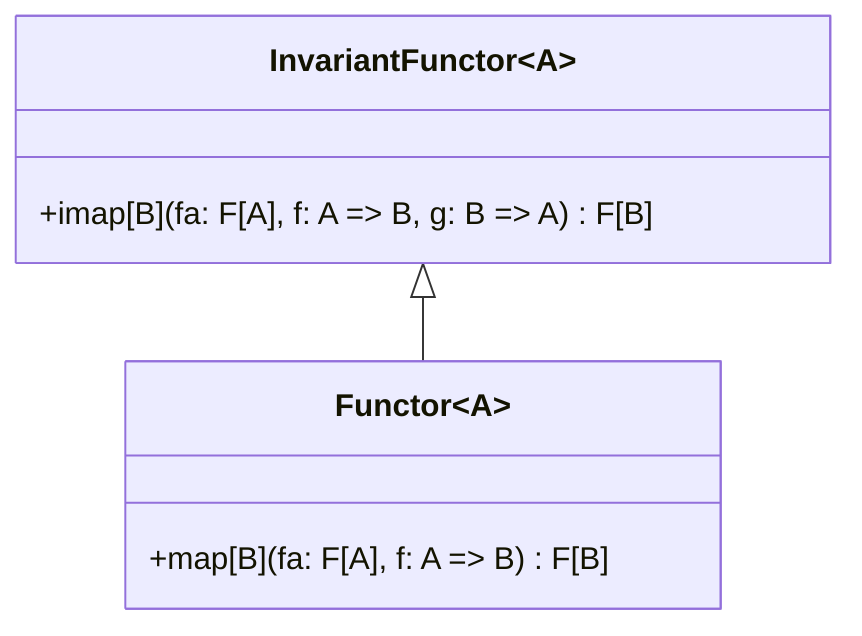



# Функтор

**Функтор** — это концепция из теории категорий, которая широко используется в функциональном программировании. 
В контексте программирования функтор — это абстракция, которая позволяет применять функцию к значениям, 
"завернутым" в некоторый контекст, без извлечения этих значений из контекста.

**Основная идея функтора**

Функтор — это тип, который реализует операцию `map`. Эта операция принимает:

- Контейнер (или контекст) со значением типа `A`.
- Функцию `A => B`.
- Возвращает новый контейнер с результатом применения функции к значению, но не меняя сам контекст.

**Зачем нужны функторы?**

Функторы полезны, потому что они позволяют работать с данными, 
находящимися в контексте (например, в `Option`, `List`, `Future` и т.д.), 
без необходимости извлекать их из этого контекста. 
Это делает код более безопасным, композируемым и выразительным.

**Примеры функторов**

- `Option` как функтор. `Option` — это контейнер, который может содержать значение (`Some`) или быть пустым (`None`). 
  Функтор позволяет применить функцию к значению внутри `Option`, если оно существует.
- `List` как функтор. `List` — это контейнер, содержащий множество значений. Функтор позволяет применить функцию к каждому элементу списка.
- `Future` как функтор. `Future` — это контейнер, представляющий асинхронное вычисление. 
  Функтор позволяет применить функцию к результату `Future`, когда он будет доступен.

## Формальное определение

Функтор — это преобразование из категории `A` в категорию `B`. 
Такие преобразования часто изображаются стрелкой: `A -> B` (или через метод `map`).
Функтор сохраняет структуру: что было связано в исходной категории, будет связано и в целевой.

Функтор создает новые экземпляры классов типов, добавляя функцию в цепочку преобразований.

Функтор (F) расширяет [инвариантный функтор](invariant-functor.md) 
и должен следовать следующим законам 
(помимо законов инвариантного функтора):

- Тождественность (identity): Если определен метод идентификации `identity` такой, что: `identity(a) == a`, 
  тогда `map(fa)(identity) == fa`. Другими словами: если мы отобразим функцию `identity` на функтор, 
  функтор, который мы получим, должен быть таким же, как исходный функтор.
- Композиция (composition): Если определены два метода `f` и `g`, тогда `fa.map(f).map(g) == fa.map(g(f(_)))`.
  Другими словами: композиция двух функций и последующее отображение результирующей функции на функтор 
  должно быть таким же, как сначала отображение одной функции на функтор, а затем отображение другой.

> Стоит отметить, что здесь и далее речь идет только о чистых функциях `identity`, `f` и `g`.

## Код

```dotty
trait Functor[F[_]] extends InvariantFunctor[F]:
  extension [A](fa: F[A])
    def map[B](f: A => B): F[B]

    override def imap[B](f: A => B, g: B => A): F[B] = fa.map(f)

  def lift[A, B](f: A => B): F[A] => F[B] = _.map(f)

  def mapply[A, B](a: A)(f: F[A => B]): F[B] = map(f)((ff: A => B) => ff(a))

  def fproduct[A, B](fa: F[A])(f: A => B): F[(A, B)] = map(fa)(a => (a, f(a)))
```

Как видно из примера выше, функтор позволяет определить дополнительные операции:

- "поднимает" (lift) функцию `A => B` до функции преобразования функторов `F[A] => F[B]`
- применяет функтор от функции преобразования из `A` в `B` (`F[A => B]`) к элементу типа `A` и получает функтор от `B`
- по функтору от `A` и функции преобразования из `A` в `B` позволяет получать функтор от кортежа `(A, B)` 

### Законы

- Закон тождественности утверждает, что применение тождественного преобразования к значению функтора
  не изменяет это значение. Формально это выражается так: `fu.map(fa)(identity) == fa`
- Закон композиции утверждает, что последовательное применение двух отображений эквивалентно одному отображению,
  которое является композицией этих двух отображений. Формально это выражается так:
  `fu.map(fu.map(fa)(f))(g) == fu.map(fa)(f andThen g)`

## Упражнения

### Упражнение 2.2.1: Функтор для тождественного типа Id

> [Репозиторий с упражнениями и инструкцией по выполнению][sample]

Реализуйте экземпляр `Functor` для типа `Id` (тождественный тип), который просто оборачивает значение того же типа.
`Id[A]` — это тип-обёртка, которая ведёт себя точно так же, как и сам тип `A`, но позволяет реализовывать
для него экземпляры классов типов, как для обычного типа с одним параметром.

```dotty
type Id[A] = A
object Id:
  def apply[A](a: A): Id[A] = a

given idFunctor: Functor[Id] with
  extension [A](as: Id[A]) 
    def map[B](f: A => B): Id[B] = ???
```

**Примеры:**

```dotty
// Id может хранить значение любого типа
val intId: Id[Int] = Id(42)
val stringId: Id[String] = Id("Hello")

// Функции для преобразования
val toString: Int => String = _.toString
val addOne: Int => Int = _ + 1
val length: String => Int = _.length

// Использование map для Id
intId.map(toString)        // Id("42")
intId.map(addOne)          // Id(43)
stringId.map(length)       // Id(5)
```

@:note(🔍 Показать решение)

Тождественный тип `Id[A]` является простейшим контейнером, который хранит ровно одно значение типа `A`.
Метод `map` должен применить функцию `f` к этому значению и вернуть новый `Id[B]`.
Так как `Id[B]` — это просто `B`, достаточно вызвать `f` на исходном значении `as` (которое имеет тип `A`)
и обернуть результат в `Id.apply`. 

```dotty
given idFunctor: Functor[Id] with
  extension [A](as: Id[A]) 
    def map[B](f: A => B): Id[B] = Id(f(as))
```

@:@

### Упражнение 2.2.2: Функтор для типа Option

Реализуйте экземпляр `Functor` для типа `Option`, который позволяет применять функцию к значению внутри `Some`,
оставляя `None` неизменным. 

```dotty
given optionFunctor: Functor[Option] with
  extension [A](optA: Option[A])
    def map[B](f: A => B): Option[B] = ???
```

**Примеры:**

```dotty
// Option с значением и без
val someNumber: Option[Int] = Some(42)
val noneNumber: Option[Int] = None
val someString: Option[String] = Some("Hello")

// Функции для преобразования
val toString: Int => String = _.toString
val addOne: Int => Int = _ + 1
val length: String => Int = _.length
val toBoolean: Int => Boolean = _ > 0

// Использование map для Option с значением
someNumber.map(toString)        // Some("42")
someNumber.map(addOne)          // Some(43)
someNumber.map(toBoolean)       // Some(true)
someString.map(length)          // Some(5)

// Использование map для None
noneNumber.map(toString)        // None
noneNumber.map(addOne)          // None
noneNumber.map(toBoolean)       // None

// Цепочка преобразований
val result = Some(5)
  .map(_ * 2)      // Some(10)
  .map(_ + 3)      // Some(13)
  .map(_.toString) // Some("13")
  .map(_ + "!")    // Some("13!")
// Some("13!")
```

@:note(🔍 Показать решение)

Решение заключается в сопоставлении с шаблоном по значению `Option[A]`. Если `optA` равно `Some(a)`,
нужно извлечь значение `a`, применить к нему функцию `f` и вернуть `Some(f(a))`.
Если `optA` равно `None`, нужно вернуть `None`. 

```dotty
given optionFunctor: Functor[Option] with
  extension [A](optA: Option[A])
    def map[B](f: A => B): Option[B] =
      optA match
        case Some(a) => Some(f(a))
        case None    => None
```

@:@

### Упражнение 2.2.3: Функтор для типа List

Реализуйте экземпляр `Functor` для типа `List`, который позволяет применять функцию к каждому элементу списка,
сохраняя его структуру и порядок элементов. `List[A]` представляет собой упорядоченную последовательность
элементов типа `A`, которая может быть пустой (`Nil`) или состоять из головы (`head`) и хвоста (`tail`).

```dotty
given listFunctor: Functor[List] with
  extension [A](as: List[A])
    def map[B](f: A => B): List[B] = ???
```

**Примеры:**

```dotty
val result = List(1, 2, 3)
  .map(_ * 2)       // List(2, 4, 6)
  .map(_ + 1)       // List(3, 5, 7)
  .map(_.toString)  // List("3", "5", "7")
  .map(_ + "!")     // List("3!", "5!", "7!")
```

@:note(🔍 Показать решение)

Решение использует рекурсивное сопоставление с шаблоном по структуре списка. Базовый случай — пустой список `Nil`,
который отображается в `Nil` (пустой список). Рекурсивный случай — непустой список вида `head :: tail`,
где нужно применить функцию `f` к голове (`f(h)`) и рекурсивно применить `map` к хвосту (`t.map(f)`),
после чего сконструировать новый список с помощью оператора `::`.

```dotty
given listFunctor: Functor[List] with
  extension [A](as: List[A])
    def map[B](f: A => B): List[B] = as match
      case Nil    => Nil
      case h :: t => f(h) :: t.map(f)
```

@:@

### Упражнение 2.2.4: Функтор для типа Either с фиксированным левым типом

Реализуйте экземпляр `Functor` для типа `Either[E, A]` с фиксированным левым типом `E`.
`Either[E, A]` представляет собой значение, которое может быть либо ошибкой типа `E` (`Left`),
либо успешным результатом типа `A` (`Right`). Функтор должен преобразовывать только правую часть
(`Right`), оставляя левую (`Left`) неизменной.

```dotty
given eitherFunctor[E]: Functor[[x] =>> Either[E, x]] with
  extension [A](fa: Either[E, A])
    def map[B](f: A => B): Either[E, B] = ???
```

**Примеры:**

```dotty
// Цепочка преобразований для успешного пути
val result = Right(5)
  .map(_ * 2)       // Right(10)
  .map(_ + 3)       // Right(13)
  .map(_.toString)  // Right("13")
  .map(_ + "!")     // Right("13!")

// Цепочка преобразований прерывается при первой ошибке
val failedResult = Left("Ошибка инициализации")
  .map(_ * 2)       // Left("Ошибка инициализации")
  .map(_ + 3)       // Left("Ошибка инициализации")
  .map(_.toString)  // Left("Ошибка инициализации")
```

@:note(🔍 Показать решение)

Решение использует сопоставление с шаблоном по значению `Either[E, A]`. Если `fa` равно `Right(a)`,
нужно извлечь успешное значение `a`, применить к нему функцию `f` и вернуть `Right(f(a))`.
Если `fa` равно `Left(e)`, нужно вернуть `Left(e)` без применения функции, сохраняя информацию об ошибке.

```dotty
given eitherFunctor[E]: Functor[[x] =>> Either[E, x]] with
  extension [A](fa: Either[E, A])
    def map[B](f: A => B): Either[E, B] =
      fa match
        case Right(a) => Right(f(a))
        case Left(e)  => Left(e)
```

@:@

### Упражнение 2.2.5: Функтор для типа Writer с фиксированным типом лога

Реализуйте экземпляр `Functor` для типа `Writer[W, A]` с фиксированным типом лога `W`.
`Writer[W, A]` представляет собой вычисление, которое производит значение типа `A`
и дополнительный лог (или побочный вывод) типа `W`. 
В данной реализации `Writer` представлен как ленивое вычисление с помощью `() => (W, A)`.

```dotty
case class Writer[W, A](run: () => (W, A))

given writerFunctor[W]: Functor[[x] =>> Writer[W, x]] with
  extension [A](fa: Writer[W, A])
    def map[B](f: A => B): Writer[W, B] = ???
```

**Примеры:**

```dotty
// Цепочка преобразований с сохранением лога
val result = Writer(() => ("Вычисление: ", 10))
  .map(_ * 2)         // Writer(() => ("Вычисление: ", 20))
  .map(_ + 5)         // Writer(() => ("Вычисление: ", 25))
  .map(_.toString)    // Writer(() => ("Вычисление: ", "25"))
  .map("Число: " + _) // Writer(() => ("Вычисление: ", "Число: 25"))
```

@:note(🔍 Показать решение)

Решение требует выполнения ленивого вычисления исходного `Writer`. В методе `map` мы вызываем `fa.run()`,
чтобы получить пару `(w, a)` — лог и значение. Затем мы применяем функцию `f` к значению `a`,
получая новое значение `f(a)`. После этого мы возвращаем новый экземпляр `Writer[W, B]`,
который при своём вычислении (через лямбда-функцию `() =>`) возвращает пару `(w, f(a))`.
Важно сохранить лог `w` без изменений и сохранить ленивость вычислений — новый `Writer`
также должен быть ленивым и вычисляться только при вызове `run()`. Это позволяет
композировать преобразования без преждевременного выполнения побочных эффектов или вычислений.

```dotty
given writerFunctor[W]: Functor[[x] =>> Writer[W, x]] with
  extension [A](fa: Writer[W, A])
    def map[B](f: A => B): Writer[W, B] =
      val (w, a) = fa.run()
      Writer[W, B](() => (w, f(a)))
```

@:@

### Упражнение 2.2.6: Функтор для типа State с фиксированным типом состояния

Реализуйте экземпляр `Functor` для типа `State[S, A]` с фиксированным типом состояния `S`.
`State[S, A]` представляет собой функцию, которая принимает начальное состояние типа `S`,
вычисляет новое состояние и значение типа `A`. Это чисто функциональная абстракция для
работы с состоянием без использования переменных.

```dotty
case class State[S, +A](run: S => (S, A))

given stateFunctor[S]: Functor[[x] =>> State[S, x]] with
  extension [A](fa: State[S, A])
    def map[B](f: A => B): State[S, B] = ???
```

**Примеры:**

```dotty
val counter = State[Int, Int](s => (s + 1, s))

val (finalCounter, values) = counter
  .map(_ * 2)      // State(s => (s+1, s*2))
  .map(_ + 3)      // State(s => (s+1, s*2+3))
  .map(_.toString) // State(s => (s+1, (s*2+3).toString))
  .run(10)
// finalCounter = 11, values = "23"
```

@:note(🔍 Показать решение)

Решение заключается в создании нового состояния `State[S, B]` на основе исходного.
В методе `map` мы возвращаем новый экземпляр `State`, который принимает начальное состояние `s`.
Внутри этого состояния мы вызываем `fa.run(s)`, чтобы получить пару `(s1, a)` — новое состояние
и вычисленное значение. Затем мы применяем функцию `f` к значению `a`, получая `f(a)`,
и возвращаем пару `(s1, f(a))`. Важно, что функция `f` применяется только к значению,
не влияя на состояние, которое полностью определяется исходным вычислением `fa`.
Такая реализация позволяет создавать цепочки преобразований значений, сохраняя
чистоту и композиционность вычислений с состоянием.

```dotty
given stateFunctor[S]: Functor[[x] =>> State[S, x]] with
  extension [A](fa: State[S, A])
    def map[B](f: A => B): State[S, B] =
      State[S, B] { s =>
        val (s1, a) = fa.run(s)
        (s1, f(a))
      }
```

@:@

### Упражнение 2.2.7: Функтор для типа IO (Input/Output)

Реализуйте экземпляр `Functor` для типа `IO[R]`, который представляет собой ленивое вычисление,
возвращающее значение типа `R` и потенциально содержащее побочные эффекты (ввод-вывод, чтение файлов,
запросы к базе данных и т.д.). `IO[R]` — это описание эффектного вычисления, которое будет выполнено
только при вызове метода `run()`.

```dotty
final case class IO[R](run: () => R)

given ioFunctor: Functor[IO] with
  extension [A](as: IO[A]) 
    def map[B](f: A => B): IO[B] = ???
```

**Примеры:**

```dotty
val resultIO = IO(() => 10)
  .map(_ * 2)         // IO(() => 20)
  .map(_ + 3)         // IO(() => 23)
  .map(_.toString)    // IO(() => "23")
  .map(_ + "!")       // IO(() => "23!")
  .map(_.toUpperCase) // IO(() => "23!")
```

@:note(🔍 Показать решение)

Решение состоит в создании нового `IO[B]`, которое лениво оборачивает применение функции
к результату исходного вычисления. В методе `map` мы возвращаем новый экземпляр `IO`,
который принимает функцию `() => B`. Внутри этой функции мы сначала вызываем `as.run()`,
чтобы выполнить исходное эффектное вычисление и получить значение `a`. Затем мы применяем
функцию `f` к этому значению, получая `f(a)`, и возвращаем его как результат нового `IO`.
Важно сохранить ленивость: новое вычисление не должно выполняться до вызова `run()`.
Это позволяет компоновать эффектные операции, откладывая их выполнение до момента,
когда результат действительно понадобится, сохраняя при этом чистоту и ссылочную прозрачность
функциональных программ.

```dotty
given ioFunctor: Functor[IO] with
  extension [A](as: IO[A]) 
    def map[B](f: A => B): IO[B] = 
      IO { () => f(as.run()) }
```

@:@

### Упражнение 2.2.8: Функтор для бинарного дерева (BinaryTree)

Реализуйте экземпляр `Functor` для типа `BinaryTree[A]`, который представляет собой бинарное дерево,
где каждый узел (`Branch`) содержит значение типа `A` и два поддерева (левое и правое),
а лист (`Leaf`) обозначает отсутствие значения. Функтор должен обходить всё дерево,
применяя функцию к каждому значению в узлах, сохраняя структуру дерева.

```dotty
enum BinaryTree[+A]:
  case Leaf
  case Branch(value: A, left: BinaryTree[A], right: BinaryTree[A])

given Functor[BinaryTree] with
  extension [A](as: BinaryTree[A])
    def map[B](f: A => B): BinaryTree[B] = ???
```

**Примеры:**

```dotty
val resultTree = BinaryTree.Branch(10,
  BinaryTree.Branch(5, BinaryTree.Leaf, BinaryTree.Leaf),
  BinaryTree.Branch(15, BinaryTree.Leaf, BinaryTree.Leaf)
)
  .map(_ * 2)         // Branch(20, Branch(10, Leaf, Leaf), Branch(30, Leaf, Leaf))
  .map(_ + 3)         // Branch(23, Branch(13, Leaf, Leaf), Branch(33, Leaf, Leaf))
  .map(_.toString)    // Branch("23", Branch("13", Leaf, Leaf), Branch("33", Leaf, Leaf))
  .map("число: " + _) // Branch("число: 23", Branch("число: 13", Leaf, Leaf), Branch("число: 33", Leaf, Leaf))
```

@:note(🔍 Показать решение)

Решение использует рекурсивное сопоставление с шаблоном по структуре бинарного дерева.
Базовый случай — лист `Leaf`, который отображается в `Leaf` (пустое дерево без значений).
Рекурсивный случай — узел `Branch(value, left, right)`, где нужно применить функцию `f`
к значению узла `a`, получив `f(a)`, и рекурсивно применить `map` к левому и правому поддеревьям
с помощью `left.map(f)` и `right.map(f)`. Затем из этих компонентов конструируется новый узел
`Branch(f(a), left.map(f), right.map(f))`.

```dotty
given Functor[BinaryTree] with
  extension [A](as: BinaryTree[A])
    def map[B](f: A => B): BinaryTree[B] = as match
      case Leaf                   => Leaf
      case Branch(a, left, right) => Branch(f(a), left.map(f), right.map(f))
```

@:@

## Композиция функторов

Композиция двух функторов - это функтор, для которого `map` - есть композиция соответствующих `map`.
Композиция функторов - категория, в которой объекты — это категории, а морфизмы — это функторы.

Рассмотрим пример:

```dotty
final case class Nested[F[_], G[_], A](value: F[G[A]])

given nf[F[_]: Functor, G[_]: Functor]: Functor[[X] =>> Nested[F, G, X]] with
  extension [A](fga: Nested[F, G, A])
    override def map[B](f: A => B): Nested[F, G, B] =
      Nested[F, G, B](fga.value.map(_.map(f)))

Nested(Some(List(1, 2))).map(_ + 10)
// Nested(Some(value = List(11, 12)))
```

Композиция функторов удовлетворяет функториальным законам:

- сохраняет единичные морфизмы: `map(fa)(identity) == fa`
    - `fga.map(ga => ga.map(identity)) == fga.map(ga => ga) == fga.map(identity) == fga`
- сохраняет композицию: `fa.map(f).map(g) == fa.map(g(f(_)))`
    - ```dotty
      fga.map(ga => ga.map(f)).map(ga => ga.map(g)) == 
      fga.map(ga => ga.map(f).map(g)) == 
      fga.map(ga => ga.map(g(f(_))))
      ```

## Схема



## Реализация в библиотеках

### Реализация в Cats

```dotty
import cats.*
import cats.data.Nested
import cats.syntax.all.*

val list1 = List(1, 2, 3)
val list2 = Functor[List].map(list1)(_ * 2) 
// List(2, 4, 6)

val func       = (x: Int) => x + 1
val liftedFunc = Functor[Option].lift(func)
liftedFunc(Option(1))
// Some(2)

val listOption                        = List(Some(1), None, Some(2))
val nested: Nested[List, Option, Int] = Nested(listOption)
// nested: Nested[List, Option, Int] = Nested(
//   value = List(Some(value = 1), None, Some(value = 2))
// )

nested.map(_ + 1)
// res2: Nested[List, Option, Int] = Nested(
//   value = List(Some(value = 2), None, Some(value = 3))
// )
```

---

**Ссылки:**

- [Ссылка на репозиторий с упражнениями][sample]
- [Категория Hask](https://habr.com/ru/articles/133277/)
- [Классические абстракции используемые в ФП](https://habr.com/ru/articles/896660/)
- [Algebird](https://twitter.github.io/algebird/typeclasses/functor.html)
- Category Theory for Programmers - Bartosz Milewski:
    - [Теория категорий для программистов](https://henrychern.wordpress.com/2022/09/15/%d1%82%d0%b5%d0%be%d1%80%d0%b8%d1%8f-%d0%ba%d0%b0%d1%82%d0%b5%d0%b3%d0%be%d1%80%d0%b8%d0%b9-%d0%b4%d0%bb%d1%8f-%d0%bf%d1%80%d0%be%d0%b3%d1%80%d0%b0%d0%bc%d0%bc%d0%b8%d1%81%d1%82%d0%be%d0%b2/)
    - [Category Theory for Programmers, Functors](https://bartoszmilewski.com/2015/01/20/functors/)
- [Cats](https://typelevel.org/cats/typeclasses/functor.html)
- [Functional Programming in Scala, Second Edition, Chapter 11](https://www.manning.com/books/functional-programming-in-scala-second-edition?query=Functional%20Programming%20in%20Scala,%20Second%20Edition)
- [Functors in Functional Programming](https://www.baeldung.com/scala/functors-functional-programming)
- [Herding Cats](http://eed3si9n.com/herding-cats/Functor.html)
- [Just what the funk is a Functor anyway?](https://blog.tmorris.net/posts/just-what-the-funk-is-a-functor-anyway/index.html)
- [Learn Functional Programming course/tutorial on Scala](https://github.com/dehun/learn-fp)
- [Learning Scalaz](http://eed3si9n.com/learning-scalaz/Functor.html)
- [Scala with Cats](https://scalawithcats.com/dist/scala-with-cats.html#definition-of-a-functor)
- [Scalaz API](https://javadoc.io/doc/org.scalaz/scalaz-core_3/7.3.6/scalaz/Functor.html)
- [SKB – Scala Functor](https://leobenkel.com/2021/01/skb-scala-functor/)
- [Tour of Scala](https://tourofscala.com/scala/functor)
- [What the Functor? Functors in Scala - Rock the JVM](https://www.youtube.com/watch?v=aSnY2JBzjUw&list=PLmtsMNDRU0Bzj7INIrLugi3a_WClwQuiS)

[sample]: https://gitverse.ru/scalabook/typeclasses
