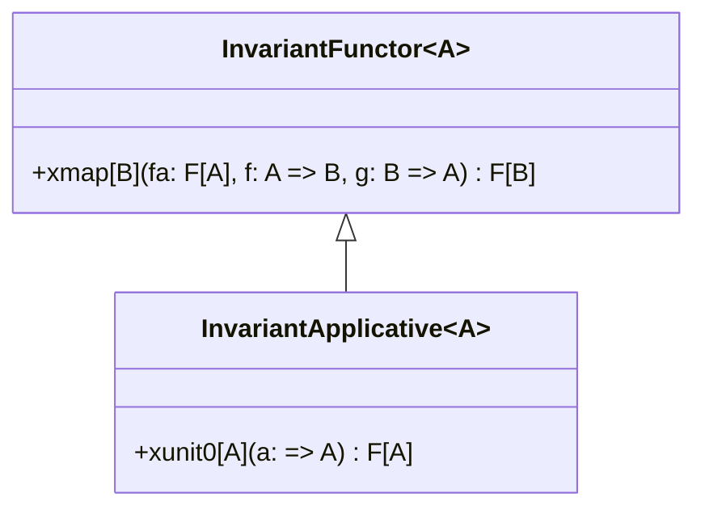



# Invariant Applicative

## Формальное определение

Инвариантный Applicative поддерживает операции `xunit0`, `xunit1` и т.д., 
которые "оборачивают" тип в инвариантный функтор. 
`InvariantApplicative` расширяет [`InvariantFunctor`](invariant-functor.md).

Используется для получения класса типов продуктов и типов значений.

## Код

```dotty
trait InvariantFunctor[F[_]]:
  extension [A](fa: F[A]) def xmap[B](f: A => B, g: B => A): F[B]

trait InvariantApplicative[F[_]] extends InvariantFunctor[F]:
  def xunit0[A](a: => A): F[A]
```

## Схема



---

**Ссылки:**

- [Ссылка на репозиторий с упражнениями][sample]
- [Scalaz API](https://javadoc.io/doc/org.scalaz/scalaz-core_3/7.3.6/scalaz/InvariantApplicative.html)

[sample]: https://gitverse.ru/scalabook/typeclasses
