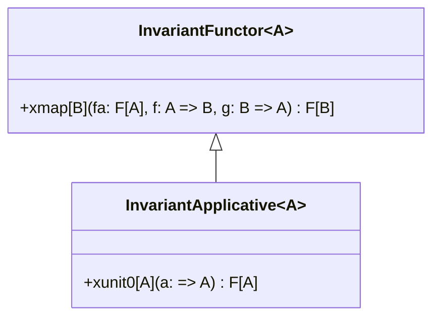



# Invariant Applicative

`InvariantApplicative` (инвариантный аппликативный функтор) — это функциональная абстракция,
которая обобщает понятие контейнера, поддерживающего двунаправленные преобразования
(инвариантные отображения) и "обёртывание" значений в контекст с помощью единичных операций
`xunit0`, `xunit1` и т.д.

В отличие от обычного [Applicative](applicative.md), который требует ковариантности 
(возможности преобразовывать значения в одном направлении), 
инвариантный аппликативный функтор позволяет работать с типами,
где преобразования могут быть обратимыми или требовать двустороннего отображения.

## Код

```dotty
trait InvariantFunctor[F[_]]:
  extension [A](fa: F[A])
    def xmap[B](f: A => B, g: B => A): F[B]

trait InvariantApplicative[F[_]] extends InvariantFunctor[F]:
  def xunit0[A](a: => A): F[A]

  extension [A](fa: => F[A])
    def xunit1[B](f: A => B, g: B => A): F[B] =
      fa.xmap(f, g)
```

1. **Базовые операции**:
    - `xmap` (инвариантное отображение) — преобразует `F[A]` в `F[B]` с помощью пары обратных функций
    - `xunit0` — помещает значение в минимальный контекст `F` (аналог `pure` в обычном `Applicative`)

2. **Производные операции**:
    - `xunit1` — комбинация `xunit0` и `xmap` для создания значения в контексте с преобразованием

### Законы

1. Закон тождественности для `xmap`: `fa.xmap(identity, identity) == fa`
2. Закон композиции для `xmap`:
   `fa.xmap(f1, g1).xmap(f2, g2) == fa.xmap(f1 andThen f2, g2 andThen g1)`
3. Закон единицы для `xunit0`: `xunit0(a).xmap(f, g) == xunit0(f(a))`

## Когда использовать

Инвариантный Applicative полезен в следующих случаях:

1. **Работа с двунаправленными преобразованиями** (сериализация/десериализация)
2. **Типы с обратимыми операциями** (изоморфизмы, кодирование/декодирование)
3. **Композиция типов-контейнеров** с сохранением возможности обратного преобразования
4. **Построение DSL** для двусторонних трансформаций данных

## Схема



---

**Ссылки:**

- [Ссылка на репозиторий с упражнениями][sample]
- [Scalaz API](https://javadoc.io/doc/org.scalaz/scalaz-core_3/7.3.6/scalaz/InvariantApplicative.html)

[sample]: https://gitverse.ru/scalabook/typeclasses
