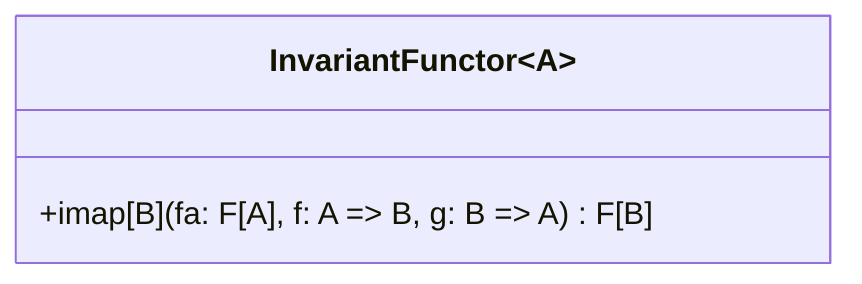

# Инвариантный функтор

**Инвариантный функтор** — это концепция из теории категорий и функционального программирования, 
которая обобщает идею функтора, но с дополнительными ограничениями. 
В отличие от [ковариантного функтора](functor.md), сохраняющего направление морфизмов (функций), 
или [контравариантного функтора](contravariant-functor.md), который обращает их, 
инвариантный функтор не предполагает сохранения или обращения направления. 
Вместо этого он позволяет работать с типами, которые могут быть преобразованы в обоих направлениях, 
но без явного сохранения структуры.

**Зачем нужен инвариантный функтор?**

Инвариантные функторы полезны в ситуациях, когда тип данных может быть преобразован как в одном направлении, 
так и в другом, но при этом не сохраняет структуру исходного типа. 
Они часто используются для работы с типами, которые не являются ни ковариантными, ни контравариантными, 
но всё же требуют некоторой формы функционального отображения.

**Примеры инвариантных функторов**

- **Тип данных, представляющий кодек (кодировщик/декодировщик):**
  Предположим, у нас есть тип данных, который может как кодировать значение в строку, так и декодировать строку обратно в значение. 
  Такой тип данных может быть инвариантным функтором.
- **Тип данных, представляющий изоморфизм:**
  Изоморфизм — это пара функций, которые могут преобразовывать значения между двумя типами в обоих направлениях.
- **Тип данных, представляющий парсер и принтер:**
  В некоторых библиотеках для работы с парсерами и принтерами используется инвариантный функтор для преобразования между типами.

## Формальное определение

Инвариантный функтор поддерживает операцию `imap` (или `xmap`), 
которая преобразует `F[A]` в `F[B]` с учетом двух функций: `A => B` и `B => A`. 

Если [функтор](functor.md) 
создает новые экземпляры класса типов, добавляя функцию в конец цепочки преобразований, 
а [контравариантный функтор](contravariant-functor.md) 
создает их, добавляя функцию в начало цепочки преобразований, 
то инвариантный функтор создает новые экземпляры класса типов с помощью пары двунаправленных преобразований.

Инвариантный функтор должен удовлетворять двум законам:

- Тождественность (identity): Если определен такой метод `identity`, что: `identity(a) == a`,
  тогда `imap(ma)(identity, identity) == ma`.
- Композиция (composition): `imap(imap(ma, f1, g1), f2, g2) == imap(ma, f2 compose f1, g1 compose g2)`

> Также известен как экспоненциальный функтор.

## Код

```dotty
trait InvariantFunctor[F[_]]:
  extension [A](fa: F[A])
    def imap[B](f: A => B, g: B => A): F[B]
```

### Законы

- Закон тождественности утверждает, что применение тождественного преобразования к значению инвариантного функтора 
  не изменяет это значение. Формально это выражается так: `inf.imap(fa)(identity, identity) == fa`
- Закон композиции утверждает, что последовательное применение двух инвариантных отображений эквивалентно одному отображению, 
  которое является композицией этих двух отображений. Формально это выражается так:
  `inf.imap(inf.imap(fa)(f, fReverse))(g, gReverse) == inf.imap(fa)(g compose f, fReverse compose gReverse)`

## Упражнения

### Упражнение 2.1.1: Invariant-отображение для изоморфизма

> [Репозиторий с упражнениями и инструкцией по выполнению][sample]

Реализуйте экземпляр `InvariantFunctor` для типа `Iso[A, C]` (`case class Iso[A, B](to: A => B, from: B => A)`)
с фиксированным правым типом `C`.
Это позволит инвариантно преобразовывать левую часть изоморфизма с помощью пары функций `f: A => B` и `g: B => A`.

```dotty
given invarFunctor[C]: InvariantFunctor[[x] =>> Iso[x, C]] with
  extension [A](iso: Iso[A, C])
    def imap[B](f: A => B, g: B => A): Iso[B, C] =
      ???
```

@:note(🔍 Показать решение)

Решение заключается в правильной реализации методов `to` и `from` для результирующего `Iso[B, C]`.
Метод `to` преобразует значение типа `B` в `C`: сначала с помощью функции `g` преобразуем `B` в `A`,
затем используем исходный `iso.to` для получения `C`. Метод `from` преобразует `C` обратно в `B`:
сначала исходный `iso.from` преобразует `C` в `A`, затем функция `f` преобразует `A` в `B`.
Таким образом, мы сохраняем свойства изоморфизма, применяя функции преобразования с обеих сторон.

```dotty
given invarFunctor[C]: InvariantFunctor[[x] =>> Iso[x, C]] with
  extension [A](iso: Iso[A, C])
    def imap[B](f: A => B, g: B => A): Iso[B, C] =
      Iso(
        to = (b: B) => iso.to(g(b)),
        from = (c: C) => f(iso.from(c))
      )
```

@:@

### Упражнение 2.1.2: Invariant-отображение для Codec.

Реализуйте экземпляр `InvariantFunctor` для типа `Codec`
(`case class Codec[A](encode: A => String, decode: String => Either[String, A])`), 
который позволяет преобразовывать кодировщик/декодировщик для одного типа в кодировщик/декодировщик для другого типа:

```dotty
given InvariantFunctor[Codec] with
  extension [A](codec: Codec[A])
    def imap[B](f: A => B, g: B => A): Codec[B] =
      ???
```

@:note(🔍 Показать решение)

Решение заключается в правильной реализации методов `encode` и `decode` для результирующего `Codec[B]`.
При кодировании значения типа `B` мы сначала преобразуем его в `A` с помощью функции `g`,
затем используем исходный `encode` исходного `codec`. При декодировании строки мы сначала
декодируем её в `A`, а затем преобразуем результат в `B` с помощью функции `f`,
применяя её к значению внутри `Either` через `map`.

```dotty
given InvariantFunctor[Codec] with
  extension [A](codec: Codec[A])
    def imap[B](f: A => B, g: B => A): Codec[B] =
      Codec(
        encode = (b: B) => codec.encode(g(b)),
        decode = (s: String) => codec.decode(s).map(f)
      )
```

@:@

## Инвариантный экземпляр для `Semigroup`

Предположим, что у нас есть `Semigroup[Long]`, 
который представляет стандартную временную метку UNIX (количество миллисекунд с начала эпохи). 
Мы хотим создать `Semigroup[Date]`, **переиспользуя** уже существующий `Semigroup[Long]`. 
Казалось бы, простая задача, но на самом деле она демонстрирует фундаментальное ограничение [функторов](functor.md) 
и необходимость использования **инвариантного функтора**.

### Часть 1: `Semigroup` не образует ковариантный функтор

[Ковариантный функтор](functor.md) (`Functor`) позволяет применять функцию `A => B` к значению внутри контекста `F[A]`, получая `F[B]`. 
Если бы [`Semigroup`](../monoid/semigroup.md) имел экземпляр `Functor`, 
мы могли бы использовать `map` для преобразования `Semigroup[Long]` в `Semigroup[Date]` с помощью функции `longToDate: Long => Date`:

```dotty
import java.util.Date

// Функция преобразования Long в Date
def longToDate: Long => Date = new Date(_)
```

Представьте, что мы пытаемся получить `Semigroup[Date]` на основе `Semigroup[Long]` с помощью `map`. У нас есть:

1. **`Semigroup[Long]`** — умеет комбинировать два `Long` (складывать их).
2. **`longToDate: Long => Date`** — умеет преобразовывать `Long` в `Date`.
3. **Два значения типа `Date`** — которые мы хотим объединить.

Проблема заключается в том, что `Semigroup[Date]` должен уметь объединять два `Date`. 
Но у нас есть только способ превратить `Long` в `Date`, а не наоборот. 
Как мы можем объединить два `Date`, если наша операция `combine` работает с `Long`?

Таким образом, `map` с `longToDate` не даёт нам `Semigroup[Date]`. 
`Functor` позволяет только преобразовывать результат (выход), но не входные данные.

> **`Semigroup` не образует ковариантный функтор**, 
> потому что для комбинирования значений типа `Date` нам нужна возможность 
> преобразовывать `Date` обратно в `Long` перед применением операции.

### Часть 2: `Semigroup` не образует контравариантный функтор

[Контравариантный функтор](contravariant-functor.md) (`Contravariant`) работает в обратном направлении: 
он позволяет применять функцию `B => A` к контексту `F[A]`, получая `F[B]`. 
Если бы `Semigroup` имел экземпляр `Contravariant`, 
мы могли бы использовать `contramap` для преобразования `Semigroup[Long]` в `Semigroup[Date]` 
с помощью функции `dateToLong: Date => Long`:

```dotty
import java.util.Date

// Функция преобразования Date в Long
def dateToLong: Date => Long = _.getTime
```

Теперь у нас есть способ преобразовывать `Date` в `Long` перед объединением. Давайте посмотрим, что произойдёт:

```
Шаг 1: Есть два значения: d1: Date, d2: Date
Шаг 2: Преобразуем их в Long: l1 = dateToLong(d1), l2 = dateToLong(d2)
Шаг 3: Объединяем Long: l = combineLong(l1, l2)
Шаг 4: Получаем результат типа Long: l
Шаг 5: Нужно получить Date, но у нас нет способа превратить Long обратно в Date!
       (у нас есть только dateToLong, но не longToDate)
Шаг 6: Невозможно получить Date из результата
```

`Contravariant` позволяет только преобразовывать входные данные (перед применением), но не выходные данные. 
Мы можем получить `Long`, но не можем превратить его в `Date`.

> **`Semigroup` не образует контравариантный функтор**, потому что после комбинирования мы получаем `Long`, 
> а нам нужен `Date`, и у нас нет функции преобразования обратно.

### Часть 3: `Semigroup` образует инвариантный функтор

Из предыдущего обсуждения следует, что нам нужны **обе** возможности:

- **`map`** (из ковариантного `Functor`) — чтобы преобразовывать результат (выходные данные).
- **`contramap`** (из контравариантного `Contravariant`) — чтобы преобразовывать входные данные.

Давайте применим `imap` к нашей задаче. У нас есть `Semigroup[Long]`, и мы хотим получить `Semigroup[Date]`. Нам нужны две функции:

1. **`longToDate: Long => Date`** — для преобразования результата (ковариантная часть).
2. **`dateToLong: Date => Long`** — для преобразования входных данных (контравариантная часть).

Схема работы `imap` для `Semigroup`:

```
Вход: два значения типа Date: d1, d2

1. Применяем g (dateToLong) к входным данным:
   l1 = dateToLong(d1)
   l2 = dateToLong(d2)

2. Используем Semigroup[Long].combine:
   l = combineLong(l1, l2)

3. Применяем f (longToDate) к результату:
   result = longToDate(l)

Выход: значение типа Date
```

Таким образом, мы сначала преобразуем входные `Date` в `Long` (контравариантная часть), 
затем комбинируем их с помощью существующей операции для `Long`, 
и наконец преобразуем результат обратно в `Date` (ковариантная часть).

#### Реализация

```dotty
import java.util.Date
import cats.*
import cats.syntax.all.*

// Функции преобразования
def longToDate: Long => Date = new Date(_)
def dateToLong: Date => Long = _.getTime

// Создаём Semigroup[Date] из Semigroup[Long] с помощью imap
given Semigroup[Date] =
  Semigroup[Long].imap(longToDate)(dateToLong)
```

Теперь у нас есть полноценный `Semigroup[Date]`, который можно использовать:

```dotty
val today: Date = longToDate(1449088684104L) // примерно 2 декабря 2015 года
val timeLeft: Date = longToDate(1900918893L) // некоторое дополнительное время

// Объединяем два значения с помощью Semigroup[Date]
val combined = today |+| timeLeft
// Результат: Date, представляющий сумму двух временных меток
```

**Что здесь происходит?**

```
1. dateToLong(today) → 1449088684104L
2. dateToLong(timeLeft) → 1900918893L
3. Semigroup[Long].combine(1449088684104L, 1900918893L) → 1450989602997L
4. longToDate(1450989602997L) → Date, представляющий новую временную метку
```

### Биекция

**На практике `imap` для `Semigroup` используется для создания новых экземпляров `Semigroup` на основе существующих, 
когда есть биекция (взаимно-однозначное соответствие) между типами.** 
Например, если у вас есть `Semigroup[Long]` и вы хотите получить `Semigroup[Date]`, 
зная, что `UUID` можно преобразовать в строку и обратно.

### Упражнение 2.1.3: Реализация инвариантного функтора для Monoid

Заполните пропуски (`???`) в реализации метода `imap` так, чтобы он корректно преобразовывал моноид из типа `A` в тип `B`.

```dotty
given InvariantFunctor[Monoid] with
  extension [A](fa: Monoid[A])
    def imap[B](f: A => B, g: B => A): Monoid[B] =
      ???
```

@:note(🔍 Показать решение)

Нейтральный элемент `empty` для типа `B` получается путём преобразования нейтрального элемента исходного моноида 
из типа `A` в тип `B` с помощью функции `f`. 

Операция `combine` для типа `B` работает следующим образом: 
сначала оба входных значения преобразуются из `B` в `A` с помощью функции `g`, 
затем применяется исходная операция `combine` для типа `A`, 
и наконец результат преобразуется обратно в `B` с помощью функции `f`. 
Таким образом, мы сохраняем семантику исходного моноида, адаптируя её к новому типу.

```dotty
given InvariantFunctor[Monoid] with
  extension [A](fa: Monoid[A])
    def imap[B](f: A => B, g: B => A): Monoid[B] =
      new Monoid[B]:
        val empty: B = f(fa.empty)

        def combine(x: B, y: B): B = f(fa.combine(g(x), g(y)))
```

@:@

## Схема



---

**Ссылки:**

- [Ссылка на репозиторий с упражнениями][sample]
- [Cats](https://typelevel.org/cats/typeclasses/invariant.html)
- [Scala with Cats](https://scalawithcats.com/dist/scala-with-cats.html#sec:functors:invariant)
- [Scalaz API](https://javadoc.io/static/org.scalaz/scalaz-core_3/7.3.6/scalaz/InvariantFunctor.html)

[sample]: https://gitverse.ru/scalabook/typeclasses
