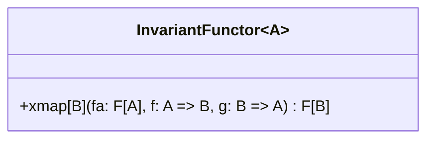

# Инвариантный функтор

**Инвариантный функтор** — это концепция из теории категорий и функционального программирования, 
которая обобщает идею функтора, но с дополнительными ограничениями. 
В отличие от [ковариантного функтора](functor.md), сохраняющего направление морфизмов (функций), 
или [контравариантного функтора](contravariant-functor.md), который обращает их, 
инвариантный функтор не предполагает сохранения или обращения направления. 
Вместо этого он позволяет работать с типами, которые могут быть преобразованы в обоих направлениях, 
но без явного сохранения структуры.

**Зачем нужен инвариантный функтор?**

Инвариантные функторы полезны в ситуациях, когда тип данных может быть преобразован как в одном направлении, 
так и в другом, но при этом не сохраняет структуру исходного типа. 
Они часто используются для работы с типами, которые не являются ни ковариантными, ни контравариантными, 
но всё же требуют некоторой формы функционального отображения.

**Примеры инвариантных функторов**

- **Тип данных, представляющий кодек (кодировщик/декодировщик):**
  Предположим, у нас есть тип данных, который может как кодировать значение в строку, так и декодировать строку обратно в значение. 
  Такой тип данных может быть инвариантным функтором.
- **Тип данных, представляющий изоморфизм:**
  Изоморфизм — это пара функций, которые могут преобразовывать значения между двумя типами в обоих направлениях.
- **Тип данных, представляющий парсер и принтер:**
  В некоторых библиотеках для работы с парсерами и принтерами используется инвариантный функтор для преобразования между типами.

## Формальное определение

Инвариантный функтор поддерживает операцию `xmap` (или `imap`), 
которая преобразует `F[A]` в `F[B]` с учетом двух функций: `A => B` и `B => A`. 

Если [функтор](functor.md) 
создает новые экземпляры класса типов, добавляя функцию в конец цепочки преобразований, 
а [контравариантный функтор](contravariant-functor.md) 
создает их, добавляя функцию в начало цепочки преобразований, 
то инвариантный функтор создает новые экземпляры класса типов с помощью пары двунаправленных преобразований.

Инвариантный функтор должен удовлетворять двум законам:

- Тождественность (identity): Если определен метод идентификации `identity` такой, что: `identity(a) == a`,
  тогда `xmap(ma)(identity, identity) == ma`.
- Композиция (composition): `xmap(xmap(ma, f1, g1), f2, g2) == xmap(ma, f2 compose f1, g1 compose g2)`

> Также известен как экспоненциальный функтор.

## Код

```dotty
trait InvariantFunctor[F[_]]:
  extension [A](fa: F[A])
    def xmap[B](f: A => B, g: B => A): F[B]
```

### "Обертка"

```dotty
type Id[A] = A
object Id:
  def apply[A](a: A): Id[A] = a

given InvariantFunctor[Id] with
  extension [A](fa: Id[A])
    def xmap[B](f: A => B, g: B => A): Id[B] = Id(f(fa))
```

Докажем, что `Id` удовлетворяет законам инвариантного функтора.

- тождественность: `xmap(ma)(identity, identity) == ma`
    - по определению метода `xmap` получим: `Id(a).xmap(identity, identity) == Id(identity(a)) == Id(a)`
- композиция: `xmap(xmap(ma, f1, g1), f2, g2) == xmap(ma, f2 compose f1, g1 compose g2)`
    - по определению метода `xmap` получим:
      `Id(a).xmap(f1, g1).xmap(f2, g2) == Id(f1(a)).xmap(f2, g2) == Id(f2(f1(a)))` 
      и `Id(a).xmap(f2 compose f1, g1 compose g2) == Id(f2(f1(a)))`

### Codec

Зачастую инвариантный функтор используется в кодеках, кодирующих и декодирующих строки.

```dotty
case class Codec[A](encode: A => String, decode: String => Either[String, A])

given InvariantFunctor[Codec] with
  extension [A](codec: Codec[A])
    def xmap[B](f: A => B, g: B => A): Codec[B] =
      Codec(
        encode = (b: B) => codec.encode(g(b)),
        decode = (s: String) => codec.decode(s).map(f)
      )
```

Докажем, что `Codec` удовлетворяет законам инвариантного функтора.

- тождественность: `xmap(ma)(identity, identity) == ma`
    - по определению метода `xmap` получим: `fa.xmap(identity, identity) ==`
      ```dotty
      encode: A => String = fa.encode(identity(value)) = fa.encode(value)
      decode: String => Either[String, A] = fa.decode(value).map(identity) = = fa.decode(value)
      ```
      Это эквивалентно исходному `codec` (в случае использования чистых функций).
- композиция: `xmap(xmap(ma, f1, g1), f2, g2) == xmap(ma, f2 compose f1, g1 compose g2)`
    - по определению метода `xmap` получим `xmap(xmap(ma, f1, g1), f2, g2) ==`:
        ```dotty
        encode: A => String = fb.encode(g2(value)) = fa.encode(g1(g2(value)))
        decode: String => Either[String, A] = fb.decode(value).map(f2) = fa.decode(value).map(f1).map(f2)
        ```
        `xmap(ma, f2 compose f1, g1 compose g2) ==`:
        ```dotty
        encode: A => String = fa.encode((g1 compose g2)(value)) = fa.encode(g1(g2(value)))
        decode: String => Either[String, A] = fa.decode(value).map(f2 compose f1) = fa.decode(value).map(f1).map(f2)
        ```

### Iso

Изоморфизм — это пара функций, которые могут преобразовывать значения между двумя типами в обоих направлениях.

```dotty
case class Iso[A, B](to: A => B, from: B => A)

given invarFunctor[C]: InvariantFunctor[[x] =>> Iso[x, C]] with
  extension [A](iso: Iso[A, C])
    def xmap[B](f: A => B, g: B => A): Iso[B, C] =
      Iso(
        to = (b: B) => iso.to(g(b)),
        from = (i: C) => f(iso.from(i))
      )
```

Здесь `xmap` позволяет преобразовать изоморфизм для типа `A` в изоморфизм для типа `B`, используя функции `f: A => B` и `g: B => A`.

### ParserPrinter

**Тип данных, представляющий парсер и принтер:**

В некоторых библиотеках для работы с парсерами и принтерами используется инвариантный функтор для преобразования между типами.

```dotty
case class ParserPrinter[A](
    parse: String => Either[String, A],
    print: A => String
)

given InvariantFunctor[ParserPrinter] with
  extension [A](pp: ParserPrinter[A])
    def xmap[B](f: A => B, g: B => A): ParserPrinter[B] =
      ParserPrinter(
        parse = (s: String) => pp.parse(s).map(f),
        print = (b: B) => pp.print(g(b))
      )
```

### Законы

- Закон тождественности утверждает, что применение тождественного преобразования к значению инвариантного функтора 
  не изменяет это значение. Формально это выражается так: `inf.xmap(fa)(identity, identity) == fa`
- Закон композиции утверждает, что последовательное применение двух инвариантных отображений эквивалентно одному отображению, 
  которое является композицией этих двух отображений. Формально это выражается так:
  `inf.xmap(inf.xmap(fa)(f, fReverse))(g, gReverse) == inf.xmap(fa)(g compose f, fReverse compose gReverse)`

```dotty
def checkXMapIdentityLaw[F[_], A](fa: F[A])(using
    inf: InvariantFunctor[F]
): ValidatedNel[String, Unit] =
  Either.cond[String, Unit](
    inf.xmap(fa)(identity, identity) == fa,
    (),
    "Не соблюдается тождественность: xmap(ma)(identity, identity) == ma"
  ).toValidatedNel

def checkXMapСompositionLaw[F[_], A, B, C](fa: F[A])(using
    inf: InvariantFunctor[F],
    f: A => B,
    fReverse: B => A,
    g: B => C,
    gReverse: C => B
): ValidatedNel[String, Unit] =
  Either.cond[String, Unit](
    inf.xmap(inf.xmap(fa)(f, fReverse))(g, gReverse) ==
      inf.xmap(fa)(g compose f, fReverse compose gReverse),
    (),
    "Не соблюдается композиция: xmap(xmap(ma, f1, g1), f2, g2) == xmap(ma, f2 compose f1, g1 compose g2)"
  ).toValidatedNel
```

## Схема



---

**Ссылки:**

- [Cats](https://typelevel.org/cats/typeclasses/invariant.html)
- [Scala with Cats](https://www.scalawithcats.com/dist/scala-with-cats.html#sec:functors:invariant)
- [Scalaz API](https://javadoc.io/static/org.scalaz/scalaz-core_3/7.3.6/scalaz/InvariantFunctor.html)
