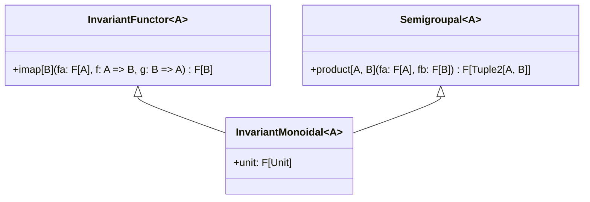



# Invariant Monoidal

## Инвариантный моноид

`InvariantMonoidal` — это класс типов, который объединяет возможности [`InvariantFunctor`](invariant-functor.md) 
(инвариантного функтора) и [`Semigroupal`](semigroupal.md) (полугруппового комбинатора), добавляя метод `unit`. 
В изолированном виде этот класс типов можно определить следующим образом:

```dotty
trait InvariantSemigroupal[F[_]] extends Semigroupal[F] with InvariantFunctor[F]

trait InvariantMonoidal[F[_]] extends InvariantSemigroupal[F]:
  def unit: F[Unit]
  
  /** `point` lifts any value into a Monoidal Functor. */
  def point[A](a: A): F[A] = unit.imap(_ => a, _ => ())
```

`InvariantMonoidal` позволяет работать с типами, которые:

1. **Могут быть преобразованы** с помощью `imap` (инвариантное отображение).
2. **Могут комбинироваться** с помощью `product` (объединение двух значений в пару).
3. **Имеют нейтральный элемент** `unit` (единичное значение).

Практическое применение `InvariantMonoidal` встречается в контексте **кодеков** — интерфейсов, 
которые одновременно захватывают сериализацию и десериализацию для некоторого формата. 
Другой известный пример — [`Semigroup`](../monoid/semigroup.md).

## `Semigroup` как `InvariantMonoidal`

### `Semigroup` — инвариантный функтор

Как объяснялось в [руководстве по `InvariantFunctor`](invariant-functor.md), `Semigroup` образует инвариантный функтор. 
Действительно, имея `Semigroup[A]` и две функции `A => B` и `B => A`, можно построить `Semigroup[B]` следующим образом:

1. Преобразуем два значения типа `B` в тип `A` с помощью `g: B => A`.
2. Комбинируем их с помощью `Semigroup[A].combine`.
3. Преобразуем результат обратно в тип `B` с помощью `f: A => B`.

### Реализация `unit` и `product` для `Semigroup`

Чтобы определить `InvariantMonoidal[Semigroup]`, нам нужны реализации `unit` и `product`.

**`unit: Semigroup[Unit]`** — тривиальный моноид для типа `Unit`:

```dotty
def unit: Semigroup[Unit] = (_, _) => ()
```

Операция `combine` для `Unit` всегда возвращает `()`, поскольку это единственное значение этого типа.

**`product: Semigroup[(A, B)]`** — комбинирует две полугруппы для типов `A` и `B` в одну полугруппу для пары `(A, B)`:

```dotty
def product[A, B](fa: Semigroup[A], fb: Semigroup[B]): Semigroup[(A, B)] =
  case ((xa, xb), (ya, yb)) => fa.combine(xa, ya) -> fb.combine(xb, yb)
```

Логика работы:

1. Разбираем две пары на компоненты: `(xa, xb)` и `(ya, yb)`.
2. Комбинируем первые компоненты с помощью `fa.combine(xa, ya)`.
3. Комбинируем вторые компоненты с помощью `fb.combine(xb, yb)`.
4. Собираем результаты в новую пару.

### Практический пример: создание `Semigroup` для case-класса

Имея экземпляр `InvariantMonoidal` для `Semigroup`, 
мы можем комбинировать существующие экземпляры `Semigroup` для создания нового с помощью синтаксиса `Semigroupal`:

```dotty
import cats.syntax.all.*

// Определяем case-класс
case class Foo(a: String, c: List[Double])

// Создаём Semigroup для Foo, комбинируя Semigroup[String] и Semigroup[List[Double]]
given Semigroup[Foo] =
  (summon[Semigroup[String]], summon[Semigroup[List[Double]]])
    .imapN(Foo.apply)(foo => (foo.a, foo.c))
```

**Что здесь происходит?**

1. `(summon[Semigroup[String]], summon[Semigroup[List[Double]]])` — создаёт кортеж из двух полугрупп.
2. `.imapN(Foo.apply)(foo => (foo.a, foo.c))` — использует `InvariantMonoidal` для:
    - Преобразования пары значений `(String, List[Double])` в `Foo` с помощью конструктора `Foo.apply`.
    - Преобразования `Foo` обратно в пару с помощью `foo => (foo.a, foo.c)`.

**Проверка работы:**

```dotty
Foo("Hello", List(0.0)) |+| Foo("World", Nil) |+| Foo("!", List(1.1, 2.2))
// Результат: Foo("HelloWorld!", List(0.0, 1.1, 2.2))
```

Здесь строки конкатенируются, а списки объединяются — именно так, как работают их соответствующие полугруппы.

## `CsvCodec` как `InvariantMonoidal`

### Определение `CsvCodec`

Мы определяем `CsvCodec` — класс типов для сериализации и десериализации строк CSV:

```dotty
type CSV = List[String]

trait CsvCodec[A]:
  def read(s: CSV): (Option[A], CSV)
  def write(a: A): CSV
```

- **`read`** — потребляет колонки из строки CSV, возвращает опциональное значение и оставшуюся часть CSV (непрочитанные колонки).
- **`write`** — создаёт CSV-представление для заданного значения.

### Закон для `CsvCodec`

Группировка сериализации и десериализации в одном классе типов позволяет определить закон, гарантирующий согласованность операций:

```dotty
forAll { (c: CsvCodec[A], a: A) => c.read(c.write(a)) == ((Some(a), List()))
```

Этот закон утверждает, что если мы сериализуем значение `a` и затем десериализуем полученный CSV, 
мы должны получить исходное значение `a`.

### Реализация `InvariantMonoidal` для `CsvCodec`

Теперь посмотрим, как определить экземпляр `InvariantMonoidal` для `CsvCodec`.

#### `unit` — тривиальный кодек для `Unit`

Поднимаем единичное значение в кодек «тривиальным способом»: ничего не потребляем из CSV и всегда возвращаем `()`, 
а при записи возвращаем пустой CSV:

```dotty
def unit: CsvCodec[Unit] = new CsvCodec[Unit]:
  def read(s: CSV): (Option[Unit], CSV) = (Some(()), s)
  def write(u: Unit): CSV               = List.empty
```

#### `product` — комбинация двух кодеков

Объединяем два кодекса для типов `A` и `B` в один кодек для пары `(A, B)`:

```dotty
def product[A, B](fa: CsvCodec[A], fb: CsvCodec[B]): CsvCodec[(A, B)] =
  new CsvCodec[(A, B)]:
    def read(s: CSV): (Option[(A, B)], CSV) =
      // Сначала читаем A
      val (maybeA, s1) = fa.read(s)
      // Затем читаем B из оставшейся части
      val (maybeB, s2) = fb.read(s1)
      // Если оба чтения успешны — объединяем в пару
      val maybePair =
        for
          a <- maybeA
          b <- maybeB
        yield a -> b

      (maybePair, s2)

    def write(a: (A, B)): CSV =
      fa.write(a._1) ++ fb.write(a._2)
```

Логика работы:

- **Чтение:** последовательно читаем `A`, затем `B`. Если оба успешны — возвращаем `Some((a, b))`, иначе — `None`.
- **Запись:** записываем `A`, затем `B` и объединяем результаты.

#### `imap` — инвариантное преобразование

Преобразуем `CsvCodec[A]` в `CsvCodec[B]` с помощью двух функций:

```dotty
extension [A](fa: CsvCodec[A])
  def imap[B](f: A => B, g: B => A): CsvCodec[B] =
    new CsvCodec[B]:
      def read(s: CSV): (Option[B], CSV) =
        val (a1, s1) = fa.read(s)
        (a1.map(f), s1) // Преобразуем результат после десериализации

      def write(a: B): CSV =
        fa.write(g(a)) // Преобразуем входные данные перед сериализацией
```

#### Сборка всего вместе

```dotty
given InvariantMonoidal[CsvCodec] with
  def unit: CsvCodec[Unit] = ...

  def product[A, B](fa: CsvCodec[A], fb: CsvCodec[B]): CsvCodec[(A, B)] =
    ...

  extension [A](fa: CsvCodec[A])
    def imap[B](f: A => B, g: B => A): CsvCodec[B] =
      ...
```

### Практический пример: использование `CsvCodec`

Определим несколько базовых кодеков:

**Кодек для `String`:**

```dotty
val stringCodec: CsvCodec[String] =
  new CsvCodec[String]:
    def read(s: CSV): (Option[String], CSV) = (s.headOption, s.drop(1))

    def write(a: String): CSV = List(a)
```

**Кодек для чисел в разных системах счисления:**

```dotty
def numericSystemCodec(base: Int): CsvCodec[Int] =
  new CsvCodec[Int]:
    def read(s: CSV): (Option[Int], CSV) =
      (
        s.headOption.flatMap: head =>
          scala.util.Try(Integer.parseInt(head, base)).toOption,
        s.drop(1)
      )

    def write(a: Int): CSV =
      List(Integer.toString(a, base))
```

**Комбинирование кодеков для case-классов:**

```dotty
case class BinDec(binary: Int, decimal: Int)

val binDecCodec: CsvCodec[BinDec] = (
  (numericSystemCodec(2), numericSystemCodec(10))
    .imapN(BinDec.apply)(bindec => (bindec.binary, bindec.decimal))
)

case class Foo(name: String, bd1: BinDec, bd2: BinDec)

val fooCodec: CsvCodec[Foo] = (
  (stringCodec, binDecCodec, binDecCodec)
    .imapN(Foo.apply)(foo => (foo.name, foo.bd1, foo.bd2))
)
```

**Проверка закона:**

```dotty
val foo = Foo("foo", BinDec(10, 10), BinDec(20, 20))

val fooCsv = fooCodec.write(foo)
// Результат: List("foo", "1010", "10", "10100", "20")

fooCodec.read(fooCsv)
// Результат: (Some(Foo("foo", BinDec(10, 10), BinDec(20, 20))), List())

fooCodec.read(fooCodec.write(foo)) == ((Some(foo), List()))
// true
```

## `InvariantMonoidal` как обобщение `InvariantFunctor`

Чтобы лучше понять мотивацию создания `InvariantMonoidal`, покажем, как можно естественно прийти к его определению, 
обобщая концепцию инвариантного функтора. 
Это рассуждение аналогично тому, которое представлено в работе 
[Free Applicative Functors by Paolo Capriotti](http://www.paolocapriotti.com/assets/applicative.pdf), 
где показано, как [`Applicative`](applicative.md) является обобщением [`Functor`](functor.md).

### Проблема: `InvariantFunctor` работает только с унарными функциями

Имея экземпляр `InvariantFunctor[F]` для некоторого контекста `F[_]`, 
метод `imap` позволяет поднимать две _унарные_ чистые функции `A => B` и `B => A` в _контекстуализированные_ функции `F[A] => F[B]`.

Но что насчёт функций другой арности?

### Обобщение: `MultiInvariant`

Значение `a` типа `A` можно рассматривать как пару нульарных функций:

- Одна не принимает входных данных и возвращает `a`.
- Другая принимает `a` и ничего не возвращает.

Мы хотим поднять их в контекстуализированное `F[A]`.

Аналогично, имея две функции `(A, B) => C` и `C => (A, B)`, мы хотим контекстуализировать их как функции типа `(F[A], F[B]) => F[C]`.

Экземпляр `Invariant` сам по себе не предоставляет ни одного из этих поднятий. 
Поэтому естественно определить класс типов для обобщения `Invariant` на функции произвольной арности:

```dotty
trait MultiInvariant[F[_]]:
  def imap0[A](a: A): F[A]
  def imap1[A, B](f: A => B)(g: B => A)(fa: F[A]): F[B]
  def imap2[A, B, C](f: ((A, B)) => C)(g: C => (A, B))(fa: F[A], fb: F[B]): F[C]
```

### Определение `imapN` через `imap2`

Более высокие арности `imapN` могут быть определены через `imap2`. Например, для `N = 3`:

```dotty
trait MultiInvariantImap3[F[_]] extends MultiInvariant[F]:
  def imap3[A, B, C, D](
      f: ((A, B, C)) => D,
      g: D => (A, B, C),
      fa: F[A],
      fb: F[B],
      fc: F[C]
  ): F[D] = (
    imap2[A, (B, C), D](f compose { case (a, (b, c)) => (a, b, c) })(g andThen {
      case (a, b, c) => (a, (b, c))
    })(fa, imap2[B, C, (B, C)](identity)(identity)(fb, fc))
  )
```

### Эквивалентность `MultiInvariant` и `InvariantMonoidal`

Можно заметить, что `MultiInvariant` — это не что иное, как альтернативная формулировка `InvariantMonoidal`. 

Действительно:

```dotty
trait MultiInvariant[F[_]]:
  def imap0[A](a: A): F[A]
  def imap1[A, B](f: A => B)(g: B => A)(fa: F[A]): F[B]
  def imap2[A, B, C](f: ((A, B)) => C)(g: C => (A, B))(fa: F[A], fb: F[B]): F[C]
  
trait InvariantMonoidal[F[_]] extends InvariantSemigroupal[F]:
  def unit: F[Unit]  
  
  extension [A](fa: F[A])
    def imap[B](f: A => B, g: B => A): F[B]

  def product[A, B](fa: F[A], fb: F[B]): F[(A, B)]
```  
  
- `imap1` и `imap` отличаются только порядком аргументов.
- `imap2` может быть легко определен через `imap` и `product`:

```dotty
trait Imap2FromImapProduct[F[_]] extends InvariantMonoidal[F]:
  def imap2[A, B, C](f: ((A, B)) => C)(g: C => (A, B))(
      fa: F[A],
      fb: F[B]
  ): F[C] =
    product(fa, fb).imap(f, g)
```

Итого:

```dotty
trait MultiInvariantViaInvariantMonoidal[F[_]] extends InvariantMonoidal[F]:
  def imap0[A](a: A): F[A] =
    unit.imap(_ => a, _ => ())

  def imap1[A, B](f: A => B)(g: B => A)(fa: F[A]): F[B] =
    fa.imap(f, g)

  def imap2[A, B, C](f: ((A, B)) => C)(g: C => (A, B))(
      fa: F[A],
      fb: F[B]
  ): F[C] =
    product(fa, fb).imap(f, g)
```

### Вывод

`InvariantMonoidal` естественным образом возникает как обобщение `InvariantFunctor` на функции произвольной арности. 
Это позволяет работать с:

- **Нульарными функциями** (константами) через `unit`.
- **Унарными функциями** через `imap`.
- **Бинарными функциями** через `product` + `imap`.
- **Функциями произвольной арности** через комбинацию `product` и `imap` (синтаксис `imapN`).

## Схема



---

**Ссылки:**

- [Ссылка на репозиторий с упражнениями][sample]
- [Cats](https://typelevel.org/cats/typeclasses/invariantmonoidal.html)

[sample]: https://gitverse.ru/scalabook/typeclasses
