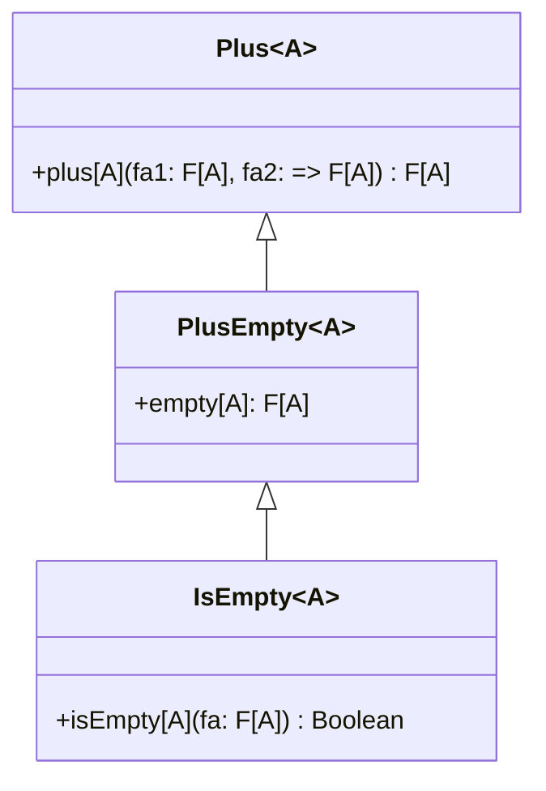



# IsEmpty

`IsEmpty` — это концепция из функционального программирования, которая расширяет [`PlusEmpty`](plus-empty.md), 
добавляя операцию проверки на "пустоту". 
Она позволяет определить, является ли значение в определённом контексте "пустым" 
(например, отсутствие значения, пустой список, неудачное вычисление и т.д.).

**Основные характеристики `IsEmpty`:**

- **Проверка на "пустоту"**:
  Операция `isEmpty` возвращает `true`, если значение является "пустым", и `false` в противном случае.
- **Связь с "пустым" значением**:
  "Пустое" значение (`empty[A]`) всегда должно быть распознано операцией `isEmpty` как "пустое".
- **Связь с операцией комбинирования**:
  Результат комбинирования двух значений с помощью `plus` (или `<+>`) является "пустым" только в том случае, 
  если оба исходных значения были "пустыми".

**Где применяется `IsEmpty`?**

`IsEmpty` используется в функциональном программировании для:

- **Обработки возможного отсутствия значений** (например, `Option`, `Either`).
- **Работы с множествами значений** (например, списки, множества).
- **Агрегации результатов вычислений** (например, в парсерах или валидаторах).
- **Управления "пустыми" состояниями** в различных контекстах.

**Примеры `IsEmpty`**

- **Списки (`List`)**.
  Представьте, что у вас есть список чисел. Операция `isEmpty` позволяет проверить, является ли список пустым. 
  Например, для списка `[1, 2, 3]` результат будет `false`, а для пустого списка `[]` — `true`. 
  Если вы комбинируете два списка с помощью `plus`, результат будет "пустым" только в том случае, если оба списка были пустыми.
- **`Option` (возможное отсутствие значения)**.
  Представьте, что у вас есть значение типа `Option`. 
  Операция `isEmpty` позволяет проверить, является ли значение `None` (отсутствие значения). 
  Например, для `Some(42)` результат будет `false`, а для `None` — `true`. 
  Если вы комбинируете два значения с помощью `plus`, результат будет "пустым" только в том случае, если оба значения были `None`.
- **Парсеры**.
  Представьте, что у вас есть парсер, который разбирает входные данные. Операция `isEmpty` позволяет проверить, 
  вернул ли парсер ошибку (что можно считать "пустым" результатом). 
  Если вы комбинируете два парсера с помощью `plus`, результат будет "пустым" только в том случае, если оба парсера вернули ошибку.
- **Валидаторы**.
  Представьте, что у вас есть валидатор, который проверяет корректность данных. 
  Операция `isEmpty` позволяет проверить, вернул ли валидатор ошибку (что можно считать "пустым" результатом). 
  Если вы комбинируете два валидатора с помощью `plus`, результат будет "пустым" только в том случае, если оба валидатора вернули ошибку.

## Формальное определение

`IsEmpty` - класс типов, позволяющий проверить, действительно ли какой-либо тип с пустым представлением является пустым.
Расширяет [`PlusEmpty`](plus-empty.md).

Законы `isEmpty` (помимо законов родителей) описывают, как должна вести себя операция проверки на "пустоту":

- **"Пустое" значение всегда должно быть распознано как "пустое"**:
  `isEmpty(empty[A]) = true`.
  Другими словами, если вы проверяете, является ли значение `empty[A]` "пустым", результат должен быть `true`.
- **Результат комбинирования двух значений является "пустым" только тогда, когда оба значения "пусты"**:
  `isEmpty(fa1) && isEmpty(fa2) == isEmpty(plus(fa1, fa2))`.
  `isEmpty` от композиции двух функторов равно `true` тогда и только тогда, когда `isEmpty` от каждого функтора - `true`: 
  Другими словами, если вы комбинируете два значения с помощью `plus`, 
  результат будет "пустым" только тогда, когда оба значения были "пустыми".

## Код

```dotty
trait IsEmpty[F[_]] extends PlusEmpty[F]:
  def isEmpty[A](fa: F[A]): Boolean
```

### Связанный список

```dotty
given IsEmpty[List] with
  override def isEmpty[A](fa: List[A]): Boolean = fa.isEmpty
  override def plus[A](fa1: List[A], fa2: => List[A]): List[A] = fa1 ++ fa2
  override def empty[A]: List[A] = List.empty[A]
```

### Законы

- **"Пустое" значение всегда должно быть распознано как "пустое"**: `isEmpty(empty[A]) = true`.
- **Результат комбинирования двух значений является "пустым" только тогда, когда оба значения "пусты"**:
  `isEmpty(fa1) && isEmpty(fa2) == isEmpty(plus(fa1, fa2))`.

```dotty
... // Законы PlusEmpty

def checkIsEmptyEmpty[F[_], A](using
    is: IsEmpty[F]
): ValidatedNel[String, Unit] =
  import is.*
  Either.cond[String, Unit](
    isEmpty(empty[A]),
    (),
    "\"Пустое\" значение всегда должно быть распознано как \"пустое\": isEmpty(empty[A])"
  ).toValidatedNel

def checkIsEmptyPair[F[_], A](fa1: F[A], fa2: F[A])(using
    is: IsEmpty[F]
): ValidatedNel[String, Unit] =
  import is.*
  Either.cond[String, Unit](
    (isEmpty(fa1) && isEmpty(fa2)) == isEmpty(plus(fa1, fa2)),
    (),
    "Результат комбинирования двух значений является \"пустым\" только тогда, когда оба значения \"пусты\": " +
      s"(isEmpty(fa1) && isEmpty(fa2)) == isEmpty(plus(fa1, fa2))"
  ).toValidatedNel
```

## Схема



## Реализация в библиотеках

### Реализация в ScalaZ

```dotty
import scalaz.*
import Scalaz.*

// ... Все операции родителей

summon[IsEmpty[List]].isEmpty(List.empty[Int]) // true
```

---

**Ссылки:**

- [Learning Scalaz](http://eed3si9n.com/learning-scalaz/MonadPlus.html)
- [Scalaz API](https://javadoc.io/doc/org.scalaz/scalaz-core_3/7.3.6/scalaz/IsEmpty.html)
