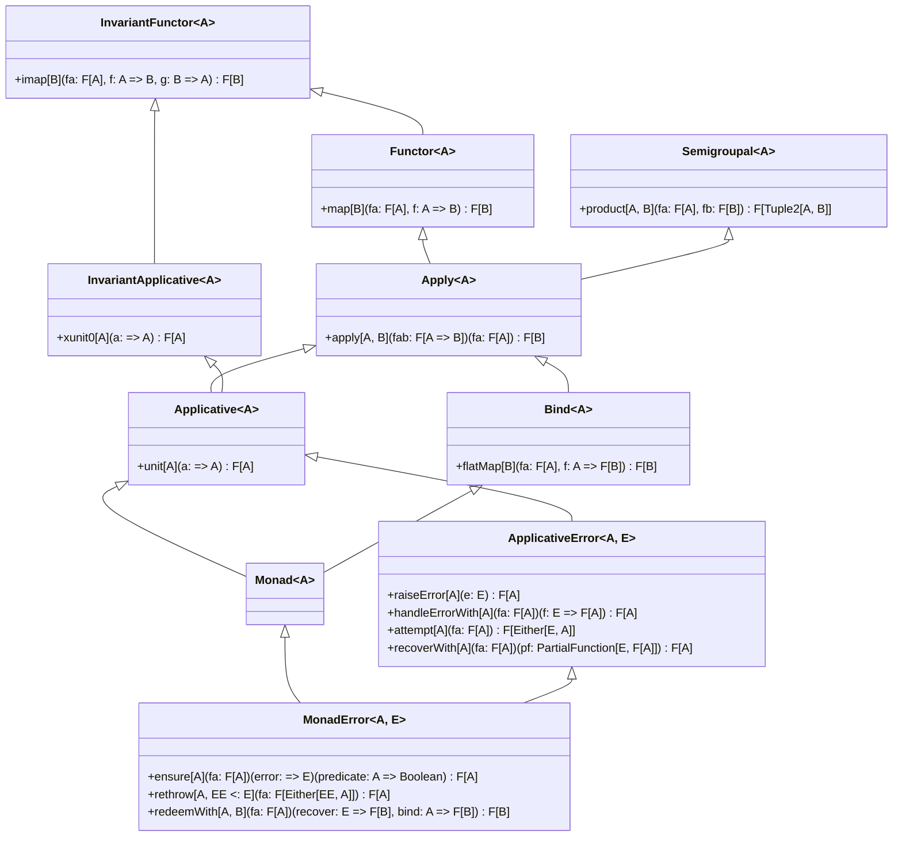



# MonadError

`MonadError` — это класс типов, который объединяет возможности [`Monad`](monad.md) и [`ApplicativeError`](applicative-error.md), 
добавляя монадические операции к контексту с ошибками. 
Если `ApplicativeError` позволяет создавать ошибки и обрабатывать их, 
то `MonadError` добавляет возможность последовательного связывания вычислений (`flatMap`) с учётом ошибок.

`MonadError` является основой для эффектных систем, поддерживающих обработку ошибок: `IO`, `Task`, `ZIO`, `EitherT` и других. 
Это одна из самых практичных абстракций в функциональном программировании.

**Параметры типа**

- **`F[_]`** — тип контекста (например, `IO`, `Either[E, *]`, `Try`, `Future`)
- **`E`** — тип ошибки (например, `Throwable`, `String`, пользовательский тип)

## Формальное определение

`MonadError` объединяет `Monad` и `ApplicativeError`, не добавляя новых примитивов, но предоставляя мощные производные комбинаторы:

```dotty
trait MonadError[F[_], E] extends ApplicativeError[F, E] with Monad[F]:
  def ensure[A](fa: F[A])(error: => E)(predicate: A => Boolean): F[A]

  def rethrow[A, EE <: E](fa: F[Either[EE, A]]): F[A]

  def redeemWith[A, B](fa: F[A])(recover: E => F[B], bind: A => F[B]): F[B]
```

## Производные комбинаторы

### `ensure` — проверка условия с ошибкой

```dotty
def ensure[A](fa: F[A])(error: => E)(predicate: A => Boolean): F[A] =
  flatMap(fa)(a => if predicate(a) then unit(a) else raiseError(error))
```

Проверяет успешный результат вычисления `fa` на соответствие предикату. 
Если предикат выполняется, результат остаётся неизменным. Если нет — вычисление заменяется на ошибку `error`.

**Use-case:** Валидация данных после запроса к базе данных или API.

### `rethrow` — переворачивание уровня ошибки

```dotty
def rethrow[A, EE <: E](fa: F[Either[EE, A]]): F[A] =
  flatMap(fa)(_.fold(raiseError, unit))
```

Превращает `F[Either[EE, A]]` в `F[A]`. 
Если внутри `Right(a)` — возвращает `unit(a)`. Если внутри `Left(e)` — возвращает `raiseError(e)`.

**Use-case:** Когда у вас есть эффект, который возвращает `Either` (например, результат парсинга), 
и вы хотите преобразовать ошибки парсинга в ошибки эффекта.

### `redeemWith` — универсальная обработка успеха и ошибки

```dotty
def redeemWith[A, B](fa: F[A])(recover: E => F[B], bind: A => F[B]): F[B] =
  flatMap(attempt(fa))(_.fold(recover, bind))
```

Позволяет обработать как успешный результат, так и ошибку, преобразуя их в новое вычисление `F[B]`. 
В отличие от `handleErrorWith`, здесь можно трансформировать и успешное значение.

**Use-case:** Трансформация ошибок, логирование, fallback-значения, сложная обработка обоих путей выполнения.

## Законы MonadError

`MonadError` наследует законы [`Monad`](monad.md) и [`ApplicativeError`](applicative-error.md) и добавляет законы для своих комбинаторов.

### Законы `ensure`

```dotty
ensure(unit(a))(error)(predicate) == if predicate(a) then unit(a) else raiseError(error)
```

**Простыми словами:** `ensure` на чистом значении либо оставляет его, либо заменяет на ошибку.

### Законы `rethrow`

```dotty
rethrow(unit(Right(a))) == unit(a)
rethrow(unit(Left(e))) == raiseError(e)
rethrow(raiseError(e)) == raiseError(e)
```

**Простыми словами:** `rethrow` правильно преобразует `Right` в успех, `Left` в ошибку, а ошибки внешнего уровня пробрасывает.

### Законы `redeemWith`

```dotty
redeemWith(unit(a))(recover, bind) == bind(a)
redeemWith(raiseError(e))(recover, bind) == recover(e)
```

**Простыми словами:** Для успеха применяется `bind`, для ошибки — `recover`.

## Схема



## Реализация в библиотеках

### Cats

```dotty
import cats.MonadError
import cats.effect.IO
import cats.implicits.*

val me = MonadError[IO, Throwable]

val success = me.pure(42)
val failure = me.raiseError[Int](new IllegalArgumentException("boom"))

val ensured =
  me.ensure(success)(new IllegalArgumentException("Must be positive"))(_ > 0)
val rethrown = me.rethrow[Int, IllegalArgumentException](IO(Right(42)))
val redeemed = me.redeemWith(success)(
  recover = e => me.pure(0),
  bind = a => me.pure(a * 2)
)
```

---

**Ссылки:**

- [Ссылка на репозиторий с упражнениями][sample]

[sample]: https://gitverse.ru/scalabook/typeclasses
