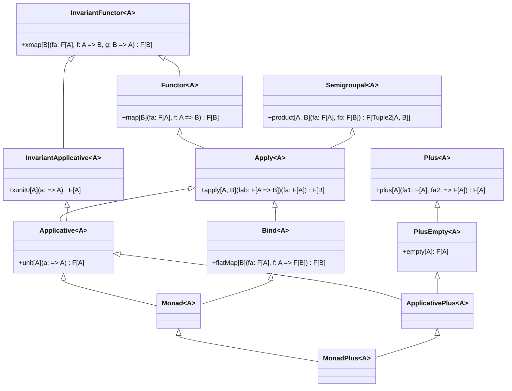



# MonadPlus

`MonadPlus` — это расширение концепции [монады](monad.md) в функциональном программировании,
которое добавляет две ключевые операции:

- **`empty`** — нейтральный элемент (или "пустое" значение) для операции комбинирования.
- **`plus`** (`combine` или `<+>`) — операция, которая позволяет комбинировать два значения в одном контексте.

`MonadPlus` объединяет возможности [монад](monad.md) (последовательные вычисления с контекстом) 
и [моноидов](../monoid/monoid.md) (операция комбинирования с нейтральным элементом). 
Это делает его мощным инструментом для работы с вычислениями, которые могут "проваливаться" или возвращать несколько результатов.

**Основные характеристики `MonadPlus`:**

- **Монадические вычисления**:
  Как и обычная монада, `MonadPlus` позволяет последовательно выполнять вычисления, 
  сохраняя контекст (например, обработку ошибок, асинхронность, состояние).
- **Комбинирование значений**:
  Операция `plus`, (`combine` или `<+>`) позволяет объединять два значения в одном контексте. 
  Например, два списка можно объединить в один, или два `Option` можно скомбинировать, выбирая первое существующее значение.
- **Пустое значение**:
  `empty` представляет нейтральный элемент для операции комбинирования. 
  Например, для списков это пустой список `[]`, для `Option` — `None`.

`MonadPlus` используется в функциональном программировании для:

- **Обработки возможного отсутствия значений** (например, `Option`, `Either`).
- **Комбинирования множеств значений** (например, списков, множеств).
- **Агрегации результатов вычислений** (например, в парсерах или валидаторах).
- **Работы с нейтральными элементами** в различных контекстах.

**Примеры `MonadPlus`**

- **Списки (`List`)**.
  Представьте, что у вас есть два списка: `[1, 2, 3]` и `[4, 5, 6]`. 
  `MonadPlus` позволяет объединить их в один список: `[1, 2, 3, 4, 5, 6]`. 
  Также можно работать с пустым списком `[]`, который является нейтральным элементом. 
  Например, объединение любого списка с пустым списком оставляет список неизменным.
- **`Option` (возможное отсутствие значения)**.
  Представьте, что у вас есть два значения типа `Option`: `Some(42)` и `None`. 
  `MonadPlus` позволяет выбрать первое существующее значение. Например, `Some(42) <+> None` вернёт `Some(42)`. 
  Пустым значением здесь является `None`, которое не изменяет результат при комбинировании.
- **Парсеры**.
  Представьте, что у вас есть два парсера: один разбирает числа, а другой — строки. 
  `MonadPlus` позволяет комбинировать результаты работы этих парсеров. 
  Например, если первый парсер не смог разобрать входные данные, второй парсер попытается это сделать. 
  Пустым значением здесь является парсер, который всегда возвращает ошибку.
- **Валидаторы**.
  Представьте, что у вас есть два валидатора: один проверяет, что строка не пустая, а другой — что строка содержит только буквы. 
  `MonadPlus` позволяет объединить результаты валидации. 
  Например, если первый валидатор вернул ошибку, второй валидатор всё равно будет выполнен, и все ошибки будут собраны вместе. 
  Пустым значением здесь является валидатор, который всегда возвращает успешный результат.

## Формальное определение

Класс типов `MonadPlus` предназначен для [монад](monad.md), 
которые также могут действовать как [моноиды](../monoid/monoid.md).

`MonadPlus` должен удовлетворять законам монад и моноидов, а также:

- Закон сохранения нейтрального элемента при `map`: `empty[A].map(_ => fa) == empty[A]`.
  Этот закон утверждает, что применение функции к "пустому" значению (`empty[A]`) с помощью `map` не изменяет его.
  Независимо от того, какую функцию вы применяете к `empty[A]`, результат всегда останется `empty[A]`.
- Закон сохранения нейтрального элемента при `flatMap`: `empty[A].flatMap(_ => fa) == empty[A]`.
  Этот закон утверждает, что применение функции к "пустому" значению (`empty[A]`) с помощью `flatMap` также не изменяет его.
  Независимо от того, какую функцию вы передаёте в `flatMap`, результат всегда останется `empty[A]`.
- Закон замыкания нейтрального элемента: `fa.flatMap(_ => empty[A]) == empty[A]`.
  Этот закон утверждает, что если в цепочке вычислений встречается `empty[A]`, то всё дерево вычислений "схлопывается" в `empty[A]`.
  Другими словами, если вы вызываете `flatMap` на значении `fa` и передаёте функцию, которая возвращает `empty[A]`,
  то результат всего выражения будет `empty[A]`.

Эти законы `MonadPlus` описывают, как "пустое" значение (`empty[A]`) должно вести себя в контексте монадических вычислений.
Они гарантируют, что:

- `empty[A]` остаётся неизменным при применении функций с помощью `map`.
- `empty[A]` остаётся неизменным при применении функций с помощью `flatMap`.
- Если в цепочке вычислений встречается `empty[A]`, то всё дерево вычислений "схлопывается" в `empty[A]`.

## Код

```dotty
trait MonadPlus[F[_]] extends Monad[F], ApplicativePlus[F]:
  def filter[A](fa: F[A])(f: A => Boolean): F[A] =
    fa.flatMap(a => if f(a) then unit(a) else empty[A])

  def unite[T[_], A](value: F[T[A]])(using T: Foldable[T]): F[A] =
    value.flatMap(ta => T.foldMap(ta)(a => unit(a))(using monoid[A]))
```

`MonadPlus` позволяет определить операцию `filter`, позволяющую фильтровать по предикату элементы монады.

А также операцию `unite`, позволяющую "схлопывать" `F[T[A]]` при наличии [Foldable](foldable.md).
Например, список `List(Some(785727510), Some(0), Some(1), None, None, Some(1))` "схлопывается" до
`List(785727510, 0, 1, 1)`.

### Законы

- Закон сохранения нейтрального элемента при `map`: `empty[A].map(_ => fa) == empty[A]`.
- Закон сохранения нейтрального элемента при `flatMap`: `empty[A].flatMap(_ => fa) == empty[A]`.
- Закон замыкания нейтрального элемента: `fa.flatMap(_ => empty[A]) == empty[A]`.

## Упражнения

### Упражнение 2.8.1: Реализация MonadPlus для типа List

> [Репозиторий с упражнениями и инструкцией по выполнению][sample]

Реализуйте экземпляр `MonadPlus` для типа `List`:

```dotty
given MonadPlus[List] with
  override def unit[A](a: => A): List[A] = ???

  extension [A](fa: List[A])
    override def flatMap[B](f: A => List[B]): List[B] = ???

  override def plus[A](fa1: List[A], fa2: => List[A]): List[A] = ???

  override def empty[A]: List[A] = ???
```

**Примеры:**

```dotty
import MonadPlus.given

// Базовые операции
empty[Int]                   // List()
plus(List(1, 2), List(3, 4)) // List(1, 2, 3, 4)

// plus с empty
plus(empty[Int], List(1, 2)) // List(1, 2)
plus(List(1, 2), empty[Int]) // List(1, 2)
```

@:note(🔍 Показать решение)

Для `List` реализация `MonadPlus` естественна и интуитивна. `unit` создаёт одноэлементный список `List(a)`. 
`flatMap` рекурсивно применяет функцию к каждому элементу и конкатенирует результаты (как в предыдущих упражнениях).
`plus` — это просто конкатенация списков через оператор `++`. 
`empty` — это пустой список `List.empty[A]`. 
Эти операции удовлетворяют всем законам `MonadPlus`: конкатенация ассоциативна, пустой список является нейтральным
элементом, и `empty.flatMap(f)` даёт `empty` (так как в пустом списке
нет элементов, к которым можно применить `f`). 
Такая реализация делает `List` монадой с поддержкой альтернатив и отката, 
что полезно для парсинга, поиска решений и недетерминированных алгоритмов.

```dotty
given MonadPlus[List] with
  override def unit[A](a: => A): List[A] =
    List(a)

  extension [A](fa: List[A])
    override def flatMap[B](f: A => List[B]): List[B] =
      fa match
        case h :: t => f(h) ++ this.flatMap(t)(f)
        case Nil    => Nil

  override def plus[A](fa1: List[A], fa2: => List[A]): List[A] = fa1 ++ fa2

  override def empty[A]: List[A] = List.empty[A]    
```

@:@

## Схема



## Реализация в библиотеках

### Реализация в ScalaZ

```dotty
import scalaz.*
import Scalaz.*

// ... Все операции родителей

List(1, 2, 3) filter {_ > 2}                     // List(3)
(1 |-> 50) filter { x => x.shows contains '7' }  // [7,17,27,37,47]
```

---

**Ссылки:**

- [Ссылка на репозиторий с упражнениями][sample]
- [Learning Scalaz](http://eed3si9n.com/learning-scalaz/MonadPlus.html)
- [Scalaz API](https://javadoc.io/doc/org.scalaz/scalaz-core_3/7.3.6/scalaz/MonadPlus.html)

[sample]: https://gitverse.ru/scalabook/typeclasses
