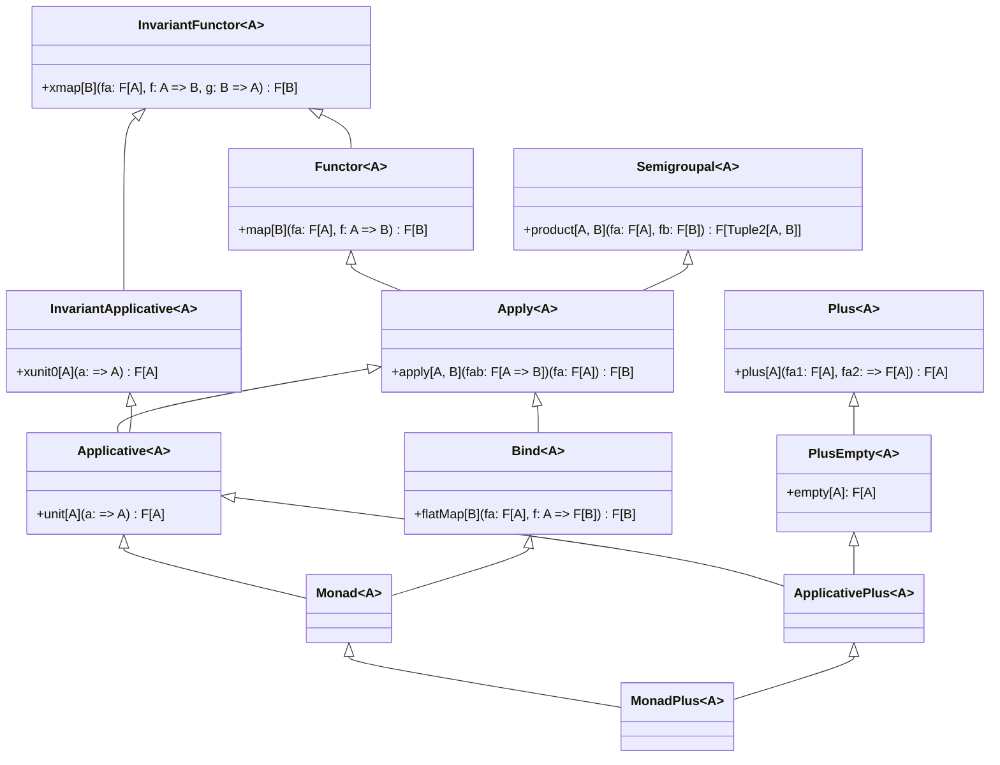

# MonadPlus

## Формальное определение

Класс типов `MonadPlus` предназначен для [монад](monad.md), 
которые также могут действовать как [моноиды](../monoid/monoid.md).

`MonadPlus` должен удовлетворять законам монад и моноидов.

## Код

```dotty
trait MonadPlus[F[_]] extends Monad[F], ApplicativePlus[F]:
  def filter[A](fa: F[A])(f: A => Boolean): F[A] =
    fa.flatMap(a => if f(a) then unit(a) else empty[A])

  def unite[T[_], A](value: F[T[A]])(using T: Foldable[T]): F[A] =
    value.flatMap(ta => T.foldMap(ta)(a => unit(a))(using monoid[A]))
```

`MonadPlus` позволяет определить операцию `filter`, позволяющую фильтровать по предикату элементы монады.

А также операцию `unite`, позволяющую "схлопывать" `F[T[A]]` при наличии `Foldable[T]`.
Например, список `List(Some(785727510), Some(0), Some(1), None, None, Some(1))` "схлопывается" до
`List(785727510, 0, 1, 1)`.

### Связанный список

```dotty
given MonadPlus[List] with
  override def unit[A](a: => A): List[A] = List(a)

  override def apply[A, B](fab: List[A => B])(fa: List[A]): List[B] =
    fab.flatMap { aToB => fa.map(aToB) }

  override def plus[A](fa1: List[A], fa2: => List[A]): List[A] = fa1 ++ fa2

  override def empty[A]: List[A] = List.empty[A]

  extension [A](fa: List[A]) override def flatMap[B](f: A => List[B]): List[B] = fa.flatMap(f)
```

## Схема



## Реализация в библиотеках

### Реализация в ScalaZ

```dotty
import scalaz.*
import Scalaz.*

// ... Все операции родителей

List(1, 2, 3) filter {_ > 2}                     // List(3)
(1 |-> 50) filter { x => x.shows contains '7' }  // [7,17,27,37,47]
```


---

**Ссылки:**

- [Learning Scalaz](http://eed3si9n.com/learning-scalaz/MonadPlus.html)
- [Scalaz API](https://javadoc.io/doc/org.scalaz/scalaz-core_3/7.3.6/scalaz/MonadPlus.html)
