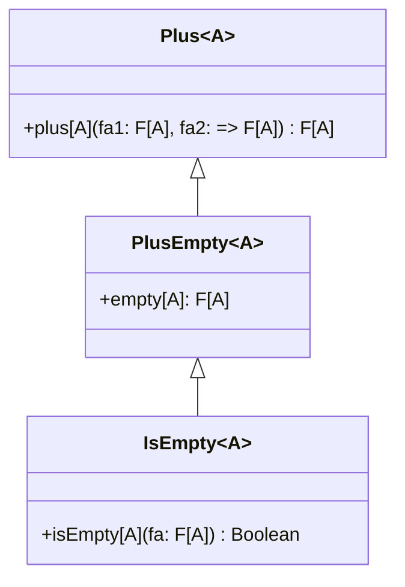



# MonadThrow


## Формальное определение

???

## Код

```dotty
trait MonadThrow[F[_]] extends Monad[F]:
  extension [A](fa: F[A])
    def attempt: F[Try[A]]
    def handleErrorWith(h: Throwable => F[A]): F[A] =
      attempt.flatMap:
        case Failure(t) => h(t)
        case Success(a) => unit(a)

  def raiseError[A](t: Throwable): F[A]
```


## Схема



## Реализация в библиотеках

### Реализация в Cats

```dotty
???
```

---

**Ссылки:**

- [Ссылка на репозиторий с упражнениями][sample]

[sample]: https://gitverse.ru/scalabook/typeclasses
