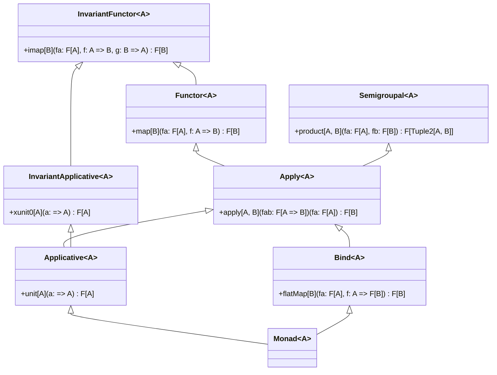



# Монада

Монада — это концепция из функционального программирования, которая позволяет структурировать вычисления, 
работающие в определённом контексте. 
Монады помогают управлять побочными эффектами, такими как обработка ошибок, асинхронность, состояние, 
и делают код более композируемым и предсказуемым.

**Основные характеристики монады:**

- **Контекст**:
  Монада "оборачивает" значение в некоторый контекст. Например, значение может быть "завёрнуто" в контейнер, 
  который указывает на возможное отсутствие значения (`Option`), асинхронное вычисление (`Future`) или множество значений (`List`).
- **Последовательность вычислений**:
  Монады позволяют связывать вычисления, которые возвращают значения в том же контексте. 
  Это делается с помощью операции `flatMap` (или `bind`).
- **Чистота и предсказуемость**:
  Монады помогают изолировать побочные эффекты (например, ошибки или асинхронность) 
  и делают код более предсказуемым, сохраняя его функциональную природу.

**Где применяются монады?**

Монады используются в функциональном программировании для работы с:

- **Обработкой ошибок** (например, `Option`, `Either`, `Try`).
- **Асинхронными вычислениями** (например, `Future`, `IO`).
- **Множеством значений** (например, `List`, `Set`).
- **Состоянием** (например, `State`).
- **Побочными эффектами** (например, `IO`).

**Примеры монад**

- **Монада `Option` (возможное отсутствие значения)**.
  Представим, что есть функция, которая ищет пользователя по его идентификатору. 
  Если пользователь найден, функция возвращает его данные; если нет — возвращает "ничего". 
  Монада `Option` позволяет работать с такими случаями, не проверяя вручную, существует ли значение. 
  Можно последовательно вызывать функции, которые возвращают `Option`, 
  и если на каком-то этапе вернётся "ничего", вычисление остановится.
- **Монада `List` (множество значений)**.
  Представим, что есть список чисел, и для каждого числа необходимо сгенерировать список его возможных модификаций 
  (например, само число и его квадрат). 
  Монада `List` позволяет "развернуть" каждый элемент списка в новый список, 
  а затем объединить все результаты в один плоский список.
- **Монада `Future` (асинхронные вычисления)**.
  Представим, что есть асинхронная операция, загружающая данные из базы данных, 
  и другая операция, которая обрабатывает эти данные. 
  Монада `Future` позволяет связать эти операции так, 
  чтобы вторая операция начала выполняться только после успешного завершения первой. 
  Если первая операция завершится с ошибкой, вторая даже не начнётся.
- **Монада `Either` (обработка ошибок)**.
  Представим, что есть функция, проверяющая, является ли строка числом, 
  и другая функция, которая преобразует строку в число и выполняет с ним какие-то вычисления. 
  Монада `Either` позволяет связать эти две операции так, чтобы вторая функция выполнялась только в том случае, 
  если первая успешно определила, что строка является числом. 
  Если строка не является числом, процесс остановится, и будет получена ошибка.
- **Монада `State` (управление состоянием)**.
  Представим, что есть программа, которая работает с некоторым состоянием (например, счётчик). 
  Есть несколько операций, каждая из которых изменяет состояние и возвращает результат. 
  Монада `State` позволяет связывать эти операции так, чтобы состояние передавалось между ними автоматически, 
  без необходимости явно управлять им вручную.
- **Монада `IO` (побочные эффекты)**.
  Представим, что есть программа, которая читает данные из файла, а затем записывает их в другой файл. 
  Монада `IO` позволяет связать эти две операции так, чтобы вторая операция (запись) выполнялась 
  только после успешного завершения первой (чтение). Если чтение завершится с ошибкой, запись даже не начнётся.
- **Монада `Try` (обработка исключений)**.
  Представим, что есть функция, которая может выбросить исключение, 
  и другая функция, которая работает с результатом первой функции. 
  Монада `Try` позволяет связать эти две функции так, чтобы вторая функция выполнялась только в том случае, 
  если первая завершилась успешно. Если первая функция выбросит исключение, вторая даже не начнётся.

Монады — мощный инструмент для структурирования вычислений в функциональном программировании. 
Они позволяют работать с контекстом (например, ошибки, асинхронность, состояние) и делают код более предсказуемым и композируемым. 

## Формальное определение

Монада (_monad_) - это [`Applicative`](applicative.md), 
который также поддерживает [`Bind`](bind.md), 
ограниченный законами монады.

Монады являются естественным расширением аппликативных функторов, они обеспечивают решение следующей проблемы: 
если у нас есть значение с контекстом, `m a`, как нам применить его к функции, 
которая принимает нормальное значение `a` и возвращает значение с контекстом.

Для `Monad` должны соблюдаться следующие законы (+ все законы родителей: `Applicative`, `Bind`, `Apply`, `Functor` и т.д.):

- Тождественность слева - первый закон монад гласит, что если мы берем значение (`A`), 
  помещаем его в контекст по умолчанию с помощью `unit` и затем передаем его функции с помощью `flatMap` (`A => F[B]`), 
  это то же самое, что просто взять значение и применить к нему функцию: `unit(a).flatMap(afb) == afb(a)`
- Тождественность справа - второй закон гласит, что если у нас есть монадическое значение (`F[A]`), и мы используем `flatMap`, 
  чтобы передать его для `unit` (`a => unit(a)`), результатом будет исходное монадическое значение: `fa.flatMap(unit _) == fa`
- Ассоциативность (наследуется от `Bind`): последний закон монад гласит, что когда у нас есть цепочка приложений 
  монадических функций с `flatMap`, не должно иметь значения, как они вложены: `fa.flatMap(f).flatMap(g) == fa.flatMap { a => f(a).flatMap(g) }`

## Код

```dotty
trait Monad[F[_]] extends Applicative[F], Bind[F]
```

### Законы

- Все законы [Applicative](applicative.md)
- Все законы [Bind](bind.md)
- Тождественность слева: `unit(a).flatMap(afb) == afb(a)`
- Тождественность справа: `fa.flatMap(a => unit(a)) == fa`

### Комбинаторы монад

Монада определяет некоторые комбинаторы:

```dotty
def sequence[A](fas: List[F[A]]): F[List[A]] =
  traverse(fas)(identity)

def traverse[A, B](as: List[A])(f: A => F[B]): F[List[B]] =
  as.foldRight(unit(List.empty[B]))((a, acc) => f(a).map2(acc)(_ :: _))

def replicateM[A](n: Int, fa: F[A]): F[List[A]] =
  sequence(List.fill(n)(fa))

// Kleisli arrows
def compose[A, B, C](f: A => F[B], g: B => F[C]): A => F[C] =
  a => f(a).flatMap(g)  
```

## Упражнения

### Упражнение 2.7.1: Реализация `map` и `map2` через `flatMap` и `unit`

> [Репозиторий с упражнениями и инструкцией по выполнению][sample]

В монаде все операции могут быть выражены через примитивные `unit` и `flatMap`.
Реализуйте методы `map` и `map2` через `flatMap` и `unit`.

```dotty
trait Monad[F[_]] extends Applicative[F], Bind[F]:
  def unit[A](a: => A): F[A]

  extension [A](fa: F[A])
    def flatMap[B](f: A => F[B]): F[B]
    
    override def map[B](f: A => B): F[B] = ???

    override def map2[B, C](fb: F[B])(f: (A, B) => C): F[C] = ???
```

**Примеры:**

```dotty
import Monad.given

// Для Option
val opt = Some(5)
opt.map(_ * 2)              // Some(10)
opt.map2(Some(3))(_ + _)    // Some(8)

// Для List
val list = List(1, 2, 3)
list.map(_ * 2)                         // List(2, 4, 6)
list.map2(List(10, 20))(_ + _)          // List(11, 21, 12, 22)
```

@:note(🔍 Показать решение)

В реализации `map` мы используем `flatMap`: извлекаем значение `a` из контекста `fa`
с помощью `fa.flatMap`, затем поднимаем результат применения функции `f` обратно
в контекст с помощью `unit(f(a))`. Это работает, потому что `flatMap` "разворачивает"
контейнер, позволяет применить функцию к содержимому и затем "заворачивает" результат
обратно. Для `map2` мы сначала извлекаем `a` из `fa` с помощью `flatMap`, а затем
применяем `fb.map(b => f(a, b))` к полученному значению. Внутренний `map` применяет
функцию `(a, b) => f(a, b)` к содержимому `fb` с фиксированным `a`, что даёт `F[C]`.

```dotty
trait Monad[F[_]] extends Applicative[F], Bind[F]:
  def unit[A](a: => A): F[A]

  extension [A](fa: F[A])
    def flatMap[B](f: A => F[B]): F[B]
    
    override def map[B](f: A => B): F[B] =
      fa.flatMap(a => unit(f(a)))

    override def map2[B, C](fb: F[B])(f: (A, B) => C): F[C] =
      fa.flatMap(a => fb.map(b => f(a, b)))      
```

@:@

### Упражнение 2.7.2: Реализация flatMap через compose

Монада может быть альтернативно определена с помощью `compose` (монадическая композиция)
и `unit`, без явного `flatMap`. Операция `compose` (также известная как `fish` или `>=>`)
композирует две функции, возвращающие монадические значения.

Реализуйте `flatMap` через `compose` и `unit`.

```dotty
trait Monad[F[_]] extends Applicative[F], Bind[F]:
  def unit[A](a: => A): F[A]

  def compose[A, B, C](f: A => F[B], g: B => F[C]): A => F[C]

  extension [A](fa: F[A])
    def flatMapViaCompose[B](f: A => F[B]): F[B] = ???
```

В этом случае монадические законы примут вид:

- тождественность:
    - `compose(f, unit) == f`
    - `compose(unit, f) == f`
- ассоциативность:
    - `compose(compose(f, g), h) == compose(f, compose(g, h))`

**Примеры:**

```dotty
import Monad.given

val opt = Some(5)
val f: Int => Option[Int] = x => Some(x * 2)
opt.flatMapViaCompose(f)  // Some(10)

val list = List(1, 2)
val g: Int => List[Int] = x => List(x, x + 1)
list.flatMapViaCompose(g) // List(1, 2, 2, 3)
```

@:note(🔍 Показать решение)

Для реализации `flatMapViaCompose` мы используем `compose` с тремя типами: `Unit`, `A` и `B`.
Первая функция `_ => fa` игнорирует свой аргумент типа `Unit` и всегда возвращает `fa`.
Вторая функция — это `f: A => F[B]`. Композиция `compose(_ => fa, f)` даёт функцию
`Unit => F[B]`. Применяя эту функцию к `()`, мы получаем `F[B]`. Такой трюк позволяет
выразить `flatMap` через `compose`, показывая эквивалентность двух подходов к определению
монады: через `flatMap` или через `compose`.

```dotty
trait Monad[F[_]] extends Applicative[F], Bind[F]:
  def unit[A](a: => A): F[A]

  def compose[A, B, C](f: A => F[B], g: B => F[C]): A => F[C]

  extension [A](fa: F[A])
    def flatMapViaCompose[B](f: A => F[B]): F[B] =
      compose[Unit, A, B](_ => fa, f)(())    
```

@:@

### Упражнение 2.7.3: Реализация flatMap и compose через join и map

Монада может быть определена через `unit` и `join` (`flatten`) вместо `flatMap`.
`join: F[F[A]] => F[A]` "склеивает" два вложенных контекста в один.

Реализуйте `flatMap` и `compose` через `map` и `join`. Этот подход демонстрирует,
что монада — это функтор с возможностью "склеивания" вложенных слоёв.

```dotty
trait Monad[F[_]] extends Applicative[F], Bind[F]:
  def unit[A](a: => A): F[A]

  extension [A](ffa: F[F[A]])
    def join: F[A]

  extension [A](fa: F[A]) 
    def map[B](f: A => B): F[B]
    
    def flatMapViaJoinAndMap[B](f: A => F[B]): F[B] = ???
      
  def composeViaJoinAndMap[A, B, C](f: A => F[B], g: B => F[C]): A => F[C] = ???
```

**Примеры:**

```dotty
import Monad.given

// Для Option
val opt = Some(5)
opt.flatMapViaJoinAndMap(x => Some(x * 2))  // Some(10)

// Для List
val list = List(1, 2)
list.flatMapViaJoinAndMap(x => List(x, x + 1))  // List(1, 2, 2, 3)

// compose через join и map
val f: Int => Option[Int] = x => Some(x * 2)
val g: Int => Option[String] = x => Some(x.toString)
val composed = composeViaJoinAndMap(f, g)
composed(5)  // Some("10")
```

@:note(🔍 Показать решение)

В `flatMapViaJoinAndMap` мы сначала преобразуем `fa: F[A]` в `F[F[B]]` с помощью `map(f)`,
где `f: A => F[B]`. Получаем вложенный контекст, который затем "склеиваем" вызовом `join`,
превращая `F[F[B]]` в `F[B]`. В `composeViaJoinAndMap` мы применяем тот же принцип:
сначала вычисляем `f(a)`, получая `F[B]`, затем применяем `map(g)` к результату,
получая `F[F[C]]`, и наконец `join` склеивает слои в `F[C]`. 

Это альтернативное
определение монады через `join` часто используется в теории категорий, где `join`
является естественным преобразованием.

```dotty
trait Monad[F[_]] extends Applicative[F], Bind[F]:
  def unit[A](a: => A): F[A]

  extension[A] (ffa: F[F[A]])
    def join: F[A]
    
  extension [A](fa: F[A]) 
    def map[B](f: A => B): F[B]
    
    def flatMapViaJoinAndMap[B](f: A => F[B]): F[B] =
      fa.map(f).join  
      
  def composeViaJoinAndMap[A, B, C](f: A => F[B], g: B => F[C]): A => F[C] =
    a => f(a).map(g).join        
```

@:@

### Упражнение 2.7.4: Реализация Monad для типа Option

`Option[A]` — это простейшая монада, представляющая вычисления, которые могут завершиться
неудачей (отсутствием значения). Реализуйте экземпляр `Monad` для `Option`, используя
`Some` для `unit` и сопоставление с шаблоном для `flatMap`.

```dotty
given Monad[Option] with
  override def unit[A](a: => A): Option[A] = ???

  extension [A](fa: Option[A])
    override def flatMap[B](f: A => Option[B]): Option[B] = ???
```

**Примеры:**

```dotty
import Monad.given

// unit — создание успешного значения
unit(42)                    
// Some(42)

// flatMap — последовательное применение
Some(5).flatMap(x => Some(x * 2))   // Some(10)
Some(5).flatMap(_ => None)          // None
None.flatMap((x: Int) => Some(x))   // None
```

@:note(🔍 Показать решение)

Реализация `unit` тривиальна: просто оборачиваем значение в `Some(a)`. Для `flatMap`
используем сопоставление с шаблоном: если `fa` равно `Some(a)`, извлекаем значение `a` и
применяем к нему функцию `f`, возвращая `f(a)`. Если `fa` равно `None`, возвращаем
`None`. Такая реализация соответствует семантике "опциональных" вычислений:
ошибка (`None`) прерывает цепочку, и последующие операции не выполняются.

```dotty
given Monad[Option] with
  override def unit[A](a: => A): Option[A] =
    Some(a)

  extension [A](fa: Option[A])
    override def flatMap[B](f: A => Option[B]): Option[B] =
      fa match
        case Some(a) => f(a)
        case None    => None       
```

@:@

### Упражнение 2.7.5: Реализация Monad для типа List

`List[A]` — это монада, представляющая недетерминированные вычисления (ноль,
один или множество результатов). Реализуйте экземпляр `Monad` для `List`, используя
`List(a)` для `unit` и рекурсивную конкатенацию для `flatMap`.

```dotty
given Monad[List] with
  override def unit[A](a: => A): List[A] = ???

  extension [A](fa: List[A])
    override def flatMap[B](f: A => List[B]): List[B] = ???
```

**Примеры:**

```dotty
import Monad.given

// unit — одноэлементный список
unit(42)                    
// List(42)

// flatMap — декартово произведение
List(1, 2).flatMap(x => List(x, x * 2))
// Результат: List(1, 2, 2, 4)
```

@:note(🔍 Показать решение)

Реализация `unit` создаёт одноэлементный список `List(a)`. Для `flatMap` используется
рекурсивное сопоставление с шаблоном: для пустого списка `Nil` возвращаем `Nil` (база рекурсии);
для непустого списка `h :: t` сначала применяем функцию `f` к голове `h`, получая список `f(h)`,
затем рекурсивно применяем `flatMap` к хвосту `t` и объединяем результаты через `++`.
Порядок важен: сначала обрабатывается голова, затем хвост, сохраняя порядок элементов.
В результате для списка из `n` элементов, где каждая функция возвращает список из `m` элементов,
результат будет содержать `n * m` элементов (декартово произведение).

```dotty
given Monad[List] with
  override def unit[A](a: => A): List[A] =
    List(a)

  extension [A](fa: List[A])
    override def flatMap[B](f: A => List[B]): List[B] =
      fa match
        case h :: t => f(h) ++ this.flatMap(t)(f)
        case Nil    => Nil       
```

@:@

### Упражнение 2.7.6: Реализация Monad для типа Either

`Either[E, A]` — это монада, представляющая вычисления, которые могут завершиться
ошибкой типа `E`. Реализуйте экземпляр `Monad` для `Either[E, A]` с фиксированным
типом ошибки `E`.

```dotty
given eitherMonad[E]: Monad[[x] =>> Either[E, x]] with
  override def unit[A](a: => A): Either[E, A] = ???

  extension [A](fa: Either[E, A])
    override def flatMap[B](f: A => Either[E, B]): Either[E, B] = ???
```

**Примеры:**

```dotty
import Monad.given

// unit — успешное значение
unit(42): Either[String, Int]    
// Right(42)

// flatMap
Right(5).flatMap(x => Right(x * 2))  // Right(10)
Right(5).flatMap(_ => Left("error")) // Left("error")
Left("err").flatMap(x => Right(x))   // Left("err")
```

@:note(🔍 Показать решение)

Реализация `unit` оборачивает значение в `Right(a)`. Для `flatMap` используем
сопоставление с шаблоном: для `Right(a)` извлекаем значение `a` и применяем функцию `f`,
возвращая `f(a)`; для `Left(e)` возвращаем `Left(e)` без вызова `f`.
Эта реализация обеспечивает семантику "короткого замыкания": как только встречается
первая ошибка (`Left`), последующие вычисления пропускаются, и ошибка распространяется
далее по цепочке. Это поведение аналогично исключениям, но выражено чистым
функциональным способом.

```dotty
given eitherMonad[E]: Monad[[x] =>> Either[E, x]] with
  override def unit[A](a: => A): Either[E, A] =
    Right(a)

  extension [A](fa: Either[E, A])
    override def flatMap[B](f: A => Either[E, B]): Either[E, B] =
      fa match
        case Right(a) => f(a)
        case Left(e)  => Left(e)       
```

@:@

### Упражнение 2.7.7: Реализация Monad для типа Writer

`Writer[W, A]` — это монада, представляющая вычисления, которые накапливают
лог (побочный вывод) типа `W`. Требуется, чтобы `W` был [моноидом](../monoid/monoid.md) 
(имел `empty` и ассоциативную `combine`). Реализуйте экземпляр `Monad` для `Writer`.

```dotty
given writerMonad[W](using m: Monoid[W]): Monad[[x] =>> Writer[W, x]] with
  override def unit[A](a: => A): Writer[W, A] = ???

  extension [A](fa: Writer[W, A])
    override def flatMap[B](f: A => Writer[W, B]): Writer[W, B] = ???
```

**Примеры:**

```dotty
import Monad.given
import ru.scalabook.typeclasses.monoid.Monoid.given

// Для String как лога (моноид с конкатенацией)
val w1 = Writer(() => ("Step 1: init ", 5))
val w2 = Writer(() => ("Step 2: multiply ", (x: Int) => x * 2))

val result = w1.flatMap(x => w2.map(f => f(x)))
result.run()  // ("Step 1: init Step 2: multiply ", 10)

// Для List[String] как лога
given Monoid[List[String]] with
  val empty: List[String] = Nil
  def combine(a: List[String], b: List[String]): List[String] = a ++ b

val logger = for
  _ <- Writer(() => (List("Logged action 1"), ()))
  x <- Writer(() => (List("Got value 42"), 42))
  _ <- Writer(() => (List("Logged action 2"), ()))
yield x

logger.run()  // (List("Logged action 1", "Got value 42", "Logged action 2"), 42)
```

@:note(🔍 Показать решение)

В реализации `unit` создаётся `Writer`, который при выполнении возвращает пару
`(m.empty, a)` — пустой лог и переданное значение. Для `flatMap` мы создаём новый
`Writer`, который при вызове `run()` сначала выполняет `fa.run()`, получая `(w1, a)`,
затем выполняет `f(a).run()`, получая `(w2, b)`, и наконец возвращает `(m.combine(w1, w2), b)`.
Ленивость сохраняется: `flatMap` не выполняет вычисления немедленно, а только
при вызове `run()`. Важно, что порядок комбинирования логов соответствует порядку
выполнения: сначала логи из `fa`, затем логи из `f(a)`. Это типичное поведение
для монады `Writer`, где логи последовательно накапливаются.

```dotty
given writerMonad[W](using m: Monoid[W]): Monad[[x] =>> Writer[W, x]] with
  override def unit[A](a: => A): Writer[W, A] =
    Writer[W, A](() => (m.empty, a))

  extension [A](fa: Writer[W, A])
    override def flatMap[B](f: A => Writer[W, B]): Writer[W, B] =
      Writer[W, B] { () =>
        val (w1, a) = fa.run()
        val (w2, b) = f(a).run()
        (m.combine(w1, w2), b)
      }       
```

@:@

### Упражнение 2.7.8: Реализация Monad для типа State

`State[S, A]` — это монада, представляющая чистые функциональные вычисления
с изменяемым состоянием. Реализуйте экземпляр `Monad` для `State`.

```dotty
given stateMonad[S]: Monad[[x] =>> State[S, x]] with
  override def unit[A](a: => A): State[S, A] = ???

  extension [A](fa: State[S, A])
    override def flatMap[B](f: A => State[S, B]): State[S, B] = ???
```

**Примеры:**

```dotty
import Monad.given

// Базовые операции
val increment: State[Int, Int] = State(s => (s + 1, s))
val getState: State[Int, Int] = State(s => (s, s))
val setState: Int => State[Int, Unit] = n => State(_ => (n, ()))

// unit — состояние не меняется
unit(42).run(5)  
// (5, 42)

// flatMap — передача состояния
increment.flatMap(x => State(s => (s, x * 2))).run(5)
// (6, 10)
```

@:note(🔍 Показать решение)

В реализации `unit` создаётся `State`, который принимает состояние `s` и возвращает
пару `(s, a)` — состояние не изменяется. 
Для `flatMap` мы создаём новый `State`, который принимает начальное состояние `s`. 
Сначала выполняем `fa.run(s)`, получая новое состояние `s1` и значение `a`. 
Затем выполняем `f(a).run(s1)`, получая финальное состояние `s2` и значение `b`. 
Результатом является пара `(s2, b)`.
Состояние последовательно передаётся через цепочку вычислений, что позволяет
реализовать эффект изменения состояния в чисто функциональном стиле.
Эта монада — основа для многих функциональных подходов к управлению состоянием.

```dotty
given stateMonad[S]: Monad[[x] =>> State[S, x]] with
  override def unit[A](a: => A): State[S, A] =
    State[S, A](s => (s, a))

  extension [A](fa: State[S, A])
    override def flatMap[B](f: A => State[S, B]): State[S, B] =
      State[S, B] { s =>
        val (s1, a) = fa.run(s)
        f(a).run(s1)
      }      
```

@:@

## Схема



## Реализация в библиотеках

### Реализация в Cats

```dotty
import cats.Monad
import cats.instances.option.*
import cats.instances.list.*

val opt1 = Monad[Option].pure(3)                                     
// Some(3)
val opt2 = Monad[Option].flatMap(opt1)(a => Some(a + 2))             
// Some(5)
val opt3 = Monad[Option].map(opt2)(a => 100 * a)                     
// Some(500)

val list1 = Monad[List].pure(3)                                      
// List(3)
val list2 = Monad[List].flatMap(List(1, 2, 3))(a => List(a, a * 10)) 
// List(1, 10, 2, 20, 3, 30)
val list3 = Monad[List].map(list2)(a => a + 123)                     
// List(124, 133, 125, 143, 126, 153)

1.pure[Option]                                                       
// Some(1)
1.pure[List]                                                         
// List(1)
```

### tailRecM (Метод хвостовой рекурсивной монады)

Помимо требования наличия методов `flatMap` и `pure`, Cats предъявляет к монадам дополнительное требование — 
реализацию метода `tailRecM`, который обеспечивает **стекобезопасную монадическую рекурсию**. 
Это требование основано на работе Фила Фримена [Stack Safety for Free](http://functorial.com/stack-safety-for-free/index.pdf) 
(«Стекобезопасность бесплатно»).

#### Проблема: рекурсия и переполнение стека

В функциональном программировании монадическая рекурсия встречается повсеместно. Она используется для:

- Обработки последовательностей данных
- Реализации циклов в функциональном стиле
- Построения парсеров и интерпретаторов
- Выполнения повторяющихся операций ввода-вывода

Однако на JVM (а также в JavaScript и Native средах) рекурсия **не является стекобезопасной** по умолчанию. 
Каждый рекурсивный вызов добавляет новый кадр в стек вызовов, и при достижении определённой глубины 
(обычно 2000–5000 вызовов) происходит переполнение стека (`StackOverflowError`).

#### Решение: tailRecM

Вместо того чтобы требовать от разработчиков самостоятельной заботы о стекобезопасности 
(используя различные обходные пути, такие как [`Trampoline`](../../fp/external-effects/stack_overflow_error.md) 
или ручную реализацию хвостовой рекурсии), 
Cats **встраивает** это требование непосредственно в класс типов `Monad`. 
Это означает, что:

1. **Все** монады в Cats обязаны предоставлять стекобезопасную реализацию `tailRecM`.
2. **Все** функции в Cats, требующие монадической рекурсии, используют `tailRecM` для её выполнения.
3. Разработчику не нужно беспокоиться о переполнении стека при использовании монад из Cats — библиотека гарантирует безопасность.

### Пример: реализация `Monad[Option]`

Рассмотрим, как выглядит стекобезопасная реализация монады для `Option`. 
Обратите внимание на аннотацию `@tailrec`, которая гарантирует, 
что рекурсивный вызов является хвостовым и компилятор оптимизирует его в цикл:

```dotty
import cats.Monad
import scala.annotation.tailrec

given Monad[Option] = new Monad[Option]:
  // Базовые методы монады
  def flatMap[A, B](fa: Option[A])(f: A => Option[B]): Option[B] = fa.flatMap(f)
  def pure[A](a: A): Option[A]                                   = Some(a)

  // Стекобезопасный tailRecM
  @tailrec
  def tailRecM[A, B](a: A)(f: A => Option[Either[A, B]]): Option[B] =
    f(a) match
      // Рекурсия завершена с пустым значением
      case None => None
      // Продолжаем рекурсию с новым значением
      case Some(Left(nextA)) =>
        tailRecM(nextA)(f)
      // Рекурсия завершена с результатом
      case Some(Right(b)) => Some(b)
```

#### Как это работает?

Сигнатура `tailRecM`:

```dotty
def tailRecM[A, B](a: A)(f: A => F[Either[A, B]]): F[B]
```

Метод принимает:

- **`a: A`** — начальное значение.
- **`f: A => F[Either[A, B]]`** — функцию, которая для значения `A` возвращает эффект `F`, содержащий либо:
    - `Left[A]` — продолжить рекурсию с новым значением `A`.
    - `Right[B]` — завершить рекурсию и вернуть результат `B`.

В случае с `Option`:

- `f(a)` возвращает `Option[Either[A, B]]`.
- Если результат — `None`, рекурсия завершается (нет значения).
- Если результат — `Some(Left(nextA))`, мы рекурсивно вызываем `tailRecM` с `nextA` (это **хвостовой вызов**!).
- Если результат — `Some(Right(b))`, мы возвращаем `Some(b)`.

Благодаря аннотации `@tailrec` компилятор Scala проверяет, что последний вызов в функции — это рекурсивный вызов `tailRecM`, 
и оптимизирует его в цикл, предотвращая рост стека.

#### Связь с `flatMap` и `pure`

`tailRecM` является частью класса типов `Monad` наряду с `flatMap` и `pure`. Это означает, что:

- Для создания экземпляра `Monad` необходимо реализовать все три метода.
- Cats предоставляет реализации `tailRecM` для всех стандартных монад (`Option`, `List`, `Either`, `Try`, `Future` и т.д.).
- Пользовательские монады также должны предоставлять корректную реализацию `tailRecM`.

#### Где используется `tailRecM`?

В Cats `tailRecM` используется во многих функциях, которые могут требовать монадической рекурсии:

- **`Monad.whileM`** и **`Monad.untilM`** — циклические операции в монадическом контексте.
- **`Foldable.foldM`** — монадическая свёртка.
- **`Traverse.traverse`** — обход структур с эффектами.
- И многие другие функции, где требуется рекурсивная обработка данных.

Более подробное обсуждение `tailRecM` можно найти в разделе ["Что такое tailRecM?"](../../libs/cats/jump_start_guide.md).

---

**Ссылки:**

- [Ссылка на репозиторий с упражнениями][sample]
- [Монада - wikipedia](https://ru.wikipedia.org/wiki/%D0%9C%D0%BE%D0%BD%D0%B0%D0%B4%D0%B0_(%D0%BF%D1%80%D0%BE%D0%B3%D1%80%D0%B0%D0%BC%D0%BC%D0%B8%D1%80%D0%BE%D0%B2%D0%B0%D0%BD%D0%B8%D0%B5))
- [A Monads Approach for Beginners, in Scala - Rock the JVM](https://www.youtube.com/watch?v=d-dy1x33moA&list=PLmtsMNDRU0Bzj7INIrLugi3a_WClwQuiS)
- [Algebird](https://twitter.github.io/algebird/typeclasses/monad.html)
- [Cats](https://typelevel.org/cats/typeclasses/monad.html)
- [Functional Programming in Scala, Second Edition, Chapter 11](https://www.manning.com/books/functional-programming-in-scala-second-edition?query=Functional%20Programming%20in%20Scala,%20Second%20Edition)
- [Herding Cats](http://eed3si9n.com/herding-cats/Monad.html)
- [Learn Functional Programming course/tutorial on Scala](https://github.com/dehun/learn-fp)
- [Learning Scalaz](http://eed3si9n.com/learning-scalaz/Monad.html)
- [Monads are fractals](https://eed3si9n.com/monads-are-fractals/)
- [Monads are Elephants Part 1](https://james-iry.blogspot.com/2007/09/monads-are-elephants-part-1.html)
- [Monads are Elephants Part 2](https://james-iry.blogspot.com/2007/10/monads-are-elephants-part-2.html)
- [Monads are Elephants Part 3](https://james-iry.blogspot.com/2007/10/monads-are-elephants-part-3.html)
- [Monads are Elephants Part 4](https://james-iry.blogspot.com/2007/11/monads-are-elephants-part-4.html)
- [Monads in Scala](https://www.baeldung.com/scala/monads)
- [ObserveFunctorMonad](https://blog.tmorris.net/posts/observefunctormonad/index.html)
- [Of Algebirds, Monoids, Monads, and other Bestiary for Large-Scale Data Analytics](https://www.michael-noll.com/blog/2013/12/02/twitter-algebird-monoid-monad-for-large-scala-data-analytics/#monads)
- [Scala with Cats](https://scalawithcats.com/dist/scala-with-cats.html#sec:monads)
- [Scalaz API](https://javadoc.io/doc/org.scalaz/scalaz-core_3/7.3.6/scalaz/Monad.html)
- [SKB – Scala Monad](https://leobenkel.com/2021/01/skb-scala-monad/)
- [Strong Type Systems](https://blog.tmorris.net/posts/strong-type-systems/index.html)
- [Tour of Scala](https://tourofscala.com/scala/monad)
- [When you hear ‘Monad’, think ‘Chainable’](https://jamesward.com/2017/10/02/when-you-hear-monad-think-chainable/)

[sample]: https://gitverse.ru/scalabook/typeclasses
