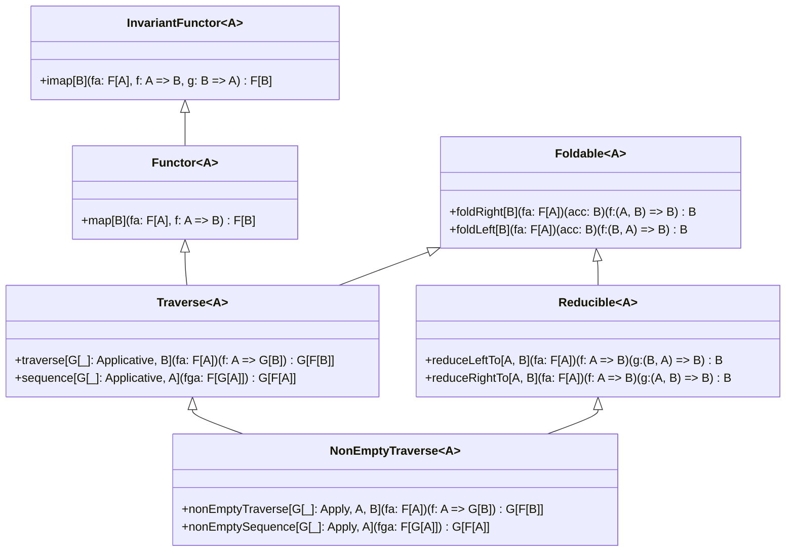

# NonEmptyTraverse

`NonEmptyTraverse` — это **непустая версия** класса типов [`Traverse`](traverse.md), 
подобно тому как [`Reducible`](reducible.md) является непустой версией [`Foldable`](foldable.md). 
В иерархии классов типов `NonEmptyTraverse` наследуется одновременно от `Reducible` и `Traverse`, объединяя их возможности:

- От `Reducible` — гарантию непустоты и методы сокращения без нейтрального элемента.
- От `Traverse` — возможность обхода структуры с эффектами.

## Основные методы

`NonEmptyTraverse` предоставляет два ключевых метода:

```dotty
def nonEmptyTraverse[G[_]: Apply, A, B](fa: F[A])(f: A => G[B]): G[F[B]]

def nonEmptySequence[G[_]: Apply, A](fga: F[G[A]]): G[F[A]]
```

### Ключевое отличие от `Traverse`

В отличие от методов `traverse` и `sequence` из `Traverse`, 
которые требуют экземпляр [`Applicative[G]`](applicative.md) (т.е. наличие `pure`), 
методы `nonEmptyTraverse` и `nonEmptySequence` требуют только [`Apply[G]`](apply.md) — 
ослабленную версию `Applicative`, **без метода `pure`**.

**Почему это важно?**

Некоторые типы могут образовывать `Apply`, но не `Applicative`, 
потому что у них нет «пустого» или «нейтрального» значения. 
Классический пример — `Map[K, *]`: невозможно реализовать `pure[A](a: A): Map[K, A]`, 
потому что для этого нужен ключ `K`, который отсутствует в общем случае.

## Использование `nonEmptyTraverse`

Рассмотрим практический пример. 
Предположим, у нас есть список текстовых фрагментов, 
и мы хотим подсчитать частоту каждого слова в каждом фрагменте, а затем объединить результаты.

```dotty
import cats.syntax.all.*
import cats.data.NonEmptyList

// Функция подсчёта слов в тексте
def countWords(text: String): Map[String, Int] =
  text.split(" ").groupBy(identity).view.mapValues(_.length).toMap

// Непустой список текстовых фрагментов
val snippets = NonEmptyList.of("What do you do", "What are you doing")

val result = snippets.nonEmptyTraverse(countWords)
// Результат:
// Map(
//   "What" -> NonEmptyList(1, 1),
//   "you"  -> NonEmptyList(1, 1)
// )
```

Что здесь произошло?

1. `countWords` применяется к каждому фрагменту, возвращая `Map[String, Int]`.
2. `nonEmptyTraverse` «обходит» структуру `NonEmptyList`, собирая результаты и объединяя карты для каждого ключа.
3. Для каждого слова мы получаем список частот — по одному значению для каждого фрагмента.

### Эквивалентная запись через `map` и `nonEmptySequence`

Метод `nonEmptyTraverse(f)` эквивалентен `map(f).nonEmptySequence`:

```dotty
val result = snippets.map(countWords).nonEmptySequence
// Результат: полностью идентичен предыдущему
```

Это аналогично тому, как в `Traverse` метод `traverse(f)` эквивалентен `map(f).sequence`.

## Код

```dotty
trait NonEmptyTraverse[F[_]] extends Traverse[F] with Reducible[F]:
  def nonEmptyTraverse[G[_]: Apply, A, B](fa: F[A])(f: A => G[B]): G[F[B]]

  def nonEmptySequence[G[_]: Apply, A](fga: F[G[A]]): G[F[A]] =
    nonEmptyTraverse(fga)(identity)

  extension [A](fa: F[A])
    override def traverse[G[_]: Applicative, B](f: A => G[B]): G[F[B]] =
      nonEmptyTraverse(fa)(f)
      
  def nonEmptyTraverseViaNes[G[_]: Apply, A, B](fa: F[A])(f: A => G[B])
      : G[F[B]] =
    nonEmptySequence(fa.map(f))
```

## Упражнения

### Упражнение 2.12.1: Реализация NonEmptyTraverse для NonEmptyList

> [Репозиторий с упражнениями и инструкцией по выполнению][sample]

Ваша задача — заполнить пропуски (`???`) в реализации метода `nonEmptyTraverse`.

```dotty
given NonEmptyTraverse[NonEmptyList] with
  def reduceLeftTo[A, B](fa: NonEmptyList[A])(f: A => B)(g: (B, A) => B): B =
    ???

  def reduceRightTo[A, B](fa: NonEmptyList[A])(f: A => B)(g: (A, B) => B): B =
    ???

  def nonEmptyTraverse[
      G[_]: Apply as app,
      A,
      B
  ](fa: NonEmptyList[A])(f: A => G[B])
      : G[NonEmptyList[B]] =
    ???
end given
```

**Примеры:**

```dotty
import cats.data.NonEmptyList
import cats.syntax.all.*

// Пример 1: Обход с Option (применяем только к непустым строкам)
val nel = NonEmptyList.of("hello", "world", "scala")

def toOption(s: String): Option[Int] =
  if s.nonEmpty then Some(s.length) else None

val result1 = NonEmptyTraverse[NonEmptyList].nonEmptyTraverse(nel)(toOption)
// Результат: Some(NonEmptyList(5, 5, 5))

// Пример 2: Обход с Option, где некоторые элементы могут быть пустыми
val nel2 = NonEmptyList.of("hello", "", "scala")

def toOption2(s: String): Option[Int] =
  if s.nonEmpty then Some(s.length) else None

val result2 = NonEmptyTraverse[NonEmptyList].nonEmptyTraverse(nel2)(toOption2)
// Результат: None (так как второй элемент — пустая строка)
```

@:note(🔍 Показать решение)

Для реализации `nonEmptyTraverse` используется рекурсивный обход списка. 
В базовом случае (список из одного элемента) мы применяем функцию `f` к голове, получая `G[B]`, 
и с помощью `map` оборачиваем результат в `NonEmptyList`. 
В рекурсивном случае (голова + непустой хвост) мы применяем `f` к голове, рекурсивно обходим хвост, 
а затем комбинируем оба результата с помощью `Apply[G].apply2`. 
Этот метод комбинирует два эффекта в один, применяя функцию к их результатам. 
Важно отметить, что `apply2` требует только `Apply`, а не `Applicative`, что позволяет использовать эффекты без `pure`. 

```dotty
given NonEmptyTraverse[NonEmptyList] with
  def reduceLeftTo[A, B](fa: NonEmptyList[A])(f: A => B)(g: (B, A) => B): B =
    Reducible.given_Reducible_NonEmptyList.reduceLeftTo(fa)(f)(g)

  def reduceRightTo[A, B](fa: NonEmptyList[A])(f: A => B)(g: (A, B) => B): B =
    Reducible.given_Reducible_NonEmptyList.reduceRightTo(fa)(f)(g)

  def nonEmptyTraverse[
      G[_]: Apply as app,
      A,
      B
  ](fa: NonEmptyList[A])(f: A => G[B])
      : G[NonEmptyList[B]] =
    fa.tail match
      case Nil =>
        f(fa.head).map(a => NonEmptyList(a, Nil))
      case h :: t =>
        app.apply2(
          f(fa.head),
          nonEmptyTraverse[G, A, B](NonEmptyList(h, t))(f)
        )((a, nel) => NonEmptyList(a, nel.toList))
end given
```

@:@

## Схема



## Реализация в библиотеках

### Реализация в Cats

```dotty
import cats.syntax.all.*
import cats.data.NonEmptyList

val snippets = NonEmptyList.of("What do you do", "What are you doing")
// snippets: NonEmptyList[String] = NonEmptyList(
//   head = "What do you do",
//   tail = List("What are you doing")
// )

def countWords(text: String): Map[String, Int] =
  text.split(" ").groupBy(identity).view.mapValues(_.length).toMap

snippets.nonEmptyTraverse(countWords)
// res0: Map[String, NonEmptyList[Int]] = Map(
//   "What" -> NonEmptyList(head = 1, tail = List(1)),
//   "you" -> NonEmptyList(head = 1, tail = List(1))
// )
```

---

**Ссылки:**

- [Ссылка на репозиторий с упражнениями][sample]
- [Cats](https://typelevel.org/cats/typeclasses/nonemptytraverse.html)

[sample]: https://gitverse.ru/scalabook/typeclasses
