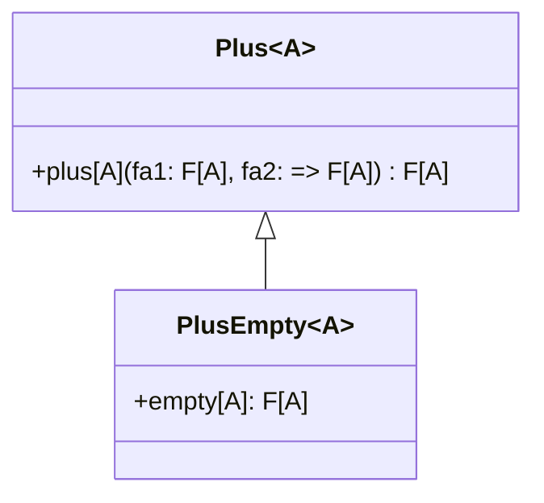

# PlusEmpty

## Формальное определение

Универсальный количественный [моноид](../monoid/monoid.md).

`PlusEmpty` должен удовлетворять законам моноида:

- Associativity (ассоциативность): `(x + y) + z = x + (y + z)`
- Identity (тождественность): существует `e ∈ M` такое, что `e + x = x + e = x`


## Код

```dotty
trait PlusEmpty[F[_]] extends Plus[F]:
  self =>

  def empty[A]: F[A]

  def monoid[A]: Monoid[F[A]] =
    new Monoid[F[A]]:
      override def combine(f1: F[A], f2: F[A]): F[A] = plus(f1, f2)
      override def empty: F[A] = self.empty[A]
```

### Связанный список

```dotty
given PlusEmpty[List] with
  def plus[A](fa1: List[A], fa2: => List[A]): List[A] = fa1 ++ fa2
  def empty[A]: List[A] = List.empty[A]
```

## Схема



## Реализация в библиотеках

### Реализация в ScalaZ

```dotty
import scalaz.*
import Scalaz.*

// ... Все операции родителей

(PlusEmpty[List].empty: List[Int])                  // List()
```

---

**Ссылки:**

- [Learning Scalaz](http://eed3si9n.com/learning-scalaz/MonadPlus.html)
- [Scalaz API](https://javadoc.io/doc/org.scalaz/scalaz-core_3/7.3.6/scalaz/PlusEmpty.html)
