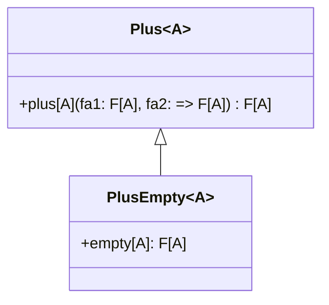



# PlusEmpty

`PlusEmpty` — это расширение концепции [`Plus`](plus.md) в функциональном программировании, 
которое добавляет возможность работать с "пустым" значением (нейтральным элементом) в контексте. 
Это значение служит единицей для операции комбинирования (`plus`, `combine` или `<+>`) 
и часто называется "пустым" или "нулевым" элементом.

**Основные характеристики `PlusEmpty`:**

- **Пустое значение**:
  `PlusEmpty` вводит понятие "пустого" значения, которое является нейтральным элементом для операции комбинирования. 
  Например, для списков это пустой список `[]`, для `Option` — `None`, для множеств — пустое множество `{}`.
- **Комбинирование с пустым значением**:
  При комбинировании значения с "пустым" значением результат остаётся неизменным. 
  Например, `Some(42) <+> None` вернёт `Some(42)`, а `[1, 2, 3] <+> []` вернёт `[1, 2, 3]`.
- **Применение в контексте**:
  `PlusEmpty` работает с контекстом, таким как списки, `Option`, `Either`, множества и другие монадические типы.

**Где применяется `PlusEmpty`?**

`PlusEmpty` используется в функциональном программировании для:

- **Обработки возможного отсутствия значений** (например, `Option`).
- **Комбинирования множеств значений** (например, списков, множеств).
- **Агрегации результатов вычислений** (например, в парсерах или валидаторах).
- **Работы с нейтральными элементами** в различных контекстах.

**Примеры `PlusEmpty`**

- **Списки (`List`)**.
  Представьте, что у вас есть список чисел `[1, 2, 3]` и пустой список `[]`. 
  Операция `PlusEmpty` позволяет объединить их, и результат будет `[1, 2, 3]`. 
  Пустой список здесь является нейтральным элементом, который не изменяет значение при комбинировании.
- **`Option` (возможное отсутствие значения)**.
  Представьте, что у вас есть значение `Some(42)` и пустое значение `None`. 
  Операция `PlusEmpty` позволяет выбрать первое существующее значение. 
  Например, `Some(42) <+> None` вернёт `Some(42)`, а `None <+> Some(10)` вернёт `Some(10)`. 
  Пустым значением здесь является `None`.
- **Множества (`Set`)**.
  Представьте, что у вас есть множество `{1, 2, 3}` и пустое множество `{}`. 
  Операция `PlusEmpty` позволяет объединить их в одно множество: `{1, 2, 3}`. 
  Пустое множество здесь является нейтральным элементом.
- **Парсеры**.
  Представьте, что у вас есть парсер, который разбирает числа, и "пустой" парсер, который всегда возвращает ошибку. 
  Операция `PlusEmpty` позволяет комбинировать результаты работы этих парсеров. 
  Например, если первый парсер не смог разобрать входные данные, второй парсер (пустой) не изменит результат. 
  Пустым значением здесь является парсер, который всегда возвращает ошибку.
- **Валидаторы**.
  Представьте, что у вас есть валидатор, который проверяет, что строка не пустая, и "пустой" валидатор, 
  который всегда возвращает успешный результат. 
  Операция `PlusEmpty` позволяет объединить результаты валидации. 
  Например, если первый валидатор вернул ошибку, второй (пустой) валидатор не изменит результат. 
  Пустым значением здесь является валидатор, который всегда возвращает успех.
- **Асинхронные вычисления (`Future`)**.
  Представьте, что у вас есть асинхронное вычисление, которое возвращает число, 
  и "пустое" вычисление, которое всегда завершается с ошибкой. 
  Операция `PlusEmpty` позволяет выполнить оба вычисления и объединить их результаты. 
  Например, если первое вычисление завершилось с ошибкой, второе (пустое) вычисление не изменит результат. 
  Пустым значением здесь является `Future`, который всегда завершается с ошибкой.
- **Логические значения (`Boolean`)**.
  Представьте, что у вас есть логическое значение `true` и "пустое" значение `false`. 
  Операция `PlusEmpty` может быть реализована как логическое ИЛИ (`||`). 
  Например, `true <+> false` вернёт `true`. Пустым значением здесь является `false`.

`PlusEmpty` — это мощный инструмент для работы с нейтральными элементами в функциональном программировании. 
Он расширяет концепцию `Plus`, добавляя возможность комбинировать значения с "пустым" значением, которое не изменяет результат. 

## Формальное определение

Универсальный количественный [моноид](../monoid/monoid.md).

`PlusEmpty` должен удовлетворять законам моноида:

- Ассоциативность (associativity): `(x + y) + z = x + (y + z)`
- Тождественность (identity): существует `e ∈ M` такое, что `e + x = x + e = x`

## Код

```dotty
trait PlusEmpty[F[_]] extends Plus[F]:
  self =>

  def empty[A]: F[A]

  def monoid[A]: Monoid[F[A]] =
    new Monoid[F[A]]:
      override def combine(f1: F[A], f2: F[A]): F[A] = plus(f1, f2)
      override def empty: F[A] = self.empty[A]
```

### Связанный список

```dotty
given PlusEmpty[List] with
  def plus[A](fa1: List[A], fa2: => List[A]): List[A] = fa1 ++ fa2
  def empty[A]: List[A] = List.empty[A]
```

### Законы

- Ассоциативность выражается следующим образом:
  `plus(plus(f1, f2), f3)` должно быть равно `plus(f1, plus(f2, f3))`.  
  Это означает, что порядок объединения элементов не влияет на итоговый результат.
- Тождественность означает, что если вы объединяете любой элемент `fa` с нейтральным элементом (`empty`),
  то результат всегда будет равен `fa`. Другими словами, нейтральный элемент не меняет значение `fa` при объединении.
  Это можно записать так:
    - `plus(fa, empty) == fa`
    - `plus(empty, fa) == fa`

```dotty
... // Законы Plus

def checkPlusEmptyRightIdentity[F[_], A](fa: F[A])(using
    pl: PlusEmpty[F]
): ValidatedNel[String, Unit] =
  import pl.*
  Either.cond[String, Unit](
    plus(fa, empty) == fa,
    (),
    "Не соблюдается тождественность справа: x + e = x"
  ).toValidatedNel

def checkPlusEmptyLeftIdentity[F[_], A](fa: F[A])(using
    pl: PlusEmpty[F]
): ValidatedNel[String, Unit] =
  import pl.*
  Either.cond[String, Unit](
    plus(empty, fa) == fa,
    (),
    "Не соблюдается тождественность слева: e + x = x"
  ).toValidatedNel
```

## Схема



## Реализация в библиотеках

### Реализация в ScalaZ

```dotty
import scalaz.*
import Scalaz.*

// ... Все операции родителей

(PlusEmpty[List].empty: List[Int])                  // List()
```

---

**Ссылки:**

- [Ссылка на репозиторий с упражнениями][sample]
- [Learning Scalaz](http://eed3si9n.com/learning-scalaz/MonadPlus.html)
- [Scalaz API](https://javadoc.io/doc/org.scalaz/scalaz-core_3/7.3.6/scalaz/PlusEmpty.html)

[sample]: https://gitverse.ru/scalabook/typeclasses
