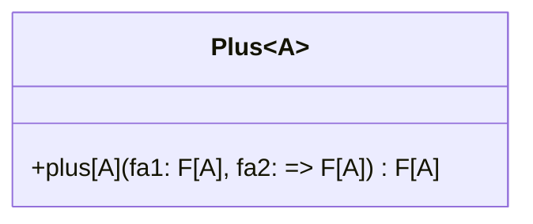

# Plus

## Формальное определение

Универсальная количественная [полугруппа](../monoid/semigroup.md). 

`Plus` должен удовлетворять законам полугруппы:

- Associativity (ассоциативность): `(x + y) + z = x + (y + z)`


## Код

```dotty
trait Plus[F[_]]:
  def plus[A](fa1: F[A], fa2: => F[A]): F[A]

  def semigroup[A]: Semigroup[F[A]] = (f1: F[A], f2: F[A]) => plus(f1, f2)
```

### Связанный список

```dotty
given Plus[List] with
  def plus[A](fa1: List[A], fa2: => List[A]): List[A] = fa1 ++ fa2
```

## Схема



## Реализация в библиотеках

### Реализация в ScalaZ

```dotty
import scalaz.*
import Scalaz.*

List(1, 2) <+> List(3, 4)                   // List(1, 2, 3, 4)
```

---

**Ссылки:**

- [Learning Scalaz](http://eed3si9n.com/learning-scalaz/MonadPlus.html)
- [Scalaz API](https://javadoc.io/doc/org.scalaz/scalaz-core_3/7.3.6/scalaz/Plus.html)
