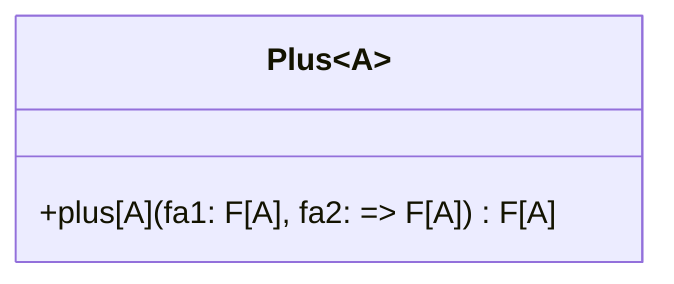

# Plus

`Plus` — это концепция из функционального программирования, которая расширяет идею [монад](monad.md) и [аппликативных функторов](applicative.md). 
Она добавляет возможность комбинировать два значения в одном контексте, используя операцию, похожую на "сложение". 
Эта операция часто называется `plus`, `combine` или `<+>`.

**Основные характеристики `Plus`:**

- **Комбинирование значений**:
  `Plus` позволяет объединять два значения, находящихся в одном контексте, в одно значение. 
  Например, два списка можно объединить в один, или два `Option` можно скомбинировать, выбирая первое существующее значение.
- **Применение в контексте**:
  `Plus` работает с контекстом, таким как списки, `Option`, `Either` и другие монадические типы.

**Где применяется `Plus`?**

`Plus` используется в функциональном программировании для:

- **Комбинирования множеств значений** (например, списков, множеств).
- **Агрегации результатов вычислений** (например, в парсерах или валидаторах).

**Примеры `Plus`**

- **Списки (`List`)**.
  Представьте, что у вас есть два списка: `[1, 2, 3]` и `[4, 5, 6]`. 
  Операция `Plus` позволяет объединить их в один список: `[1, 2, 3, 4, 5, 6]`. 
- **`Option` (возможное отсутствие значения)**.
  Представьте, что у вас есть два значения типа `Option`: `Some(42)` и `None`. 
  Операция `Plus` позволяет выбрать первое существующее значение. 
  Например, `Some(42) <+> None` вернёт `Some(42)`, а `None <+> Some(10)` вернёт `Some(10)`. 
- **Парсеры**.
  Представьте, что у вас есть два парсера: один разбирает числа, а другой — строки. 
  Операция `Plus` позволяет комбинировать результаты работы этих парсеров. 
  Например, если первый парсер не смог разобрать входные данные, второй парсер попытается это сделать. 
- **Валидаторы**.
  Представьте, что у вас есть два валидатора: один проверяет, что строка не пустая, а другой — что строка содержит только буквы. 
  Операция `Plus` позволяет объединить результаты валидации. 
  Например, если первый валидатор вернул ошибку, второй валидатор всё равно будет выполнен, и все ошибки будут собраны вместе. 
- **Логические значения (`Boolean`)**.
  Представьте, что у вас есть два логических значения: `true` и `false`. 
  Операция `Plus` может быть реализована как логическое ИЛИ (`||`). 
  Например, `true <+> false` вернёт `true`.

`Plus` — это мощный инструмент для комбинирования значений в одном контексте. 
Он применяется в различных сценариях, таких как объединение списков, обработка возможного отсутствия значений, 
агрегация результатов валидации или парсинга. 

## Формальное определение

Универсальная количественная [полугруппа](../monoid/semigroup.md). 

`Plus` должен удовлетворять законам полугруппы:

- Ассоциативность (associativity): `(x + y) + z = x + (y + z)`


## Код

```dotty
trait Plus[F[_]]:
  def plus[A](fa1: F[A], fa2: => F[A]): F[A]

  def semigroup[A]: Semigroup[F[A]] = (f1: F[A], f2: F[A]) => plus(f1, f2)
```

### Связанный список

```dotty
given Plus[List] with
  def plus[A](fa1: List[A], fa2: => List[A]): List[A] = fa1 ++ fa2
```

### Законы

Законы Plus аналогичны законам [полугруппы](../monoid/semigroup.md):

- Ассоциативность выражается следующим образом:
  `plus(plus(f1, f2), f3)` должно быть равно `plus(f1, plus(f2, f3))`.  
  Это означает, что порядок объединения элементов не влияет на итоговый результат.

```dotty
def checkAssociativity[F[_], A](f1: F[A], f2: F[A], f3: F[A])(using
    pl: Plus[F]
): ValidatedNel[String, Unit] =
  import pl.*
  Either.cond[String, Unit](
    plus(plus(f1, f2), f3) == plus(f1, plus(f2, f3)),
    (),
    "Не соблюдается ассоциативность: (x + y) + z должно быть равно x + (y + z)"
  ).toValidatedNel
```

## Схема



## Реализация в библиотеках

### Реализация в ScalaZ

```dotty
import scalaz.*
import Scalaz.*

List(1, 2) <+> List(3, 4)                   // List(1, 2, 3, 4)
```

---

**Ссылки:**

- [Learning Scalaz](http://eed3si9n.com/learning-scalaz/MonadPlus.html)
- [Scalaz API](https://javadoc.io/doc/org.scalaz/scalaz-core_3/7.3.6/scalaz/Plus.html)
