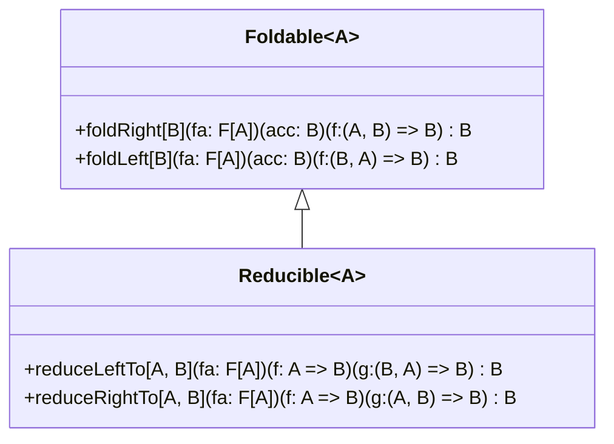

# Reducible

`Reducible` — это класс типов, который расширяет `Foldable`, добавляя методы для **сокращения (редукции)** коллекций. 
Если вы знакомы со стандартной библиотекой Scala, то наверняка встречали методы `reduce`, `reduceLeft` или `reduceOption` на коллекциях.

В отличие от `Foldable`, который требует наличия нейтрального элемента (`empty`), `Reducible` работает с **непустыми** коллекциями. 
Это принципиальное отличие делает `Reducible` особенно полезным для абстрагирования над непустыми структурами данных, 
такими как `NonEmptyList` или `NonEmptyVector`.

## Ключевое преимущество

Поскольку `Reducible` работает только с непустыми коллекциями, 
методы `reduce` и `reduceMap` **никогда не выбрасывают исключений** и **не возвращают `Option`**. 
Это гарантирует, что результат всегда существует, что может быть очень удобно в контексте непустых структур данных.

Это позволяет, например, реализовать методы `maximum` и `minimum` (максимальное и минимальное значение) 
на основе `Reducible`, в отличие от `maximumOption` и `minimumOption` в `Foldable`, которые возвращают `Option`.

## Основные методы `Reducible`

`Reducible[F]` реализуется на основе двух базовых методов (в дополнение к методам, требуемым `Foldable`):

1. **`reduceLeftTo(fa)(f)(g)`** — строгое сокращение с дополнительной функцией отображения.
2. **`reduceRightTo(fa)(f)(g)`** — ленивое сокращение с дополнительной функцией отображения.

Все остальные методы могут быть реализованы через эти два.

## Код

```dotty
trait Reducible[F[_]] extends Foldable[F]:
  /** Базовый метод левоассоциативного сокращения с начальным отображением
    * первого элемента. Применяет функцию `f` к первому элементу, затем
    * последовательно комбинирует результат с каждым следующим элементом,
    * используя бинарную операцию `g`.
    */
  def reduceLeftTo[A, B](fa: F[A])(f: A => B)(g: (B, A) => B): B

  /** Базовый метод правоассоциативного сокращения с начальным отображением
    * последнего элемента. Применяет функцию `f` к последнему элементу, затем
    * последовательно комбинирует результат с каждым предыдущим элементом,
    * используя бинарную операцию `g`.
    */
  def reduceRightTo[A, B](fa: F[A])(f: A => B)(g: (A, B) => B): B

  /** Левоассоциативное сокращение с использованием бинарной операции `f`.
    * Последовательно применяет `f` к элементам коллекции слева направо.
    */
  def reduceLeft[A](fa: F[A])(f: (A, A) => A): A =
    reduceLeftTo(fa)(identity)(f)

  /** Правоассоциативное сокращение с использованием бинарной операции `f`.
    * Последовательно применяет `f` к элементам коллекции справа налево.
    */
  def reduceRight[A](fa: F[A])(f: (A, A) => A): A =
    reduceRightTo(fa)(identity)(f)

  /** Сокращает коллекцию, используя операцию `combine` из `Semigroup[A]`.
    * Эквивалент `reduceLeft` с операцией полугруппы.
    */
  def reduce[A: Semigroup as semi](fa: F[A]): A =
    reduceLeft(fa)(semi.combine)

  /** Отображает каждый элемент в значение типа `B` и сокращает результаты,
    * используя операцию `combine` из `Semigroup[B]`.
    */
  def reduceMap[A, B: Semigroup as semi](fa: F[A])(f: A => B): B =
    reduceLeftTo(fa)(f)((b, a) => semi.combine(b, f(a)))

  /** Преобразует непустую коллекцию в `NonEmptyList`, сохраняя порядок
    * элементов. Использует правоассоциативное сокращение для построения списка
    * с конца.
    */
  def toNonEmptyList[A](fa: F[A]): NonEmptyList[A] =
    reduceRightTo(fa)(a => NonEmptyList(a, Nil)): (a, lnel) =>
      NonEmptyList(a, lnel.toList)

  /** Находит минимальный элемент в непустой коллекции. 
    */
  def minimum[A: Ordering as ord](fa: F[A]): A =
    reduceLeft(fa)(ord.min)

  /** Находит максимальный элемент в непустой коллекции.
    */
  def maximum[A: Ordering as ord](fa: F[A]): A =
    reduceLeft(fa)(ord.max)
```

## Упражнения

### Упражнение 2.11.1: Реализация методов `Foldable` через `Reducible`

> [Репозиторий с упражнениями и инструкцией по выполнению][sample]

В этом упражнении вам предстоит реализовать методы трейта `Foldable` для непустых коллекций,
используя возможности `Reducible`.
Поскольку `Reducible` расширяет `Foldable`, все методы `Foldable` должны быть реализованы 
через базовые методы `Reducible`: `reduceLeftTo` и `reduceRightTo`.

Ваша задача — заполнить пропуски (`???`) в реализации методов `foldRight`, `foldLeft`, `foldMap`, `combineAll` и `toList`.
При реализации обратите внимание на следующие ключевые моменты:

- `foldRight` и `foldLeft` можно выразить через композицию функций, используя `reduceRightTo` и `reduceLeftTo` соответственно.
- `foldMap` должен отображать каждый элемент в значение моноида и объединять результаты.
- `combineAll` должен объединять все элементы с помощью операции моноида.
- `toList` должен преобразовывать непустую коллекцию в обычный список.

```dotty
extension [A](as: F[A])
  override def foldRight[B](acc: B)(f: (A, B) => B): B =
    ???

  override def foldLeft[B](acc: B)(f: (B, A) => B): B =
    ???

  override def foldMap[B: Monoid as m](f: A => B): B =
    ???

  override def combineAll(using ma: Monoid[A]): A =
    ???

  override def toList: List[A] =
    ???
end extension
```

**Примеры:**

```dotty
import cats.data.NonEmptyList

// Создаём непустой список
val nel = NonEmptyList.of(1, 2, 3, 4)

// 1. foldRight — правоассоциативная свёртка
val sumRight = nel.foldRight(0)(_ + _)
// Результат: 10 (1 + (2 + (3 + (4 + 0))))

val concatRight = nel.foldRight("")((i, s) => s + i.toString)
// Результат: "4321"

// 2. foldLeft — левоассоциативная свёртка
val sumLeft = nel.foldLeft(0)(_ + _)
// Результат: 10 ((((0 + 1) + 2) + 3) + 4)

val concatLeft = nel.foldLeft("")((s, i) => s + i.toString)
// Результат: "1234"

// 3. foldMap — отображение и свёртка
val stringConcat = nel.foldMap(_.toString)
// Результат: "1234" (конкатенация строк)

val lengthSum = nel.foldMap(_.toString.length)
// Результат: 4 (сумма длин строк: 1 + 1 + 1 + 1)

// 4. combineAll — объединение всех элементов
val sumAll = nel.combineAll
// Результат: 10 (сумма чисел)

val strs = NonEmptyList.of("a", "b", "c")
val concatAll = strs.combineAll
// Результат: "abc" (конкатенация строк)

// 5. toList — преобразование в список
val list = nel.toList
// Результат: List(1, 2, 3, 4)
```

@:note(🔍 Показать решение)

Для реализации методов `Foldable` через `Reducible` используется техника композиции функций. 
В `foldRight` каждый элемент преобразуется в функцию `B => B` (`g: A => B => B`), 
которая добавляет элемент к аккумулятору справа. 
Функция `h` комбинирует эти функции при правоассоциативном сокращении. 
Аналогично, в `foldLeft` функции комбинируются в обратном порядке. 
`foldMap` использует `reduceLeftTo` с начальным отображением первого элемента и последующим комбинированием с помощью моноида. 
`combineAll` — это частный случай `reduceLeft` с операцией моноида. 
`toList` использует `toNonEmptyList` и затем преобразует результат в обычный список.

```dotty
extension [A](as: F[A])
  override def foldRight[B](acc: B)(f: (A, B) => B): B =
    // g: преобразует каждый элемент в функцию B => B
    val g: A => B => B = (a: A) => (b: B) => f(a, b)
    // h: комбинирует функции при правоассоциативном сокращении
    val h: (A, B => B) => (B => B) = (a, b2b) => b => f(a, b2b(b))
    // Сокращаем коллекцию справа, получая одну функцию B => B
    val func = reduceRightTo[A, B => B](as)(g)(h)
    // Применяем полученную функцию к начальному значению
    func(acc)

  override def foldLeft[B](acc: B)(f: (B, A) => B): B =
    // g: преобразует каждый элемент в функцию B => B
    val g: A => B => B = (a: A) => (b: B) => f(b, a)
    // h: комбинирует функции при левоассоциативном сокращении
    val h: (B => B, A) => (B => B) = (b2b, a) => b => f(b2b(b), a)
    // Сокращаем коллекцию слева, получая одну функцию B => B
    val func = reduceLeftTo[A, B => B](as)(g)(h)
    // Применяем полученную функцию к начальному значению
    func(acc)

  override def foldMap[B: Monoid as m](f: A => B): B =
    // Начинаем с отображения первого элемента, затем комбинируем с остальными
    reduceLeftTo(as)(f)((b: B, a: A) => m.combine(b, f(a)))

  override def combineAll(using ma: Monoid[A]): A =
    // Левоассоциативное сокращение с операцией моноида
    reduceLeft(as)(ma.combine)

  override def toList: List[A] =
    // Преобразуем в NonEmptyList, затем в обычный список
    toNonEmptyList(as).toList
end extension
```

@:@

### Упражнение 2.11.2: Реализация `Reducible` для `NonEmptyList`

В этом упражнении вам предстоит реализовать экземпляр класса типов `Reducible` для `NonEmptyList`.

```dotty
given Reducible[NonEmptyList] with
  def reduceLeftTo[A, B](fa: NonEmptyList[A])(f: A => B)(g: (B, A) => B): B =
    ???

  def reduceRightTo[A, B](fa: NonEmptyList[A])(f: A => B)(g: (A, B) => B): B =
    ???
```

**Примеры:**

```dotty
import cats.data.NonEmptyList

val nel = NonEmptyList.of(1, 2, 3, 4)
val strs = NonEmptyList.of("a", "b", "c", "d")

// 1. reduceLeftTo — левоассоциативное сокращение
val sum = Reducible[NonEmptyList].reduceLeftTo(nel)(identity)(_ + _)
// Результат: 10 (1 + 2 + 3 + 4)

val concat = Reducible[NonEmptyList].reduceLeftTo(strs)(identity)(_ ++ _)
// Результат: "abcd"

val doubledSum = Reducible[NonEmptyList].reduceLeftTo(nel)(_ * 2)(_ + _)
// Результат: 20 (1*2 + 2*2 + 3*2 + 4*2)

// 2. reduceRightTo — правоассоциативное сокращение
val sumRight = Reducible[NonEmptyList].reduceRightTo(nel)(identity)(_ + _)
// Результат: 10 (1 + (2 + (3 + 4)))

val concatRight = Reducible[NonEmptyList].reduceRightTo(strs)(identity)(_ ++ _)
// Результат: "abcd" ("a" ++ ("b" ++ ("c" ++ "d")))
```

@:note(🔍 Показать решение)

Для реализации `reduceLeftTo` используется структура `NonEmptyList`: 
голова списка служит начальным значением аккумулятора после применения функции `f`, 
а затем с помощью `foldLeft` последовательно применяется бинарная операция `g` к аккумулятору и каждому элементу хвоста. 
Это даёт левоассоциативное сокращение с эффективностью O(n) по времени и O(1) по памяти.

Для `reduceRightTo` реализация рекурсивна: базовый случай — список из одного элемента, где возвращается `f(a)`; 
рекурсивный случай — голова и непустой хвост, где сначала рекурсивно сокращается хвост, 
а затем применяется `g` к голове и результату сокращения хвоста. 
Такая реализация даёт правоассоциативное сокращение, но требует O(n) памяти из-за рекурсии.

```dotty
given Reducible[NonEmptyList] with
  def reduceLeftTo[A, B](fa: NonEmptyList[A])(f: A => B)(g: (B, A) => B): B =
    fa.tail.foldLeft(f(fa.head))(g)

  def reduceRightTo[A, B](fa: NonEmptyList[A])(f: A => B)(g: (A, B) => B): B =
    fa match
      case NonEmptyList(a, Nil) =>
        f(a)
      case NonEmptyList(a, h :: t) =>
        g(a, reduceRightTo(NonEmptyList(h, t))(f)(g))
```

@:@

## Схема



## Реализация в библиотеках

### Реализация в Cats

```dotty
import cats.*
import cats.data.*
import cats.syntax.all.*

Reducible[NonEmptyList].reduce(NonEmptyList.of("a", "b", "c"))
// res0: String = "abc"
Reducible[NonEmptyList].reduceMap(NonEmptyList.of(1, 2, 4))(_.toString)
// res1: String = "124"
Reducible[NonEmptyVector].reduceK(NonEmptyVector.of(
  List(1, 2, 3),
  List(2, 3, 4)
))
// res2: List[Int] = List(1, 2, 3, 2, 3, 4)
Reducible[NonEmptyVector].reduceLeft(NonEmptyVector.of(1, 2, 3, 4))((s, i) =>
  s + i
)
// res3: Int = 10
Reducible[NonEmptyList].reduceRight(NonEmptyList.of(1, 2, 3, 4))((i, s) =>
  Later(s.value + i)
).value
// res4: Int = 10
Reducible[NonEmptyList].reduceLeftTo(NonEmptyList.of(1, 2, 3, 4))(_.toString)(
  (s, i) => s + i
)
// res5: String = "1234"
Reducible[NonEmptyList].reduceRightTo(NonEmptyList.of(1, 2, 3, 4))(_.toString)(
  (i, s) => Later(s.value + i)
).value
// res6: String = "4321"
Reducible[NonEmptyList].nonEmptyIntercalate(
  NonEmptyList.of("a", "b", "c"),
  ", "
)
// res7: String = "a, b, c"

def countChars(s: String) =
  s.toCharArray.groupBy(identity).view.mapValues(_.length).toMap

Reducible[NonEmptyList].nonEmptyTraverse_(NonEmptyList.of(
  "Hello",
  "World"
))(countChars)
// res8: Map[Char, Unit] = Map('l' -> (), 'o' -> ())
Reducible[NonEmptyVector].nonEmptyTraverse_(NonEmptyVector.of(
  "Hello",
  ""
))(countChars)
// res9: Map[Char, Unit] = Map()
Reducible[NonEmptyList].nonEmptySequence_(NonEmptyList.of(
  Map(1 -> 'o'),
  Map(1 -> 'o')
))
// res10: Map[Int, Unit] = Map(1 -> ())
```

---

**Ссылки:**

- [Ссылка на репозиторий с упражнениями][sample]
- [Cats](https://typelevel.org/cats/typeclasses/reducible.html)

[sample]: https://gitverse.ru/scalabook/typeclasses
