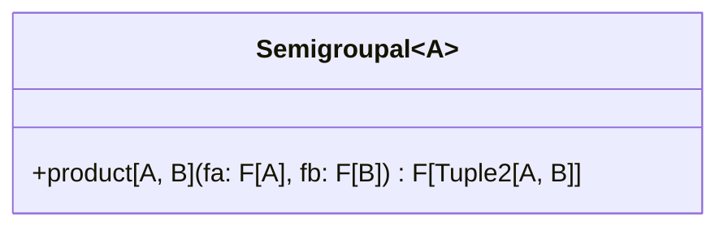



# Semigroupal

**Semigroupal** — это абстракция из функционального программирования, которая позволяет комбинировать два или более значений, 
находящихся в контексте (например, в `Option`, `List`, `Future` и т.д.), в одно значение. 
В отличие от [`Applicative`](applicative.md), `Semigroupal` не требует наличия операции `pure` 
(которая помещает значение в контекст), что делает его более общей и менее строгой абстракцией.

**Основная идея Semigroupal**

`Semigroupal` — это тип, который реализует операцию `product` (или `tuple2`, `tuple3` и т.д.), 
которая комбинирует два значения в контексте в пару (или кортеж) в том же контексте.

**Зачем нужен Semigroupal?**

`Semigroupal` полезен, когда вам нужно:

- Комбинировать несколько значений, находящихся в контексте, в одно значение (например, пару или кортеж).
- Работать с эффектами (например, асинхронность, опциональность, ошибки) без необходимости использовать 
  более строгие абстракции, такие как `Applicative` или `Monad`.
- Создавать композируемые и выразительные комбинаторы для работы с контекстами.

**Примеры Semigroupal**

- `Option` как Semigroupal. `Option` — это контейнер, который может содержать значение (`Some`) или быть пустым (`None`). 
  `Semigroupal` позволяет комбинировать два опциональных значения в пару.
- `List` как Semigroupal. `List` — это контейнер, содержащий множество значений. 
  `Semigroupal` позволяет комбинировать два списка, создавая декартово произведение.
- `Future` как Semigroupal. `Future` — это контейнер, представляющий асинхронное вычисление. 
  `Semigroupal` позволяет комбинировать два асинхронных вычисления в одно.

## Формальное определение

`Semigroupal` - это класс типов, который позволяет комбинировать контексты. 
Если есть два объекта типа `F[A]` и `F[B]`, `Semigroupal[F]` позволяет объединить их для формирования объекта `F[(A, B)]`:
`product: (F[A], F[B]) => F[(A, B)]` (также встречается название операции `tuple2`).

`Semigroupal` должен удовлетворять следующим законам:

- ассоциативность: `product(a, product(b, c)) == product(product(a, b), c)`

Закон ассоциативности обеспечивает предсказуемость и согласованность при работе с контекстами. 
Это особенно важно в функциональном программировании, где композиция и комбинирование операций являются основными принципами. 
Если закон ассоциативности выполняется, вы можете быть уверены, что порядок комбинирования не повлияет на результат, 
что делает код более надежным и легким для понимания.

## Код

```dotty
trait Semigroupal[F[_]]:
  def product[A, B](fa: F[A], fb: F[B]): F[(A, B)]
```

### "Обертка"

```dotty
type Id[A] = A
object Id:
  def apply[A](a: A): Id[A] = a

given Semigroupal[Id] with
  override def product[A, B](fa: Id[A], fb: Id[B]): Id[(A, B)] = Id((fa, fb))
```

### Option

```dotty
given Semigroupal[Option] with
  override def product[A, B](fa: Option[A], fb: Option[B]): Option[(A, B)] =
    (fa, fb) match
      case (Some(a), Some(b)) => Some((a, b))
      case _                  => None
```

### Законы

Закон ассоциативности утверждает, что порядок, в котором вы комбинируете значения, не должен влиять на результат. 
Например, если у вас есть три значения в контексте: `fa`, `fb` и `fc`, то:

- Сначала скомбинировать `fa` и `fb`, а затем результат с `fc` — это то же самое, что:
- Сначала скомбинировать `fb` и `fc`, а затем результат с `fa`.

```dotty
def checkSemigroupalLaw[F[_]: Semigroupal: Runner1, A, B, C](
    fa: F[A],
    fb: F[B],
    fc: F[C]
): ValidatedNel[String, Unit] =
  val product1: (A, (B, C)) =
    Runner1[F].run(
      Semigroupal[F]
        .product[A, (B, C)](fa, Semigroupal[F].product[B, C](fb, fc))
    )
  val product2: ((A, B), C) =
    Runner1[F].run(
      Semigroupal[F]
        .product[(A, B), C](Semigroupal[F].product[A, B](fa, fb), fc)
    )
  val value1: (A, B, C) = (product1._1, product1._2._1, product1._2._2)
  val value2: (A, B, C) = (product2._1._1, product2._1._2, product2._2)
  Either.cond[String, Unit](
    value1 == value2,
    (),
    "Не соблюдается ассоциативность: product(a, product(b, c)) == product(product(a, b), c)"
  ).toValidatedNel
end checkSemigroupalLaw
```

## Схема



## Реализация в библиотеках

### Реализация в Cats

```dotty
import cats.Semigroupal
import cats.instances.option.*

Semigroupal[Option].product(Some(123), Some("abc")) // Some((123,abc))
Semigroupal.tuple3(Option(1), Option(2), Option(3)) // Some((1,2,3))
```

---

**Ссылки:**

- [Cats API](https://typelevel.org/cats/api/cats/Semigroupal.html)
- [Herding Cats](http://eed3si9n.com/herding-cats/Semigroupal.html)
- [Scala with Cats](https://www.scalawithcats.com/dist/scala-with-cats.html#semigroupal)
