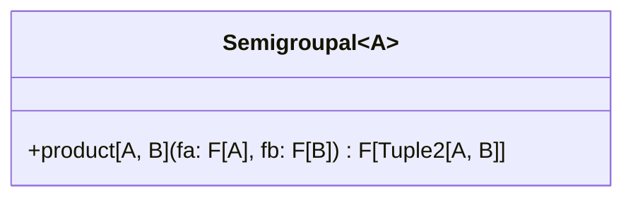



# Semigroupal

**Semigroupal** — это абстракция из функционального программирования, которая позволяет комбинировать два или более значений, 
находящихся в контексте (например, в `Option`, `List`, `Future` и т.д.), в одно значение. 
В отличие от [`Applicative`](applicative.md), `Semigroupal` не требует наличия операции `pure` 
(которая помещает значение в контекст), что делает его более общей и менее строгой абстракцией.

**Зачем нужен Semigroupal?**

`Semigroupal` полезен, когда вам нужно:

- Комбинировать несколько значений, находящихся в контексте, в одно значение (например, пару или кортеж).
- Работать с эффектами (например, асинхронность, опциональность, ошибки) без необходимости использовать 
  более строгие абстракции, такие как `Applicative` или `Monad`.
- Создавать композируемые и выразительные комбинаторы для работы с контекстами.

**Примеры Semigroupal**

- `Option` как Semigroupal. `Option` — это контейнер, который может содержать значение (`Some`) или быть пустым (`None`). 
  `Semigroupal` позволяет комбинировать два опциональных значения в пару.
- `List` как Semigroupal. `List` — это контейнер, содержащий множество значений. 
  `Semigroupal` позволяет комбинировать два списка, создавая декартово произведение.
- `Future` как Semigroupal. `Future` — это контейнер, представляющий асинхронное вычисление. 
  `Semigroupal` позволяет комбинировать два асинхронных вычисления в одно.

## Формальное определение

`Semigroupal` - это класс типов, который позволяет комбинировать контексты. 
Если есть два объекта типа `F[A]` и `F[B]`, `Semigroupal[F]` позволяет объединить их для формирования объекта `F[(A, B)]`:
`product: (F[A], F[B]) => F[(A, B)]` (также встречается название операции `tuple2`).

`Semigroupal` должен удовлетворять следующим законам:

- ассоциативность: `product(a, product(b, c)) == product(product(a, b), c)`

## Код

```dotty
trait Semigroupal[F[_]]:
  def product[A, B](fa: F[A], fb: F[B]): F[(A, B)]
```

### Законы

Закон ассоциативности утверждает, что порядок, в котором вы комбинируете значения, не должен влиять на результат.
Например, если у вас есть три значения в контексте: `fa`, `fb` и `fc`, то:

- Сначала скомбинировать `fa` и `fb`, а затем результат с `fc` — это то же самое, что:
- Сначала скомбинировать `fb` и `fc`, а затем результат с `fa`.

Закон ассоциативности обеспечивает предсказуемость и согласованность при работе с контекстами.
Это особенно важно в функциональном программировании, где композиция и комбинирование операций являются основными принципами.

## Упражнения

### Упражнение 2.3.1: Реализация Semigroupal для тождественного типа Id.

> [Репозиторий с упражнениями и инструкцией по выполнению][sample]

Реализуйте экземпляр `Semigroupal` для тождественного типа `Id[A]`, который является простой обёрткой над значением `A`. 
Операция `product` должна создать пару из двух значений, обёрнутую в `Id`.

```dotty
type Id[A] = A
object Id:
  def apply[A](a: A): Id[A] = a

given Semigroupal[Id] with
  def product[A, B](fa: Id[A], fb: Id[B]): (A, B) = ???
```

**Примеры:**

```dotty
import Semigroupal.given

val a: Id[Int] = Id(42)
val b: Id[String] = Id("Hello")
val c: Id[Boolean] = Id(true)

// Комбинирование двух значений
val result1 = product(a, b)     // Id((42, "Hello"))
val result2 = product(a, c)     // Id((42, true))
val result3 = product(b, c)     // Id(("Hello", true))
```

@:note(🔍 Показать решение)

Тождественный тип `Id[A]` — это просто обёртка над значением `A`, 
поэтому `product` должен принять два таких значения `fa` и `fb`, 
которые на самом деле являются просто значениями типов `A` и `B`, 
и вернуть пару `(fa, fb)`, обёрнутую в `Id`. 

```dotty
given Semigroupal[Id] with
  def product[A, B](fa: Id[A], fb: Id[B]): (A, B) =
    Id((fa, fb))
```

@:@

### Упражнение 2.3.2: Реализация Semigroupal для типа Option

`Semigroupal` для `Option` должен комбинировать два значения типа `Option[A]` и `Option[B]` в `Option[(A, B)]`.
Такое поведение напоминает логическое "И" (AND) для наличия значений. 
Реализуйте экземпляр `Semigroupal[Option]`, следуя этому правилу.

```dotty
given Semigroupal[Option] with
  def product[A, B](fa: Option[A], fb: Option[B]): Option[(A, B)] = ???
```

**Примеры:**

```dotty
import Semigroupal.given

val someInt: Option[Int] = Some(42)
val someString: Option[String] = Some("Hello")
val someBoolean: Option[Boolean] = Some(true)
val noneInt: Option[Int] = None

val result1 = product(someInt, someString)     // Some((42, "Hello"))
val result2 = product(someInt, someBoolean)    // Some((42, true))
val result3 = product(someString, someBoolean) // Some(("Hello", true))
val result4 = product(someInt, noneString)     // None
```

@:note(🔍 Показать решение)

Решение использует сопоставление с шаблоном по паре значений `(fa, fb)`. 
Если оба значения являются `Some(a)` и `Some(b)`, 
мы извлекаем их содержимое и возвращаем `Some((a, b))` — пару из обоих значений. 
Во всех остальных случаях (когда хотя бы одно из значений — `None`) мы возвращаем `None`. 
Такая реализация соответствует семантике "отказоустойчивого" комбинирования: 
если хотя бы один из компонентов отсутствует, весь результат считается отсутствующим. 

```dotty
given Semigroupal[Option] with
  def product[A, B](fa: Option[A], fb: Option[B]): Option[(A, B)] =
    (fa, fb) match
      case (Some(a), Some(b)) => Some((a, b))
      case _                  => None
```

@:@

### Упражнение 2.3.3: Реализация Semigroupal для типа List

`Semigroupal` для `List` должен комбинировать два списка в список пар элементов.
Реализация должна создавать пары из элементов с одинаковыми индексами (позициями)
и прекращать объединение, когда хотя бы один из списков заканчивается.

Реализуйте экземпляр `Semigroupal[List]`, следуя этому правилу.

```dotty
given Semigroupal[List] with
  def product[A, B](fa: List[A], fb: List[B]): List[(A, B)] = ???
```

**Примеры:**

```dotty
import Semigroupal.given

val numbers = List(1, 2, 3, 4, 5)
val strings = List("a", "b", "c")
val booleans = List(true, false)

val result1 = product(numbers, strings)   
// List((1,"a"), (2,"b"), (3,"c"))
val result2 = product(numbers, booleans)  
// List((1,true), (2,false))
```

@:note(🔍 Показать решение)

Решение использует рекурсивное сопоставление с шаблоном. 
Базовый случай — когда хотя бы один из списков пуст (паттерн `_` в сочетании с `Nil`), тогда возвращается пустой список `Nil`. 
Рекурсивный случай — когда оба списка непустые и имеют вид `a :: tailA` и `b :: tailB`. 
В этом случае мы создаём пару из голов `(a, b)`, добавляем её в начало результата рекурсивного вызова `product(tailA, tailB)`. 
Важно отметить, что эта реализация обрезает результат до длины более короткого списка, 
что соответствует поведению стандартного метода `zip`. 
Такой подход гарантирует линейную сложность O(min(n, m)) и сохраняет порядок элементов.

```dotty
given Semigroupal[List] with
  def product[A, B](fa: List[A], fb: List[B]): List[(A, B)] =
    (fa, fb) match
      case (a :: tailA, b :: tailB) =>
        (a, b) :: product(tailA, tailB)
      case _ => Nil
```

@:@

## Схема



## Реализация в библиотеках

### Реализация в Cats

```dotty
import cats.Semigroupal
import cats.instances.option.*

Semigroupal[Option].product(Some(123), Some("abc")) // Some((123,abc))
Semigroupal.tuple3(Option(1), Option(2), Option(3)) // Some((1,2,3))
```

---

**Ссылки:**

- [Ссылка на репозиторий с упражнениями][sample]
- [Cats API](https://typelevel.org/cats/api/cats/Semigroupal.html)
- [Herding Cats](http://eed3si9n.com/herding-cats/Semigroupal.html)
- [Scala with Cats](https://scalawithcats.com/dist/scala-with-cats.html#semigroupal)

[sample]: https://gitverse.ru/scalabook/typeclasses
