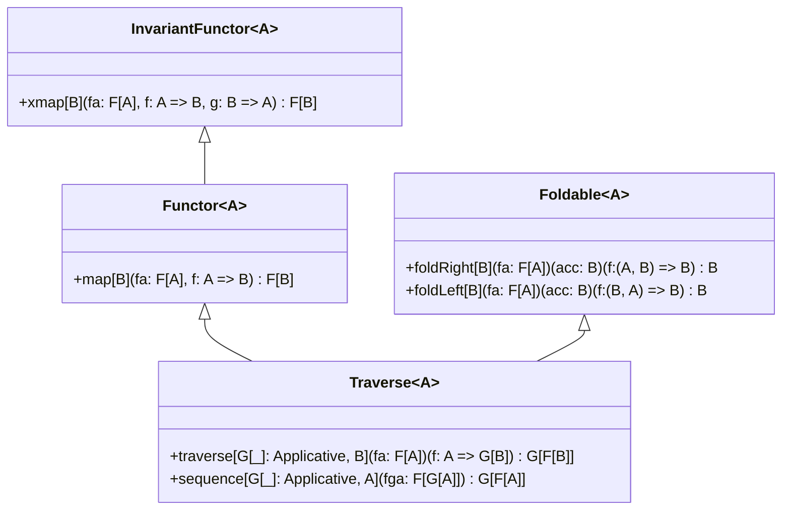



# Traverse

`Traverse` — это концепция из функционального программирования, 
которая расширяет возможности [`Functor`](functor.md) и [`Foldable`](foldable.md). 
Она позволяет "проходить" (_traverse_) по структуре данных, применяя функцию к каждому элементу 
и собирая результаты в новую структуру. 

Основная идея `Traverse` — это возможность работать с эффектами 
(например, `Option`, `Future`, `Either`) внутри структуры данных.

**Основные характеристики `Traverse`:**

- **Операция `traverse`**:
  Применяет функцию к каждому элементу структуры данных, собирая результаты в новую структуру с эффектом. 
  Например, можно преобразовать список чисел в список `Option` или `Future`.
- **Операция `sequence`**:
  Преобразует структуру данных, содержащую эффекты, в эффект, содержащий структуру данных. 
  Например, можно преобразовать список `Option` в `Option` списка.
- **Комбинирование с эффектами**:
  `Traverse` позволяет работать с эффектами (например, обработка ошибок, асинхронные вычисления) внутри структур данных.

**Примеры `Traverse`**

- **Преобразование списка `Option` в `Option` списка**.
  Предположим есть список чисел, и необходимо преобразовать каждое число в `Option` (например, проверяя, является ли число чётным). 
  С помощью `Traverse` можно применить эту операцию ко всем элементам списка и получить `Option` списка.
- **Преобразование списка `Future` в `Future` списка**.
  Предположим есть список асинхронных вычислений (`Future`). 
  С помощью `Traverse` можно преобразовать этот список в одно асинхронное вычисление, которое возвращает список результатов.
- **Обработка ошибок в списке**.
  Предположим есть список операций, каждая из которых может завершиться ошибкой (`Either`). 
  С помощью `Traverse` можно выполнить все операции и собрать результаты в один `Either`, 
  который либо содержит список успешных результатов, либо первую ошибку.
- **Валидация данных**.
  Предположим есть список данных, и необходимо проверить каждый элемент на соответствие определённым правилам 
  (например, с помощью валидатора). С помощью `Traverse` можно применить валидатор ко всем элементам 
  и собрать результаты в один объект, который либо содержит все данные, либо список ошибок.
- **Преобразование JSON**.
  Предположим есть JSON-объект, и необходимо преобразовать каждое поле в определённый тип (например, строку в число). 
  С помощью `Traverse` можно применить функцию преобразования ко всем полям и собрать результаты в новый JSON-объект.

## Формальное определение

`Traverse` — это тип данных, расширяющий возможности [`Functor`](functor.md) и [`Foldable`](foldable.md), 
для которого определена операция `traverse` (и её вариант `sequence`), удовлетворяющая следующим свойствам:

- **Операция `traverse`**:
  Для типа `F[A]` (где `F` — контейнер, а `A` — тип элементов) и [аппликативного функтора](applicative.md) `G` 
  операция `traverse` имеет сигнатуру:
  `def traverse[G[_]: Applicative, A, B](fa: F[A])(f: A => G[B]): G[F[B]]`
  Здесь:
    - `fa` — контейнер с элементами типа `A`.
    - `f` — функция, которая принимает элемент типа `A` и возвращает значение типа `G[B]` (эффект).
    - `G` — аппликативный функтор эффекта.
    - Результат — значение типа `G[F[B]]`, где `F[B]` — новая структура данных, а `G` — эффект.
- **Операция `sequence`**:
  Это частный случай `traverse`, где функция `f` — это тождественное преобразование (`identity`). 
  Она преобразует структуру данных, содержащую эффекты, в эффект, содержащий структуру данных:
   `def sequence[G[_]: Applicative, A](fga: F[G[A]]): G[F[A]]`

С помощью `traverse` можно выразить и `map`, и `foldRight`, а также `sequence`, отображающий `F[G[A]]` в `G[F[A]]`.
По этой причине `Traverse` иногда называют _"обходным функтором"_.

### Законы `Traverse`

Для того чтобы тип данных считался `Traverse`, он должен удовлетворять определённым законам. 
Вот основные из них:

- **Закон согласованности с `map`**:
  Операция `traverse` должна быть согласована с операцией `map`:
  `traverse(fa)(x => Applicative[G].pure(f(x))) == Applicative[G].pure(fa.map(f))`
- **Закон согласованности с `sequence`**:
  Операция `sequence` должна быть согласована с `traverse`:
  `sequence(fga) == traverse(fga)(identity)`
- Обход `Id` эквивалентен `Functor#map`:
  ```dotty
  type Id[A] = A
  traverse[F, Id, A, B](fa, a => Id(f(a))) == fa.map(f)
  ```
- Два последовательно зависимых эффекта могут быть объединены в один, их композицию:
  ```dotty
  val optFb: G[F[B]] = traverse[F, G, A, B](fa, a => unit(f(a)))
  val optListFc1: G[H[F[C]]] =
      map[G, F[B], H[F[C]]](
        optFb, 
        fb => traverse[F, H, B, C](fb, b => unit(g(b)))
      )
  val optListFc2: G[H[F[C]]] =
      traverse[F, [X] =>> G[H[X]], A, C](
        fa, 
        a => map[G, B, H[C]](unit(f(a)), b => unit(g(b)))
      )
  optListFc1 == optListFc2
  ```
- Два независимых эффекта могут быть объединены в один эффект, их произведение
  ```dotty
  type GH[A] = (G[A], H[A])
  val t1: GH[F[B]] = 
      (traverse[F, G, A, B](fa, a => unit(f(a))), 
      traverse[F, H, A, B](fa, a => unit(f(a))))
  val t2: GH[F[B]] = traverse[F, GH, A, B](fa, a => (unit(f(a)), unit(f(a))))
  t1 == t2
  ```

## Код

```dotty
trait Traverse[F[_]] extends Functor[F], Foldable[F]:
  import Traverse.given

  extension [A](fa: F[A])
    def traverse[G[_]: Applicative, B](f: A => G[B]): G[F[B]]

    override def map[B](f: A => B): F[B] =
      traverse[[X] =>> X, B](a => f(a))

    override def foldMap[B](f: A => B)(using mb: Monoid[B]): B =
      val state: State[B, F[A]] =
        traverse(a => State[B, A]((b: B) => (mb.combine(b, f(a)), a)))(using
          stateApplicative
        )
      val (b, _) = state.run(mb.empty)
      b

  def sequence[G[_]: Applicative, A](fga: F[G[A]]): G[F[A]] =
    fga.traverse(ga => ga)
    
object Traverse:
  def apply[F[_]: Traverse]: Traverse[F] = summon[Traverse[F]]

  given Applicative[[X] =>> X] with
    override def unit[A](a: => A): A = a

    override def apply[A, B](fab: A => B)(fa: A): B =
      fab(fa)

  given stateApplicative[S]: Applicative[[X] =>> State[S, X]] = 
    ??? // Упражнение 2.5.6: Реализация Applicative для типа State   
```

## Реализация `map`, `foldMap` и `sequence` в `Traverse`

### Реализация `map` через `traverse`

```dotty
override def map[B](f: A => B): F[B] =
  traverse[[X] =>> X, B](a => f(a))
```

**Как это работает:**

`map` — частный случай `traverse`, где эффект `G` является **тождественным типом** `Id[A] = A` (отсутствие эффекта).

- `traverse[G[_]: Applicative, B](f: A => G[B]): G[F[B]]`
- Подставляем `G = [X] =>> X` (тождественный функтор)
- `f: A => Id[B] = A => B`
- Результат: `Id[F[B]] = F[B]`

В объекте `Traverse` определён экземпляр:

```dotty
given Applicative[[X] =>> X] with
  override def unit[A](a: => A): A = a
  override def apply[A, B](fab: A => B)(fa: A): B = fab(fa)
```

Этот экземпляр делает тождественный тип аппликативным функтором:

- `unit(a)` просто возвращает `a`
- `apply` применяет функцию к аргументу

### Реализация `foldMap` через `traverse`

```dotty
override def foldMap[B](f: A => B)(using mb: Monoid[B]): B =
  val state: State[B, F[A]] =
    traverse(a => 
      State[B, A] { (b: B) =>
        (mb.combine(b, f(a)), a)
      }
    )(using stateApplicative)
  
  val (result, _) = state.run(mb.empty)
  result
```

**Шаг 1: Преобразование каждого элемента в State-вычисление**

Для каждого элемента `a` создаётся `State[B, A]`:

```dotty
State[B, A] { (b: B) =>
  (mb.combine(b, f(a)), a)
}
```

Это вычисление:

- Принимает текущий аккумулятор `b` (типа `B`)
- Комбинирует его с `f(a)` с помощью операции моноида: `mb.combine(b, f(a))`
- Возвращает пару `(новый_аккумулятор, исходный_элемент_a)`

**Шаг 2: traverse с State**

```dotty
val state: State[B, F[A]] = traverse(...)(using stateApplicative)
```

`traverse` проходит по структуре `F[A]` и:

- Для каждого элемента `a` создаёт `State`-вычисление, которое обновляет аккумулятор
- Комбинирует их с помощью аппликатива `State`
- Результат: `State[B, F[A]]` — вычисление, которое:
    - Принимает начальное состояние (пустой элемент моноида)
    - Возвращает финальное состояние и исходную структуру `F[A]`

**Шаг 3: Запуск State-вычисления**

```dotty
val (result, _) = state.run(mb.empty)
```

- Запускаем State с начальным аккумулятором `mb.empty`
- Получаем финальный аккумулятор `result` — это и есть результат `foldMap`
- Игнорируем `F[A]` (исходную структуру)

#### Почему это работает как foldMap?

Для каждого элемента структуры мы последовательно комбинируем аккумулятор с `f(a)`:

```dotty
// Для списка [a1, a2, a3] с пустым начальным значением empty:

// Шаг 1: (empty, a1) -> combine(empty, f(a1)) = f(a1)
// Шаг 2: (f(a1), a2) -> combine(f(a1), f(a2))
// Шаг 3: (combine(f(a1), f(a2)), a3) -> combine(combine(f(a1), f(a2)), f(a3))

// Результат: combine(combine(combine(empty, f(a1)), f(a2)), f(a3))
```

Это в точности левая ассоциативная свёртка, которая для моноида эквивалентна `foldMap` (так как моноид ассоциативен).

### Пример для списка целых чисел

```dotty
val list = List(1, 2, 3, 4)

// foldMap для суммы
list.foldMap(identity)(using Monoid.intAdditionMonoid)

// Процесс:
// 1. state.run(0): (0, 1) -> combine(0, 1) = 1
// 2. (1, 2) -> combine(1, 2) = 3
// 3. (3, 3) -> combine(3, 3) = 6
// 4. (6, 4) -> combine(6, 4) = 10
// Результат: 10

// foldMap для конкатенации строк
list.foldMap(_.toString)(using Monoid.stringMonoid)

// Результат: "1234"
```

### Реализация `sequence`

```dotty
def sequence[G[_]: Applicative, A](fga: F[G[A]]): G[F[A]] =
  fga.traverse(ga => ga)
```

**Как это работает:**

`sequence` "переворачивает" структуры: из `F[G[A]]` получает `G[F[A]]`.

- Вход: `F[G[A]]` — структура `F`, содержащая эффекты `G`
- Выход: `G[F[A]]` — эффект `G`, содержащий структуру `F[A]`

**Реализация через `traverse`:**

```dotty
fga.traverse(ga => ga)
```

- `traverse` ожидает функцию `A => G[B]`
- Здесь `fga: F[G[A]]`, то есть каждый элемент имеет тип `G[A]`
- Функция `ga => ga` — это **тождественная функция**: `G[A] => G[A]`
- `traverse` применяет эту функцию к каждому элементу и собирает результаты

**Типы:**

- `traverse[G[_], B](f: A => G[B]): G[F[B]]`
- Подставляем `A = G[A]` (элемент структуры `F` имеет тип `G[A]`)
- Подставляем `B = A`
- `f: G[A] => G[A]` — тождественная функция
- Результат: `G[F[A]]`

**Пример для `List[Option[Int]]`:**

```dotty
val listOpt: List[Option[Int]] = List(Some(1), Some(2), Some(3))

// sequence переворачивает структуру
val optList = sequence(listOpt)  // Some(List(1, 2, 3))

// Как это работает:
// traverse проходит по списку: Some(1), Some(2), Some(3)
// Каждый элемент ga => ga возвращает Some(1), Some(2), Some(3)
// Applicative[Option] комбинирует их: Some(1) *> Some(2) *> Some(3)
// Результат: Some(List(1, 2, 3))

// Если есть None:
val listOpt2: List[Option[Int]] = List(Some(1), None, Some(3))
val optList2 = sequence(listOpt2)  // None
```

**Пример для `Option[List[Int]]`:**

```dotty
val optList: Option[List[Int]] = Some(List(1, 2, 3))

// sequence переворачивает структуру
val listOpt = sequence(optList)  // List(Some(1), Some(2), Some(3))
```

### Итого

| Метод      | Выражается через         | Ключевая идея              |
|------------|--------------------------|----------------------------|
| `map`      | `traverse` с `Id`        | Тождественный эффект       |
| `foldMap`  | `traverse` с `State`     | Аккумулятор как состояние  |
| `sequence` | `traverse` с `identity`  | Переворачивание эффектов   |

`Traverse` объединяет возможности `Functor`, `Foldable` и добавляет **эффектный проход** по структуре данных, 
что делает его одной из самых мощных абстракций в функциональном программировании.

## Упражнения

### Упражнение 2.10.1: Реализация Traverse для типа Option.

> [Репозиторий с упражнениями и инструкцией по выполнению][sample]

Реализуйте экземпляр `Traverse` для `Option`:

```dotty
given Traverse[Option] with
  extension [A](fa: Option[A])
    override def traverse[G[_]: Applicative, B](f: A => G[B]): G[Option[B]] = ???
```

**Примеры:**

```dotty
val opt = Some(5)

// traverse с List как эффектом
opt.traverse(x => List(x, x * 2)) 
// List(Some(5), Some(10))

// Использование для преобразования типов
opt.traverse(x => Right(x.toString): Either[String, String]) 
// Right(Some("5"))
```

@:note(🔍 Показать решение)

В реализации используется сопоставление с шаблоном: для `Some(a)` мы применяем `f(a)`, получая `G[B]`, 
затем с помощью `map` поднимаем результат в `Some`, получая `G[Option[B]]`. 
Для `None` мы просто возвращаем `None`, поднятый в контекст `G` с помощью `ap.unit(None)`. 

```dotty
given Traverse[Option] with
  extension [A](fa: Option[A])
    override def traverse[G[_]: Applicative as ap, B](f: A => G[B])
        : G[Option[B]] =
      fa match
        case Some(a) => f(a).map(Some(_))
        case None    => ap.unit(None)
```

@:@

### Упражнение 2.10.2: Реализация Traverse для типа List.

Реализуйте экземпляр `Traverse` для `List`.

```dotty
given Traverse[List] with
  extension [A](fa: List[A])
    override def traverse[G[_]: Applicative, B](f: A => G[B]): G[List[B]] = ???
```

**Примеры:**

```dotty
// traverse с Option как эффектом
val list1 = List(1, 2, 3)
list1.traverse(x => Some(x * 2))   // Some(List(2, 4, 6))
list1.traverse(x => if x % 2 == 0 then Some(x) else None) // None

// traverse с Either как эффектом
list1.traverse(x => Right(x.toString): Either[String, String]) // Right(List("1","2","3"))
list1.traverse(x => if x > 0 then Right(x) else Left("negative")) // Right(List(1,2,3))
```

@:note(🔍 Показать решение)

Используем `foldRight`, начиная с `g.unit(List[B]())` — пустого списка в контексте `G`. 
Для каждого элемента `a` и текущего аккумулятора `acc` применяем `f(a)`, получая `G[B]`, 
и комбинируем с `acc` через `map2`. 
Функция `(b, bs) => b :: bs` добавляет новый элемент в начало списка, 
что при обходе справа налево восстанавливает исходный порядок.

```dotty
given Traverse[List] with
  extension [A](fa: List[A])
    override def traverse[G[_]: Applicative as g, B](
        f: A => G[B]
    ): G[List[B]] =
      fa.foldRight(g.unit(List[B]()))((a, acc) => f(a).map2(acc)(_ :: _))
```

@:@

### Упражнение 2.10.3: Реализация Traverse для пары (tuple2).

Реализуйте экземпляр `Traverse` для пары `(X, X)`.

```dotty
given Traverse[[X] =>> (X, X)] with
  extension [A](fa: (A, A))
    override def traverse[G[_]: Applicative, B](f: A => G[B]): G[(B, B)] = ???
```

**Примеры:**

```dotty
val pair = (1, 2)

// traverse с Option как эффектом
pair.traverse(x => Some(x * 2))    // Some((2, 4))
pair.traverse(x => None)           // None

// traverse с List как эффектом
pair.traverse(x => List(x, x * 2)) 
// List((1,2), (1,4), (2,2), (2,4))

// traverse с Either как эффектом
pair.traverse(x => Right(x.toString)) // Right(("1","2"))
```

@:note(🔍 Показать решение)

Создаём каррированную функцию `b1 => b2 => (b1, b2)`, поднимаем её в контекст `G` через `g.unit`. Затем применяем эту функцию сначала к результату `f(fa._1)`, получая `G[B => (B, B)]`, а затем к `f(fa._2)`, получая `G[(B, B)]`. Это стандартный паттерн для аппликативного обхода кортежей.

```dotty
given Traverse[[X] =>> (X, X)] with
  extension [A](fa: (A, A))
    override def traverse[G[_]: Applicative as g, B](f: A => G[B])
        : G[(B, B)] =
      val func: G[B => B => (B, B)] = g.unit(b1 => b2 => (b1, b2))
      g.apply(g.apply(func)(f(fa._1)))(f(fa._2))
```

@:@

### Упражнение 2.10.4: Реализация Traverse для тройки (tuple3).

Реализуйте экземпляр `Traverse` для тройки `(X, X, X)`.

```dotty
given Traverse[[X] =>> (X, X, X)] with
  extension [A](fa: (A, A, A))
    override def traverse[G[_]: Applicative, B](f: A => G[B]): G[(B, B, B)] = ???
```

**Примеры:**

```dotty
val triple = (1, 2, 3)

// traverse с Option как эффектом
triple.traverse(x => Some(x * 2))    // Some((2, 4, 6))
triple.traverse(x => None)           // None

// traverse с List как эффектом
triple.traverse(x => List(x, x * 2)) 
// 8 вариантов: все комбинации (1/2, 2/4, 3/6)

// traverse с Either как эффектом
triple.traverse(x => Right(x.toString)) // Right(("1","2","3"))
```

@:note(🔍 Показать решение)

Создаём каррированную функцию от трёх аргументов `b1 => b2 => b3 => (b1, b2, b3)`, 
поднимаем её в контекст `G` через `g.unit`. 
Затем трижды применяем `g.apply`: сначала к `f(fa._1)`, получая `G[B => B => (B, B, B)]`, 
затем к `f(fa._2)`, получая `G[B => (B, B, B)]`, 
и наконец к `f(fa._3)`, получая `G[(B, B, B)]`.

```dotty
given Traverse[[X] =>> (X, X, X)] with
  extension [A](fa: (A, A, A))
    override def traverse[G[_]: Applicative as g, B](f: A => G[B])
        : G[(B, B, B)] =
      val func: G[B => B => B => (B, B, B)] =
        g.unit(b1 => b2 => b3 => (b1, b2, b3))
      g.apply(g.apply(g.apply(func)(f(fa._1)))(f(fa._2)))(f(fa._3))
```

@:@

### Упражнение 2.10.5: Реализация Traverse для бинарного дерева (Tree).

`Tree` — это рекурсивная структура данных, где каждый узел содержит значение (`head`) и список поддеревьев (`tail`). 
При обходе дерева мы должны:

1. Применить функцию с эффектом `f` к `head` узла
2. Рекурсивно обойти все поддеревья в `tail` с помощью `traverse` (список деревьев)
3. Скомбинировать результаты через `map2`, используя конструктор `Tree(_, _)`

Реализуйте экземпляр `Traverse` для `Tree`.

```dotty
case class Tree[+A](head: A, tail: List[Tree[A]])

given Traverse[Tree] with
  extension [A](ta: Tree[A])
    override def traverse[G[_]: Applicative, B](f: A => G[B]): G[Tree[B]] = ???
```

**Примеры:**

```dotty
val tree = Tree(1, List(Tree(2, Nil), Tree(3, Nil)))

// traverse с Option как эффектом
tree.traverse(x => Some(x * 2))   
// Some(Tree(2, List(Tree(4, Nil), Tree(6, Nil))))

tree.traverse(x => if x % 2 == 0 then Some(x) else None) // None

// traverse с Either как эффектом
tree.traverse(x => Right(x.toString)) 
// Right(Tree("1", List(Tree("2", Nil), Tree("3", Nil))))
```

@:note(🔍 Показать решение)

Для узла дерева сначала применяем `f` к `head`, получая `G[B]`. 
Затем рекурсивно обходим `tail` — список поддеревьев. Для этого вызываем `ta.tail.traverse(_.traverse(f))`. 
Обратите внимание: `ta.tail` имеет тип `List[Tree[A]]`, поэтому `.traverse` требует функцию `Tree[A] => G[Tree[B]]`. 
Эту функцию мы получаем, применяя `_.traverse(f)`. 
После этого с помощью `map2` комбинируем результат для головы и список поддеревьев, используя конструктор `Tree(_, _)`.

```dotty
case class Tree[+A](head: A, tail: List[Tree[A]])

given Traverse[Tree] with
  extension [A](ta: Tree[A])
    override def traverse[G[_]: Applicative, B](f: A => G[B]): G[Tree[B]] =
      f(ta.head).map2(ta.tail.traverse(a => a.traverse(f)))(Tree(_, _))
```

@:@

### Упражнение 2.10.6: Реализация Traverse для Map.

`Map[K, A]` — это структура данных, отображающая ключи в значения. 
При обходе карты мы должны применить функцию с эффектом `f` к каждому значению, сохраняя при этом соответствующие ключи. 

Реализуйте экземпляр `Traverse` для `Map[K, *]` (фиксированный тип ключа `K`).

```dotty
given mapTraverse[K]: Traverse[[X] =>> Map[K, X]] with
  extension [A](m: Map[K, A])
    override def traverse[G[_]: Applicative, B](f: A => G[B]): G[Map[K, B]] = ???
```

**Примеры:**

```dotty
val map = Map("a" -> 1, "b" -> 2, "c" -> 3)

// traverse с Option как эффектом
map.traverse(x => Some(x * 2))   // Some(Map("a" -> 2, "b" -> 4, "c" -> 6))
map.traverse(x => None)          // None

// traverse с List как эффектом
map.traverse(x => List(x, x * 2))
// 2^3 = 8 вариантов: для каждого ключа значение может быть x или x*2

// traverse с Either как эффектом
map.traverse(x => Right(x.toString)) // Right(Map("a" -> "1", "b" -> "2", "c" -> "3"))
```

@:note(🔍 Показать решение)

Используем `foldLeft` по карте, начиная с `g.unit(Map.empty[K, B])`. Для каждой записи `(k, a)` текущий аккумулятор `acc` имеет тип `G[Map[K, B]]`. С помощью `acc.map2(f(a))` комбинируем существующую карту с результатом применения `f` к значению `a`. Функция `(m, b) => m + (k -> b)` добавляет новую пару в карту. В результате получаем `G[Map[K, B]]` — карту, где все значения преобразованы с сохранением ключей.

```dotty
given mapTraverse[K]: Traverse[[X] =>> Map[K, X]] with
  extension [A](m: Map[K, A])
    override def traverse[G[_]: Applicative, B](f: A => G[B]): G[Map[K, B]] =
      m.foldLeft(summon[Applicative[G]].unit(Map.empty[K, B])) {
        case (acc, (k, a)) =>
          acc.map2(f(a))((m, b) => m + (k -> b))
      }
```

@:@

## Схема



## Реализация в библиотеках

### Реализация в Cats

```dotty
import scala.concurrent.*
import scala.concurrent.duration.*
import scala.concurrent.ExecutionContext.Implicits.global

val hostnames = List(
  "alpha.example.com",
  "beta.example.com",
  "gamma.demo.com"
)

def getUptime(hostname: String): Future[Int] =
  Future(hostname.length * 60)

val allUptimes: Future[List[Int]] =
  Future.traverse(hostnames)(getUptime)

Await.result(allUptimes, 1.second)  // List(1020, 960, 840)
```

### Реализация в ScalaZ

```dotty
import scalaz.*
import Scalaz.*

List(1, 2, 3) traverse { x => (x > 0) option (x + 1) }  // Some(List(2, 3, 4))
List(1.some, 2.some).sequence                           // Some(List(1, 2))
1.success[String].leaf.sequenceU map {_.drawTree}       // Success(1)
```

---

**Ссылки:**

- [Ссылка на репозиторий с упражнениями][sample]
- [Классические абстракции используемые в ФП](https://habr.com/ru/articles/896660/)
- [Cats](https://typelevel.org/cats/typeclasses/traverse.html)
- [Functional Programming in Scala, Second Edition](https://www.manning.com/books/functional-programming-in-scala-second-edition?query=Functional%20Programming%20in%20Scala,%20Second%20Edition)
- [Herding Cats](http://eed3si9n.com/herding-cats/Traverse.html)
- [Learn Functional Programming course/tutorial on Scala](https://github.com/dehun/learn-fp)
- [Scala with Cats](https://scalawithcats.com/dist/scala-with-cats.html#sec:traverse)
- [Scalaz API](https://javadoc.io/doc/org.scalaz/scalaz-core_3/7.3.6/scalaz/Traverse.html)
- [SKB – Scala Traversable](https://leobenkel.com/2021/01/skb-scala-traversable/)
- [Tour of Scala](https://tourofscala.com/scala/traversable)

[sample]: https://gitverse.ru/scalabook/typeclasses
