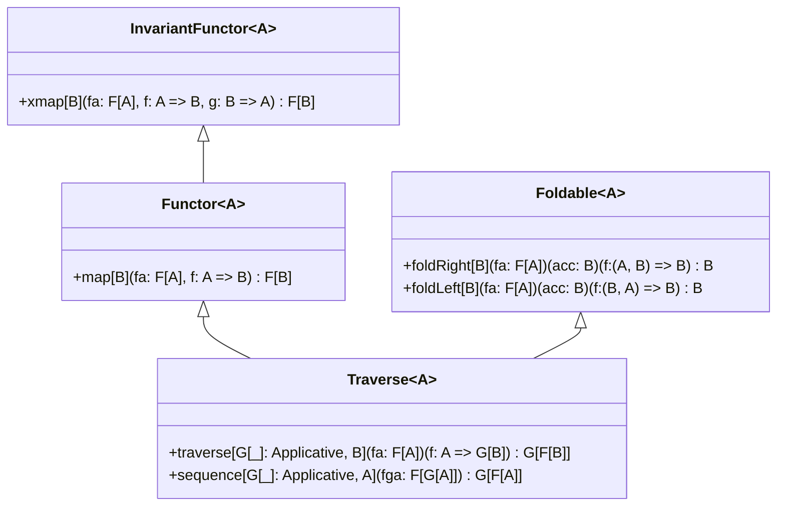



# Traverse

`Traverse` — это концепция из функционального программирования, 
которая расширяет возможности [`Functor`](functor.md) и [`Foldable`](foldable.md). 
Она позволяет "проходить" (_traverse_) по структуре данных, применяя функцию к каждому элементу 
и собирая результаты в новую структуру. 

Основная идея `Traverse` — это возможность работать с эффектами 
(например, `Option`, `Future`, `Either`) внутри структуры данных.

**Основные характеристики `Traverse`:**

- **Операция `traverse`**:
  Применяет функцию к каждому элементу структуры данных, собирая результаты в новую структуру с эффектом. 
  Например, можно преобразовать список чисел в список `Option` или `Future`.
- **Операция `sequence`**:
  Преобразует структуру данных, содержащую эффекты, в эффект, содержащий структуру данных. 
  Например, можно преобразовать список `Option` в `Option` списка.
- **Комбинирование с эффектами**:
  `Traverse` позволяет работать с эффектами (например, обработка ошибок, асинхронные вычисления) внутри структур данных.

**Где применяется `Traverse`?**

`Traverse` используется в функциональном программировании для:

- **Работы с эффектами внутри структур данных** (например, `Option`, `Future`, `Either`).
- **Преобразования структур данных с эффектами**.
- **Агрегации результатов вычислений с эффектами**.

**Примеры `Traverse`**

- **Преобразование списка чисел в список `Option`**.
  Предположим есть список чисел, и необходимо преобразовать каждое число в `Option` (например, проверяя, является ли число чётным). 
  С помощью `Traverse` можно применить эту операцию ко всем элементам списка и получить `Option` списка.
- **Преобразование списка `Future` в `Future` списка**.
  Предположим есть список асинхронных вычислений (`Future`). 
  С помощью `Traverse` можно преобразовать этот список в одно асинхронное вычисление, которое возвращает список результатов.
- **Обработка ошибок в списке**.
  Предположим есть список операций, каждая из которых может завершиться ошибкой (`Either`). 
  С помощью `Traverse` можно выполнить все операции и собрать результаты в один `Either`, 
  который либо содержит список успешных результатов, либо первую ошибку.
- **Работа с деревьями**.
  Предположим есть дерево, где каждый узел содержит значение, которое нужно преобразовать с эффектом 
  (например, в `Option` или `Future`). С помощью `Traverse` можно обойти всё дерево, 
  применить функцию к каждому узлу и собрать результаты в новое дерево с эффектом.
- **Валидация данных**.
  Предположим есть список данных, и необходимо проверить каждый элемент на соответствие определённым правилам 
  (например, с помощью валидатора). С помощью `Traverse` можно применить валидатор ко всем элементам 
  и собрать результаты в один объект, который либо содержит все данные, либо список ошибок.
- **Преобразование JSON**.
  Предположим есть JSON-объект, и необходимо преобразовать каждое поле в определённый тип (например, строку в число). 
  С помощью `Traverse` можно применить функцию преобразования ко всем полям и собрать результаты в новый JSON-объект.

## Формальное определение

`Traverse` — это тип данных, расширяющий возможности [`Functor`](functor.md) и [`Foldable`](foldable.md), 
для которого определена операция `traverse` (и её вариант `sequence`), удовлетворяющая следующим свойствам:

- **Операция `traverse`**:
  Для типа `F[A]` (где `F` — контейнер, а `A` — тип элементов) и [аппликативного функтора](applicative.md) `G` 
  операция `traverse` имеет сигнатуру:
  `def traverse[G[_]: Applicative, A, B](fa: F[A])(f: A => G[B]): G[F[B]]`
  Здесь:
    - `fa` — контейнер с элементами типа `A`.
    - `f` — функция, которая принимает элемент типа `A` и возвращает значение типа `G[B]` (эффект).
    - `G` — аппликативный функтор (например, `Option`, `Future`, `Either`).
    - Результат — значение типа `G[F[B]]`, где `F[B]` — новая структура данных, а `G` — эффект.
- **Операция `sequence`**:
  Это частный случай `traverse`, где функция `f` — это тождественное преобразование (`identity`). 
  Она преобразует структуру данных, содержащую эффекты, в эффект, содержащий структуру данных:
   `def sequence[G[_]: Applicative, A](fga: F[G[A]]): G[F[A]]`

С помощью `traverse` можно выразить и `map`, и `foldRight`, а также `sequence`, отображающий `F[G[A]]` в `G[F[A]]`.
По этой причине `Traverse` иногда называют _"обходным функтором"_.

### Законы `Traverse`

Для того чтобы тип данных считался `Traverse`, он должен удовлетворять определённым законам. 
Вот основные из них:

- **Закон согласованности с `map`**:
  Операция `traverse` должна быть согласована с операцией `map`:
  `traverse(fa)(x => Applicative[G].pure(f(x))) == Applicative[G].pure(fa.map(f))`
- **Закон согласованности с `sequence`**:
  Операция `sequence` должна быть согласована с `traverse`:
  `sequence(fga) == traverse(fga)(identity)`
- Обход `Id` эквивалентен `Functor#map`:
  ```dotty
  type Id[A] = A
  traverse[F, Id, A, B](fa, a => Id(f(a))) == fa.map(f)
  ```
- Два последовательно зависимых эффекта могут быть объединены в один, их композицию:
  ```dotty
  val optFb: G[F[B]] = traverse[F, G, A, B](fa, a => unit(f(a)))
  val optListFc1: G[H[F[C]]] =
    map[G, F[B], H[F[C]]](optFb, fb => traverse[F, H, B, C](fb, b => unit(g(b))))
  val optListFc2: G[H[F[C]]] =
    traverse[F, [X] =>> G[H[X]], A, C](fa, a => map[G, B, H[C]](unit(f(a)), b => unit(g(b))))
  optListFc1 == optListFc2
  ```
- Два независимых эффекта могут быть объединены в один эффект, их произведение
  ```dotty
  type GH[A] = (G[A], H[A])
  val t1: GH[F[B]] = (traverse[F, G, A, B](fa, a => unit(f(a))), traverse[F, H, A, B](fa, a => unit(f(a))))
  val t2: GH[F[B]] = traverse[F, GH, A, B](fa, a => (unit(f(a)), unit(f(a))))
  t1 == t2
  ```

## Код

```dotty
trait Traverse[F[_]] extends Functor[F], Foldable[F]:
  self =>

  extension [A](fa: F[A])
    def traverse[G[_]: Applicative, B](f: A => G[B]): G[F[B]]

    override def map[B](f: A => B): F[B] = traverse(a => Id(f(a)))

    override def foldRight[B](init: B)(f: (A, B) => B): B =
      traverse(a => State[B, A]((b: B) => (f(a, b), a))).run(init)._1

  def sequence[G[_]: Applicative, A](fga: F[G[A]]): G[F[A]] =
    fga.traverse(ga => ga)
```

### "Обертка"

```dotty
type Id[A] = A
object Id:
  def apply[A](a: A): Id[A] = a

given Traverse[Id] with
  extension [A](fa: Id[A])
    override def traverse[G[_]: Applicative, B](f: A => G[B]): G[Id[B]] =
      f(fa).map(b => Id(b))
```

### Кортеж от двух и более элементов

```dotty
given Traverse[[X] =>> (X, X)] with
  extension [A](fa: (A, A))
    override def traverse[G[_]: Applicative, B](f: A => G[B]): G[(B, B)] =
      val g = summon[Applicative[G]]
      val func: G[B => B => (B, B)] = g.unit(b1 => b2 => (b1, b2))
      g.apply(g.apply(func)(f(fa._1)))(f(fa._2))

given Traverse[[X] =>> (X, X, X)] with
  extension [A](fa: (A, A, A))
    override def traverse[G[_]: Applicative, B](f: A => G[B]): G[(B, B, B)] =
      val g = summon[Applicative[G]]
      val func: G[B => B => B => (B, B, B)] = g.unit(b1 => b2 => b3 => (b1, b2, b3))
      g.apply(g.apply(g.apply(func)(f(fa._1)))(f(fa._2)))(f(fa._3))
```

### Option

```dotty
given Traverse[Option] with
  extension [A](fa: Option[A])
    override def traverse[G[_]: Applicative, B](f: A => G[B]): G[Option[B]] =
      fa match
        case Some(a) => f(a).map(Some(_))
        case None    => summon[Applicative[G]].unit(None)
```

### Последовательность

```dotty
given Traverse[List] with
  extension [A](fa: List[A])
    override def traverse[G[_]: Applicative, B](f: A => G[B]): G[List[B]] =
      val g = summon[Applicative[G]]
      fa.foldRight(g.unit(List[B]()))((a, acc) => f(a).map2(acc)(_ :: _))
```

### Дерево

В области видимости должны быть доступны `idApplicative` and `listTraverse`

```dotty
case class Tree[+A](head: A, tail: List[Tree[A]])

given Traverse[Tree] with
  extension [A](ta: Tree[A])
    override def traverse[G[_]: Applicative, B](f: A => G[B]): G[Tree[B]] =
      f(ta.head).map2(ta.tail.traverse(a => a.traverse(f)))(Tree(_, _))

val tree = Tree(0, List(Tree(1, List(Tree(2, Nil)))))
tree.traverse(a => Id(a + 1))
// Id(Tree(1,List(Tree(2,List(Tree(3,List()))))))
```

### Map

```dotty
given mapTraverse[K]: Traverse[[X] =>> Map[K, X]] with
  extension [A](m: Map[K, A])
    override def traverse[G[_]: Applicative, B](f: A => G[B]): G[Map[K, B]] =
      m.foldLeft(summon[Applicative[G]].unit(Map.empty[K, B])) { case (acc, (k, a)) =>
        acc.map2(f(a))((m, b) => m + (k -> b))
      }
```

## Схема



## Реализация в библиотеках

### Реализация в Cats

```dotty
import scala.concurrent.*
import scala.concurrent.duration.*
import scala.concurrent.ExecutionContext.Implicits.global

val hostnames = List(
  "alpha.example.com",
  "beta.example.com",
  "gamma.demo.com"
)

def getUptime(hostname: String): Future[Int] =
  Future(hostname.length * 60)

val allUptimes: Future[List[Int]] =
  Future.traverse(hostnames)(getUptime)

Await.result(allUptimes, 1.second)  // List(1020, 960, 840)
```

### Реализация в ScalaZ

```dotty
import scalaz.*
import Scalaz.*

List(1, 2, 3) traverse { x => (x > 0) option (x + 1) }  // Some(List(2, 3, 4))
List(1.some, 2.some).sequence                           // Some(List(1, 2))
1.success[String].leaf.sequenceU map {_.drawTree}       // Success(1)
```

---

**Ссылки:**

- [Cats](https://typelevel.org/cats/typeclasses/traverse.html)
- [Functional Programming in Scala, Second Edition](https://www.manning.com/books/functional-programming-in-scala-second-edition?query=Functional%20Programming%20in%20Scala,%20Second%20Edition)
- [Herding Cats](http://eed3si9n.com/herding-cats/Traverse.html)
- [Learn Functional Programming course/tutorial on Scala](https://github.com/dehun/learn-fp)
- [Scala with Cats](https://www.scalawithcats.com/dist/scala-with-cats.html#sec:traverse)
- [Scalaz API](https://javadoc.io/doc/org.scalaz/scalaz-core_3/7.3.6/scalaz/Traverse.html)
- [SKB – Scala Traversable](https://leobenkel.com/2021/01/skb-scala-traversable/)
- [Tour of Scala](https://tourofscala.com/scala/traversable)
