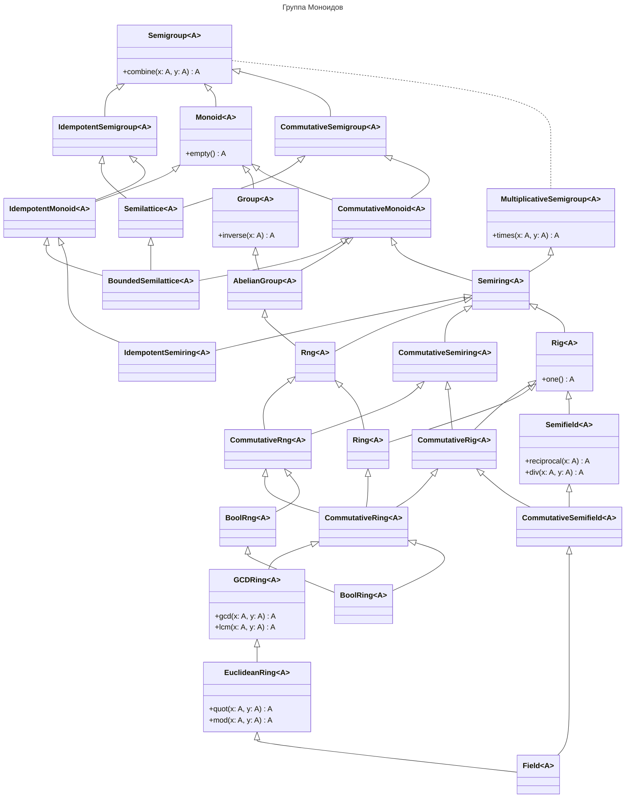
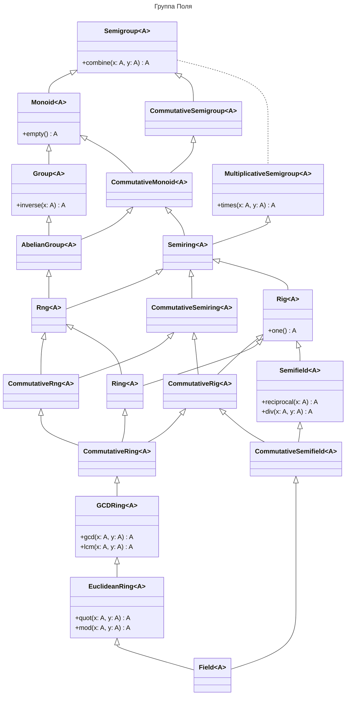
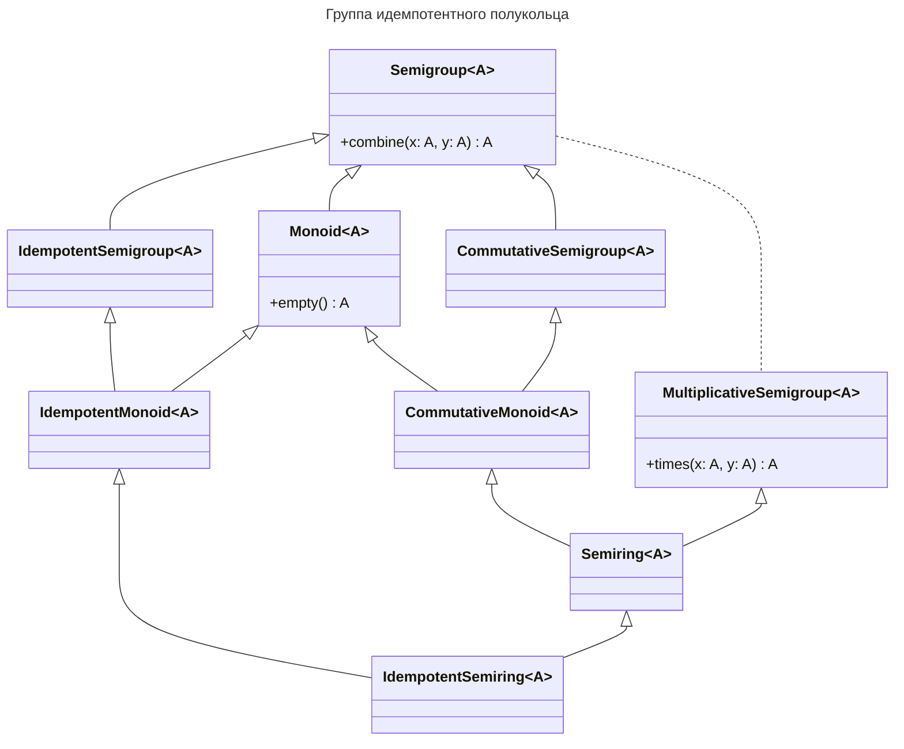
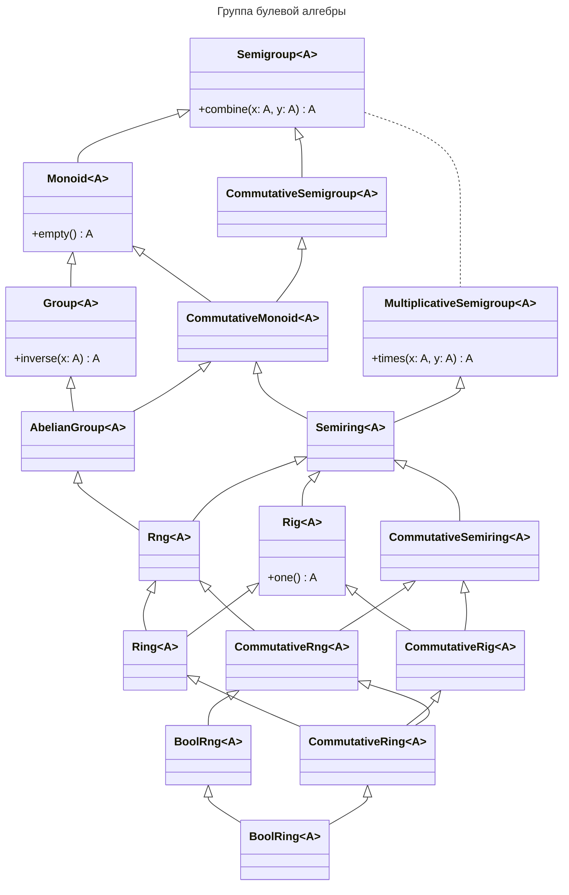



# Группа моноидов

**Моноиды** – это фундаментальная концепция в математике и информатике, 
которая находит широкое применение в самых разных областях, 
включая теорию категорий, функциональное программирование и обработку данных. 
Моноид представляет собой структуру, состоящую из набора элементов и бинарной операции, 
удовлетворяющей двум ключевым свойствам: ассоциативности и наличию нейтрального элемента.

## Использование 

Моноиды играют важную роль в различных областях математики и информатики благодаря своей универсальности 
и способности моделировать множество операций и структур данных. Вот несколько причин, почему моноиды полезны:

### Обобщение операций

Моноиды предоставляют абстрактную модель для многих распространенных операций, таких как сложение чисел, 
конкатенация строк, объединение множеств и другие. 
Это позволяет разрабатывать общие алгоритмы и структуры данных, 
которые могут применяться ко многим различным типам данных без необходимости переписывания кода для каждого конкретного случая.

### Ассоциативность

Ассоциативная операция, одна из основных характеристик моноидов, означает, 
что порядок выполнения операций не влияет на результат. 
Это свойство делает моноиды удобными для оптимизации вычислений, 
поскольку позволяет переставлять операции для повышения эффективности исполнения.

### Нейтральный элемент

Наличие нейтрального элемента гарантирует, что при применении операции к этому элементу результат остается неизменным. 
Например, добавление нуля к числу или конкатенация пустой строки к другой строке не изменяют исходное значение. 
Это свойство полезно для инициализации переменных и обработки граничных случаев.

### Функциональное программирование

В функциональном программировании моноиды часто используются для создания функций высшего порядка, 
которые обрабатывают коллекции данных. Например, функция `fold` (или `reduce`) может принимать любой моноидный оператор 
и применять его к последовательности элементов, 
что позволяет легко писать обобщенные алгоритмы для суммирования, объединения и других операций.

### Параллельные вычисления

Благодаря свойству ассоциативности, операции в моноиде могут выполняться параллельно,
что существенно ускоряет выполнение задач на многопроцессорных системах или кластерах. 
Например, сумму большого массива чисел можно вычислить быстрее, 
разбивая массив на части и суммируя каждую часть отдельно, а затем объединяя результаты.

### Теория категорий

В теории категорий моноиды являются важным строительным блоком для описания различных математических структур. 
Они помогают формализовать отношения между объектами и морфизмами, 
что имеет приложения в теоретической информатике, физике и других науках.

### Практические применения

Моноиды находят применение в самых разных областях, включая обработку текстов, 
анализ данных, криптографию, машинное обучение и многие другие. 
Например, использование моноидных структур позволяет эффективно обрабатывать большие объемы данных, 
такие как журналы событий или потоковые данные.

Таким образом, моноиды представляют собой мощный инструмент для разработки обобщённых, 
эффективных и масштабируемых решений в различных областях науки и инженерии.

## Пример

Моноиды обычно используются для сворачивания последовательностей.
Например, вот как можно посчитать произведение чисел:

```dotty
trait Semigroup[A]:
  def combine(x: A, y: A): A

trait Monoid[A] extends Semigroup[A]:
  def empty: A

given Monoid[Int] with
  val empty = 1
  def combine(x: Int, y: Int): Int = x * y

def fold[A](xs: List[A])(using m: Monoid[A]): A =
  xs.foldLeft(m.empty)(m.combine)

fold(List(1, 2, 3, 4, 5))
// 120
```

## Схема группы



И детальнее:







---

**Ссылки:**

- [Ссылка на репозиторий с упражнениями][sample]
- [Learning Scalaz](http://eed3si9n.com/learning-scalaz/sum+function.html)
- [Scala with Cats][Scala with Cats]
- [Semigroups and Monoids in Scala](https://www.youtube.com/watch?v=LmBTiFYa-V4&list=PLmtsMNDRU0Bzj7INIrLugi3a_WClwQuiS)

[sample]: https://gitverse.ru/scalabook/typeclasses
[Scala with Cats]: https://scalawithcats.com/dist/scala-with-cats.html#applications-of-monoids
