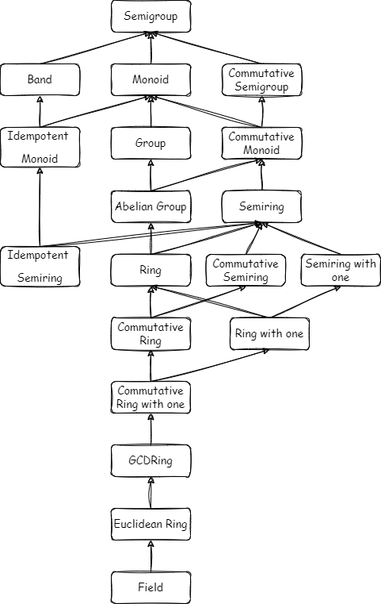

# Группа моноидов

## Схема



## Использование

Моноиды обычно используются для сворачивания последовательностей. 
Например, вот как можно посчитать произведение чисел:

```dotty
trait Semigroup[A]:
  def combine(x: A, y: A): A

trait Monoid[A] extends Semigroup[A]:
  def empty: A

given Monoid[Int] with
  val empty = 1
  def combine(x: Int, y: Int): Int = x * y

def fold[A](xs: List[A])(using m: Monoid[A]): A =
  xs.foldLeft(m.empty)(m.combine)

fold(List(1, 2, 3, 4, 5))
// val res0: Int = 120
```

Более подробно применение моноидов рассматривается в книге [Scala with Cats][Scala with Cats].

Обычно библиотеки определяют "свой" оператор для моноидальной операции `combine`, например:

```dotty
trait Semigroup[A]:
  def combine(x: A, y: A): A
  
  extension (x: A)
    def |+|(y: A) = combine(x, y)

...

3 |+| 4
// val res1: Int = 12
```

---

**Ссылки:**

- [Исходный код](https://gitverse.ru/artemkorsakov/scalabook/content/master/examples/src/main/scala/ru/scalabook/typeclass/monoid)
- [Тесты](https://gitverse.ru/artemkorsakov/scalabook/content/master/examples/src/test/scala/ru/scalabook/typeclass/monoid)
- [Learning Scalaz](http://eed3si9n.com/learning-scalaz/sum+function.html)
- [Scala with Cats][Scala with Cats]
- [Semigroups and Monoids in Scala](https://www.youtube.com/watch?v=LmBTiFYa-V4&list=PLmtsMNDRU0Bzj7INIrLugi3a_WClwQuiS)

[Scala with Cats]: https://www.scalawithcats.com/dist/scala-with-cats.html#applications-of-monoids
