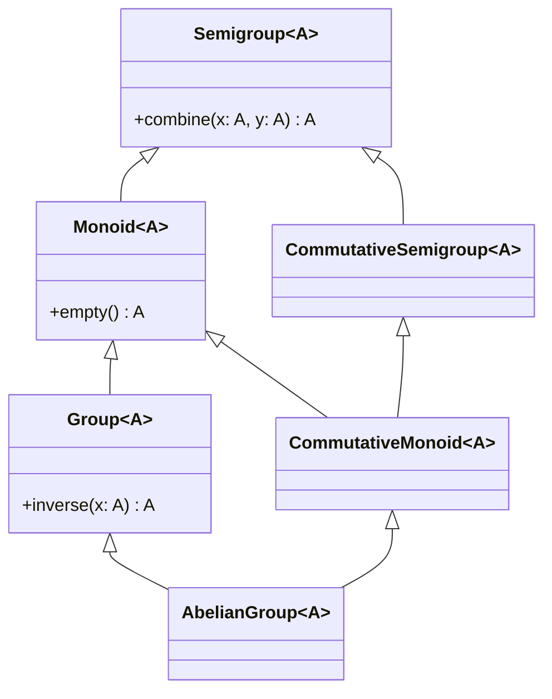



# Абелева группа

**Абелева группа** (или коммутативная группа) — это алгебраическая структура, 
которая объединяет свойства [группы](group.md) и [коммутативности](cmonoid.md). 
Разберем эти понятия по отдельности, а затем объединим их.

а) **Группа**

Группа — это множество \\(G\\), на котором определена бинарная операция \\(\cdot\\) (обычно называемая умножением или сложением), 
удовлетворяющая следующим свойствам:

- **Ассоциативность**: для любых \\(a, b, c \in G\\) выполняется \\((a \cdot b) \cdot c = a \cdot (b \cdot c)\\).
- **Наличие нейтрального элемента**: существует элемент \\(e \in G\\) такой, что для любого \\(a \in G\\) выполняется \\(e \cdot a = a \cdot e = a\\).
- **Наличие обратного элемента**: для любого \\(a \in G\\) существует элемент \\(a^{-1} \in G\\) такой, что \\(a \cdot a^{-1} = a^{-1} \cdot a = e\\).

б) **Коммутативность**

Операция \\(\cdot\\) называется **коммутативной**, если для любых \\(a, b \in G\\) выполняется:
\\(a \cdot b = b \cdot a.\\)

Таким образом, абелева группа — это группа, в которой операция \\(\cdot\\) коммутативна. 
То есть:

- **Ассоциативность**: \\((a \cdot b) \cdot c = a \cdot (b \cdot c)\\) для любых \\(a, b, c \in G\\).
- **Наличие нейтрального элемента**: существует \\(e \in G\\) такой, что \\(e \cdot a = a \cdot e = a\\) для любого \\(a \in G\\).
- **Наличие обратного элемента**: для любого \\(a \in G\\) существует \\(a^{-1} \in G\\) такой, что \\(a \cdot a^{-1} = a^{-1} \cdot a = e\\).
- **Коммутативность**: \\(a \cdot b = b \cdot a\\) для любых \\(a, b \in G\\).

**Примеры абелевых групп**

- **Множество целых чисел с сложением**:
    - Операция: \\(+\\).
    - Нейтральный элемент: \\(0\\).
    - Обратный элемент для \\(a\\): \\(-a\\).
    - Коммутативность: \\(a + b = b + a\\).
- **Множество действительных чисел с сложением**:
    - Операция: \\(+\\).
    - Нейтральный элемент: \\(0\\).
    - Обратный элемент для \\(a\\): \\(-a\\).
    - Коммутативность: \\(a + b = b + a\\).
- **Множество комплексных чисел с сложением**:
    - Операция: \\(+\\).
    - Нейтральный элемент: \\(0\\).
    - Обратный элемент для \\(a\\): \\(-a\\).
    - Коммутативность: \\(a + b = b + a\\).
- **Множество ненулевых действительных чисел с умножением**:
    - Операция: \\(\times\\).
    - Нейтральный элемент: \\(1\\).
    - Обратный элемент для \\(a\\): \\(\frac{1}{a}\\).
    - Коммутативность: \\(a \times b = b \times a\\).
- **Множество векторов на плоскости с операцией сложения векторов**:
    - Операция: \\(+\\).
    - Нейтральный элемент: нулевой вектор \\(\overrightarrow{0}\\).
    - Обратный элемент для \\(\overrightarrow{a}\\): \\(-\overrightarrow{a}\\).
    - Коммутативность: \\(\overrightarrow{a} + \overrightarrow{b} = \overrightarrow{b} + \overrightarrow{a}\\).

**Зачем нужны абелевы группы?**

Абелевы группы играют важную роль в математике и её приложениях:

- **Алгебра**: изучаются как базовые алгебраические структуры.
- **Теория чисел**: используются для анализа свойств чисел и их операций.
- **Линейная алгебра**: векторные пространства являются абелевыми группами относительно сложения векторов.
- **Топология**: применяются в алгебраической топологии для изучения гомологий и когомологий.
- **Физика**: используются для описания симметрий в физических системах.

Таким образом, абелевы группы — это важный объект изучения, 
позволяющий анализировать системы с коммутативными, ассоциативными операциями, нейтральным и обратными элементами.

## Формальное определение

`AbGroup[A]` - "абелева группа", [группа](group.md), которая является [коммутативной](cmonoid.md).

Помимо законов группы:

- _Замыкание_ (_closure_): для \\(\forall x, y \in G\\) выполняется \\(x + y \in G\\).
- _Ассоциативность_ (_associativity_): для \\(\forall x, y, z \in G\\) выполняется \\((x + y) + z = x + (y + z)\\).
- _Тождественность_ или _существования нейтрального элемента_ (_identity_): существует \\(\exists e \in G\\) такой, 
  что для \\(\forall x \in G\\) выполняется \\(e + x = x + e = x\\)
- _Обратимость_: для \\(\forall x \in G\\) существует \\((-x)\\) такой, что \\(x + (-x) = (-x) + x = 0\\)

должен соблюдаться закон:

- _Коммутативность_ (_commutative_): для \\(\forall x, y \in G\\) выполняется \\(x + y = y + x\\).

## Код

```dotty
trait AbGroup[A] extends Group[A], CMonoid[A]
```

### Целые числа **Z** являются абелевой группой по сложению

```dotty
given AbGroup[Int] with
  val empty                        = 0
  def combine(x: Int, y: Int): Int = x + y
  extension (a: Int)
    def inverse: Int = -a
```

### Законы

Законы наследуются от [группы](group.md) и [коммутативного моноида](cmonoid.md).

- Замыкание следует из определения функции `combine`: тип результата этой функции совпадает с типом переменных,
  которые она принимает.
- Ассоциативность выражается следующим образом:
  `g.combine(x, g.combine(y, z))` должно быть равно `g.combine(g.combine(x, y), z)`.  
  Это означает, что порядок объединения элементов не влияет на итоговый результат.
- Тождественность означает, что если вы объединяете любой элемент `x` с нейтральным элементом (`g.empty`),
  то результат всегда будет равен `x`. Другими словами, нейтральный элемент не меняет значение `x` при объединении.
  Это можно записать так:
    - `g.combine(x, g.empty) == x`
    - `g.combine(g.empty, x) == x`
- Обратимость означает, что для каждого элемента `x` существует обратный элемент `x.inverse`,
  при объединении с которым результат будет равен нейтральному элементу `g.empty`.
  Это можно записать так:
    - `g.combine(x.inverse, x) == g.empty`
    - `g.combine(x, x.inverse) == g.empty`
- Коммутативность означает, что порядок элементов при объединении не важен.
  Другими словами, результат операции `combine` будет одинаковым, независимо от того,
  в каком порядке вы передаёте элементы `x` и `y`.
  Это можно записать так: `g.combine(x, y) == g.combine(y, x)`

## Схема



## Реализация в библиотеках

### Реализация в Spire

```dotty
import spire.algebra.AbGroup

AbGroup[Int].inverse(1) // -1
```

---

**Ссылки:**

- [Spire home page](https://typelevel.org/spire/)
- [Wikipedia](https://ru.wikipedia.org/wiki/%D0%90%D0%B1%D0%B5%D0%BB%D0%B5%D0%B2%D0%B0_%D0%B3%D1%80%D1%83%D0%BF%D0%BF%D0%B0)

