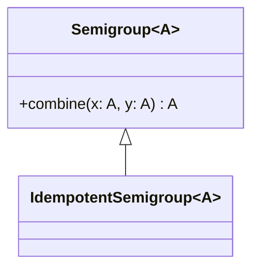

# Идемпотентная полугруппа

**Идемпотентная полугруппа** — это алгебраическая структура, представляющая собой полугруппу, 
в которой все элементы обладают свойством идемпотентности.
Идемпотентность означает, что результат операции над любым элементом множества с самим собой дает тот же элемент, 
то есть для любого \\(a \in S\\) выполняется \\(a \cdot a = a\\)

Таким образом, идемпотентная полугруппа — это полугруппа, в которой каждый элемент является "самостоятельным" 
в том смысле, что его умножение на себя не меняет его.

**Зачем нужна идемпотентная полугруппа?**

Идемпотентные полугруппы играют важную роль в различных областях математики и прикладных наук. 
Вот несколько причин:

- **Теория решеток**: Идемпотентные полугруппы тесно связаны с решетками. 
  Фактически, любая идемпотентная полугруппа может быть представлена как решетка, и наоборот. 
  Это делает их полезными для изучения частично упорядоченных множеств.
- **Теория автоматов**: Идемпотентные полугруппы используются для моделирования поведения автоматов и процессов, 
  где важную роль играют операции, которые не изменяют состояние системы 
  (например, операции объединения или пересечения состояний).
- **Теория графов**: В теории графов идемпотентные полугруппы применяются для описания операций 
  над подмножествами вершин или ребер, таких как объединение или пересечение.
- **Программирование и информатика**: В информатике идемпотентные полугруппы используются для моделирования операций, 
  которые не зависят от порядка выполнения (например, операции над множествами или булевыми значениями).
- **Теория формальных языков**: Идемпотентные полугруппы помогают описывать правила композиции строк 
  или символов в формальных языках.

**Примеры идемпотентных полугрупп**

- **Множество булевых значений с операцией дизъюнкции**:  
  Рассмотрим множество \\(\{0, 1\}\\) с операцией дизъюнкции \\(\lor\\). Это идемпотентная полугруппа, так как:
    - \\(0 \lor 0 = 0\\),
    - \\(1 \lor 1 = 1\\),
    - Операция \\(\lor\\) ассоциативна.
- **Множество подмножеств с операцией объединения**:  
  Пусть \\(S\\) — множество всех подмножеств некоторого универсального множества \\(U\\). 
  Операция объединения \\(\cup\\) на \\(S\\) образует идемпотентную полугруппу, так как:
    - \\(A \cup A = A\\) для любого \\(A \subseteq U\\),
    - Операция \\(\cup\\) ассоциативна.

## Формальное определение

_Band_ — это [полугруппа](semigroup.md), которая также является идемпотентной, 
т.е. добавление значения к самому себе приводит к тому же значению.

`Band` должна удовлетворять следующим законам:

- _Замыкание_ (_closure_): для \\(\forall x, y \in B\\) выполняется \\(x + y \in B\\).
- _Ассоциативность_ (_associativity_): для \\(\forall x, y, z \in B\\) выполняется \\((x + y) + z = x + (y + z)\\).
- _Идемпотентность_ (_idempotency_): для \\(\forall x \in B\\) выполняется \\(x + x = x\\).

## Код

```dotty
trait Band[A] extends Semigroup[A]:
  override def combineN(a: A, n: Int): Either[String, A] =
    if n <= 0 then
      Left("Repeated combining for semigroups must have n > 0")
    else Right(a) // combine(a, a) == a
```

### Законы

- Замыкание следует из определения функции `combine`: тип результата этой функции совпадает с типом переменных, 
  которые она принимает.
- Ассоциативность выражается следующим образом:
  `s.combine(x, s.combine(y, z))` должно быть равно `s.combine(s.combine(x, y), z)`.  
  Это означает, что порядок объединения элементов не влияет на итоговый результат.
- Идемпотентность формулируется так:  
  `s.combine(x, x)` должно быть равно `x`.  
  Это означает, что объединение элемента с самим собой не изменяет его.

## Схема



---

**Ссылки:**

- [Ссылка на репозиторий с упражнениями][sample]
- [Scalaz API](https://javadoc.io/doc/org.scalaz/scalaz-core_3/7.3.6/scalaz/Band.html)

[sample]: https://gitverse.ru/scalabook/typeclasses
