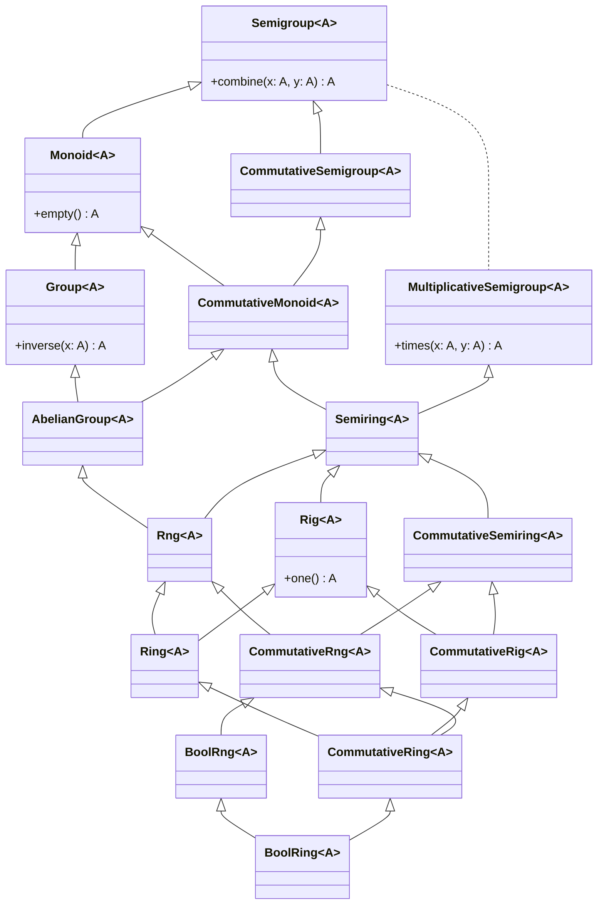



# Кольцо Буля

Кольцо Буля — это [кольцо](cring.md), умножение в котором идемпотентно, то есть `a · a = a` для всех элементов `a`. 
Это свойство также влечёт `a + a = 0` для всех `a`, а также коммутативность умножения: `a · b = b · a`.

Кольцо Буля может быть представлено как [коммутативное кольцо с единицей](cring.md), 
в котором каждый элемент идемпотентен относительно умножения. 
В терминах теории решёток кольцо Буля является дистрибутивной решёткой с дополнениями.

Для кольца Буля должны соблюдаться следующие законы:

- _Замыкание сложения_ (_closure_): для \\(\forall x, y \in B\\) выполняется \\(x + y \in B\\).
- _Ассоциативность сложения_ (_associativity_): для \\(\forall x, y, z \in B\\) выполняется \\((x + y) + z = x + (y + z)\\).
- _Существование нулевого элемента_: существует \\(\exists 0 \in B\\) такой, что для \\(\forall x \in B\\) выполняется \\(0 + x = x + 0 = x\\).
- _Обратимость сложения_: для \\(\forall x \in B\\) существует \\((-x)\\) такой, что \\(x + (-x) = (-x) + x = 0\\). 
  В булевой алгебре \\(-x = x\\).
- _Коммутативность сложения_ (_commutative_): для \\(\forall x, y \in B\\) выполняется \\(x + y = y + x\\).
- _Замыкание умножения_ (_closure_): для \\(\forall x, y \in B\\) выполняется \\(x \* y \in B\\).
- _Ассоциативность умножения_ (_associativity_): для \\(\forall x, y, z \in B\\) выполняется \\((x \* y) \* z = x \* (y \* z)\\).
- _Существование единичного элемента_: \\(\exists 1 \in B \quad \forall x \in B \quad x \* 1 = 1 \* x = x\\).
- _Коммутативность умножения_: для \\(\forall x, y \in B\\) выполняется \\(x \* y = y \* x\\).
- _Дистрибутивность_ (_distributivus_, _распределительный закон_): для \\(\forall x, y, z \in B\\) 
  выполняется \\(x \* (y + z) = x \* y + x \* z\\) и \\((x + y) \* z = x \* z + y \* z\\).
- _Идемпотентность умножения_: для \\(\forall x \in B\\) выполняется \\(x \* x = x\\).
- _Свойство отрицания_: для \\(\forall x \in B\\) выполняется \\(x + x = 0\\).

## Код

```dotty
trait BoolRng[A] extends CommutativeRng[A]:
  extension (a: A)
    override def inverse: A = a
    
trait BoolRing[A] extends BoolRng[A], CommutativeRing[A]
```

## Схема



---

**Ссылки:**

- [Ссылка на репозиторий с упражнениями][sample]

[sample]: https://gitverse.ru/scalabook/typeclasses
