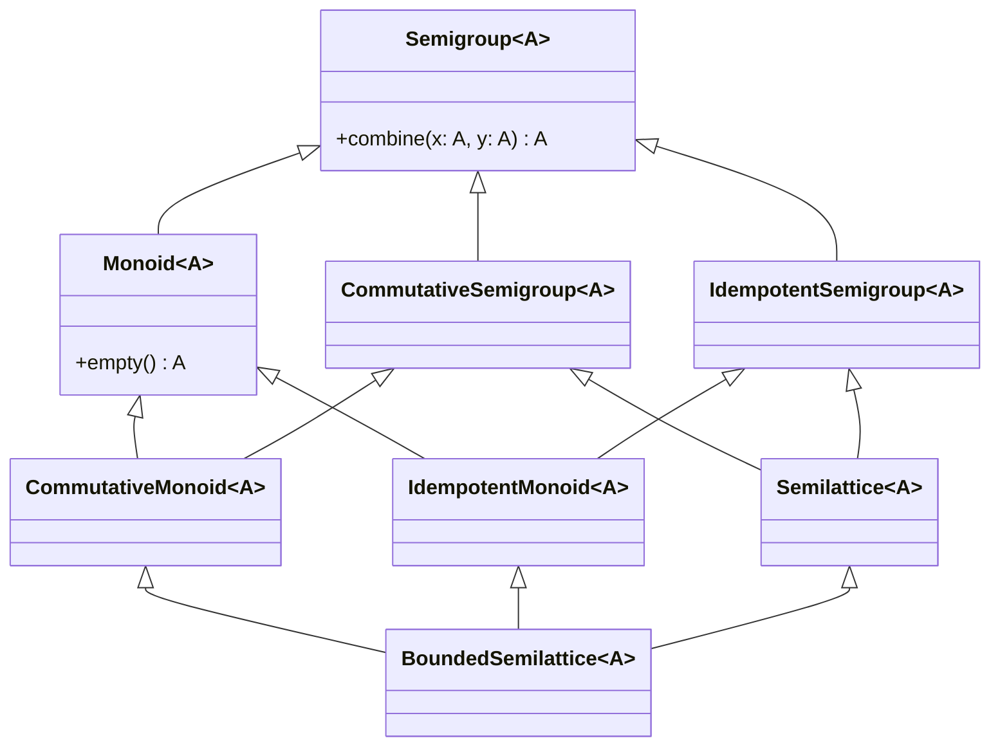

# Ограниченная полурешетка

`BoundedSemilattice[A]` - [коммутативный](cmonoid.md) и [идемпотентный](idempotent-monoid.md) моноид, 
[решетка](semilattice.md) с нейтральным элементом.

Законы ограниченной полурешетки:

- _Замыкание_ (_closure_): для \\(\forall x, y \in CM\\) выполняется \\(x + y \in CM\\).
- _Ассоциативность_ (_associativity_): для \\(\forall x, y, z \in CM\\) выполняется \\((x + y) + z = x + (y + z)\\).
- _Тождественность_ или _существования нейтрального элемента_ (_identity_): существует \\(\exists e \in CM\\) такой,
  что для \\(\forall x \in CM\\) выполняется \\(e + x = x + e = x\\)
- _Коммутативность_ (_commutative_): для \\(\forall x, y \in CM\\) выполняется \\(x + y = y + x\\).
- _Идемпотентность_ (_idempotency_): для \\(\forall x \in B\\) выполняется \\(x + x = x\\).

## Код

```dotty
trait BoundedSemilattice[A] extends Semilattice[A], IdempotentMonoid[A], CMonoid[A]
```

## Схема



## Реализация в библиотеках

### Реализация в Cats

```dotty
import cats.kernel.BoundedSemilattice
import cats.implicits.*

BoundedSemilattice.combine(Set(1, 2), BoundedSemilattice[Set[Int]].empty)
// Set(1, 2)
```

---

**Ссылки:**

- [Ссылка на репозиторий с упражнениями][sample]
- [Spire home page](https://typelevel.org/spire/)

[sample]: https://gitverse.ru/scalabook/typeclasses
