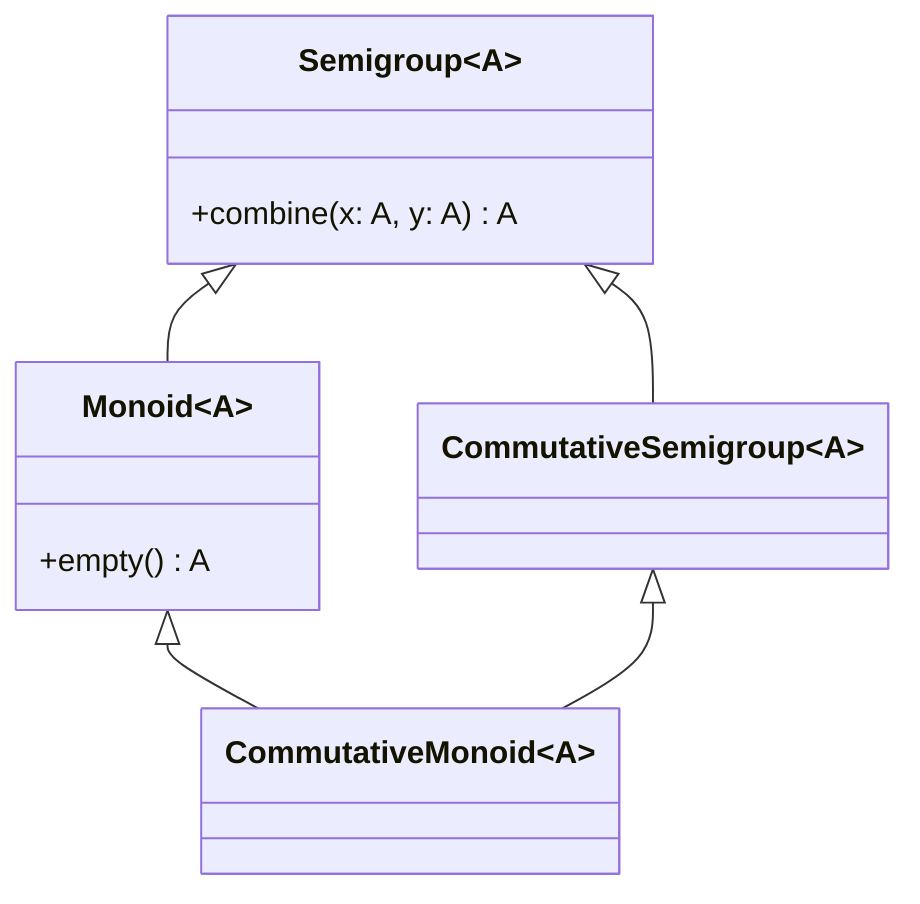

# Коммутативный моноид

## Формальное определение

`CMonoid[A]` - [моноид](monoid.md), который [коммутативен](csemigroup.md).

Помимо законов моноида:

- _Замыкание_ (_closure_): для \\(\forall x, y \in CM\\) выполняется \\(x + y \in CM\\).
- _Ассоциативность_ (_associativity_): для \\(\forall x, y, z \in CM\\) выполняется \\((x + y) + z = x + (y + z)\\).
- _Тождественность_ или _существования нейтрального элемента_ (_identity_): существует \\(\exists e \in CM\\) такой, 
  что для \\(\forall x \in CM\\) выполняется \\(e + x = x + e = x\\)

должен соблюдаться закон:

- _Коммутативность_ (_commutative_): для \\(\forall x, y \in CM\\) выполняется \\(x + y = y + x\\).

## Определение в виде кода на Scala

```dotty
trait CMonoid[A] extends Monoid[A], CSemigroup[A]
```

## Законы в виде кода на Scala

```dotty
trait CMonoidLaw extends MonoidLaw, CSemigroupLaw:
  def checkCMonoidLaw[A: CMonoid](
      x: A,
      y: A,
      z: A
  ): ValidatedNel[String, Unit] =
    checkMonoidLaw(x, y, z) combine checkCSemigroupLaw(x, y, z)
```

## Примеры

### Натуральные числа N образуют коммутативный моноид относительно сложения и 0

```dotty
given CMonoid[Int] with
  val empty                        = 0
  def combine(x: Int, y: Int): Int = x + y
```

## Схема



## Реализация в библиотеках

### Реализация в Spire

```dotty
import spire.algebra.CMonoid

CMonoid.combine(100, CMonoid.empty[Int]) // 100
```

---

**Ссылки:**

- [Spire home page](https://typelevel.org/spire)

