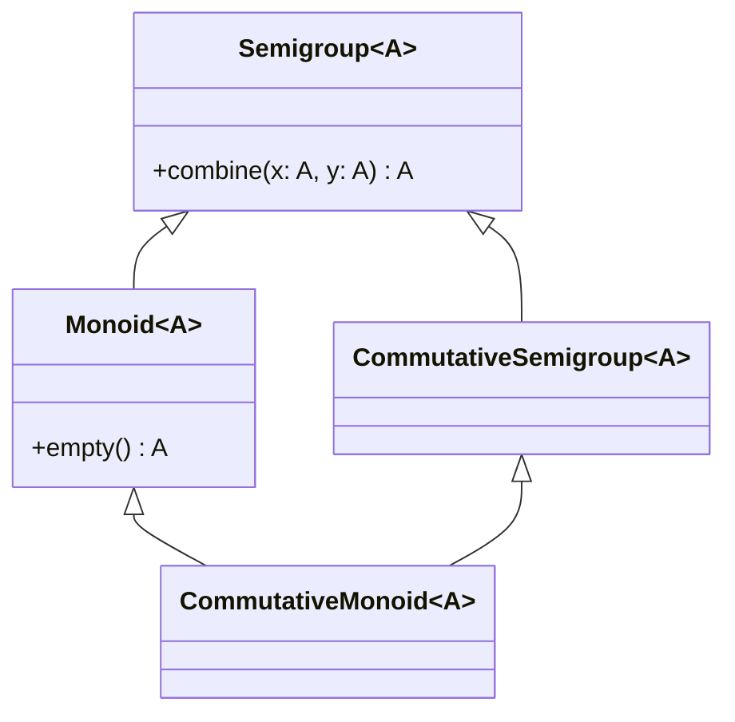



# Коммутативный моноид

`CMonoid[A]` - [моноид](monoid.md), который [коммутативен](csemigroup.md).

Помимо законов моноида:

- _Замыкание_ (_closure_): для \\(\forall x, y \in CM\\) выполняется \\(x + y \in CM\\).
- _Ассоциативность_ (_associativity_): для \\(\forall x, y, z \in CM\\) выполняется \\((x + y) + z = x + (y + z)\\).
- _Тождественность_ или _существования нейтрального элемента_ (_identity_): существует \\(\exists e \in CM\\) такой, 
  что для \\(\forall x \in CM\\) выполняется \\(e + x = x + e = x\\)

должен соблюдаться закон:

- _Коммутативность_ (_commutative_): для \\(\forall x, y \in CM\\) выполняется \\(x + y = y + x\\).

## Код

```dotty
trait CMonoid[A] extends Monoid[A], CSemigroup[A]
```

### Законы

Законы наследуются от [моноида](monoid.md) и [коммутативной полугруппы](csemigroup.md).

## Схема



## Реализация в библиотеках

### Реализация в Spire

```dotty
import spire.algebra.CMonoid

CMonoid.combine(100, CMonoid.empty[Int]) // 100
```

---

**Ссылки:**

- [Ссылка на репозиторий с упражнениями][sample]
- [Spire home page](https://typelevel.org/spire/)

[sample]: https://gitverse.ru/scalabook/typeclasses
