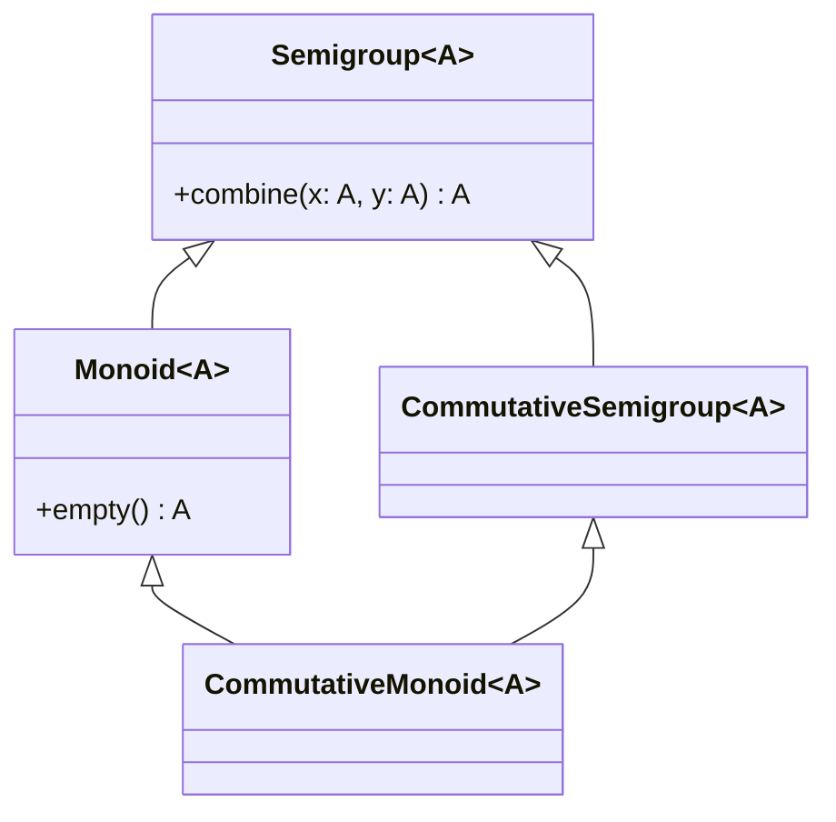

# Коммутативный моноид

**Коммутативный моноид** — это алгебраическая структура, которая объединяет свойства [моноида](monoid.md) и [коммутативности](csemigroup.md). 
Разберем эти понятия по отдельности, а затем объединим их.

а) **Моноид**

Моноид — это множество \\(M\\), на котором определена бинарная операция \\(\cdot\\) (обычно называемая умножением или композицией), 
удовлетворяющая следующим свойствам:

- **Ассоциативность**: для любых \\(a, b, c \in M\\) выполняется \\((a \cdot b) \cdot c = a \cdot (b \cdot c)\\).
- **Наличие нейтрального элемента**: существует элемент \\(e \in M\\) такой, 
  что для любого \\(a \in M\\) выполняется \\(e \cdot a = a \cdot e = a\\).

б) **Коммутативность**

Операция \\(\cdot\\) называется **коммутативной**, если для любых \\(a, b \in M\\) выполняется:

\\(a \cdot b = b \cdot a.\\)

Таким образом, коммутативный моноид — это моноид, в котором операция \\(\cdot\\) коммутативна. 
То есть:

- **Ассоциативность**: \\((a \cdot b) \cdot c = a \cdot (b \cdot c)\\) для любых \\(a, b, c \in M\\).
- **Наличие нейтрального элемента**: существует \\(e \in M\\) такой, что \\(e \cdot a = a \cdot e = a\\) для любого \\(a \in M\\).
- **Коммутативность**: \\(a \cdot b = b \cdot a\\) для любых \\(a, b \in M\\).

**Примеры коммутативных моноидов**

- **Множество натуральных чисел со сложением**:
    - Операция: \\(+\\).
    - Нейтральный элемент: \\(0\\).
    - Ассоциативность: \\((a + b) + c = a + (b + c)\\).
    - Коммутативность: \\(a + b = b + a\\).
- **Множество натуральных чисел с умножением**:
    - Операция: \\(\times\\).
    - Нейтральный элемент: \\(1\\).
    - Ассоциативность: \\((a \times b) \times c = a \times (b \times c)\\).
    - Коммутативность: \\(a \times b = b \times a\\).
- **Множество действительных чисел с операцией максимума**:
    - Операция: \\(\max(a, b)\\).
    - Нейтральный элемент: \\(-\infty\\) (если рассматривать расширенную числовую прямую).
    - Ассоциативность: \\(\max(\max(a, b), c) = \max(a, \max(b, c))\\).
    - Коммутативность: \\(\max(a, b) = \max(b, a)\\).
- **Множество подмножеств с операцией объединения**:
    - Операция: \\(\cup\\).
    - Нейтральный элемент: пустое множество \\(\emptyset\\).
    - Ассоциативность: \\((A \cup B) \cup C = A \cup (B \cup C)\\).
    - Коммутативность: \\(A \cup B = B \cup A\\).

**Зачем нужны коммутативные моноиды?**

Коммутативные моноиды находят применение в различных областях:

- **Алгебра**: изучаются как базовые алгебраические структуры.
- **Теория чисел**: используются для анализа свойств операций над числами.
- **Компьютерные науки**: применяются в параллельных вычислениях, где порядок выполнения операций не важен.
- **Теория графов**: используются для анализа симметричных структур.

## Формальное определение

`CMonoid[A]` - [моноид](monoid.md), который [коммутативен](csemigroup.md).

Помимо законов моноида:

- _Замыкание_ (_closure_): для \\(\forall x, y \in CM\\) выполняется \\(x + y \in CM\\).
- _Ассоциативность_ (_associativity_): для \\(\forall x, y, z \in CM\\) выполняется \\((x + y) + z = x + (y + z)\\).
- _Тождественность_ или _существования нейтрального элемента_ (_identity_): существует \\(\exists e \in CM\\) такой, 
  что для \\(\forall x \in CM\\) выполняется \\(e + x = x + e = x\\)

должен соблюдаться закон:

- _Коммутативность_ (_commutative_): для \\(\forall x, y \in CM\\) выполняется \\(x + y = y + x\\).

## Код

```dotty
trait CMonoid[A] extends Monoid[A], CSemigroup[A]
```

### Натуральные числа N образуют коммутативный моноид относительно сложения и 0

```dotty
given CMonoid[Int] with
  val empty                        = 0
  def combine(x: Int, y: Int): Int = x + y
```

### Законы

Законы наследуются от [моноида](monoid.md) и [коммутативной полугруппы](csemigroup.md).

## Схема



## Реализация в библиотеках

### Реализация в Spire

```dotty
import spire.algebra.CMonoid

CMonoid.combine(100, CMonoid.empty[Int]) // 100
```

---

**Ссылки:**

- [Spire home page](https://typelevel.org/spire)

