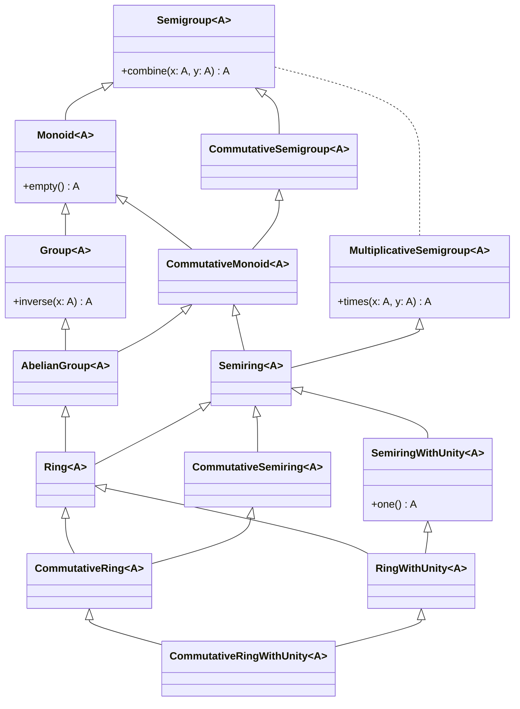



# Коммутативное кольцо с единицей

**Коммутативное кольцо с единицей** — это кольцо, которое одновременно является:

- [**Коммутативным**](cring.md): операция умножения коммутативна, то есть \\(a \cdot b = b \cdot a\\) для любых элементов \\(a, b\\) из кольца.
- [**Кольцом с единицей**](ring-with-one.md): существует нейтральный элемент относительно умножения, называемый **единицей** 
  и обозначаемый \\(1\\), такой, что \\(a \cdot 1 = 1 \cdot a = a\\) для любого элемента \\(a\\) из кольца.

**Определение коммутативного кольца с единицей**

Коммутативное кольцо с единицей — это множество \\(R\\), на котором определены две бинарные операции:

- **Сложение** (\\(+\\)): коммутативная и ассоциативная операция.
- **Умножение** (\\(\cdot\\)): коммутативная и ассоциативная операция.

Эти операции должны удовлетворять следующим аксиомам:

- **Коммутативность сложения**: \\(a + b = b + a\\) для любых \\(a, b \in R\\).
- **Ассоциативность сложения**: \\((a + b) + c = a + (b + c)\\) для любых \\(a, b, c \in R\\).
- **Наличие нулевого элемента**: существует элемент \\(0 \in R\\) такой, что \\(0 + a = a + 0 = a\\) для любого \\(a \in R\\).
- **Наличие противоположного элемента**: для любого \\(a \in R\\) существует элемент \\(-a \in R\\) такой, что \\(a + (-a) = 0\\).
- **Ассоциативность умножения**: \\((a \cdot b) \cdot c = a \cdot (b \cdot c)\\) для любых \\(a, b, c \in R\\).
- **Коммутативность умножения**: \\(a \cdot b = b \cdot a\\) для любых \\(a, b \in R\\).
- **Дистрибутивность умножения относительно сложения**:
    - \\(a \cdot (b + c) = a \cdot b + a \cdot c\\) (левая дистрибутивность),
    - \\((a + b) \cdot c = a \cdot c + b \cdot c\\) (правая дистрибутивность).
- **Наличие единичного элемента**: существует элемент \\(1 \in R\\) такой, что \\(a \cdot 1 = 1 \cdot a = a\\) для любого \\(a \in R\\).

**Примеры коммутативных колец с единицей**

- **Кольцо целых чисел \\(\mathbb{Z}\\)**:
    - Операции: сложение и умножение.
    - Нулевой элемент: \\(0\\).
    - Единичный элемент: \\(1\\).
- **Кольцо действительных чисел \\(\mathbb{R}\\)**:
    - Операции: сложение и умножение.
    - Нулевой элемент: \\(0\\).
    - Единичный элемент: \\(1\\).
- **Кольцо многочленов \\(\mathbb{R}\[x\]\\)**:
    - Операции: сложение и умножение многочленов.
    - Нулевой элемент: нулевой многочлен.
    - Единичный элемент: многочлен \\(1\\).
- **Кольцо вычетов \\(\mathbb{Z}/n\mathbb{Z}\\)**:
    - Операции: сложение и умножение по модулю \\(n\\).
    - Нулевой элемент: \\(0\\).
    - Единичный элемент: \\(1\\).
- **Кольцо функций \\(C(\[a, b\])\\)**:
    - Множество: непрерывные функции на отрезке \\(\[a, b\]\\).
    - Операции: поточечное сложение и умножение функций.
    - Нулевой элемент: нулевая функция.
    - Единичный элемент: функция, тождественно равная \\(1\\).

**Зачем нужны коммутативные кольца с единицей?**

Коммутативные кольца с единицей играют важную роль в математике и её приложениях:

- **Алгебра**: изучаются как базовые алгебраические структуры.
- **Теория чисел**: используются для анализа свойств чисел, например, в теории делимости.
- **Геометрия**: кольца многочленов применяются в алгебраической геометрии.
- **Физика**: используются для описания симметрий в физических системах.
- **Криптография**: кольца вычетов применяются в алгоритмах шифрования.

## Формальное определение

Коммутативное кольцо с единицей объединяет в себе [коммутативное кольцо](cring.md) и [кольцо с единицей](ring-with-one.md).

Для коммутативного кольца с единицей должны соблюдаться следующие законы:

- _Замыкание сложения_ (_closure_): для \\(\forall x, y \in R\\) выполняется \\(x + y \in R\\).
- _Ассоциативность сложения_ (_associativity_): для \\(\forall x, y, z \in R\\) выполняется \\((x + y) + z = x + (y + z)\\).
- _Существование нулевого элемента_: существует \\(\exists 0 \in R\\) такой,
  что для \\(\forall x \in R\\) выполняется \\(0 + x = x + 0 = x\\)
- _Обратимость сложения_: для \\(\forall x \in R\\) существует \\((-x)\\) такой,
  что \\(x + (-x) = (-x) + x = 0\\)
- _Коммутативность сложения_ (_commutative_): для \\(\forall x, y \in R\\) выполняется \\(x + y = y + x\\).
- _Замыкание умножения_ (_closure_): для \\(\forall x, y \in R\\) выполняется \\(x \* y \in R\\).
- _Ассоциативность умножения_ (_associativity_): для \\(\forall x, y, z \in R\\) выполняется \\((x \* y) \* z = x \* (y \* z)\\).
- _Существование единичного элемента_: \\(\exists 1 \in R \quad \forall x \in R \quad x \* 1 = 1 \* x = x\\)
- _Коммутативность умножения_: для \\(\forall x, y \in R\\) выполняется \\(x \* y = y \* x\\).
- _Дистрибутивность_ (_distributivus_, _распределительный закон_):
  для \\(\forall x, y, z \in R\\) выполняется \\(x \* (y + z) = x \* y + x \* z\\) и \\((x + y) \* z = x \* z + y \* z\\).

## Код

```dotty
trait CRingWithUnity[A] extends CRing[A], RingWithUnity[A]
```

### Числа относительно сложения с 0 и умножения с 1

`(Z, +, *)`

```dotty
given CRingWithUnity[Int] with
  val empty: Int                               = 0
  val one: Int                                 = 1
  def combine(x: Int, y: Int): Int             = x + y
  def times(x: Int, y: Int): Int               = x * y
  extension (a: Int) override def inverse: Int = -a
```

### Законы

Законы наследуются от [законов коммутативного кольца](cring.md) и [кольца с единицей](ring-with-one.md).

## Схема



## Реализация в библиотеках

### Реализация в Spire

```dotty
import spire.algebra.CRing
import spire.math.Rational

CRing.plus(Rational(1, 2), Rational(1, 3))
// val res0: spire.math.Rational = 5/6
CRing.times(Rational(1, 2), Rational(1, 3))
// val res1: spire.math.Rational = 1/6
CRing.pow(Rational(1, 2), 3)
// val res2: spire.math.Rational = 1/8
CRing.negate(Rational(1, 2))
// val res3: spire.math.Rational = -1/2
CRing.minus(Rational(1, 2), Rational(1, 3))
// val res4: spire.math.Rational = 1/6
CRing.zero[Rational]
// val res5: spire.math.Rational = 0
CRing.one[Rational]
// val res6: spire.math.Rational = 1
```

---

**Ссылки:**

- [Ссылка на репозиторий с упражнениями][sample]
- [Spire home page](https://typelevel.org/spire/)
- [Spire User's Guide](https://typelevel.org/spire/guide.html)

[sample]: https://gitverse.ru/scalabook/typeclasses
