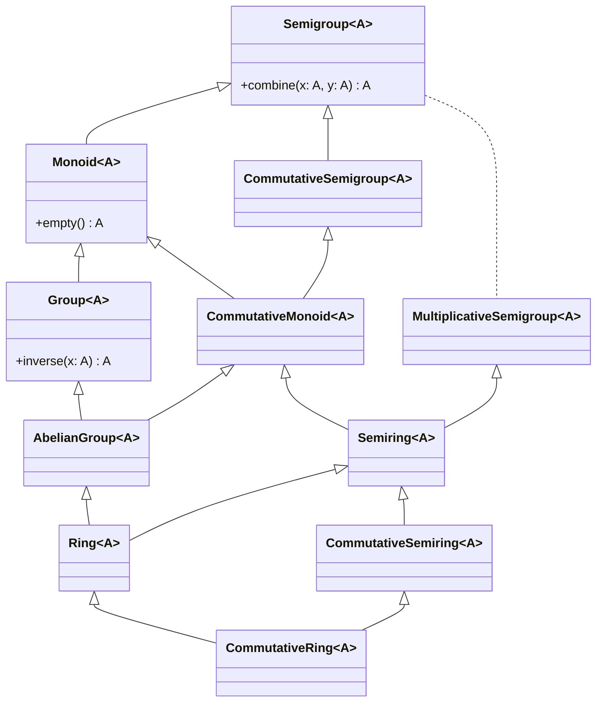

# Коммутативное кольцо

**Коммутативное кольцо** — это кольцо, в котором операция умножения коммутативна. Это означает, что для любых элементов \( a \) и \( b \) из кольца выполняется равенство \( a \cdot b = b \cdot a \). Давайте разберём это подробнее.

---

### Определение коммутативного кольца
Коммутативное кольцо — это множество \( R \), на котором определены две бинарные операции:
1. **Сложение** (\( + \)): коммутативная и ассоциативная операция.
2. **Умножение** (\( \cdot \)): коммутативная и ассоциативная операция.

Эти операции должны удовлетворять следующим аксиомам:
1. **Коммутативность сложения**: \( a + b = b + a \) для любых \( a, b \in R \).
2. **Ассоциативность сложения**: \( (a + b) + c = a + (b + c) \) для любых \( a, b, c \in R \).
3. **Наличие нулевого элемента**: существует элемент \( 0 \in R \) такой, что \( a + 0 = a \) для любого \( a \in R \).
4. **Наличие противоположного элемента**: для любого \( a \in R \) существует элемент \( -a \in R \) такой, что \( a + (-a) = 0 \).
5. **Ассоциативность умножения**: \( (a \cdot b) \cdot c = a \cdot (b \cdot c) \) для любых \( a, b, c \in R \).
6. **Коммутативность умножения**: \( a \cdot b = b \cdot a \) для любых \( a, b \in R \).
7. **Дистрибутивность умножения относительно сложения**:
  - \( a \cdot (b + c) = a \cdot b + a \cdot c \) (левая дистрибутивность),
  - \( (a + b) \cdot c = a \cdot c + b \cdot c \) (правая дистрибутивность).

Если в кольце также существует **единичный элемент** \( 1 \in R \) такой, что \( a \cdot 1 = 1 \cdot a = a \) для любого \( a \in R \), то такое кольцо называется **коммутативным кольцом с единицей**.

---

### Примеры коммутативных колец
1. **Кольцо целых чисел \( \mathbb{Z} \)**:
  - Операции: сложение и умножение.
  - Нулевой элемент: \( 0 \).
  - Единичный элемент: \( 1 \).
  - Коммутативное кольцо с единицей.

2. **Кольцо действительных чисел \( \mathbb{R} \)**:
  - Операции: сложение и умножение.
  - Нулевой элемент: \( 0 \).
  - Единичный элемент: \( 1 \).
  - Коммутативное кольцо с единицей.

3. **Кольцо многочленов \( \mathbb{R}[x] \)**:
  - Операции: сложение и умножение многочленов.
  - Нулевой элемент: нулевой многочлен.
  - Единичный элемент: многочлен \( 1 \).
  - Коммутативное кольцо с единицей.

4. **Кольцо вычетов \( \mathbb{Z}/n\mathbb{Z} \)**:
  - Операции: сложение и умножение по модулю \( n \).
  - Нулевой элемент: \( 0 \).
  - Единичный элемент: \( 1 \).
  - Коммутативное кольцо с единицей.

5. **Кольцо функций \( C([a, b]) \)**:
  - Множество: непрерывные функции на отрезке \([a, b]\).
  - Операции: поточечное сложение и умножение функций.
  - Нулевой элемент: нулевая функция.
  - Единичный элемент: функция, тождественно равная \( 1 \).
  - Коммутативное кольцо с единицей.

---

### Зачем нужны коммутативные кольца?
Коммутативные кольца играют важную роль в математике и её приложениях:
1. **Алгебра**: изучаются как базовые алгебраические структуры.
2. **Теория чисел**: используются для анализа свойств чисел, например, в теории делимости.
3. **Геометрия**: кольца многочленов применяются в алгебраической геометрии.
4. **Физика**: используются для описания симметрий в физических системах.
5. **Криптография**: кольца вычетов применяются в алгоритмах шифрования.

---

### Отличие коммутативного кольца от некоммутативного
Основное отличие заключается в том, что в коммутативном кольце операция умножения коммутативна, то есть \( a \cdot b = b \cdot a \) для любых \( a, b \in R \). В некоммутативном кольце это свойство может не выполняться.

---

### Итог
Коммутативное кольцо — это кольцо, в котором операция умножения коммутативна. Оно широко используется в математике и её приложениях для моделирования и анализа различных систем.

## Формальное определение

Коммутативное кольцо - [кольцо](ring.md), коммутативное относительно умножения.

Для коммутативного кольца должны соблюдаться все законы кольца:

- _Замыкание сложения_ (_closure_): для \\(\forall x, y \in R\\) выполняется \\(x + y \in R\\).
- _Ассоциативность сложения_ (_associativity_): для \\(\forall x, y, z \in R\\) выполняется \\((x + y) + z = x + (y + z)\\).
- _Существование нулевого элемента_: существует \\(\exists 0 \in R\\) такой,
  что для \\(\forall x \in R\\) выполняется \\(0 + x = x + 0 = x\\)
- _Обратимость сложения_: для \\(\forall x \in R\\) существует \\((-x)\\) такой,
  что \\(x + (-x) = (-x) + x = 0\\)
- _Коммутативность сложения_ (_commutative_): для \\(\forall x, y \in R\\) выполняется \\(x + y = y + x\\).
- _Замыкание умножения_ (_closure_): для \\(\forall x, y \in R\\) выполняется \\(x \* y \in R\\).
- _Ассоциативность умножения_ (_associativity_): для \\(\forall x, y, z \in R\\) выполняется \\((x \* y) \* z = x \* (y \* z)\\).
- _Дистрибутивность_ (_distributivus_, _распределительный закон_):
  для \\(\forall x, y, z \in R\\) выполняется \\(x \* (y + z) = x \* y + x \* z\\) и \\((x + y) \* z = x \* z + y \* z\\).

, а также закон коммутативности умножения:

- _Коммутативность умножения_: для \\(\forall x, y \in R\\) выполняется \\(x * y = y * x\\).

## Код

```dotty
trait CRing[A] extends Ring[A]
```

### Числа относительно сложения с 0 и умножения

`(Z, +, *)`

```dotty
given CRing[Int] with
  val empty                                    = 0
  def combine(x: Int, y: Int): Int             = x + y
  def times(x: Int, y: Int): Int               = x * y
  extension (a: Int) override def inverse: Int = -a
```

### Законы

```dotty
trait CRingLaw extends RingLaw:
  def checkCRingLaw[A: CRing](x: A, y: A, z: A): ValidatedNel[String, Unit] =
    checkRingLaw(x, y, z) combine
      check(
        CRing[A].times(x, y) == CRing[A].times(y, x),
        "times commutative: x * y = y * x"
      )
```

## Схема



## Реализация в библиотеках

### Реализация в Spire

```dotty
import spire.algebra.CRing
import spire.math.Rational

CRing.plus(Rational(1, 2), Rational(1, 3))
// val res0: spire.math.Rational = 5/6
CRing.times(Rational(1, 2), Rational(1, 3))
// val res1: spire.math.Rational = 1/6
CRing.pow(Rational(1, 2), 3)
// val res2: spire.math.Rational = 1/8
CRing.negate(Rational(1, 2))
// val res3: spire.math.Rational = -1/2
CRing.minus(Rational(1, 2), Rational(1, 3))
// val res4: spire.math.Rational = 1/6
CRing.zero[Rational]
// val res5: spire.math.Rational = 0
```

---

**Ссылки:**

- [Spire home page](https://typelevel.org/spire)
- [Spire User's Guide](https://typelevel.org/spire/guide.html)
- [Wikipedia](https://ru.wikipedia.org/wiki/%D0%9A%D0%BE%D0%BC%D0%BC%D1%83%D1%82%D0%B0%D1%82%D0%B8%D0%B2%D0%BD%D0%BE%D0%B5_%D0%BA%D0%BE%D0%BB%D1%8C%D1%86%D0%BE)
