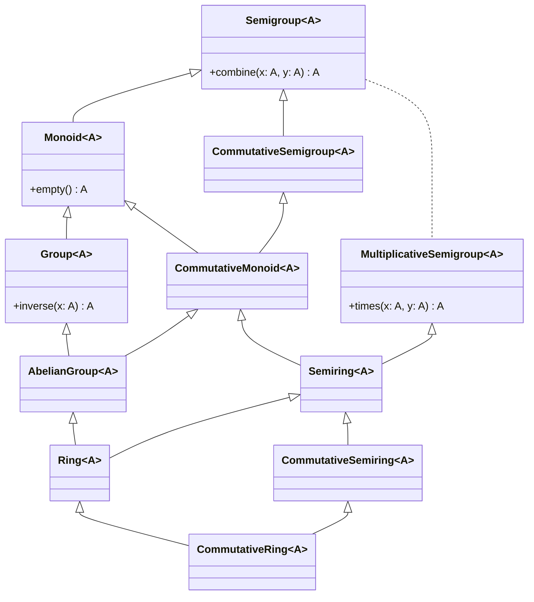



# Коммутативное кольцо

Коммутативное кольцо - [кольцо](ring.md), коммутативное относительно умножения.

Для коммутативного кольца должны соблюдаться все законы кольца:

- _Замыкание сложения_ (_closure_): для \\(\forall x, y \in R\\) выполняется \\(x + y \in R\\).
- _Ассоциативность сложения_ (_associativity_): для \\(\forall x, y, z \in R\\) выполняется \\((x + y) + z = x + (y + z)\\).
- _Существование нулевого элемента_: существует \\(\exists 0 \in R\\) такой,
  что для \\(\forall x \in R\\) выполняется \\(0 + x = x + 0 = x\\)
- _Обратимость сложения_: для \\(\forall x \in R\\) существует \\((-x)\\) такой,
  что \\(x + (-x) = (-x) + x = 0\\)
- _Коммутативность сложения_ (_commutative_): для \\(\forall x, y \in R\\) выполняется \\(x + y = y + x\\).
- _Замыкание умножения_ (_closure_): для \\(\forall x, y \in R\\) выполняется \\(x \* y \in R\\).
- _Ассоциативность умножения_ (_associativity_): для \\(\forall x, y, z \in R\\) выполняется \\((x \* y) \* z = x \* (y \* z)\\).
- _Дистрибутивность_ (_distributivus_, _распределительный закон_):
  для \\(\forall x, y, z \in R\\) выполняется \\(x \* (y + z) = x \* y + x \* z\\) и \\((x + y) \* z = x \* z + y \* z\\).

, а также закон коммутативности умножения:

- _Коммутативность умножения_: для \\(\forall x, y \in R\\) выполняется \\(x * y = y * x\\).

## Код

```dotty
trait CRing[A] extends Ring[A], CSemiring[A]
```

### Законы

Законы наследуются от [законов кольца](ring.md) и [коммутативного полукольца](csemiring.md).

## Схема



## Реализация в библиотеках

### [Реализация в Spire](../../libs/spire.md)

`CRing[A]` обеспечивает коммутативный `+`, `zero`, `-`, коммутативный `*` и `one`.
`CRing[A]` расширяет `Ring[A]` и `MultiplicativeCMonoid[A]`.

```dotty
import spire.algebra.CRing
import spire.math.Rational

CRing.plus(Rational(1, 2), Rational(1, 3))
// val res0: spire.math.Rational = 5/6
CRing.times(Rational(1, 2), Rational(1, 3))
// val res1: spire.math.Rational = 1/6
CRing.pow(Rational(1, 2), 3)
// val res2: spire.math.Rational = 1/8
CRing.negate(Rational(1, 2))
// val res3: spire.math.Rational = -1/2
CRing.minus(Rational(1, 2), Rational(1, 3))
// val res4: spire.math.Rational = 1/6
CRing.zero[Rational]
// val res5: spire.math.Rational = 0
CRing.one[Rational]
// val res6: spire.math.Rational = 1
```

---

**Ссылки:**

- [Ссылка на репозиторий с упражнениями][sample]
- [Spire home page](https://typelevel.org/spire/)
- [Spire User's Guide](https://typelevel.org/spire/guide.html)
- [Wikipedia](https://ru.wikipedia.org/wiki/%D0%9A%D0%BE%D0%BC%D0%BC%D1%83%D1%82%D0%B0%D1%82%D0%B8%D0%B2%D0%BD%D0%BE%D0%B5_%D0%BA%D0%BE%D0%BB%D1%8C%D1%86%D0%BE)

[sample]: https://gitverse.ru/scalabook/typeclasses
