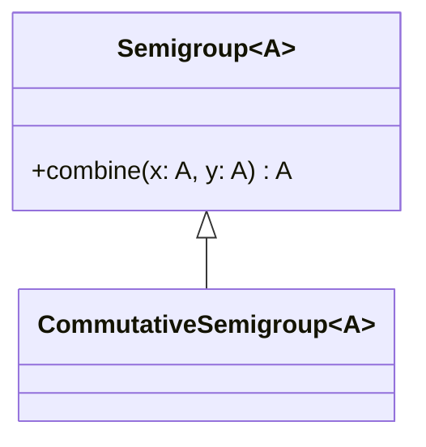



# Коммутативная полугруппа

`CSemigroup[A]` - [полугруппа](semigroup.md), которая является коммутативной.

Помимо законов полугруппы:

- _Замыкание_ (_closure_): для \\(\forall x, y \in CS\\) выполняется \\(x + y \in CS\\).
- _Ассоциативность_ (_associativity_): для \\(\forall x, y, z \in CS\\) выполняется \\((x + y) + z = x + (y + z)\\).

должен соблюдаться закон:

- _Коммутативность_ (_commutative_): для \\(\forall x, y \in CS\\) выполняется \\(x + y = y + x\\).

## Код

```dotty
trait CSemigroup[A] extends Semigroup[A]
```

### Законы

Коммутативность означает, что порядок элементов при объединении не важен. 
Другими словами, результат операции `combine` будет одинаковым, независимо от того, 
в каком порядке вы передаёте элементы `x` и `y`. 
Это можно записать так: `cs.combine(x, y) == cs.combine(y, x)`

## Схема



## Реализация в библиотеках

### [Реализация в Spire](../../libs/spire.md)

```dotty
import spire.algebra.CSemigroup

CSemigroup.combine(1, 2) == CSemigroup.combine(2, 1)
```

---

**Ссылки:**

- [Ссылка на репозиторий с упражнениями][sample]
- [Spire home page](https://typelevel.org/spire/)

[sample]: https://gitverse.ru/scalabook/typeclasses
