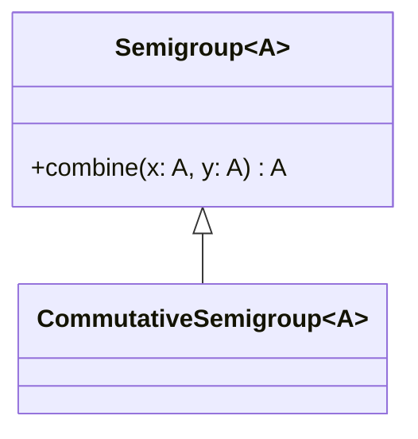

# Коммутативная полугруппа

## Формальное определение

`CSemigroup[A]` - [полугруппа](semigroup.md), которая является коммутативной.

Помимо законов полугруппы:

- _Замыкание_ (_closure_): для \\(\forall x, y \in CS\\) выполняется \\(x + y \in CS\\).
- _Ассоциативность_ (_associativity_): для \\(\forall x, y, z \in CS\\) выполняется \\((x + y) + z = x + (y + z)\\).

должен соблюдаться закон:

- _Коммутативность_ (_commutative_): для \\(\forall x, y \in CS\\) выполняется \\(x + y = y + x\\).

## Определение в виде кода на Scala

```dotty
trait CSemigroup[A] extends Semigroup[A]
```

## Законы в виде кода на Scala

```dotty
trait CSemigroupLaw extends SemigroupLaw:
  def checkCSemigroupLaw[A: CSemigroup](
      x: A,
      y: A,
      z: A
  ): ValidatedNel[String, Unit] =
    checkSemigroupLaw(x, y, z) combine
      check(
        CSemigroup[A].combine(x, y) == CSemigroup[A].combine(y, x),
        "commutative: x + y = y + x"
      )
```

## Примеры

### Натуральные числа N образуют коммутативную полугруппу относительно сложения

```dotty
given CSemigroup[Int] = (x: Int, y: Int) => x + y
```

## Схема



## Реализация в библиотеках

### Реализация в Spire

```dotty
import spire.algebra.CSemigroup

CSemigroup.combine(1, 2) == CSemigroup.combine(2, 1)
```

---

**Ссылки:**

- [Spire home page](https://typelevel.org/spire)

