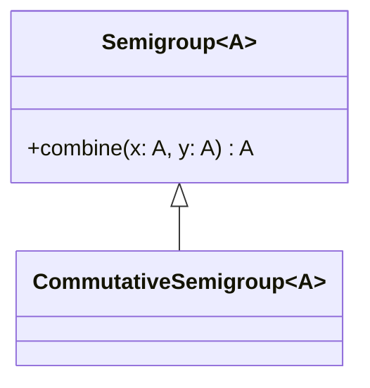

# Коммутативная полугруппа

**Коммутативная полугруппа** — это алгебраическая структура, которая сочетает в себе свойства [полугруппы](semigroup.md) и коммутативности. 
Разберем эти понятия по отдельности, а затем объединим их.

а) **Полугруппа**

Полугруппа — это множество \\(S\\), на котором определена бинарная операция \\(\cdot\\) (обычно называемая умножением или композицией), 
удовлетворяющая свойству **ассоциативности**:

- Для любых \\(a, b, c \in S\\) выполняется \\((a \cdot b) \cdot c = a \cdot (b \cdot c)\\).

б) **Коммутативность**

Операция \\(\cdot\\) называется **коммутативной**, если для любых \\(a, b \in S\\) выполняется:

\\(a \cdot b = b \cdot a.\\)

Таким образом, коммутативная полугруппа — это полугруппа, в которой операция \\(\cdot\\) коммутативна. 
То есть:

- **Ассоциативность**: \\((a \cdot b) \cdot c = a \cdot (b \cdot c)\\) для любых \\(a, b, c \in S\\).
- **Коммутативность**: \\(a \cdot b = b \cdot a\\) для любых \\(a, b \in S\\).

**Примеры коммутативных полугрупп**

- **Множество натуральных чисел со сложением**:
    - Операция: \\(+\\).
    - Ассоциативность: \\((a + b) + c = a + (b + c)\\).
    - Коммутативность: \\(a + b = b + a\\).
- **Множество натуральных чисел с умножением**:
    - Операция: \\(\times\\).
    - Ассоциативность: \\((a \times b) \times c = a \times (b \times c)\\).
    - Коммутативность: \\(a \times b = b \times a\\).
- **Множество действительных чисел с операцией максимума**:
    - Операция: \\(\max(a, b)\\).
    - Ассоциативность: \\(\max(\max(a, b), c) = \max(a, \max(b, c))\\).
    - Коммутативность: \\(\max(a, b) = \max(b, a)\\).
- **Множество подмножеств с операцией объединения**:
    - Операция: \\(\cup\\).
    - Ассоциативность: \\((A \cup B) \cup C = A \cup (B \cup C)\\).
    - Коммутативность: \\(A \cup B = B \cup A\\).

**Зачем нужны коммутативные полугруппы?**

Коммутативные полугруппы находят применение в различных областях:

- **Алгебра**: изучаются как базовые алгебраические структуры.
- **Теория чисел**: используются для анализа свойств операций над числами.
- **Компьютерные науки**: применяются в параллельных вычислениях, где порядок выполнения операций не важен.
- **Теория графов**: используются для анализа симметричных структур.

## Формальное определение

`CSemigroup[A]` - [полугруппа](semigroup.md), которая является коммутативной.

Помимо законов полугруппы:

- _Замыкание_ (_closure_): для \\(\forall x, y \in CS\\) выполняется \\(x + y \in CS\\).
- _Ассоциативность_ (_associativity_): для \\(\forall x, y, z \in CS\\) выполняется \\((x + y) + z = x + (y + z)\\).

должен соблюдаться закон:

- _Коммутативность_ (_commutative_): для \\(\forall x, y \in CS\\) выполняется \\(x + y = y + x\\).

## Код

```dotty
trait CSemigroup[A] extends Semigroup[A]
```

### Натуральные числа N образуют коммутативную полугруппу относительно сложения

```dotty
given CSemigroup[Int] = (x: Int, y: Int) => x + y
```

### Законы

```dotty
def checkAssociativity[A](x: A, y: A, z: A)(using
    s: Semigroup[A]
): ValidatedNel[String, Unit] =
  Either.cond[String, Unit](
    s.combine(s.combine(x, y), z) == s.combine(x, s.combine(y, z)),
    (),
    "Не соблюдается ассоциативность: (x + y) + z должно быть равно x + (y + z)"
  ).toValidatedNel
  
def checkCommutativity[A](x: A, y: A)(using
    cs: CSemigroup[A]
): ValidatedNel[String, Unit] =
  Either.cond[String, Unit](
    cs.combine(x, y) == cs.combine(y, x),
    (),
    "Не соблюдается коммутативность: x + y должно быть равно y + x"
  ).toValidatedNel  
```

## Схема



## Реализация в библиотеках

### Реализация в Spire

```dotty
import spire.algebra.CSemigroup

CSemigroup.combine(1, 2) == CSemigroup.combine(2, 1)
```

---

**Ссылки:**

- [Spire home page](https://typelevel.org/spire)

