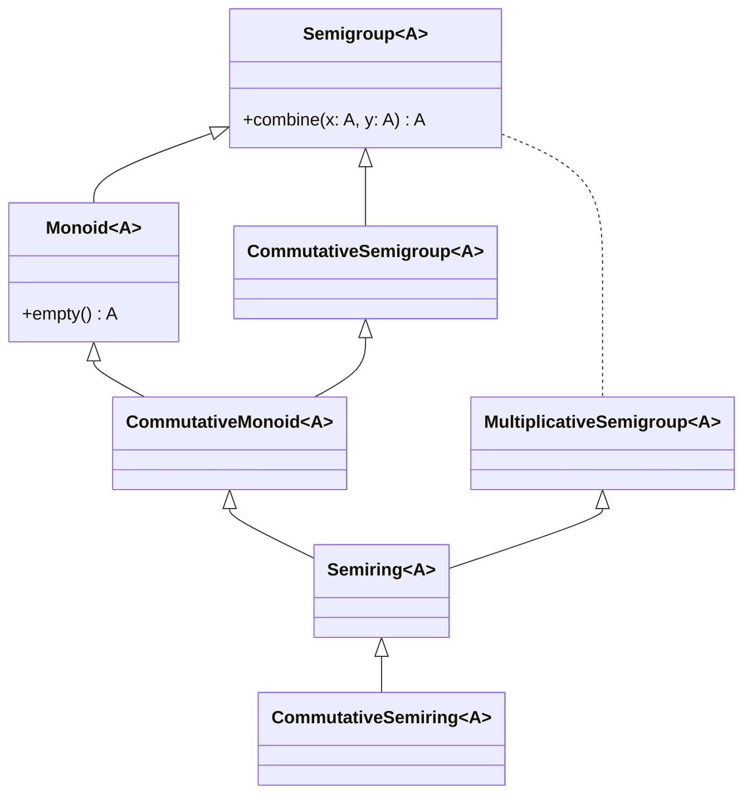

# Коммутативное полукольцо

**Коммутативное полукольцо** — это [полукольцо](semiring.md), в котором операция умножения коммутативна. 

**Определение коммутативного полукольца**

Коммутативное полукольцо — это множество \\(S\\), на котором определены две бинарные операции:

- **Сложение** (\\(+\\)): коммутативная и ассоциативная операция.
- **Умножение** (\\(\cdot\\)): ассоциативная и коммутативная операция.

Эти операции должны удовлетворять следующим аксиомам:

- **Коммутативность сложения**: \\(a + b = b + a\\) для любых \\(a, b \in S\\).
- **Ассоциативность сложения**: \\((a + b) + c = a + (b + c)\\) для любых \\(a, b, c \in S\\).
- **Ассоциативность умножения**: \\((a \cdot b) \cdot c = a \cdot (b \cdot c)\\) для любых \\(a, b, c \in S\\).
- **Коммутативность умножения**: \\(a \cdot b = b \cdot a\\) для любых \\(a, b \in S\\).
- **Дистрибутивность умножения относительно сложения**:
    - \\(a \cdot (b + c) = a \cdot b + a \cdot c\\) (левая дистрибутивность),
    - \\((a + b) \cdot c = a \cdot c + b \cdot c\\) (правая дистрибутивность).
- **Наличие нулевого элемента**: существует элемент \\(0 \in S\\) такой, что \\(0 + a = a + 0 = a\\) и \\(a \cdot 0 = 0 \cdot a = 0\\) для любого \\(a \in S\\).

Если в полукольце также существует **единичный элемент** \\(1 \in S\\) такой, 
что \\(a \cdot 1 = 1 \cdot a = a\\) для любого \\(a \in S\\), 
то такое полукольцо называется **коммутативным полукольцом с единицей**.

**Примеры коммутативных полуколец**

- **Множество натуральных чисел \\(\mathbb{N}\\) с обычными сложением и умножением**:
    - Сложение и умножение ассоциативны и коммутативны.
    - Нулевой элемент: \\(0\\).
    - Единичный элемент: \\(1\\).
    - Дистрибутивность выполняется.
- **Множество неотрицательных действительных чисел \\(\mathbb{R}_{\geq 0}\\) с обычными сложением и умножением**:
    - Сложение и умножение ассоциативны и коммутативны.
    - Нулевой элемент: \\(0\\).
    - Единичный элемент: \\(1\\).
    - Дистрибутивность выполняется.
- **Булево полукольцо**:
    - Множество: \\(\{0, 1\}\\).
    - Операции: логическое ИЛИ (\\(+\\)) и логическое И (\\(\cdot\\)).
    - Нулевой элемент: \\(0\\).
    - Единичный элемент: \\(1\\).
    - Дистрибутивность выполняется.
- **Полукольцо подмножеств**:
    - Множество: все подмножества некоторого множества \\(X\\).
    - Операции: объединение (\\(+\\)) и пересечение (\\(\cdot\\)).
    - Нулевой элемент: пустое множество \\(\emptyset\\).
    - Единичный элемент: само множество \\(X\\).
    - Дистрибутивность выполняется.
- **Тропическое полукольцо**:
    - Множество: \\(\mathbb{R} \cup \{+\infty\}\\).
    - Операции: минимум (\\(+\\)) и сложение (\\(\cdot\\)).
    - Нулевой элемент: \\(+\infty\\).
    - Единичный элемент: \\(0\\).
    - Дистрибутивность выполняется.

**Зачем нужны коммутативные полукольца?**

Коммутативные полукольца находят применение в различных областях:

- **Теория автоматов и формальных языков**: используются для описания и анализа регулярных выражений.
- **Оптимизация**: тропическое полукольцо применяется в задачах оптимизации, таких как поиск кратчайших путей в графах.
- **Компьютерные науки**: используются в алгоритмах, связанных с графами, сетями и логическими операциями.
- **Алгебра**: изучаются как обобщение колец и полей.

**Отличие коммутативного полукольца от некоммутативного**

Основное отличие заключается в том, что в коммутативном полукольце операция умножения коммутативна, 
то есть \\(a \cdot b = b \cdot a\\) для любых \\(a, b \in S\\). 
В некоммутативном полукольце это свойство может не выполняться.

## Формальное определение

Коммутативное полукольцо - это [полукольцо](semiring.md), с коммутативной операцией умножения:
для \\(\forall x, y \in S\\) выполняется \\(x * y = y * x\\).

Для полукольца с единицей должны соблюдаться все законы полукольца:

- _Замыкание сложения_ (_closure_): для \\(\forall x, y \in S\\) выполняется \\(x + y \in S\\).
- _Ассоциативность сложения_ (_associativity_): для \\(\forall x, y, z \in S\\) выполняется \\((x + y) + z = x + (y + z)\\).
- _Существование нулевого элемента_: существует \\(\exists 0 \in S\\) такой,
  что для \\(\forall x \in S\\) выполняется \\(0 + x = x + 0 = x\\)
- _Коммутативность сложения_ (_commutative_): для \\(\forall x, y \in S\\) выполняется \\(x + y = y + x\\).
- _Замыкание умножения_ (_closure_): для \\(\forall x, y \in S\\) выполняется \\(x \* y \in S\\).
- _Ассоциативность умножения_ (_associativity_): для \\(\forall x, y, z \in S\\) выполняется \\((x \* y) \* z = x \* (y \* z)\\).
- _Дистрибутивность_ (_distributivus_, _распределительный закон_):
  для \\(\forall x, y, z \in S\\) выполняется \\(x \* (y + z) = x \* y + x \* z\\) и \\((x + y) \* z = x \* z + y \* z\\).
- _Мультипликативное свойство нуля_: \\(a \* 0 = 0 \* a = 0\\)

, а также закон коммутативности умножения:

- _Коммутативность умножения_ (_commutative_): для \\(\forall x, y \in S\\) выполняется \\(x \* y = y \* x\\).

## Код

```dotty
trait CSemiring[A] extends Semiring[A]
```

### Числа относительно сложения с 0 и умножения с 1

`(Z, +, *)`

```dotty
given CSemiring[Int] with
  val empty: Int                   = 0
  def combine(x: Int, y: Int): Int = x + y
  def times(x: Int, y: Int): Int   = x * y
```

### Законы

- Законы [полукольца](semiring.md)
- Коммутативность по умножению означает, что порядок элементов при умножении не важен. 
  Другими словами, результат операции `times` будет одинаковым, независимо от того, в каком порядке передаются элементы `x` и `y`. 
  Это можно записать так: `cs.times(x, y) == cs.times(y, x)`

```dotty
... // Законы полукольца

def checkTimesCommutativity[A](x: A, y: A)(using
    cs: CSemiring[A]
): ValidatedNel[String, Unit] =
  Either.cond[String, Unit](
    cs.times(x, y) == cs.times(y, x),
    (),
    "Не соблюдается коммутативность по умножению: x * y = y * x"
  ).toValidatedNel
```

## Схема



## Реализация в библиотеках

---

**Ссылки:**

- [Wikipedia](https://ru.wikipedia.org/wiki/%D0%9F%D0%BE%D0%BB%D1%83%D0%BA%D0%BE%D0%BB%D1%8C%D1%86%D0%BE)
