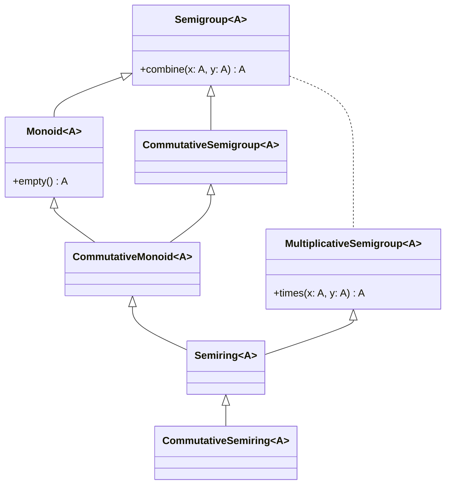

# Коммутативное полукольцо

Коммутативное полукольцо - это [полукольцо](semiring.md), с коммутативной операцией умножения:
для \\(\forall x, y \in S\\) выполняется \\(x * y = y * x\\).

Для полукольца с единицей должны соблюдаться все законы полукольца:

- _Замыкание сложения_ (_closure_): для \\(\forall x, y \in S\\) выполняется \\(x + y \in S\\).
- _Ассоциативность сложения_ (_associativity_): для \\(\forall x, y, z \in S\\) выполняется \\((x + y) + z = x + (y + z)\\).
- _Существование нулевого элемента_: существует \\(\exists 0 \in S\\) такой,
  что для \\(\forall x \in S\\) выполняется \\(0 + x = x + 0 = x\\)
- _Коммутативность сложения_ (_commutative_): для \\(\forall x, y \in S\\) выполняется \\(x + y = y + x\\).
- _Замыкание умножения_ (_closure_): для \\(\forall x, y \in S\\) выполняется \\(x \* y \in S\\).
- _Ассоциативность умножения_ (_associativity_): для \\(\forall x, y, z \in S\\) выполняется \\((x \* y) \* z = x \* (y \* z)\\).
- _Дистрибутивность_ (_distributivus_, _распределительный закон_):
  для \\(\forall x, y, z \in S\\) выполняется \\(x \* (y + z) = x \* y + x \* z\\) и \\((x + y) \* z = x \* z + y \* z\\).
- _Мультипликативное свойство нуля_: \\(a \* 0 = 0 \* a = 0\\)

, а также закон коммутативности умножения:

- _Коммутативность умножения_ (_commutative_): для \\(\forall x, y \in S\\) выполняется \\(x \* y = y \* x\\).

## Код

```dotty
trait CSemiring[A] extends Semiring[A]
```

### Законы

- Законы [полукольца](semiring.md)
- Коммутативность по умножению означает, что порядок элементов при умножении не важен. 
  Другими словами, результат операции `times` будет одинаковым, независимо от того, в каком порядке передаются элементы `x` и `y`. 
  Это можно записать так: `cs.times(x, y) == cs.times(y, x)`

## Схема



## Реализация в библиотеках

---

**Ссылки:**

- [Ссылка на репозиторий с упражнениями][sample]
- [Wikipedia](https://ru.wikipedia.org/wiki/%D0%9F%D0%BE%D0%BB%D1%83%D0%BA%D0%BE%D0%BB%D1%8C%D1%86%D0%BE)

[sample]: https://gitverse.ru/scalabook/typeclasses
