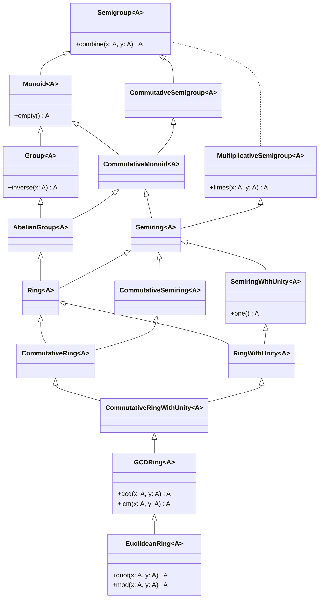



# Евклидово кольцо

**Евклидово кольцо** — это [коммутативное кольцо с единицей](cring-with-one.md), в котором определена функция, называемая **евклидовой нормой**, 
позволяющая обобщить алгоритм Евклида для нахождения [наибольшего общего делителя (НОД)](gcdring.md). 
Евклидовы кольца являются важным классом алгебраических структур, обобщающих свойства целых чисел и многочленов.

**Определение евклидова кольца**

Евклидово кольцо — это коммутативное кольцо с единицей \\(R\\), 
на котором задана функция \\(\nu: R \setminus \{0\} \to \mathbb{N}_0\\) (называемая **евклидовой нормой**), 
удовлетворяющая следующим условиям:

- **Свойство деления с остатком**:
  Для любых элементов \\(a, b \in R\\), где \\(b \neq 0\\), существуют элементы \\(q, r \in R\\) такие, 
  что \\(a = b \cdot q + r\\), где либо \\(r = 0\\), либо \\(\nu(r) < \nu(b)\\).
- **Монотонность нормы**:
  Для любых ненулевых элементов \\(a, b \in R\\) выполняется неравенство \\(\nu(a) \leq \nu(a \cdot b)\\).

**Примеры евклидовых колец**

- **Кольцо целых чисел \\(\mathbb{Z}\\)**:
    - Евклидова норма: \\(\nu(a) = |a|\\) (абсолютная величина числа).
    - Алгоритм Евклида для нахождения НОД основан на делении с остатком.
- **Кольцо многочленов \\(\mathbb{R}\[x\]\\) над полем \\(\mathbb{R}\\)**:
    - Евклидова норма: \\(\nu(f(x)) = \deg(f(x))\\) (степень многочлена).
    - Алгоритм Евклида для нахождения НОД многочленов также основан на делении с остатком.
- **Кольцо гауссовых целых чисел \\(\mathbb{Z}\[i\]\\)**:
    - Это кольцо чисел вида \\(a + bi\\), где \\(a, b \in \mathbb{Z}\\), а \\(i\\) — мнимая единица.
    - Евклидова норма: \\(\nu(a + bi) = a^2 + b^2\\).
    - В этом кольце также можно применять алгоритм Евклида.
- **Кольцо многочленов \\(\mathbb{F}\[x\]\\) над произвольным полем \\(\mathbb{F}\\)**:
    - Евклидова норма: \\(\nu(f(x)) = \deg(f(x))\\).
    - Алгоритм Евклида работает аналогично случаю \\(\mathbb{R}\[x\]\\).

**Свойства евклидовых колец**

- **Существование НОД**:
  В евклидовом кольце для любых двух элементов \\(a, b \in R\\) существует их наибольший общий делитель \\(\text{НОД}(a, b)\\).
- **Алгоритм Евклида**:
  В евклидовом кольце можно применять алгоритм Евклида для нахождения НОД двух элементов.
- **Факториальность**:
  Каждое евклидово кольцо является **факториальным кольцом**, 
  то есть в нём выполняется однозначное разложение на простые множители (с точностью до порядка и ассоциированности).
- **Кольцо главных идеалов (PID)**:
  Каждое евклидово кольцо является кольцом главных идеалов, то есть каждый идеал в нём порождается одним элементом.

**Зачем нужны евклидовы кольца?**

Евклидовы кольца находят применение в различных областях:

- **Теория чисел**: используются для изучения свойств делимости и алгоритмов нахождения НОД.
- **Алгебра**: изучаются как обобщение свойств целых чисел и многочленов.
- **Криптография**: применяются в алгоритмах, основанных на теории чисел, таких как RSA.
- **Компьютерные науки**: используются в алгоритмах работы с многочленами и целыми числами.

## Формальное определение

Евклидово кольцо — это [кольцо НОД](gcdring.md),
которое также поддерживает евклидово деление (например, поэтапное или целочисленное деление).

Формально евклидовы кольца определяют _евклидову функцию_ `f` такую, что для любого `x` и `y` в `A`,
если `y` ненулевое, то существуют `q` и `r` (частное и остаток) такие, что `a = b*q + r` и `r = 0` или `f(r) < f(b)`.
Для целых чисел обычно `f` - это функция абсолютного значения.

`EuclideanRing[A]` добавляет следующие операции:

- `quot` (`/~`, `a /~ b`): частное (евклидово деление)
- `mod` (`%`, `a % b`): остаток

В целых числах евклидово частное и остаток соответствуют делению с остатком;
однако знак результата является вопросом соглашения.
Для рациональных чисел (или с плавающей запятой) `a /~ b = a / b` и `a % b = 0` по определению.

Помимо законов кольца НОД:


- _Замыкание сложения_ (_closure_): для \\(\forall x, y \in R\\) выполняется \\(x + y \in R\\).
- _Ассоциативность сложения_ (_associativity_): для \\(\forall x, y, z \in R\\) выполняется \\((x + y) + z = x + (y + z)\\).
- _Существование нулевого элемента_: существует \\(\exists 0 \in R\\) такой,
  что для \\(\forall x \in R\\) выполняется \\(0 + x = x + 0 = x\\)
- _Обратимость сложения_: для \\(\forall x \in R\\) существует \\((-x)\\) такой,
  что \\(x + (-x) = (-x) + x = 0\\)
- _Коммутативность сложения_ (_commutative_): для \\(\forall x, y \in R\\) выполняется \\(x + y = y + x\\).
- _Замыкание умножения_ (_closure_): для \\(\forall x, y \in R\\) выполняется \\(x \* y \in R\\).
- _Ассоциативность умножения_ (_associativity_): для \\(\forall x, y, z \in R\\) выполняется \\((x \* y) \* z = x \* (y \* z)\\).
- _Существование единичного элемента_: \\(\exists 1 \in R \quad \forall x \in R \quad x \* 1 = 1 \* x = x\\)
- _Коммутативность умножения_: для \\(\forall x, y \in R\\) выполняется \\(x \* y = y \* x\\).
- _Дистрибутивность_ (_distributivus_, _распределительный закон_):
  для \\(\forall x, y, z \in R\\) выполняется \\(x \* (y + z) = x \* y + x \* z\\) и \\((x + y) \* z = x \* z + y \* z\\).
- для \\(\forall x, y \in R\\) выполняется \\(gcd(x, y) \* lcm(x, y) = x \* y\\).
- _Ассоциативность НОД_: для \\(\forall x, y, z \in R\\) выполняется \\(gcd(gcd(x, y), z) = gcd(x, gcd(y, z))\\).
- _Коммутативность НОД_: для \\(\forall x, y \in R\\) выполняется \\(gcd(x, y) = gcd(y, x)\\).
- _Ассоциативность НОК_: для \\(\forall x, y, z \in R\\) выполняется \\(lcm(lcm(x, y), z) = lcm(x, lcm(y, z))\\).
- _Коммутативность НОК_: для \\(\forall x, y \in R\\) выполняется \\(lcm(x, y) = lcm(y, x)\\).

должен соблюдаться закон:

- `b * (a /~ b) + (a % b) = a`

## Код

```dotty
trait EuclideanRing[A] extends GCDRing[A]:
  def quot(x: A, y: A): A

  def mod(x: A, y: A): A
```

### Числа относительно сложения с 0 и умножения с 1

`(Z, +, *)`

```dotty
given EuclideanRing[Int] with
  val empty: Int                   = 0
  val one: Int                     = 1
  def combine(x: Int, y: Int): Int = x + y
  def times(x: Int, y: Int): Int   = x * y
  def gcd(x: Int, y: Int): Int = if y == 0 then x else gcd(y, x % y)
  def lcm(x: Int, y: Int): Int                 = times(x, y) / gcd(x, y)
  def quot(x: Int, y: Int): Int                = x / y
  def mod(x: Int, y: Int): Int                 = x % y
  extension (a: Int) override def inverse: Int = -a
```

### Законы

Законы наследуются от [Кольца НОД](gcdring.md).

Кроме того:

- **Закон для частного и остатка**: Утверждение гласит, что для любых двух чисел \\(x\\) и \\(y\\) (где \\(y \neq 0\\)), 
  если мы разделим \\(x\\) на \\(y\\) с остатком, то результат можно восстановить, используя частное и остаток.
  `er.combine(er.times(y, er.quot(x, y)), er.mod(x, y)) == x`

```dotty
... // Законы кольца НОД

def checkQuotModMultiplication[A](x: A, y: A)(using
    er: EuclideanRing[A]
): ValidatedNel[String, Unit] =
  Either.cond[String, Unit](
    er.combine(er.times(y, er.quot(x, y)), er.mod(x, y)) == x,
    (),
    "Для частного и остатка должен соблюдаться закон: b * (a /~ b) + (a % b) = a"
  ).toValidatedNel
```

## Схема



## Реализация в библиотеках

### Реализация в Spire

```dotty
import spire.algebra.EuclideanRing
import spire.std.int.*

EuclideanRing.plus(15, 10)
// val res0: Int = 25
EuclideanRing.times(15, 10)
// val res1: Int = 150
EuclideanRing.pow(15, 2)
// val res2: Int = 225
EuclideanRing.negate(15)
// val res3: Int = -15
EuclideanRing.minus(15, 10)
// val res4: Int = 5
EuclideanRing.zero[Int]
// val res5: Int = 0
EuclideanRing.one[Int]
// val res6: Int = 1
EuclideanRing.gcd(15, 10)
// val res7: Int = 5
EuclideanRing.lcm(15, 10)
// val res8: Int = 30
EuclideanRing.equot(15, 10)
// val res9: Int = 1
EuclideanRing.emod(15, 10)
// val res10: Int = 5
EuclideanRing.equotmod(15, 10)
// val res11: (Int, Int) = (1,5)
```

---

**Ссылки:**

- [Spire home page](https://typelevel.org/spire/)
- [Spire User's Guide](https://typelevel.org/spire/guide.html)
- [Wikipedia](https://ru.wikipedia.org/wiki/%D0%95%D0%B2%D0%BA%D0%BB%D0%B8%D0%B4%D0%BE%D0%B2%D0%BE_%D0%BA%D0%BE%D0%BB%D1%8C%D1%86%D0%BE)
