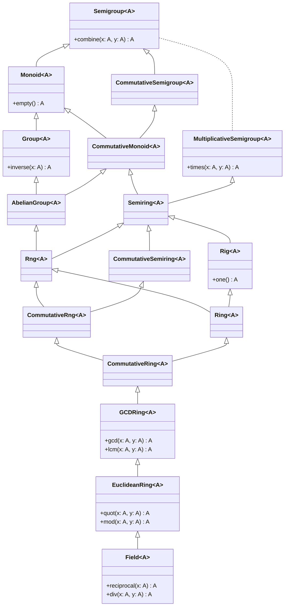



# Поле

**Поле** — это алгебраическая структура, которая является [коммутативным кольцом с единицей](cring.md), 
в котором каждый ненулевой элемент имеет обратный относительно умножения. 
Поля являются одной из ключевых структур в математике, обобщающих свойства чисел и операций над ними.

**Определение поля**

Поле — это множество \\(F\\), на котором определены две бинарные операции:

- **Сложение** (\\(+\\)): коммутативная и ассоциативная операция.
- **Умножение** (\\(\cdot\\)): коммутативная и ассоциативная операция.

Эти операции должны удовлетворять следующим аксиомам:

- **Коммутативность сложения**: \\(a + b = b + a\\) для любых \\(a, b \in F\\).
- **Ассоциативность сложения**: \\((a + b) + c = a + (b + c)\\) для любых \\(a, b, c \in F\\).
- **Наличие нулевого элемента**: существует элемент \\(0 \in F\\) такой, что \\(0 + a = a + 0 = a\\) для любого \\(a \in F\\).
- **Наличие противоположного элемента**: для любого \\(a \in F\\) существует элемент \\(-a \in F\\) такой, что \\(a + (-a) = 0\\).
- **Коммутативность умножения**: \\(a \cdot b = b \cdot a\\) для любых \\(a, b \in F\\).
- **Ассоциативность умножения**: \\((a \cdot b) \cdot c = a \cdot (b \cdot c)\\) для любых \\(a, b, c \in F\\).
- **Наличие единичного элемента**: существует элемент \\(1 \in F\\) такой, что \\(a \cdot 1 = a\\) для любого \\(a \in F\\).
- **Наличие обратного элемента**: для любого \\(a \in F\\), \\(a \neq 0\\), существует элемент \\(a^{-1} \in F\\) такой, что \\(a \cdot a^{-1} = 1\\).
- **Дистрибутивность умножения относительно сложения**:
    - \\(a \cdot (b + c) = a \cdot b + a \cdot c\\) (левая дистрибутивность),
    - \\((a + b) \cdot c = a \cdot c + b \cdot c\\) (правая дистрибутивность).

**Примеры полей**

- **Поле рациональных чисел \\(\mathbb{Q}\\)**:
    - Операции: сложение и умножение.
    - Нулевой элемент: \\(0\\).
    - Единичный элемент: \\(1\\).
    - Обратный элемент для \\(a \neq 0\\): \\(\frac{1}{a}\\).
- **Конечные поля (поля Галуа)**:
    - Например, поле \\(\mathbb{Z}/p\mathbb{Z}\\), где \\(p\\) — простое число.
    - Операции: сложение и умножение по модулю \\(p\\).
    - Нулевой элемент: \\(0\\).
    - Единичный элемент: \\(1\\).
    - Обратный элемент для \\(a \neq 0\\): элемент \\(b\\), такой, что \\(a \cdot b \equiv 1 \pmod{p}\\).

**Свойства полей**

- **Обратимость ненулевых элементов**:
  В поле каждый ненулевой элемент имеет обратный относительно умножения.
- **Отсутствие делителей нуля**:
  В поле если \\(a \cdot b = 0\\), то \\(a = 0\\) или \\(b = 0\\).

Поля находят применение в различных областях:

- **Алгебра**: изучаются как базовые алгебраические структуры.
- **Теория чисел**: используются для анализа свойств чисел и их операций.
- **Геометрия**: применяются в алгебраической геометрии.
- **Физика**: используются для описания симметрий в физических системах.
- **Криптография**: конечные поля применяются в алгоритмах шифрования.
- **Компьютерные науки**: используются в алгоритмах работы с многочленами и числами.

## Формальное определение

_Поле_ — алгебра над множеством \\(\mathbf{F}\\), 
образующая [коммутативную группу](abgroup.md) по сложению \\(\mathbf{+}\\) над \\(\mathbf{F}\\) с нейтральным элементом \\(\mathbf{0}\\) 
и коммутативную группу по умножению \\(\mathbf{\*}\\) над ненулевыми элементами \\(\mathbf{F} \backslash \begin{Bmatrix} \mathbf{0} \end{Bmatrix}\\), 
при выполняющемся свойстве дистрибутивности умножения относительно сложения. 
Подразумевается также применимость операции \\(\mathbf{\*}\\) к нулевому элементу по сложению 
с сохранением свойства дистрибутивности на всём множестве \\(\mathbf{F}\\).

Если раскрыть определение, то множество \\(\mathbf{F}\\) с введёнными на нём алгебраическими операциями 
сложения \\(\mathbf{+}\\) и умножения \\(\mathbf{\*}\\)
(\\(\mathbf{+}\colon \mathbf{F} \times \mathbf{F} \to \mathbf{F},\mathbf{\*}\colon \mathbf{F} \times \mathbf{F} \to \mathbf{F}\\), 
то есть \\(\forall a, b \in F \quad (a + b) \in F, (a \* b) \in F\\))
называется _полем_ \\(\left< F, +, \* \right>\\), если выполнены следующие аксиомы:

- _Ассоциативность сложения_: для \\(\forall x, y, z \in F\\) выполняется \\((x + y) + z = x + (y + z)\\).
- _Существование нулевого элемента_: существует \\(\exists 0 \in F\\) такой,
  что для \\(\forall x \in F\\) выполняется \\(0 + x = x + 0 = x\\)
- _Обратимость сложения_: для \\(\forall x \in F\\) существует \\((-x)\\) такой,
  что \\(x + (-x) = (-x) + x = 0\\)
- _Коммутативность сложения_: для \\(\forall x, y \in F\\) выполняется \\(x + y = y + x\\).
- _Ассоциативность умножения_: для \\(\forall x, y, z \in F\\) выполняется \\((x \* y) \* z = x \* (y \* z)\\).
- _Существование единичного элемента_: \\(\exists 1 \in F \quad \forall x \in F \quad x \* 1 = 1 \* x = x\\)
- _Коммутативность умножения_: для \\(\forall x, y \in F\\) выполняется \\(x \* y = y \* x\\).
- _Существование обратного элемента для ненулевых элементов_: \\((\forall x \in F: x \neq 0) \quad \exists x^{-1} \in F: \quad x \* x^{-1} = 1\\).
- _Дистрибутивность умножения относительно сложения_:
  для \\(\forall x, y, z \in F\\) выполняется \\(x \* (y + z) = x \* y + x \* z\\) и \\((x + y) \* z = x \* z + y \* z\\).

## Код

```dotty
trait Field[A] extends EuclideanRing[A]:
  extension (a: A) def reciprocal: A

  def div(x: A, y: A): A = times(x, y.reciprocal)
```

### Законы

Законы наследуются от [Евклидова кольца](euclidean-ring.md).

Кроме того:

- **Закон существования обратного по умножению числа**:
  Утверждение гласит, что для любого числа \\(x\\) (кроме нуля) должно существовать обратное число \\(x^{-1}\\) 
  (или \\(\text{reciprocal}\\)), такое что их произведение равно единице. 
  `x == fi.empty || fi.times(x, x.reciprocal) == fi.one`

## Упражнения

### Упражнение 1.9.1: Реализация поля для рациональных чисел.

> [Репозиторий с упражнениями и инструкцией по выполнению][sample]

Заполните пропущенные части (`???`):

```dotty
import spire.math.Rational

given Field[Rational] with
  val empty: Rational = ???

  val one: Rational = ???

  def combine(x: Rational, y: Rational): Rational = 
    ???

  def times(x: Rational, y: Rational): Rational = 
    ???

  def gcd(x: Rational, y: Rational): Rational = 
    ???

  def lcm(x: Rational, y: Rational): Rational = 
    ???

  def quot(x: Rational, y: Rational): Rational = 
    ???

  def mod(x: Rational, y: Rational): Rational = 
    ???

  extension (a: Rational)
    def inverse: Rational    = 
      ???
      
    def reciprocal: Rational = 
      ???
end given
```

@:note(🔍 Показать решение)

```dotty
import spire.math.Rational

given Field[Rational] with
  val empty: Rational = Rational(0)

  val one: Rational = Rational(1)

  def combine(x: Rational, y: Rational): Rational = 
    x + y

  def times(x: Rational, y: Rational): Rational = 
    x * y

  def gcd(x: Rational, y: Rational): Rational = 
    one

  def lcm(x: Rational, y: Rational): Rational = 
    times(x, y)

  def quot(x: Rational, y: Rational): Rational = 
    x / y

  def mod(x: Rational, y: Rational): Rational = 
    empty

  extension (a: Rational)
    def inverse: Rational    = 
      Rational(-a.numerator, a.denominator)
      
    def reciprocal: Rational = 
      Rational(a.denominator, a.numerator)
end given
```

**Примеры вызовов**:

```dotty
val a = Rational(1, 2)  // 1/2
val b = Rational(2, 3)  // 2/3
val c = Rational(3, 4)  // 3/4

// Базовые операции поля
Field[Rational].combine(a, b) = 1/2 + 2/3 = 7/6
Field[Rational].times(a, b) = 1/2 * 2/3 = 2/6 = 1/3
Field[Rational].inverse(a) = -1/2
Field[Rational].reciprocal(a) = 2/1 = 2
Field[Rational].empty = Rational(0) = 0/1
Field[Rational].one = Rational(1) = 1/1

// Операции GCD и LCM в поле
Field[Rational].gcd(a, b) = 1 (всегда)
Field[Rational].lcm(a, b) = times(a, b) = 1/3

// Операции евклидова кольца
Field[Rational].quot(a, b) = (1/2) / (2/3) = 3/4
Field[Rational].mod(a, b) = 0 (всегда)
```

@:@

## Схема



## Реализация в библиотеках

### [Реализация в Spire](../../libs/spire.md)

Поля представляют собой коммутативные кольца с коммутативным умножением и мультипликативными обратными для всех ненулевых элементов.
`spire.Field[A]` расширяет `algebra.Field[A]` и `EuclideanRing[A]`.
Поля обобщают то, что большинство людей думает о рациональных числах.

`Field[A]` поддерживает следующие операции:

- `reciprocal` (`a.reciprocal`): обратная операция умножению. Мультипликативный обратный `a`, т.е. `one/a`.
- `div` (`/`, `a / b`): деление `a` на `b`.
- `ceil`: округление вверх
- `floor`: округление вниз
- `round`: округление до ближайшего

Несмотря на то, что поля находятся на вершине кольцевой иерархии,
существует множество операций, которые поля не предоставляют:

- равенство и упорядоченность (обеспечиваемые `Eq[A]` и `Order[A]`).
- квадратный корень и другие корни (предоставленные `NRoot[A]`).
- синус, косинус и тригонометрические функции (предоставлены `Trig[A]`).

```dotty
import spire.math.Real.apply

15.reciprocal
// val res0: spire.math.Real = 1/15
15 / 3
// val res1: Int = 5
15.24.ceil
// val res2: spire.math.Real = 16
15.24.floor
// val res3: spire.math.Real = 15
15.24.round
// val res4: spire.math.Real = 15
```

#### Иррациональные и трансцендентальные классы типов

Spire поддерживает квадратные корни и дробные степени через `NRoot[A]`.
Доступны следующие методы:

- `nroot` (`a nroot k`): корень k-й степени из `a` (тип k - `Int`)
- `sqrt` (`a.sqrt`): квадратный корень из `a`
- `fpow` (`**`, `a fpow b`): возведение в степень (принимает дробный показатель степени)

В Spire нет дробных типов, которые могли бы точно представлять иррациональные корни.
Это означает, что многие законы, которые можно было бы написать о корнях, будут слабее, чем хотелось бы:

- `a.sqrt` = `(a nroot 2)` = `(a fpow 2.reciprocal)`
- если `A` может точно представить `1/k`, то `(a nroot k)` = `(a fpow k.reciprocal)`
- если `(a nroot k)` рационально, то `(a nroot k).pow(k)` = `a`

Типы приближенных значений, например `Double` и `BigDecimal`, содержат встроенную точность,
с которой Spire может находить корни.
Точные типы, например, `Rational` не имеют экземпляров `NRoot`, определенных по умолчанию,
но экземпляры могут быть созданы с точностью, заданной пользователем.

```dotty
import spire.math.Real.apply

9 nroot 2
// val res1: spire.math.Real = 3
9.sqrt
// val res2: spire.math.Real = 3
3 fpow 2
// val res3: spire.math.Real = 9
```

---

**Ссылки:**

- [Ссылка на репозиторий с упражнениями][sample]
- [Spire home page](https://typelevel.org/spire/)
- [Spire User's Guide](https://typelevel.org/spire/guide.html)
- [Wikipedia](https://ru.wikipedia.org/wiki/%D0%9F%D0%BE%D0%BB%D0%B5_(%D0%B0%D0%BB%D0%B3%D0%B5%D0%B1%D1%80%D0%B0))

[sample]: https://gitverse.ru/scalabook/typeclasses
