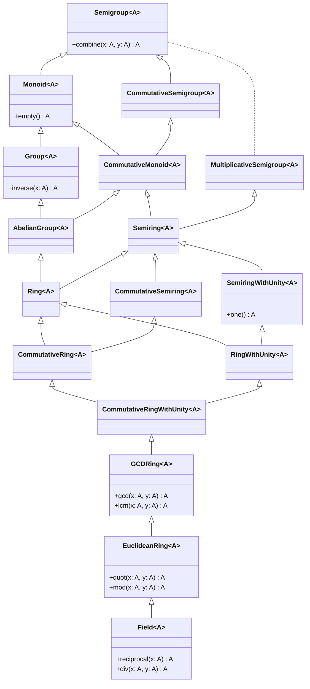

# Поле

**Поле** — это алгебраическая структура, которая является коммутативным кольцом с единицей, в котором каждый ненулевой элемент имеет обратный относительно умножения. Поля являются одной из ключевых структур в математике, обобщающих свойства чисел и операций над ними. Давайте разберём это подробнее.

---

### Определение поля
Поле — это множество \( F \), на котором определены две бинарные операции:
1. **Сложение** (\( + \)): коммутативная и ассоциативная операция.
2. **Умножение** (\( \cdot \)): коммутативная и ассоциативная операция.

Эти операции должны удовлетворять следующим аксиомам:
1. **Коммутативность сложения**: \( a + b = b + a \) для любых \( a, b \in F \).
2. **Ассоциативность сложения**: \( (a + b) + c = a + (b + c) \) для любых \( a, b, c \in F \).
3. **Наличие нулевого элемента**: существует элемент \( 0 \in F \) такой, что \( a + 0 = a \) для любого \( a \in F \).
4. **Наличие противоположного элемента**: для любого \( a \in F \) существует элемент \( -a \in F \) такой, что \( a + (-a) = 0 \).
5. **Коммутативность умножения**: \( a \cdot b = b \cdot a \) для любых \( a, b \in F \).
6. **Ассоциативность умножения**: \( (a \cdot b) \cdot c = a \cdot (b \cdot c) \) для любых \( a, b, c \in F \).
7. **Наличие единичного элемента**: существует элемент \( 1 \in F \) такой, что \( a \cdot 1 = a \) для любого \( a \in F \).
8. **Наличие обратного элемента**: для любого \( a \in F \), \( a \neq 0 \), существует элемент \( a^{-1} \in F \) такой, что \( a \cdot a^{-1} = 1 \).
9. **Дистрибутивность умножения относительно сложения**:
  - \( a \cdot (b + c) = a \cdot b + a \cdot c \) (левая дистрибутивность),
  - \( (a + b) \cdot c = a \cdot c + b \cdot c \) (правая дистрибутивность).

---

### Примеры полей
1. **Поле рациональных чисел \( \mathbb{Q} \)**:
  - Операции: сложение и умножение.
  - Нулевой элемент: \( 0 \).
  - Единичный элемент: \( 1 \).
  - Обратный элемент для \( a \neq 0 \): \( \frac{1}{a} \).

2. **Поле действительных чисел \( \mathbb{R} \)**:
  - Операции: сложение и умножение.
  - Нулевой элемент: \( 0 \).
  - Единичный элемент: \( 1 \).
  - Обратный элемент для \( a \neq 0 \): \( \frac{1}{a} \).

3. **Поле комплексных чисел \( \mathbb{C} \)**:
  - Операции: сложение и умножение.
  - Нулевой элемент: \( 0 \).
  - Единичный элемент: \( 1 \).
  - Обратный элемент для \( a + bi \neq 0 \): \( \frac{a - bi}{a^2 + b^2} \).

4. **Конечные поля (поля Галуа)**:
  - Например, поле \( \mathbb{Z}/p\mathbb{Z} \), где \( p \) — простое число.
  - Операции: сложение и умножение по модулю \( p \).
  - Нулевой элемент: \( 0 \).
  - Единичный элемент: \( 1 \).
  - Обратный элемент для \( a \neq 0 \): элемент \( b \), такой, что \( a \cdot b \equiv 1 \pmod{p} \).

---

### Свойства полей
1. **Обратимость ненулевых элементов**:
   В поле каждый ненулевой элемент имеет обратный относительно умножения.

2. **Отсутствие делителей нуля**:
   В поле если \( a \cdot b = 0 \), то \( a = 0 \) или \( b = 0 \).

3. **Характеристика поля**:
   Характеристика поля — это наименьшее положительное целое число \( n \) такое, что \( n \cdot 1 = 0 \). Если такого числа не существует, то характеристика поля равна \( 0 \).

4. **Подполя**:
   Подмножество поля, которое само является полем относительно тех же операций, называется подполем.

---

### Зачем нужны поля?
Поля находят применение в различных областях:
1. **Алгебра**: изучаются как базовые алгебраические структуры.
2. **Теория чисел**: используются для анализа свойств чисел и их операций.
3. **Геометрия**: применяются в алгебраической геометрии.
4. **Физика**: используются для описания симметрий в физических системах.
5. **Криптография**: конечные поля применяются в алгоритмах шифрования.
6. **Компьютерные науки**: используются в алгоритмах работы с многочленами и числами.

---

### Итог
Поле — это коммутативное кольцо с единицей, в котором каждый ненулевой элемент имеет обратный относительно умножения. Оно обобщает свойства чисел и операций над ними и находит применение в алгебре, теории чисел, геометрии, физике, криптографии и компьютерных науках.

## Формальное определение

Поля расширяют [Евклидово кольцо](euclidean-ring.md), добавляя операцию обратную умножению для всех элементов,
за исключением нуля по сложению.

`Field[A]` поддерживает следующие операции:

- `reciprocal` (`a.reciprocal`): обратная операция умножению. Мультипликативный обратный `a`, т.е. `one/a`.
- `div` (`/`, `a / b`): деление `a` на `b`.

Формально, _поле_ — алгебра над множеством \\(\mathbf{F}\\), 
образующая [коммутативную группу](abgroup.md) по сложению \\(\mathbf{+}\\) над \\(\mathbf{F}\\) с нейтральным элементом \\(\mathbf{0}\\) 
и коммутативную группу по умножению \\(\mathbf{\*}\\) над ненулевыми элементами \\(\mathbf{F} \backslash \begin{Bmatrix} \mathbf{0} \end{Bmatrix}\\), 
при выполняющемся свойстве дистрибутивности умножения относительно сложения. 
Подразумевается также применимость операции \\(\mathbf{\*}\\) к нулевому элементу по сложению 
с сохранением свойства дистрибутивности на всём множестве \\(\mathbf{F}\\).

Если раскрыть определение, то множество \\(\mathbf{F}\\) с введёнными на нём алгебраическими операциями 
сложения \\(\mathbf{+}\\) и умножения \\(\mathbf{\*}\\)
(\\(\mathbf{+}\colon \mathbf{F} \times \mathbf{F} \to \mathbf{F},\mathbf{\*}\colon \mathbf{F} \times \mathbf{F} \to \mathbf{F}\\), 
то есть \\(\forall a, b \in F \quad (a + b) \in F, (a \* b) \in F\\) 
называется _полем_ \\(\left< F, +, \* \right>\\), если выполнены следующие аксиомы:

- _Ассоциативность сложения_: для \\(\forall x, y, z \in F\\) выполняется \\((x + y) + z = x + (y + z)\\).
- _Существование нулевого элемента_: существует \\(\exists 0 \in F\\) такой,
  что для \\(\forall x \in F\\) выполняется \\(0 + x = x + 0 = x\\)
- _Обратимость сложения_: для \\(\forall x \in F\\) существует \\((-x)\\) такой,
  что \\(x + (-x) = (-x) + x = 0\\)
- _Коммутативность сложения_: для \\(\forall x, y \in F\\) выполняется \\(x + y = y + x\\).
- _Ассоциативность умножения_: для \\(\forall x, y, z \in F\\) выполняется \\((x \* y) \* z = x \* (y \* z)\\).
- _Существование единичного элемента_: \\(\exists 1 \in F \quad \forall x \in F \quad x \* 1 = 1 \* x = x\\)
- _Коммутативность умножения_: для \\(\forall x, y \in F\\) выполняется \\(x \* y = y \* x\\).
- _Существование обратного элемента для ненулевых элементов_: \\((\forall x \in F: x \neq 0) \quad \exists x^{-1} \in F: \quad x \* x^{-1} = 1\\).
- _Дистрибутивность умножения относительно сложения_:
  для \\(\forall x, y, z \in F\\) выполняется \\(x \* (y + z) = x \* y + x \* z\\) и \\((x + y) \* z = x \* z + y \* z\\).

## Код

```dotty
trait Field[A] extends EuclideanRing[A]:
  extension (a: A) def reciprocal: A

  def div(x: A, y: A): A = times(x, y.reciprocal)
```

### Рациональные числа со сложением и умножением

```dotty
import spire.math.Rational

given Field[Rational] with
  val empty: Rational = Rational(0)
  val one: Rational   = Rational(1)
  def combine(x: Rational, y: Rational): Rational = x + y
  def times(x: Rational, y: Rational): Rational = x * y
  def gcd(x: Rational, y: Rational): Rational = one
  def lcm(x: Rational, y: Rational): Rational = times(x, y)
  def quot(x: Rational, y: Rational): Rational = x / y
  def mod(x: Rational, y: Rational): Rational = empty

  extension (a: Rational)
    def inverse: Rational    = Rational(-a.numerator, a.denominator)
    def reciprocal: Rational = Rational(a.denominator, a.numerator)
end given
```

### Законы

```dotty
trait FieldLaw extends EuclideanRingLaw:
  def checkFieldLaw[A: Field](x: A, y: A, z: A): ValidatedNel[String, Unit] =
    checkEuclideanRingLaw(x, y, z) combine
      check(
        x == Field[A].empty || Field[A].times(x, x.reciprocal) == Field[A].one,
        "x * x^{-1} = 1"
      )
```

## Схема



## Реализация в библиотеках

### Реализация в Spire

```dotty
import spire.math.Real.apply

15.reciprocal
// val res0: spire.math.Real = 1/15
15 / 3
// val res1: Int = 5
15.24.ceil
// val res2: spire.math.Real = 16
15.24.floor
// val res3: spire.math.Real = 15
15.24.round
// val res4: spire.math.Real = 15
```

---

**Ссылки:**

- [Spire home page](https://typelevel.org/spire)
- [Spire User's Guide](https://typelevel.org/spire/guide.html)
- [Wikipedia](https://ru.wikipedia.org/wiki/%D0%9F%D0%BE%D0%BB%D0%B5_(%D0%B0%D0%BB%D0%B3%D0%B5%D0%B1%D1%80%D0%B0))
