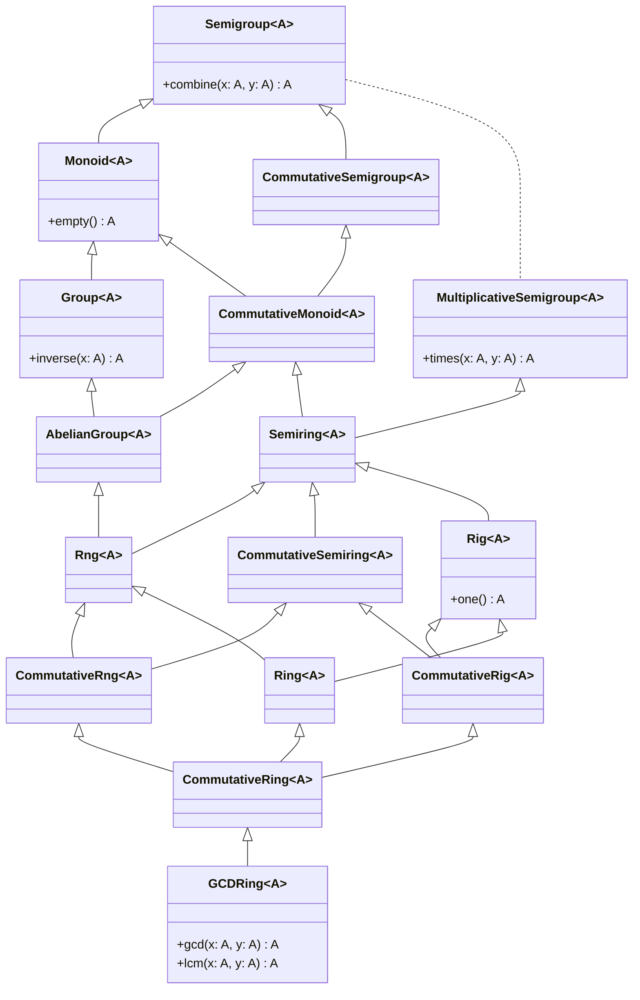

# Кольца НОД

**Кольца НОД** (кольца с наибольшим общим делителем) — это [коммутативные кольца с единицей](cring.md), 
в которых для любых двух элементов существует наибольший общий делитель (НОД). 
Эти кольца являются важным классом алгебраических структур, обобщающих свойства целых чисел.

**Определение кольца НОД**

Кольцо НОД — это коммутативное кольцо с единицей \\(R\\), в котором для любых двух элементов \\(a, b \in R\\) 
существует их **наибольший общий делитель** (НОД). 
Наибольший общий делитель \\(d = \text{НОД}(a, b)\\) определяется следующим образом:

- \\(d\\) является общим делителем \\(a\\) и \\(b\\), то есть \\(d \mid a\\) и \\(d \mid b\\).
- Любой другой общий делитель \\(a\\) и \\(b\\) делит \\(d\\), то есть если \\(c \mid a\\) и \\(c \mid b\\), то \\(c \mid d\\).

**Свойства колец НОД**

- **Существование НОД**:
  В кольце НОД для любых двух элементов \\(a, b \in R\\) существует их наибольший общий делитель \\(\text{НОД}(a, b)\\).
- **Свойства НОД**:
    - НОД определён с точностью до обратимых элементов (ассоциированных элементов). 
      То есть если \\(d\_1\\) и \\(d\_2\\) — два НОД элементов \\(a\\) и \\(b\\), 
      то \\(d\_1 = u \cdot d\_2\\), где \\(u\\) — обратимый элемент кольца \\(R\\).
    - НОД может быть выражен как линейная комбинация: если \\(d = \text{НОД}(a, b)\\), 
      то существуют элементы \\(x, y \in R\\) такие, что \\(d = a \cdot x + b \cdot y\\).
- **Связь с другими классами колец**:
    - Каждое **факториальное кольцо** (кольцо с однозначным разложением на простые множители) является кольцом НОД.
    - Однако не каждое кольцо НОД является факториальным.

**Примеры колец НОД**

- **Кольцо целых чисел \\(\mathbb{Z}\\)**:
    - Для любых двух целых чисел \\(a\\) и \\(b\\) существует их наибольший общий делитель \\(\text{НОД}(a, b)\\).
    - Например, \\(\text{НОД}(12, 18) = 6\\).
- **Кольцо многочленов \\(\mathbb{R}\[x\]\\)**:
    - Для любых двух многочленов \\(f(x)\\) и \\(g(x)\\) существует их наибольший общий делитель.
    - Например, \\(\text{НОД}(x^2 - 1, x^2 + x - 2) = x - 1\\).
- **Кольцо гауссовых целых чисел \\(\mathbb{Z}\[i\]\\)**:
    - Это кольцо чисел вида \\(a + bi\\), где \\(a, b \in \mathbb{Z}\\), а \\(i\\) — мнимая единица.
    - Для любых двух гауссовых целых чисел существует их наибольший общий делитель.
- **Кольцо главных идеалов (PID)**:
    - Каждое кольцо главных идеалов является кольцом НОД.
    - Например, кольцо целых чисел \\(\mathbb{Z}\\) и кольцо многочленов \\(\mathbb{R}\[x\]\\) являются кольцами главных идеалов.

Кольца НОД находят применение в различных областях:

- **Теория чисел**: используются для изучения свойств делимости и алгоритмов нахождения НОД (например, алгоритм Евклида).
- **Алгебра**: изучаются как обобщение свойств целых чисел и многочленов.
- **Криптография**: применяются в алгоритмах, основанных на теории чисел, таких как RSA.
- **Компьютерные науки**: используются в алгоритмах работы с многочленами и целыми числами.

## Формальное определение

Кольца НОД - [коммутативное кольцо с единицей](cring.md)
с добавлением наибольшего общего делителя и наименьшего общего кратного.

Кольца НОД поддерживают следующие операции:

- `gcd`: наибольший общий делитель
- `lcm`: наименьшее общее кратное

Для Кольца НОД должны соблюдаться законы родителей:

- _Замыкание сложения_ (_closure_): для \\(\forall x, y \in R\\) выполняется \\(x + y \in R\\).
- _Ассоциативность сложения_ (_associativity_): для \\(\forall x, y, z \in R\\) выполняется \\((x + y) + z = x + (y + z)\\).
- _Существование нулевого элемента_: существует \\(\exists 0 \in R\\) такой,
  что для \\(\forall x \in R\\) выполняется \\(0 + x = x + 0 = x\\)
- _Обратимость сложения_: для \\(\forall x \in R\\) существует \\((-x)\\) такой,
  что \\(x + (-x) = (-x) + x = 0\\)
- _Коммутативность сложения_ (_commutative_): для \\(\forall x, y \in R\\) выполняется \\(x + y = y + x\\).
- _Замыкание умножения_ (_closure_): для \\(\forall x, y \in R\\) выполняется \\(x \* y \in R\\).
- _Ассоциативность умножения_ (_associativity_): для \\(\forall x, y, z \in R\\) выполняется \\((x \* y) \* z = x \* (y \* z)\\).
- _Существование единичного элемента_: \\(\exists 1 \in R \quad \forall x \in R \quad x \* 1 = 1 \* x = x\\)
- _Коммутативность умножения_: для \\(\forall x, y \in R\\) выполняется \\(x \* y = y \* x\\).
- _Дистрибутивность_ (_distributivus_, _распределительный закон_):
  для \\(\forall x, y, z \in R\\) выполняется \\(x \* (y + z) = x \* y + x \* z\\) и \\((x + y) \* z = x \* z + y \* z\\).

, а также следующие законы:

- для \\(\forall x, y \in R\\) выполняется \\(gcd(x, y) * lcm(x, y) = x * y\\).
- _Ассоциативность НОД_: для \\(\forall x, y, z \in R\\) выполняется \\(gcd(gcd(x, y), z) = gcd(x, gcd(y, z))\\).
- _Коммутативность НОД_: для \\(\forall x, y \in R\\) выполняется \\(gcd(x, y) = gcd(y, x)\\).
- _Ассоциативность НОК_: для \\(\forall x, y, z \in R\\) выполняется \\(lcm(lcm(x, y), z) = lcm(x, lcm(y, z))\\).
- _Коммутативность НОК_: для \\(\forall x, y \in R\\) выполняется \\(lcm(x, y) = lcm(y, x)\\).

## Код

```dotty
trait GCDRing[A] extends CommutativeRing[A]:
  def gcd(x: A, y: A): A

  def lcm(x: A, y: A): A
```

### Законы

Законы наследуются от [коммутативного кольца с единицей](cring.md):

- _Замыкание сложения_ (_closure_): для \\(\forall x, y \in R\\) выполняется \\(x + y \in R\\).
- _Ассоциативность сложения_ (_associativity_): для \\(\forall x, y, z \in R\\) выполняется \\((x + y) + z = x + (y + z)\\).
- _Существование нулевого элемента_: существует \\(\exists 0 \in R\\) такой,
  что для \\(\forall x \in R\\) выполняется \\(0 + x = x + 0 = x\\)
- _Обратимость сложения_: для \\(\forall x \in R\\) существует \\((-x)\\) такой,
  что \\(x + (-x) = (-x) + x = 0\\)
- _Коммутативность сложения_ (_commutative_): для \\(\forall x, y \in R\\) выполняется \\(x + y = y + x\\).
- _Замыкание умножения_ (_closure_): для \\(\forall x, y \in R\\) выполняется \\(x \* y \in R\\).
- _Ассоциативность умножения_ (_associativity_): для \\(\forall x, y, z \in R\\) выполняется \\((x \* y) \* z = x \* (y \* z)\\).
- _Существование единичного элемента_: \\(\exists 1 \in R \quad \forall x \in R \quad x \* 1 = 1 \* x = x\\)
- _Коммутативность умножения_: для \\(\forall x, y \in R\\) выполняется \\(x \* y = y \* x\\).
- _Дистрибутивность_ (_distributivus_, _распределительный закон_):
  для \\(\forall x, y, z \in R\\) выполняется \\(x \* (y + z) = x \* y + x \* z\\) и \\((x + y) \* z = x \* z + y \* z\\).

Кроме того:

- **Произведение НОД и НОК должно равняться произведению чисел**:
    - Если взять два числа \\(x\\) и \\(y\\), то произведение их наибольшего общего делителя (НОД) 
      и наименьшего общего кратного (НОК) будет равно произведению самих чисел \\(x\\) и \\(y\\).
    - Формула: `gr.times(gr.gcd(x, y), gr.lcm(x, y)) == gr.times(y, x)`.
- **Ассоциативность НОД**:
    - Если нужно найти НОД для трех чисел \\(x\\), \\(y\\) и \\(z\\), то неважно, в каком порядке мы это делаем. 
      Сначала найдем НОД для \\(x\\) и \\(y\\), а потом для результата и \\(z\\), или сначала для \\(y\\) и \\(z\\), 
      а потом для \\(x\\) и результата — ответ будет одинаковым.
    - Формула: `gr.gcd(gr.gcd(x, y), z) == gr.gcd(x, gr.gcd(y, z))`.
- **Коммутативность НОД**:
    - Порядок чисел не важен при вычислении НОД. НОД для \\(x\\) и \\(y\\) будет таким же, как и НОД для \\(y\\) и \\(x\\).
    - Формула: `gr.gcd(x, y) == gr.gcd(y, x)`.
- **Ассоциативность НОК**:
    - Аналогично НОД, для НОК трех чисел \\(x\\), \\(y\\) и \\(z\\) порядок вычислений не важен. 
      Сначала найдем НОК для \\(x\\) и \\(y\\), а потом для результата и \\(z\\), или сначала для \\(y\\) и \\(z\\), 
      а потом для \\(x\\) и результата — ответ будет одинаковым.
    - Формула: `gr.lcm(gr.lcm(x, y), z) == gr.lcm(x, gr.lcm(y, z))`.
- **Коммутативность НОК**:
    - Порядок чисел не важен при вычислении НОК. НОК для \\(x\\) и \\(y\\) будет таким же, как и НОК для \\(y\\) и \\(x\\).
    - Формула: `gr.lcm(x, y) == gr.lcm(y, x)`.

## Упражнения

### Упражнение 1.7.1: Реализация кольца с НОД (GCD-кольца) для целых чисел.

> [Репозиторий с упражнениями и инструкцией по выполнению][sample]

Заполните пропущенные части (`???`):

```dotty
given GCDRing[BigInt] with
  val empty: BigInt = ???

  val one: BigInt = ???

  def combine(x: BigInt, y: BigInt): BigInt = ???

  def times(x: BigInt, y: BigInt): BigInt = ???

  def gcd(x: BigInt, y: BigInt): BigInt =
    ???

  def lcm(x: BigInt, y: BigInt): BigInt =
    ???

  extension (a: BigInt)
    def inverse: BigInt = ???
```

@:note(🔍 Показать решение)

```dotty
given GCDRing[BigInt] with
  val empty: BigInt = 0

  val one: BigInt = 1

  def combine(x: BigInt, y: BigInt): BigInt = x + y

  def times(x: BigInt, y: BigInt): BigInt = x * y

  def gcd(x: BigInt, y: BigInt): BigInt =
    if y == 0 then x.abs else gcd(y, x % y)

  def lcm(x: BigInt, y: BigInt): BigInt =
    times(x, y) / gcd(x, y)

  extension (a: BigInt)
    def inverse: BigInt = a * BigInt(-1)
```

**Примеры вызовов**:

```dotty
GCDRing[BigInt].combine(5, 3)
// 8
GCDRing[BigInt].empty
// 0
GCDRing[BigInt].inverse(5)
// -5
GCDRing[BigInt].times(5, 3)
// 15
GCDRing[BigInt].one
// 1
GCDRing[BigInt].gcd(12, 18)
// 6
GCDRing[BigInt].lcm(12, 18)
// 36
```

@:@

## Схема



## Реализация в библиотеках

### [Реализация в Spire](../../libs/spire.md)

Коммутативные кольца (в литературе их также называют _доменами_ (_domains_)) имеют богатую структуру.

`GCDRing[A]` — это коммутативные кольца (расширяет `CRing[A]`)
с добавлением наибольшего общего делителя и наименьшего общего кратного.

`GCDRing[A]` поддерживает следующие операции:

- `gcd` (`a gcd b`): наибольший общий делитель
- `lcm` (`a lcm b`): наименьшее общее кратное

И подчиняется следующим законам:

- `d * m === a * b` для `d = gcd(a, b)` и `m = lcm(a, b)`,
- `gcd` ассоциативен и коммутативен,
- `lcm` ассоциативен и коммутативен.

Обратите внимание, что НОД определяется с точностью до делимого элемента (единицы);
в частности, его знак является вопросом соглашения.

Spire требует, чтобы эти операции были коммутативными.
Обратите внимание, что поля имеют свободу действий для определения операции НОД.
На практике экземпляры `Field[A]` предоставляют либо тривиальную реализацию `gcd(x != 0, y != 0) == 1`,
либо определение, расширяющее определение,
используемое для целочисленного кольца (`gcd(a / b, c / d) == gcd(a, c) / lcm(b, d)`).

```dotty
import spire.algebra.GCDRing
import spire.math.Rational
import spire.std.int.*

GCDRing.plus(Rational(1, 2), Rational(1, 3))
// val res0: spire.math.Rational = 5/6
GCDRing.times(Rational(1, 2), Rational(1, 3))
// val res1: spire.math.Rational = 1/6
GCDRing.pow(Rational(1, 2), 3)
// val res2: spire.math.Rational = 1/8
GCDRing.negate(Rational(1, 2))
// val res3: spire.math.Rational = -1/2
GCDRing.minus(Rational(1, 2), Rational(1, 3))
// val res4: spire.math.Rational = 1/6
GCDRing.zero[Rational]
// val res5: spire.math.Rational = 0
GCDRing.one[Rational]
// val res6: spire.math.Rational = 1
GCDRing.gcd(15, 10)
// val res7: Int = 5
GCDRing.lcm(15, 10)
// val res8: Int = 30
```

---

**Ссылки:**

- [Ссылка на репозиторий с упражнениями][sample]
- [Spire home page](https://typelevel.org/spire/)
- [Spire User's Guide](https://typelevel.org/spire/guide.html)

[sample]: https://gitverse.ru/scalabook/typeclasses
