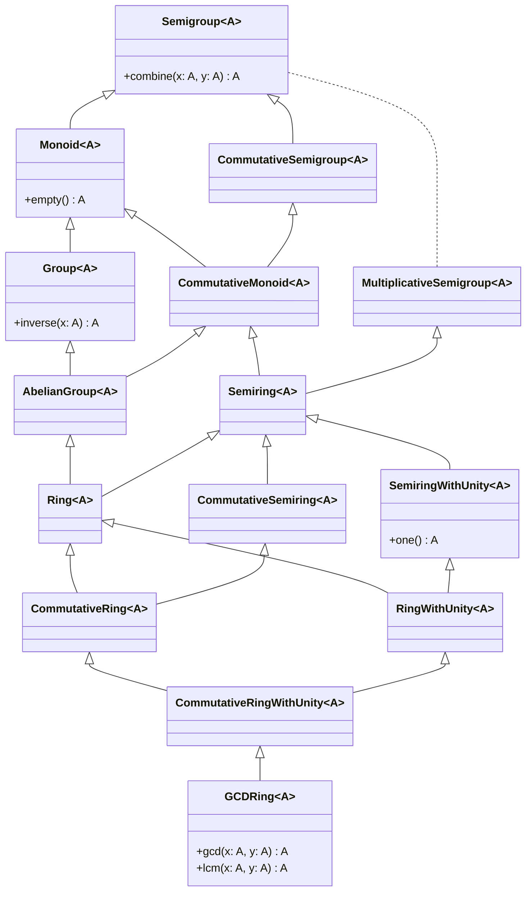

# Кольца НОД

**Кольца НОД** (кольца с наибольшим общим делителем) — это коммутативные кольца с единицей, в которых для любых двух элементов существует наибольший общий делитель (НОД). Эти кольца являются важным классом алгебраических структур, обобщающих свойства целых чисел. Давайте разберём это подробнее.

---

### Определение кольца НОД
Кольцо НОД — это коммутативное кольцо с единицей \( R \), в котором для любых двух элементов \( a, b \in R \) существует их **наибольший общий делитель** (НОД). Наибольший общий делитель \( d = \text{НОД}(a, b) \) определяется следующим образом:
1. \( d \) является общим делителем \( a \) и \( b \), то есть \( d \mid a \) и \( d \mid b \).
2. Любой другой общий делитель \( a \) и \( b \) делит \( d \), то есть если \( c \mid a \) и \( c \mid b \), то \( c \mid d \).

---

### Свойства колец НОД
1. **Существование НОД**:
   В кольце НОД для любых двух элементов \( a, b \in R \) существует их наибольший общий делитель \( \text{НОД}(a, b) \).

2. **Свойства НОД**:
  - НОД определён с точностью до обратимых элементов (ассоциированных элементов). То есть если \( d_1 \) и \( d_2 \) — два НОД элементов \( a \) и \( b \), то \( d_1 = u \cdot d_2 \), где \( u \) — обратимый элемент кольца \( R \).
  - НОД может быть выражен как линейная комбинация: если \( d = \text{НОД}(a, b) \), то существуют элементы \( x, y \in R \) такие, что \( d = a \cdot x + b \cdot y \).

3. **Связь с другими классами колец**:
  - Каждое **факториальное кольцо** (кольцо с однозначным разложением на простые множители) является кольцом НОД.
  - Однако не каждое кольцо НОД является факториальным.

---

### Примеры колец НОД
1. **Кольцо целых чисел \( \mathbb{Z} \)**:
  - Для любых двух целых чисел \( a \) и \( b \) существует их наибольший общий делитель \( \text{НОД}(a, b) \).
  - Например, \( \text{НОД}(12, 18) = 6 \).

2. **Кольцо многочленов \( \mathbb{R}[x] \)**:
  - Для любых двух многочленов \( f(x) \) и \( g(x) \) существует их наибольший общий делитель.
  - Например, \( \text{НОД}(x^2 - 1, x^2 - 4) = x - 1 \).

3. **Кольцо гауссовых целых чисел \( \mathbb{Z}[i] \)**:
  - Это кольцо чисел вида \( a + bi \), где \( a, b \in \mathbb{Z} \), а \( i \) — мнимая единица.
  - Для любых двух гауссовых целых чисел существует их наибольший общий делитель.

4. **Кольцо главных идеалов (PID)**:
  - Каждое кольцо главных идеалов является кольцом НОД.
  - Например, кольцо целых чисел \( \mathbb{Z} \) и кольцо многочленов \( \mathbb{R}[x] \) являются кольцами главных идеалов.

---

### Зачем нужны кольца НОД?
Кольца НОД находят применение в различных областях:
1. **Теория чисел**: используются для изучения свойств делимости и алгоритмов нахождения НОД (например, алгоритм Евклида).
2. **Алгебра**: изучаются как обобщение свойств целых чисел и многочленов.
3. **Криптография**: применяются в алгоритмах, основанных на теории чисел, таких как RSA.
4. **Компьютерные науки**: используются в алгоритмах работы с многочленами и целыми числами.

---

### Итог
Кольцо НОД — это коммутативное кольцо с единицей, в котором для любых двух элементов существует наибольший общий делитель. Оно обобщает свойства целых чисел и многочленов и находит применение в теории чисел, алгебре, криптографии и компьютерных науках.

## Формальное определение

Кольца НОД - [коммутативное кольцо с единицей](cring-with-one.md)
с добавлением наибольшего общего делителя и наименьшего общего кратного.

Кольца НОД поддерживают следующие операции:

- `gcd`: наибольший общий делитель
- `lcm`: наименьшее общее кратное

Для Кольца НОД должны соблюдаться законы родителей:

- _Замыкание сложения_ (_closure_): для \\(\forall x, y \in R\\) выполняется \\(x + y \in R\\).
- _Ассоциативность сложения_ (_associativity_): для \\(\forall x, y, z \in R\\) выполняется \\((x + y) + z = x + (y + z)\\).
- _Существование нулевого элемента_: существует \\(\exists 0 \in R\\) такой,
  что для \\(\forall x \in R\\) выполняется \\(0 + x = x + 0 = x\\)
- _Обратимость сложения_: для \\(\forall x \in R\\) существует \\((-x)\\) такой,
  что \\(x + (-x) = (-x) + x = 0\\)
- _Коммутативность сложения_ (_commutative_): для \\(\forall x, y \in R\\) выполняется \\(x + y = y + x\\).
- _Замыкание умножения_ (_closure_): для \\(\forall x, y \in R\\) выполняется \\(x \* y \in R\\).
- _Ассоциативность умножения_ (_associativity_): для \\(\forall x, y, z \in R\\) выполняется \\((x \* y) \* z = x \* (y \* z)\\).
- _Существование единичного элемента_: \\(\exists 1 \in R \quad \forall x \in R \quad x \* 1 = 1 \* x = x\\)
- _Коммутативность умножения_: для \\(\forall x, y \in R\\) выполняется \\(x \* y = y \* x\\).
- _Дистрибутивность_ (_distributivus_, _распределительный закон_):
  для \\(\forall x, y, z \in R\\) выполняется \\(x \* (y + z) = x \* y + x \* z\\) и \\((x + y) \* z = x \* z + y \* z\\).

, а также следующие законы:

- для \\(\forall x, y \in R\\) выполняется \\(gcd(x, y) * lcm(x, y) = x * y\\).
- _Ассоциативность НОД_: для \\(\forall x, y, z \in R\\) выполняется \\(gcd(gcd(x, y), z) = gcd(x, gcd(y, z))\\).
- _Коммутативность НОД_: для \\(\forall x, y \in R\\) выполняется \\(gcd(x, y) = gcd(y, x)\\).
- _Ассоциативность НОК_: для \\(\forall x, y, z \in R\\) выполняется \\(lcm(lcm(x, y), z) = lcm(x, lcm(y, z))\\).
- _Коммутативность НОК_: для \\(\forall x, y \in R\\) выполняется \\(lcm(x, y) = lcm(y, x)\\).

## Код

```dotty
trait GCDRing[A] extends CRingWithUnity[A]:
  def gcd(x: A, y: A): A

  def lcm(x: A, y: A): A
```

### Числа относительно сложения с 0 и умножения с 1

`(Z, +, *)`

```dotty
given GCDRing[Int] with
  val empty: Int                   = 0
  val one: Int                     = 1
  def combine(x: Int, y: Int): Int = x + y
  def times(x: Int, y: Int): Int   = x * y
  def gcd(x: Int, y: Int): Int =
    if y == 0 then x else gcd(y, x % y)
  def lcm(x: Int, y: Int): Int = times(x, y) / gcd(x, y)

  extension (a: Int) override def inverse: Int = -a
```

### Законы

```dotty
trait GCDRingLaw extends CRingWithUnityLaw:
  def checkGCDRingLaw[A: GCDRing](
      x: A,
      y: A,
      z: A
  ): ValidatedNel[String, Unit] =
    checkCRingWithUnityLaw(x, y, z) combine
      check(
        GCDRing[A].times(GCDRing[A].gcd(x, y), GCDRing[A].lcm(x, y)) ==
          GCDRing[A].times(y, x),
        "gcd(x, y) * lcm(x, y) = x * y"
      ) combine
      check(
        GCDRing[A].gcd(GCDRing[A].gcd(x, y), z) ==
          GCDRing[A].gcd(x, GCDRing[A].gcd(y, z)),
        "gcd associativity: gcd(gcd(x, y), z) = gcd(x, gcd(y, z))"
      ) combine
      check(
        GCDRing[A].gcd(x, y) == GCDRing[A].gcd(y, x),
        "gcd commutative: gcd(x, y) = gcd(y, x)"
      ) combine
      check(
        GCDRing[A].lcm(GCDRing[A].lcm(x, y), z) ==
          GCDRing[A].lcm(x, GCDRing[A].lcm(y, z)),
        "lcm associativity: lcm(lcm(x, y), z) = lcm(x, lcm(y, z))"
      ) combine
      check(
        GCDRing[A].lcm(x, y) == GCDRing[A].lcm(y, x),
        "lcm commutative: lcm(x, y) = lcm(y, x)"
      )
```

## Схема



## Реализация в библиотеках

### Реализация в Spire

```dotty
import spire.algebra.GCDRing
import spire.math.Rational
import spire.std.int.*

GCDRing.plus(Rational(1, 2), Rational(1, 3))
// val res0: spire.math.Rational = 5/6
GCDRing.times(Rational(1, 2), Rational(1, 3))
// val res1: spire.math.Rational = 1/6
GCDRing.pow(Rational(1, 2), 3)
// val res2: spire.math.Rational = 1/8
GCDRing.negate(Rational(1, 2))
// val res3: spire.math.Rational = -1/2
GCDRing.minus(Rational(1, 2), Rational(1, 3))
// val res4: spire.math.Rational = 1/6
GCDRing.zero[Rational]
// val res5: spire.math.Rational = 0
GCDRing.one[Rational]
// val res6: spire.math.Rational = 1
GCDRing.gcd(15, 10)
// val res7: Int = 5
GCDRing.lcm(15, 10)
// val res8: Int = 30
```

---

**Ссылки:**

- [Spire home page](https://typelevel.org/spire)
- [Spire User's Guide](https://typelevel.org/spire/guide.html)
