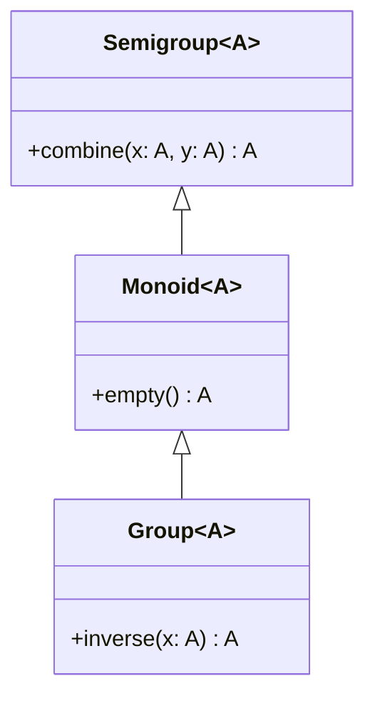

# Группа

Моноиды, как базовые алгебраические структуры, представляют собой упорядоченные множества 
с одной ассоциативной операцией и нейтральным элементом. 
Они служат фундаментом для изучения более сложных структур, таких как **группы**, 
которые являются естественным продолжением и расширением моноидов. 
Группы добавляют к свойствам моноидов ключевое условие — существование обратного элемента для каждого элемента множества. 
Это позволяет группам обладать более богатым набором свойств и находить применение в широком спектре областей, 
от теории чисел и геометрии до физики и криптографии.

**Что такое группа?**

**Группа** — это алгебраическая структура, которая формализует понятие симметрии и операции, 
подчиняющейся определенным правилам. Формально, группа определяется как множество \\(G\\), 
на котором задана бинарная операция \\(\cdot\\) - "точка" (называемая "умножением" или "групповой операцией"), 
удовлетворяющая четырем аксиомам:

- **Замкнутость**: Для любых двух элементов \\(a, b \in G\\) результат операции \\(a \cdot b\\) также принадлежит \\(G\\).
- **Ассоциативность**: Для любых \\(a, b, c \in G\\) выполняется \\((a \cdot b) \cdot c = a \cdot (b \cdot c)\\). 
  Это свойство позволяет не учитывать порядок выполнения операций.
- **Существование нейтрального элемента**: В группе существует элемент \\(e \in G\\), называемый нейтральным, 
  такой, что для любого \\(a \in G\\) выполняется \\(a \cdot e = e \cdot a = a\\).
- **Существование обратного элемента**: Для каждого элемента \\(a \in G\\) существует обратный элемент \\(a^{-1} \in G\\), 
  такой, что \\(a \cdot a^{-1} = a^{-1} \cdot a = e\\).

**Примеры групп**

- **Целые числа по сложению**: Множество \\(\mathbb{Z}\\) с операцией сложения \\(+\\) является группой. 
  Нейтральный элемент — 0, а обратный элемент к a — это -a.
- **Неотрицательные рациональные числа по умножению**: Множество \\(\mathbb{Q}^+\\) (положительных рациональных чисел) 
  с операцией умножения \\(\cdot\\) является группой. 
  Нейтральный элемент — 1, а обратный элемент к a — это \\(\frac{1}{a}\\).
- **Группа симметрий фигуры**: Множество всех преобразований (например, вращений и отражений), 
  сохраняющих симметрию фигуры, образует группу относительно операции композиции преобразований.
- Натуральные числа не являются группой по сложению (данное число x в \\(\mathbb{N}\\), но -x не находится в \\(\mathbb{N}\\)).
- Ни целые числа, ни натуральные числа не являются группой по умножению,
  но множество ненулевых рациональных чисел (\\(\frac{n}{d}\\) для любого \\(n, d \in N, n \neq 0, d \neq 0\\))
  является ([абелевой](abgroup.md)) группой по умножению с единичным элементом 1.

**Важные свойства групп**

- **Коммутативность (абелевость)**: Если для любых \\(a, b \in G\\) выполняется \\(a \cdot b = b \cdot a\\), 
  то группа называется [**абелевой**](abgroup.md) (или коммутативной). В противном случае группа называется **неабелевой**.
- **Порядок группы**: Порядок группы \\(G\\) — это количество элементов в ней. 
  Если группа содержит конечное число элементов, она называется **конечной группой**. 
  Если элементов бесконечно много, группа называется **бесконечной группой**.

## Формальное определение

Группа **G** — это [моноид](monoid.md) с обратным \\(g^{-1}\\) для каждого элемента g.

Множество \\(G\\) с заданной на нём бинарной операцией +: \\(G \times G \to G\\) называется _группой_
\\((G, +)\\), если выполнены следующие аксиомы:

- _Замыкание_ (_closure_): для \\(\forall x, y \in G\\) выполняется \\(x + y \in G\\).
- _Ассоциативность_ (_associativity_): для \\(\forall x, y, z \in G\\) выполняется \\((x + y) + z = x + (y + z)\\).
- _Тождественность_ или _существования нейтрального элемента_ (_identity_):
  существует \\(\exists e \in G\\) такой, что для \\(\forall x \in G\\) выполняется \\(e + x = x + e = x\\)
- _Обратимость_: для \\(\forall x \in G\\) существует \\((-x)\\) такой, что \\(x + (-x) = (-x) + x = e\\)

## Код

```dotty
trait Group[A] extends Monoid[A]:
  extension (a: A) 
    def inverse: A
    
  /** Удалить `b` из `a`. */
  def remove(a: A, b: A): A = combine(a, inverse(b))  
```

### Законы групп

- Замыкание следует из определения функции `combine`: тип результата этой функции совпадает с типом переменных,
  которые она принимает.
- Ассоциативность выражается следующим образом:
  `g.combine(x, g.combine(y, z))` должно быть равно `g.combine(g.combine(x, y), z)`.  
  Это означает, что порядок объединения элементов не влияет на итоговый результат.
- Тождественность означает, что если вы объединяете любой элемент `x` с нейтральным элементом (`g.empty`),
  то результат всегда будет равен `x`. Другими словами, нейтральный элемент не меняет значение `x` при объединении.
  Это можно записать так:
    - `g.combine(x, g.empty) == x`
    - `g.combine(g.empty, x) == x`
- Обратимость означает, что для каждого элемента `x` существует обратный элемент `x.inverse`,
  при объединении с которым результат будет равен нейтральному элементу `g.empty`.
  Это можно записать так:
    - `g.combine(x.inverse, x) == g.empty`
    - `g.combine(x, x.inverse) == g.empty`

## Упражнения

### Упражнение 1.3.1: Реализация группы для целых чисел по сложению.

> [Репозиторий с упражнениями и инструкцией по выполнению][sample]

Ваша задача - заполнив пропущенные части (`???`), реализовать группу по сложению:

```dotty
given Group[Int] with
  val empty: Int = ???

  def combine(x: Int, y: Int): Int = ???

  extension (a: Int)
    def inverse: Int = ???
```

@:note(🔍 Показать решение)

```dotty
given Group[Int] with
  val empty: Int = 0

  def combine(x: Int, y: Int): Int = x + y

  extension (a: Int)
    def inverse: Int = -a    
```

**Примеры вызовов**:

```dotty
Group[Int].combine(5, 3)
// 8
Group[Int].empty
// 0
Group[Int].inverse(5)
// -5
```

@:@

### Упражнение 1.3.2: Реализация группы для рациональных чисел по умножению.

Ваша задача - заполнив пропущенные части (`???`), реализовать группу по умножению:

```dotty
import spire.math.Rational

given Group[Rational] with
  val empty: Rational = ???

  def combine(x: Rational, y: Rational): Rational = ???

  extension (a: Rational)
    def inverse: Rational = ???
```

@:note(🔍 Показать решение)

```dotty
import spire.math.Rational

given Group[Rational] with
  val empty: Rational = Rational(1, 1)

  def combine(x: Rational, y: Rational): Rational = x * y

  extension (a: Rational)
    def inverse: Rational = Rational(a.denominator, a.numerator)   
```

**Примеры вызовов**:

```dotty
val r1 = Rational(2, 3)
val r2 = Rational(3, 4)
    
Group[Rational].combine(r1, r2)
// Rational(6, 12) = Rational(1, 2)
Group[Rational].empty
// Rational(1, 1)
Group[Rational].inverse(r1)
// Rational(3, 2)
```

@:@

## Схема



## Реализация в библиотеках

### Реализация в Cats

```dotty
import cats.*
import cats.syntax.all.*

1.inverse()       // -1
1 |+| 1.inverse() // 0
```

### [Реализация в Spire](../../libs/spire.md)

`Group` - моноид, который также имеет обратную операцию (`inverse` или `|-|`). `Group` расширяет `Monoid`.

- `inverse`: унарный оператор

```dotty
import spire.algebra.Group
import spire.syntax.group.*

1.inverse       // -1
1 |+| 1.inverse // 0
```

---

**Ссылки:**

- [Ссылка на репозиторий с упражнениями][sample]
- [Algebird](https://twitter.github.io/algebird/typeclasses/group.html)
- [Herding Cats](http://eed3si9n.com/herding-cats/Grp.html)
- [Spire home page](https://typelevel.org/spire/)
- [The Group Typeclass](https://www.inner-product.com/posts/define-group/)
- [Wikipedia](https://ru.wikipedia.org/wiki/%D0%93%D1%80%D1%83%D0%BF%D0%BF%D0%B0_(%D0%BC%D0%B0%D1%82%D0%B5%D0%BC%D0%B0%D1%82%D0%B8%D0%BA%D0%B0))

[sample]: https://gitverse.ru/scalabook/typeclasses
