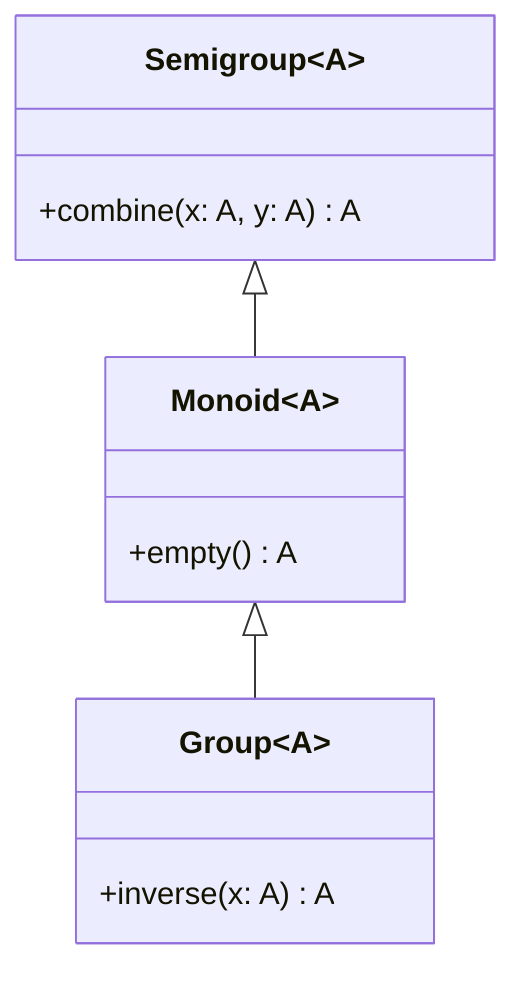

# Группа

Моноиды, как базовые алгебраические структуры, представляют собой упорядоченные множества 
с одной ассоциативной операцией и нейтральным элементом. 
Они служат фундаментом для изучения более сложных структур, таких как **группы**, 
которые являются естественным продолжением и расширением моноидов. 
Группы добавляют к свойствам моноидов ключевое условие — существование обратного элемента для каждого элемента множества. 
Это позволяет группам обладать более богатым набором свойств и находить применение в широком спектре областей, 
от теории чисел и геометрии до физики и криптографии.

**Что такое группа?**

**Группа** — это алгебраическая структура, которая формализует понятие симметрии и операции, 
подчиняющейся определенным правилам. Формально, группа определяется как множество \\(G\\), 
на котором задана бинарная операция \\(\cdot\\) (называемая "умножением" или "групповой операцией"), 
удовлетворяющая четырем аксиомам:

- **Замкнутость**: Для любых двух элементов \\(a, b \in G\\) результат операции \\(a \cdot b\\) также принадлежит \\(G\\).
- **Ассоциативность**: Для любых \\(a, b, c \in G\\) выполняется \\((a \cdot b) \cdot c = a \cdot (b \cdot c)\\). 
  Это свойство позволяет не учитывать порядок выполнения операций.
- **Существование нейтрального элемента**: В группе существует элемент \\(e \in G\\), называемый нейтральным, 
  такой, что для любого \\(a \in G\\) выполняется \\(a \cdot e = e \cdot a = a\\).
- **Существование обратного элемента**: Для каждого элемента \\(a \in G\\) существует обратный элемент \\(a^{-1} \in G\\), 
  такой, что \\(a \cdot a^{-1} = a^{-1} \cdot a = e\\).

**Примеры групп**

- **Целые числа по сложению**: Множество \\(\mathbb{Z}\\) с операцией сложения \\(+\\) является группой. 
  Нейтральный элемент — 0, а обратный элемент к a — это -a.
- **Неотрицательные рациональные числа по умножению**: Множество \\(\mathbb{Q}^+\\) (положительных рациональных чисел) 
  с операцией умножения \\(\cdot\\) является группой. 
  Нейтральный элемент — 1, а обратный элемент к a — это \\(\frac{1}{a}\\).
- **Группа симметрий фигуры**: Множество всех преобразований (например, вращений и отражений), 
  сохраняющих симметрию фигуры, образует группу относительно операции композиции преобразований.
- Натуральные числа не являются группой по сложению (данное число x в \\(\mathbb{N}\\), но -x не находится в \\(\mathbb{N}\\)).
- Ни целые числа, ни натуральные числа не являются группой по умножению,
  но множество ненулевых рациональных чисел (\\(\frac{n}{d}\\) для любого \\(n, d \in N, n \neq 0, d \neq 0\\))
  является ([абелевой](abgroup.md)) группой по умножению с единичным элементом 1.

**Важные свойства групп**

- **Коммутативность (абелевость)**: Если для любых \\(a, b \in G\\) выполняется \\(a \cdot b = b \cdot a\\), 
  то группа называется [**абелевой**](abgroup.md) (или коммутативной). В противном случае группа называется **неабелевой**.
- **Порядок группы**: Порядок группы \\(G\\) — это количество элементов в ней. 
  Если группа содержит конечное число элементов, она называется **конечной группой**. 
  Если элементов бесконечно много, группа называется **бесконечной группой**.

## Формальное определение

Группа **G** — это [моноид](monoid.md) с обратным \\(g^{-1}\\) для каждого элемента g.

Множество \\(G\\) с заданной на нём бинарной операцией +: \\(G \times G \to G\\) называется _группой_
\\((G, +)\\), если выполнены следующие аксиомы:

- _Замыкание_ (_closure_): для \\(\forall x, y \in G\\) выполняется \\(x + y \in G\\).
- _Ассоциативность_ (_associativity_): для \\(\forall x, y, z \in G\\) выполняется \\((x + y) + z = x + (y + z)\\).
- _Тождественность_ или _существования нейтрального элемента_ (_identity_):
  существует \\(\exists e \in G\\) такой, что для \\(\forall x \in G\\) выполняется \\(e + x = x + e = x\\)
- _Обратимость_: для \\(\forall x \in G\\) существует \\((-x)\\) такой, что \\(x + (-x) = (-x) + x = e\\)

## Код

```dotty
trait Group[A] extends Monoid[A]:
  extension (a: A) 
    def inverse: A
```

### Числа относительно сложения с 0

```dotty
given Group[Int] with
  val empty: Int                      = 0
  def combine(x: Int, y: Int): Int    = x + y
  extension (a: Int) def inverse: Int = -a
```

### Рациональные числа относительно умножения

В упрощенном варианте группа для рациональных чисел будет выглядеть так:

```dotty
final case class Rational(n: Int, d: Int):
  def *(that: Rational): Rational =
    Rational(n * that.n, d * that.d)

given Group[Rational] with
  val empty: Rational                             = Rational(1, 1)
  def combine(x: Rational, y: Rational): Rational = x * y
  extension (a: Rational) def inverse: Rational   = Rational(a.d, a.n)
```

### Законы групп

Законы групп принимают следующий вид:

- замыкание следует из определения функции `combine` - тип результата тот же, что и тип переменных
- ассоциативность формулируется так: `g.combine(x, g.combine(y, z)) == g.combine(g.combine(x, y), z)`
- тождественность формулируется так: `(g.combine(x, g.empty) == x) && (g.combine(g.empty, x) == x)`
- обратимость формулируется так: `g.combine(x.inverse, x) == g.empty && g.combine(x, x.inverse) == g.empty`

```dotty
def checkAssociativity[A](x: A, y: A, z: A)(using
    s: Semigroup[A]
): ValidatedNel[String, Unit] =
  Either.cond[String, Unit](
    s.combine(s.combine(x, y), z) == s.combine(x, s.combine(y, z)),
    (),
    "Не соблюдается ассоциативность: (x + y) + z должно быть равно x + (y + z)"
  ).toValidatedNel

def checkRightIdentity[A](x: A)(using
    m: Monoid[A]
): ValidatedNel[String, Unit] =
  Either.cond[String, Unit](
    m.combine(x, m.empty) == x,
    (),
    "Не соблюдается тождественность справа: x + e = x"
  ).toValidatedNel

def checkLeftIdentity[A](x: A)(using
    m: Monoid[A]
): ValidatedNel[String, Unit] =
  Either.cond[String, Unit](
    m.combine(m.empty, x) == x,
    (),
    "Не соблюдается тождественность слева: e + x = x"
  ).toValidatedNel

def checkInverse[A](x: A)(using
    g: Group[A]
): ValidatedNel[String, Unit] =
  Either.cond[String, Unit](
    g.combine(x.inverse, x) == g.empty &&
      g.combine(x, x.inverse) == g.empty,
    (),
    "Не соблюдается обратимость: x + (-x) = (-x) + x = e"
  ).toValidatedNel
```

## Схема



## Реализация в библиотеках

### Реализация в Cats

```dotty
import cats.*
import cats.syntax.all.*

1.inverse()       // -1
1 |+| 1.inverse() // 0
```

### Реализация в Spire

```dotty
import spire.algebra.Group
import spire.syntax.group.*

1.inverse       // -1
1 |+| 1.inverse // 0
```

---

**Ссылки:**

- [Algebird](https://twitter.github.io/algebird/typeclasses/group.html)
- [Herding Cats](http://eed3si9n.com/herding-cats/Grp.html)
- [Spire home page](https://typelevel.org/spire)
- [Wikipedia](https://ru.wikipedia.org/wiki/%D0%93%D1%80%D1%83%D0%BF%D0%BF%D0%B0_(%D0%BC%D0%B0%D1%82%D0%B5%D0%BC%D0%B0%D1%82%D0%B8%D0%BA%D0%B0))
